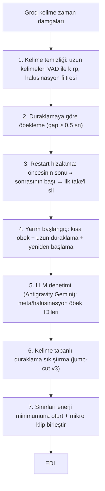

# Jump-cut ve Retake: Elle yapılan edit ile otomatik editin karşılaştırması

**Karşılaştırılanlar:** `C:\editlivideo\Mukayeseli hukuk Tam2.mp4` (senin editin) ile OtoEdit'in "Mukayeseli Hukuk4" projesi için ürettiği **otomatik EDL** (snapshot v1, yani sen elle düzeltmeden önceki hali).
**Yöntem:** İki videoyu da Groq Whisper ile kelime zaman damgalarıyla transkribe ettim ve metinleri kelime kelime hizaladım. 1491 kelimenin 1450'si eşleşti. Böylece senin kestiğin her bölgenin orijinal videodaki tam yerini ve içinde hangi metnin olduğunu buldum. Ses dalgası hizalaması işe yaramadı, çünkü edit edilmiş videonun sesi işlenmiş/müzikli.

---

## 1. Rakamlar

| | Sen (elle) | Otomatik |
|---|---|---|
| Çıktı süresi | 965 sn (orijinalin ≈ 1027 sn'si*) | ≈ 1572 sn |
| Kaldırılan süre | ≈ 2116 sn | 1571 sn |
| Kaldırılan kelime | 456 | 194 |
| **Senin sildiğin bölgelerde otomatiğin bıraktığı** | – | **571 sn** |
| Senin tuttuğun yerden otomatiğin sildiği | – | 80 kelime, 28 bölge |
| Retake kesimi | 97 içerikli kesim | 38 (isabet ort. %57, **12'si tamamen yanlış**) |

\* Hizalamaya göre senin versiyonun yaklaşık **%6 hızlandırılmış** görünüyor (hız katsayısı 1.064). Bunu bilerek mi yaptın, kontrol etmen iyi olur.

**Senin kesimlerinin dağılımı (222 kesim):**

| Tür | Adet | Senin sildiğin | Otomatiğin de sildiği | Otomatiğin bıraktığı |
|---|---|---|---|---|
| İçinde kelime olan kesimler (retake / yarım cümle) | 97 | 1256 sn | %62 (retake modülü sadece **121 sn**'sini sildi) | **472 sn** |
| Sadece duraklama | 125 | 784 sn | %87 | 99 sn |

İçerikli 97 kesimin **48'i "geri dönüp tekrar okuma"** (restart), **38'i "tek kelime söyle → uzun duraklama → yeniden başla"**, 11'i diğer (meta konuşma, halüsinasyon vs.).

> [!IMPORTANT]
> Ana sorun jump-cut'ta değil, **retake'te**. Otomatik sistem duraklamaları büyük ölçüde siliyor, ama **tekrar edilen cümleleri bırakıyor**. İzleyici aynı cümleyi iki kez duyuyor, aradaki boşluk kesildiği için de bu daha çok göze batıyor.

---

## 2. Hocanın konuşma kalıbı (senin editinden çıkan kural)

Hoca metni kısa öbekler halinde okuyor. Takıldığında duruyor (3–15 sn), sonra **birkaç kelime geriden alıp tekrar okuyor**. Sen her seferinde **son okunanı tutup** öncekini ve aradaki duraklamayı silmişsin:

```
[vefat sonrası ölenin hatırına saygıya kadar] (5 sn) [hatta vefat sonrası ölenin hatırasına saygıya kadar] insan hayatını…
        ↑ SİLİNDİ                                           ↑ TUTULDU (son take)

[Fakat asıl fırtına] [Asıl zihin ameliyat] [Asıl zihni ameliyat] Tahkikat safhasında kopar
        TUTULDU          ↑ SİLİNDİ             ↑ TUTULDU

Kıştan | Kıştan sonra Baharın geldiği gibi | Kıştan sonra Baharın getirdiği kesinlikle | Kıştan sonra baharı getirdiği…
  ↑──────────── hepsi SİLİNDİ, sadece en sondaki tutuldu ────────────↑
```

Kısacası kural şu: **kesim, ilk okumanın tekrar edilen kısmının başından başlar, son okumanın başında biter.** İncelediğim restart örneklerinin hepsinde son take'i tutmuşsun.

---

## 3. Mevcut algoritmadaki somut hatalar

### Retake ([retake_detector.py](file:///d:/OtoEdit/OtoEdit/src/OtoEdit.PythonWorker/pipeline/retake_detector.py))

1. **Yanlış birimle çalışıyor.** Karşılaştırmayı 6 kelime / 3 sn'lik altyazı parçaları arasında yapıyor. Restart ise parçanın ortasından başlıyor ("…ölenin **|** hatırına…"), yani parça sınırlarına denk gelmiyor. Bu yüzden Jaccard benzerliği eşiği geçmiyor ve tekrarların çoğu hiç yakalanmıyor (retake modülü 1256 sn'nin sadece 121 sn'sini buldu).
2. **Kazananı puanla seçiyor ve sık sık yanlış take'i siliyor.** Formül `0.40 akustik + 0.35 tamlık + 0.25 güven + ≤5 yenilik bonusu`. Groq kelimelerinde noktalama olmadığı için "tamlık" puanı rastgele davranıyor. Yanlış seçimden birkaç örnek:
   - 1131 sn / 1140 sn "Akıllıca ve gerçeği ortaya çıkaracak sualler yöneltir": sen ilkini sildin, otomatik **ikincisini** sildi.
   - 2698 sn / 2707 sn "Hüküm vermek sıradan bir söz söylemek değildir": aynı hata.
   - 175 sn "tefekkür ne ahlaki bir muhasebe ne de": iyi take silinmiş.
   - Toplamda 9 retake kesimi **tamamen senin tuttuğun** metni kesiyor (isabet 0).
3. **Pencere çok dar** (`i+5` parça). 30–47 sn'lik takılma bloklarında (2063 sn: 47 sn, 1770 sn: 40 sn) tekrarlar pencerenin dışına düşüyor.
4. "Yarım cümle" kuralı noktalamaya dayanıyor. Groq'ta noktalama olmadığı için bu kural ya sürekli tetikleniyor ya da işe yaramıyor.

### Jump-cut ([silence_detector.py](file:///d:/OtoEdit/OtoEdit/src/OtoEdit.PythonWorker/pipeline/silence_detector.py))

1. **Kesim yerlerinde fazla boşluk bırakıyor.** Uzun duraklamalarda (≥2.5 sn) otomatik **0.8–0.9 sn** bırakıyor (lead 350 ms + trail 200 ms + VAD payı). Sen çoğunlukla ~0–0.4 sn bırakmışsın. 1.5–2.5 sn'lik boşluklara otomatik neredeyse hiç dokunmuyor (≈1.76 sn kalıyor).
2. **Sessizliğe VAD'ın gözüyle bakıyor.** Uzun duraklamaların içindeki nefes, ağız sesi ve mırıldanmayı "konuşma" sayıp bırakıyor (sadece duraklama olan kesimlerde 99 sn kaldı). Bu bölgelerde Whisper tek kelime bile yazmamış. Bunu doğrulamak için 3 bölgeyi ayrıca tek başına transkribe ettim, yine boş çıktı.
3. **Whisper'ın uzattığı kelimeler.** Örneğin "ancak" kelimesi 1495–1502 sn arasında 7 sn uzunluğunda görünüyor. Böyle durumlarda sessizlik kesimi gerçek kelimeyi yiyor (10 kelime kırpılmış, 7 tek kelime yanlışlıkla silinmiş).

### Gözden kaçan küçük şeyler
- Whisper halüsinasyonları: "Mısır, diber, çay.", "Altyazı M.K.". Bir de meta konuşma var: "Süper ulan." (2090 sn). Sen bunları sildin, otomatik kısmen bıraktı.
- Hipotezim şuydu: "tek kelime → uzun duraklama" tipindeki 38 kesimde Whisper tekrarı yutuyor. **Bunu doğrulayamadım.** Bölgeleri tek başına transkribe ettiğimde de aynı sonuç çıktı. Kalıp yine de net: tek kelime, ardından ≥3 sn duraklama ve içinde kelimesiz ses.

---

## 4. Önerilen yeni algoritma: "Take-aware Edit"



### Adım 1: Kelime temizliği
- Süresi 1.2 sn'yi geçen tek bir kelime varsa, gerçek bitişini RMS düşüşüne bakarak bul ve kelimeyi orada kes ("ancak = 7 sn" hatası böyle çözülür).
- Halüsinasyon filtresi: sessiz bölgede (RMS < −45 dB) çıkan kelimeler ve bilinen kalıplar ("Altyazı M.K.", "abone olmayı unutmayın" gibi) atılır.

### Adım 2: Duraklamaya göre öbekleme
Altyazı parçaları yerine **duraklamalarla ayrılmış öbekler** kullanılır: ardışık iki kelime arasındaki boşluk ≥ 0.5 sn ise yeni öbek başlar. Hocanın okuma tarzında her öbek tek bir okuma denemesine karşılık geliyor.

### Adım 3: Restart hizalama (çekirdek kısım)
Her duraklama sınırı P için (önceki kelimeler `L`, sonraki kelimeler `R`):
1. Kelimeler normalize edilir: küçük harf, noktalama yok, Türkçe karakterler sadeleştirilir.
2. `L`'nin son ≤25 kelimesi (≤20 sn) içinde, `R`'nin başıyla eşleşen **en uzun öbek** aranır. Eşleşme bulanık yapılır: kelime benzerliği ≥ 0.75 olmalı, böylece "hürhandır/bürhandır" ve "yöneltir/yöneldir" de eşleşir. k kelimede 1 kelimelik atlamaya izin verilir.
3. Kabul koşulu: k ≥ 2 kelime, ya da k = 1 ve duraklama ≥ 1.0 sn ve kelime ≥ 4 harf (yanlışlıkla "ve, bir" gibi kelimelerle eşleşmesin diye).
4. **Kesim = [L'deki eşleşmenin ilk kelimesinin başı, R'nin ilk kelimesinin başı).** Yani son take tutulur, puanlama yapılmaz.
5. Tekrar yoksa ama L'nin son öbeği yarım kaldıysa (aşağıdaki Adım 4), o öbek de silinir.
6. Sabit noktaya kadar tekrarlanır. Böylece "Kıştan… Kıştan sonra… Kıştan sonra…" zinciri tek kesime iner ve sadece en son okuma kalır.

### Adım 4: Yarım başlangıç
1–3 kelimelik bir öbeğin ardından ≥ 2 sn duraklama geliyorsa ve sonraki öbek aynı kelimeyle ya da benzer bir kelimeyle başlıyorsa, kısa öbek ve duraklama silinir ("Asıl zihin ameliyat | Asıl zihni ameliyat", "Senet, senet,").

### Adım 5: LLM denetimi (opsiyonel, Antigravity Gemini)
LLM'e öbek listesi `[id, metin, süre, önceki/sonraki duraklama]` şeklinde gönderilir. LLM **sadece silinecek öbeklerin ID'lerini** döndürür ("Süper ulan", konu dışı laf, halüsinasyon). Zaman damgasını LLM üretmez, kesim yerleri her zaman kelime sınırlarından gelir.

### Adım 6: Jump-cut v3 (kelime tabanlı duraklama sıkıştırma)
VAD adaları yerine **tutulan kelimeler arasındaki boşluk** esas alınır:

| Orijinal boşluk | Bırakılacak boşluk |
|---|---|
| < 0.35 sn | dokunma |
| 0.35 – 1.0 sn | 0.30 sn |
| > 1.0 sn | cümle içi 0.25 sn, cümle sonu 0.40 sn (önceki kelimeden sonra 0.12–0.20 sn + sonraki kelimeden önce 0.10–0.12 sn) |

Boşluğun içindeki kelimesiz ses adaları (nefes, mırıltı) **tamamen silinir**. Bu değerler parametre olarak dışarıda tutulur ve senin editinden ölçülen dağılıma göre ayarlanabilir.

### Adım 7: Sınır rafinesi
- Her kesim noktası ±60 ms içindeki enerji minimumuna oturtulur, 10 ms crossfade uygulanır.
- 0.4 sn'den kısa kalan klipler komşu kesimle birleştirilir, 0.12 sn'den kısa kesimler atlanır.

### Değerlendirme düzeneği (yeni)
Bu analizde kullandığım [text_compare.py](file:///C:/Users/Kursu/.gemini/antigravity-ide/brain/ab422bda-d0af-40ac-9c4f-3fd784c438e4/scratch/text_compare.py) script'ini `tools/eval_edit.py` olarak repoya alalım. Senin editin "doğru cevap" olur ve her algoritma değişikliğinden sonra şu ölçülür:
- silinen kelimelerde isabet (precision) ve kapsama (recall),
- senin sildiğin saniyelerin ne kadarının silindiği,
- senin tuttuğun kelimelerden kaçının yanlışlıkla silindiği.

Önerdiğim hedef: kapsama ≥ %85 ve yanlış silme ≤ %2. Bunlar hedef, henüz ölçülmüş sonuç değil.

---

## 5. Dosya değişiklikleri (onay verirsen)

| Dosya | Değişiklik |
|---|---|
| `pipeline/take_aligner.py` (yeni) | Adım 2–4: öbekleme, restart hizalama, yarım başlangıç |
| [retake_detector.py](file:///d:/OtoEdit/OtoEdit/src/OtoEdit.PythonWorker/pipeline/retake_detector.py) | Puanla kazanan seçme kaldırılır, `take_aligner` çağrılır, meta-konuşma ve LLM öbek ID'leriyle çalışır |
| [silence_detector.py](file:///d:/OtoEdit/OtoEdit/src/OtoEdit.PythonWorker/pipeline/silence_detector.py) | Jump-cut v3: kelime boşluğu tabanlı sıkıştırma, kelimesiz adaları silme |
| `transcriber.py` | Uzun kelime kırpma, halüsinasyon filtresi (altyazı segmentleri sadece altyazı için kalır) |
| `tools/eval_edit.py` (yeni) | İnsan editiyle otomatik kıyas metrikleri |

> [!NOTE]
> Bir video üzerinde yapılmış bir analiz bu. Kalıp (son take'i tut, aradaki boşluğu sil) bu tarz okuma videolarında genel geçer, ama eşikleri başka 1–2 elle editlenmiş videoyla da doğrulamak gerekir.
