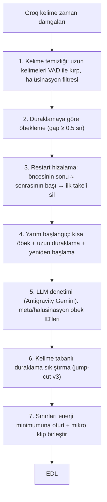

# Jump-cut ve Retake: Elle yapılan edit ile otomatik editin karşılaştırması

**Karşılaştırılanlar:** `C:\editlivideo\Mukayeseli hukuk Tam2.mp4` (senin editin) ile OtoEdit'in "Mukayeseli Hukuk4" projesi için ürettiği **otomatik EDL** (snapshot v1, yani sen elle düzeltmeden önceki hali).
**Yöntem:** İki videoyu da Groq Whisper ile kelime zaman damgalarıyla transkribe ettim ve metinleri kelime kelime hizaladım. 1491 kelimenin 1450'si eşleşti. Böylece senin kestiğin her bölgenin orijinal videodaki tam yerini ve içinde hangi metnin olduğunu buldum. Ses dalgası hizalaması işe yaramadı, çünkü edit edilmiş videonun sesi işlenmiş/müzikli.

---

## 1. Rakamlar

| | Sen (elle) | Otomatik |
|---|---|---|
| Çıktı süresi | 965 sn (orijinalin ≈ 1027 sn'si*) | ≈ 1572 sn |
| Kaldırılan süre | ≈ 2116 sn | 1571 sn |
| Kaldırılan kelime | 456 | 194 |
| **Senin sildiğin bölgelerde otomatiğin bıraktığı** | – | **571 sn** |
| Senin tuttuğun yerden otomatiğin sildiği | – | 80 kelime, 28 bölge |
| Retake kesimi | 97 içerikli kesim | 38 (isabet ort. %57, **12'si tamamen yanlış**) |

\* Hizalamaya göre senin versiyonun yaklaşık **%6 hızlandırılmış** görünüyor (hız katsayısı 1.064). Bunu bilerek mi yaptın, kontrol etmen iyi olur.

**Senin kesimlerinin dağılımı (222 kesim):**

| Tür | Adet | Senin sildiğin | Otomatiğin de sildiği | Otomatiğin bıraktığı |
|---|---|---|---|---|
| İçinde kelime olan kesimler (retake / yarım cümle) | 97 | 1256 sn | %62 (retake modülü sadece **121 sn**'sini sildi) | **472 sn** |
| Sadece duraklama | 125 | 784 sn | %87 | 99 sn |

İçerikli 97 kesimin **48'i "geri dönüp tekrar okuma"** (restart), **38'i "tek kelime söyle → uzun duraklama → yeniden başla"**, 11'i diğer (meta konuşma, halüsinasyon vs.).

> [!IMPORTANT]
> Ana sorun jump-cut'ta değil, **retake'te**. Otomatik sistem duraklamaları büyük ölçüde siliyor, ama **tekrar edilen cümleleri bırakıyor**. İzleyici aynı cümleyi iki kez duyuyor, aradaki boşluk kesildiği için de bu daha çok göze batıyor.

---

## 2. Hocanın konuşma kalıbı (senin editinden çıkan kural)

Hoca metni kısa öbekler halinde okuyor. Takıldığında duruyor (3–15 sn), sonra **birkaç kelime geriden alıp tekrar okuyor**. Sen her seferinde **son okunanı tutup** öncekini ve aradaki duraklamayı silmişsin:

```
[hatta vefat sonrası ölenin hatırına saygıya kadar] (5 sn) [hatta vefat sonrası ölenin hatırasına saygıya kadar] insan hayatını…
        ↑ SİLİNDİ                                                 ↑ TUTULDU (son take)

[Fakat asıl fırtına] [Asıl zihin ameliyat] [Asıl zihni ameliyat] Tahkikat safhasında kopar
        TUTULDU          ↑ SİLİNDİ             ↑ TUTULDU

Kıştan | Kıştan sonra Baharın geldiği gibi | Kıştan sonra Baharın getirdiği kesinlikle | Kıştan sonra baharı getirdiği…
  ↑──────────── hepsi SİLİNDİ, sadece en sondaki tutuldu ────────────↑
```

Kısacası kural şu: **kesim, ilk okumanın tekrar edilen kısmının başından başlar, son okumanın başında biter.** İncelediğim restart örneklerinin hepsinde son take'i tutmuşsun.

---

## 3. Mevcut algoritmadaki somut hatalar

### Retake ([retake_detector.py](file:///d:/OtoEdit/OtoEdit/src/OtoEdit.PythonWorker/pipeline/retake_detector.py))

1. **Yanlış birimle çalışıyor.** Karşılaştırmayı 6 kelime / 3 sn'lik altyazı parçaları arasında yapıyor. Restart ise parçanın ortasından başlıyor ("…ölenin **|** hatırına…"), yani parça sınırlarına denk gelmiyor. Bu yüzden Jaccard benzerliği eşiği geçmiyor ve tekrarların çoğu hiç yakalanmıyor (retake modülü 1256 sn'nin sadece 121 sn'sini buldu).
2. **Kazananı puanla seçiyor ve sık sık yanlış take'i siliyor.** Formül `0.40 akustik + 0.35 tamlık + 0.25 güven + ≤5 yenilik bonusu`. Groq noktalamayı tutarsız koyuyor (bu videoda 1853 kelimenin sadece 174'ünde `.?!` var). Üstelik karşılaştırma 6 kelimelik parçalar üzerinden yapıldığı için parçaların çoğu noktayla bitmiyor. Bu yüzden "tamlık" puanı (+30 puana kadar fark) ≤5'lik yenilik bonusunu eziyor ve sonuç rastgeleye dönüyor. Yanlış seçimden birkaç örnek:
   - 1131 sn / 1140 sn "Akıllıca ve gerçeği ortaya çıkaracak sualler yöneltir": sen ilkini sildin, otomatik **ikincisini** sildi.
   - 2698 sn / 2707 sn "Hüküm vermek sıradan bir söz söylemek değildir": aynı hata.
   - 175 sn "tefekkür ne ahlaki bir muhasebe ne de": iyi take silinmiş.
   - Toplamda 9 retake kesimi **tamamen senin tuttuğun** metni kesiyor (isabet 0).
3. **Pencere çok dar** (`i+5` parça). 30–47 sn'lik takılma bloklarında (2063 sn: 47 sn, 1770 sn: 40 sn) tekrarlar pencerenin dışına düşüyor.
4. "Yarım cümle" kuralı noktalamaya dayanıyor. Noktalama hem tutarsız hem de 6 kelimelik parçalara bölünmüş olduğu için bu kural güvenilir değil.

### Jump-cut ([silence_detector.py](file:///d:/OtoEdit/OtoEdit/src/OtoEdit.PythonWorker/pipeline/silence_detector.py))

1. **Kesim yerlerinde fazla boşluk bırakıyor.** Uzun duraklamalarda (≥2.5 sn) otomatik **0.8–0.9 sn** bırakıyor (lead 350 ms + trail 200 ms + VAD payı). Sen çoğunlukla ~0–0.4 sn bırakmışsın. 1.5–2.5 sn'lik boşluklara otomatik neredeyse hiç dokunmuyor (≈1.76 sn kalıyor).
2. **Sessizliğe VAD'ın gözüyle bakıyor.** Uzun duraklamaların içindeki nefes, ağız sesi ve mırıldanmayı "konuşma" sayıp bırakıyor (sadece duraklama olan kesimlerde 99 sn kaldı). Bu bölgelerde Whisper tek kelime bile yazmamış. Bunu doğrulamak için 3 bölgeyi ayrıca tek başına transkribe ettim, yine boş çıktı.
3. **Whisper'ın uzattığı kelimeler.** Örneğin "ancak" kelimesi 1495–1502 sn arasında 7 sn uzunluğunda görünüyor. Böyle durumlarda sessizlik kesimi gerçek kelimeyi yiyor (10 kelime kırpılmış, 7 tek kelime yanlışlıkla silinmiş).

### Gözden kaçan küçük şeyler
- Whisper halüsinasyonları: "Mısır, diber, çay.", "Altyazı M.K.". Bir de meta konuşma var: "Süper ulan." (2090 sn). Sen bunları sildin, otomatik kısmen bıraktı.
- Hipotezim şuydu: "tek kelime → uzun duraklama" tipindeki 38 kesimde Whisper tekrarı yutuyor. **Bunu doğrulayamadım.** Bölgeleri tek başına transkribe ettiğimde de aynı sonuç çıktı. Kalıp yine de net: tek kelime, ardından ≥3 sn duraklama ve içinde kelimesiz ses.

---

## 4. Önerilen yeni algoritma: "Take-aware Edit"



### Adım 1: Kelime temizliği
- **Çift yönlü kırpma:** Süresi > 1.0 sn olan ya da içinde > 250 ms sessizlik barındıran her kelimenin `[start, end]` aralığı ses enerjisiyle (RMS, −40 dB eşik) kesiştirilir. `start` ilk gerçek ses başlangıcına **ileri**, `end` son ses bitişine **geri** çekilir. Whisper uzun duraklamanın sessizliğini bazen kelimenin başına, bazen sonuna ekler. Sadece sonu kırpılırsa gerçek kelime silinip sessizlik tutulabilir ("ancak = 7 sn" hatası).
- Kırpılan aralıkta hiç ses yoksa kelime "şüpheli" işaretlenir. Kelime tek başına silinmez, Adım 5'e (LLM) bilgi olarak gider.
- Halüsinasyon filtresi: sessiz bölgede (RMS < −45 dB) çıkan kelimeler ve bilinen kalıplar ("Altyazı M.K.", "abone olmayı unutmayın" gibi) atılır.

### Adım 2: Duraklamaya göre öbekleme
Altyazı parçaları yerine **duraklamalarla ayrılmış öbekler** kullanılır: ardışık iki kelime arasındaki boşluk ≥ 0.5 sn ise yeni öbek başlar. Hocanın okuma tarzında her öbek tek bir okuma denemesine karşılık geliyor.

### Adım 3: Restart hizalama (çekirdek kısım)
Her duraklama sınırı P için (gap ≥ 0.5 sn; önceki kelimeler `L`, sonraki kelimeler `R`):

**3a. Kelime eşleşmesi (Türkçe'ye özel)**
- Normalize: küçük harf (`İ→i`, `I→ı` Türkçe kurallı), noktalama silinir, şapkalar kaldırılır (`â→a`).
- İki kelime eşleşmesi için iki koşul birlikte aranır:
  - `difflib` benzerliği ≥ 0.75
  - **ve** ilk 3 harf aynı **ya da** toplam düzenleme mesafesi ≤ 1 ("bürhandır/hürhandır" eşleşir).
- Bunun sebebi Türkçe'nin eklemeli olması: "hükümlerinin" ile "bölümlerinin" gibi kökü farklı, eki aynı kelimeler yalnızca benzerlik oranıyla yanlışlıkla eşleşir.

**3b. Eşleşme arama**
- `R`'nin başındaki en fazla 2 bağlaç/dolgu kelimesi (`hatta, yani, fakat, ama, şimdi, tabii, peki, işte, ve`) eşleşme için atlanabilir. Kesim yine de `R[0].start`'ta biter, yani bağlaç korunur.
- `L` penceresi: P'den geriye en fazla 30 kelime / 25 sn.
- `R` önekiyle eşleşen **L içindeki konum** aranır, k kelime ardışık eşleşmeli. k kelimede 1 atlamaya/değişikliğe izin verilir.

**3c. Kabul koşulu**
1. k ≥ 2, ya da k = 1 ve gap ≥ 1.0 sn ve kelime ≥ 4 harf.
2. **Yeniden okuma kapsaması:** `L`'de eşleşmeden sonra P'ye kadar kalan kuyruk (`tail`), `R`'de de eşleşen kısımdan sonra tekrar okunmuş olmalı. Ölçüt: `SequenceMatcher(L[m:P], R[j:j+len(L[m:P])+3]).ratio() ≥ 0.6`.
   - **Neden sabit "en fazla 6 kelime kuyruk" kuralı değil:** Gerçek retake'lerde kuyruk uzun olabiliyor. Örneğin 1538 sn'de hoca 12 kelime okuyup durmuş, sonra cümlenin başından ("baskı altında…") tekrar okumuş. 6 kelime sınırı bunu kaçırır.
   - Kapsama ölçütü ise rastlantısal tekrarı eler: önceki cümle "Bu konuda…" diye bitip yeni cümle yine "Bu konuda…" ile başlıyor ama farklı içerikle devam ediyorsa ratio düşük çıkar ve kesim yapılmaz.
3. Kesimin içinde kalan metin 40 kelimeyi / 35 sn'yi geçemez (güvenlik sınırı).

**3d. Kesim ve zincir**
- **Kesim = [L'deki eşleşmenin ilk kelimesinin başı, R[0].start).** Son take tutulur, puanlama yapılmaz.
- **Zincir, sağdan sola ve adım adım takip edilir.** Son take'ten (R) başlanır, bir önceki take'e ancak 3c koşullarını sağlıyorsa geçilir. Zincir koptuğu anda durulur, sonra en soldaki geçerli take'ten R'ye kadar tek kesim atılır. "Kıştan | Kıştan sonra… | Kıştan sonra… | Kıştan sonra…" böylece tek kesime iner.
- **"45 sn geriye bak, en erken eşleşmeyi al" yöntemi kullanılmaz.** Hoca terimleri bilerek tekrarlıyor: "Bürhan-ı inni ve bürhan-ı ilmi. Birincisi bürhan-ı inni'dir." En erken eşleşmeye atlamak buradaki sağlam cümleyi siler. Adım adım zincir bu hatayı yapmaz.
- Tekrar yoksa ama L'nin son öbeği yarım kaldıysa o öbek Adım 4'te değerlendirilir.

### Adım 4: Yarım başlangıç
1–3 kelimelik bir öbeğin ardından ≥ 2 sn duraklama geliyorsa ve sonraki öbek aynı kelimeyle ya da benzer bir kelimeyle başlıyorsa, kısa öbek ve duraklama silinir ("Asıl zihin ameliyat | Asıl zihni ameliyat", "Senet, senet,").

### Adım 5: LLM denetimi (opsiyonel, Antigravity Gemini)
LLM'e öbek listesi `[id, metin, süre, önceki/sonraki duraklama]` şeklinde gönderilir. LLM **sadece silinecek öbeklerin ID'lerini** döndürür ("Süper ulan", konu dışı laf, halüsinasyon). Zaman damgasını LLM üretmez, kesim yerleri her zaman kelime sınırlarından gelir.

### Adım 6: Jump-cut v3 (kelime tabanlı duraklama sıkıştırma)
VAD adaları yerine **tutulan kelimeler arasındaki boşluk** esas alınır:

| Orijinal boşluk | Bırakılacak boşluk |
|---|---|
| < 0.35 sn | dokunma |
| 0.35 – 1.0 sn | 0.30 sn |
| > 1.0 sn | cümle içi 0.25 sn, cümle sonu 0.40 sn (önceki kelimeden sonra 0.12–0.20 sn + sonraki kelimeden önce 0.10–0.12 sn) |

**Cümle sonu tanımı:** Noktalama güvenilir olmadığı için önceki kelime `.?!` ile bitiyorsa **veya** orijinal boşluk ≥ 1.5 sn ise cümle sonu sayılır. Diğer durumlar cümle içi kabul edilir.

- Boşluğun içindeki kelimesiz ses adaları (nefes, mırıltı) **tamamen silinir**.
- Bu değerler `config.py`'de parametre olarak tutulur ve eval aracıyla senin editine göre ayarlanır.
- **Jump-cut, retake kesimlerinden SONRA ve sadece tutulan kelimeler üzerinde çalışır** (bkz. Bölüm 4.1).

### Adım 7: Sınır rafinesi
- Her kesim noktası ±60 ms içindeki enerji minimumuna oturtulur. Bu adım bir kelimenin içine düşmemeli; düşerse kelime sınırına geri çekilir.
- **Crossfade yok, süreyi değiştirmeyen mikro fade var.** Render, her klibi ayrı encode edip `-f concat` ile birleştiriyor ([video_renderer.py `_cut_single_segment`](file:///d:/OtoEdit/OtoEdit/src/OtoEdit.PythonWorker/render/video_renderer.py#L288-L310)). Burada `acrossfade` kullanılamaz, 200 klibe zincirlemek de senkronu bozar. Bunun yerine her klibin ses akışına `afade=t=in:d=0.008, afade=t=out:st=<dur-0.008>:d=0.008` eklenir. Süre değişmez ve kesim yerlerindeki tık sesi gider.
- 0.4 sn'den kısa kalan klipler komşu kesimle birleştirilir, 0.12 sn'den kısa kesimler atlanır.

### Değerlendirme düzeneği (yeni)
Analiz script'i repoya alındı: [tools/eval_edit.py](file:///d:/OtoEdit/OtoEdit/src/OtoEdit.PythonWorker/tools/eval_edit.py). Kullanımı: `python tools/eval_edit.py orig_words.json edited_words.json auto_edl.json orig16k.wav out_dir`. Girdiler: iki videonun Groq kelime çıktısı, otomatik EDL ve 16 kHz mono wav. Senin editin "doğru cevap" olur ve her algoritma değişikliğinden sonra şu ölçülür:
- silinen kelimelerde isabet (precision) ve kapsama (recall),
- senin sildiğin saniyelerin ne kadarının silindiği,
- senin tuttuğun kelimelerden kaçının yanlışlıkla silindiği.

Önerdiğim hedef: kapsama ≥ %85 ve yanlış silme ≤ %2. Bunlar hedef, henüz ölçülmüş sonuç değil.

### 4.1 Entegrasyon kuralları (kodda doğrulandı)

1. **Pipeline sırası değişir.** Şu an [analysis_consumer.py](file:///d:/OtoEdit/OtoEdit/src/OtoEdit.PythonWorker/consumers/analysis_consumer.py#L227-L250) önce `silence_detector.detect_v2`'yi, sonra `retake_detector.detect_retakes(silence_cuts=…)`'i çağırıyor. Yeni sıra:
   1. Adım 1 (kelime temizliği)
   2. Adım 2–5 (TakeAligner + LLM) → silinecek kelime aralıkları
   3. Adım 6 (jump-cut v3), sadece tutulan kelimeler üzerinde
   4. Adım 7
2. **Retake ve sessizlik kesimleri birleştirilmez.** [edl_builder.py `_merge_overlapping_cuts`](file:///d:/OtoEdit/OtoEdit/src/OtoEdit.PythonWorker/pipeline/edl_builder.py#L141-L158) şu an `reason`'a bakmadan çakışan **ve bitişik** (`start <= prev.end`) kesimleri birleştirip `silence+smart_retake` yapıyor.
   - Sonuç: editörde bir retake geri alındığında yanındaki sessizlik de geri geliyor. 38 retake'in editörde 35 görünmesinin sebebi de büyük ihtimalle bu.
   - Yeni kural: sadece aynı türdeki (`retake`/`silence`) kesimler birleşir. Farklı türdekiler çakışıyorsa sınır kelime/duraklama noktasından bölünür.
3. **Altyazılar kesilmiş kelimeleri göstermemeli.** Editör önizlemesi aktif segmenti bütün halinde gösteriyor ([editor.component.ts `currentSubtitleSegment`](file:///d:/OtoEdit/OtoEdit/src/OtoEdit.Frontend/src/app/features/editor/editor.component.ts#L2274-L2280)). Bir segmentin 2 kelimesi kesildiyse o 2 kelime ekranda yine görünür. İki katmanlı çözüm:
   - **Worker:** altyazı segmentleri (`_words_to_segments`) kesimlerden sonra, kesim sınırlarını aşmayacak şekilde yeniden üretilir.
   - **Editör:** altyazı metni gösterilirken, o an aktif kesimlerin içine düşen kelimeler filtrelenir. Bu katman şart, çünkü kullanıcı editörde bir retake'i geri alınca segmentler yeniden üretilmez.

---

## 5. Dosya değişiklikleri (onay verirsen)

| Dosya | Değişiklik |
|---|---|
| `pipeline/take_aligner.py` (yeni) | Adım 2–4: öbekleme, Türkçe kelime eşleşmesi, restart hizalama (kapsama ölçütü + sağdan sola zincir), yarım başlangıç |
| [retake_detector.py](file:///d:/OtoEdit/OtoEdit/src/OtoEdit.PythonWorker/pipeline/retake_detector.py) | Puanla kazanan seçme kaldırılır, `take_aligner` çağrılır, meta-konuşma ve LLM öbek ID'leriyle çalışır |
| [silence_detector.py](file:///d:/OtoEdit/OtoEdit/src/OtoEdit.PythonWorker/pipeline/silence_detector.py) | Jump-cut v3: tutulan kelimeler arası boşluk sıkıştırma, kelimesiz adaları silme, cümle sonu kuralı |
| `transcriber.py` | Çift yönlü kelime kırpma, halüsinasyon filtresi, kesim sonrası altyazı yeniden segmentleme |
| [analysis_consumer.py](file:///d:/OtoEdit/OtoEdit/src/OtoEdit.PythonWorker/consumers/analysis_consumer.py) | Sıra: kelime temizliği → retake → jump-cut |
| [edl_builder.py](file:///d:/OtoEdit/OtoEdit/src/OtoEdit.PythonWorker/pipeline/edl_builder.py) | Kesim birleştirme sadece aynı tür içinde |
| [video_renderer.py](file:///d:/OtoEdit/OtoEdit/src/OtoEdit.PythonWorker/render/video_renderer.py) | Klip başı/sonu 8 ms `afade` |
| `editor.component.ts` | Altyazıda kesilmiş kelimeleri filtrele |
| [tools/eval_edit.py](file:///d:/OtoEdit/OtoEdit/src/OtoEdit.PythonWorker/tools/eval_edit.py) (eklendi) | İnsan editiyle otomatik kıyas metrikleri |

### Uygulama sırası önerisi
1. `take_aligner.py` yazılır ve worker'a bağlanmadan önce eval aracıyla bu videoda ölçülür. Eşikler (0.75, 0.6, 30 kelime vb.) burada ayarlanır.
2. Pipeline sırası, jump-cut v3, EDL birleştirme.
3. Render fade ve altyazı filtreleme.

---

## 6. Dış inceleme notları (neler alındı, neler değiştirildi)

| Öneri | Karar | Gerekçe |
|---|---|---|
| R başındaki bağlaçları atla | ✅ Alındı (3b) | Genel olarak doğru. Not: dokümandaki ilk örnek hatalıydı, gerçek veride iki take de "hatta" ile başlıyor. Örnek düzeltildi. |
| L kuyruğu ≤ 6 kelime | 🔁 Değiştirildi (3c-2) | Gerçek retake'leri kaçırıyor (1538 sn: 12 kelimelik kuyruk). Yerine "yeniden okuma kapsaması" ölçütü kondu. |
| Çift yönlü kelime kırpma | ✅ Alındı (Adım 1) | Doğru tespit. |
| Noktalamasız cümle sonu kuralı | ✅ Alındı (Adım 6) | Ayrıca dokümandaki "Groq noktalama koymuyor" ifadesi düzeltildi: koyuyor ama tutarsız (%9). |
| Pipeline sırası | ✅ Alındı (4.1) | Kodda doğrulandı. |
| Crossfade yerine `afade` | ✅ Alındı (Adım 7) | Render'ın ayrı encode + concat yaptığı kodda doğrulandı. |
| Retake/sessizlik kesimlerini birleştirme | ✅ Alındı (4.1) | Kodda doğrulandı. Bitişik kesimleri de birleştiriyor. |
| eval aracını repoya al | ✅ Yapıldı | `tools/eval_edit.py` |
| Sağdan sola tarama, "en erken eşleşme" | 🔁 Değiştirildi (3d) | Sağdan sola fikri doğru, ama 45 sn geriye en erken eşleşmeye atlamak tekrarlanan terimlerde sağlam cümleyi siler. Adım adım zincir kullanılacak. |
| Türkçe ilk 3 harf kuralı | ✅ Alındı (3a) | Eklemeli dil için yerinde. "Düzenleme mesafesi ≤1" istisnası eklendi. |
| Altyazıyı kesimden sonra yeniden üret | ✅ Alındı + genişletildi (4.1-3) | Sadece worker'da yapmak yetmez, kullanıcı retake'i geri alabiliyor. Editörde de kelime filtresi gerekir. |
| "%95+ başarı" iddiası | ⚠️ Kabul edilmedi | Ölçülmeden verilmiş bir rakam. Hedefi eval aracı belirleyecek. |

> [!NOTE]
> Bir video üzerinde yapılmış bir analiz bu. Kalıp (son take'i tut, aradaki boşluğu sil) bu tarz okuma videolarında genel geçer, ama eşikleri başka 1–2 elle editlenmiş videoyla da doğrulamak gerekir.
