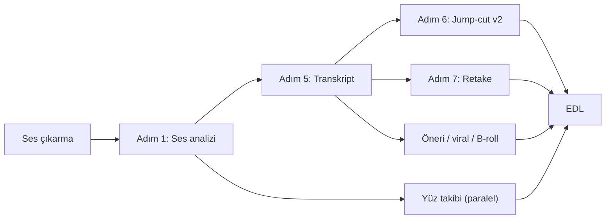

# 🛠️ Çözüm Rehberi — Transkript Motoru ve Oto Jump-Cut (Adım Adım)

> **Tarih:** 13 Ekim 2026
> **Dayanak:** [`transkript_ve_jumpcut_arastirma_raporu.md`](file:///d:/OtoEdit/OtoEdit/docs/transkript_ve_jumpcut_arastirma_raporu.md) ve bugün yapılan canlı API testleri
> **Kapsam:** A4 (erken kesim), transkript kalitesi/hızı, retake kesimlerinin hizası, temp klasörü şişmesi
> **Durum:** 📝 Uygulamaya hazır — her adımın sonunda bir doğrulama var, doğrulama geçmeden sonraki adıma geçilmez

---

## 0. Bugün Doğrulanan Gerçekler (13.10.2026, canlı testler)

| # | Bulgu | Kanıt | Rehberdeki karşılığı |
|---|---|---|---|
| 1 | `gemini-3.5-transcribe` resmi anahtarla çalışıyor; kelime zamanlarını kendisi veriyor | 60 sn → 2 sn; 10 dk → 9,9 sn, 421 kelime, `finishReason=STOP` | Asıl motor (Adım 3) |
| 2 | **"Bismillahirrahmanirrahim" atlanmasının sebebi `language_codes: ["tr-TR"]`** | Dil kodu varken 3/3 denemede atlandı; dil kodu kaldırılınca 2,10–3,00 sn'de geldi. Kelime Arapça; Türkçeye zorlanınca model o bölümü atıyor. Ayrıca o bölüm normal konuşmadan ~15 dB daha kısık (-34 dB'e karşı -19,5 dB). | **Dil kodu gönderilmeyecek** + kayıp kelime dedektörü (Adım 4) |
| 3 | Ücretsiz katman limiti: **dakikada 3 istek** (model başına, proje başına) | 429 yanıtı: `GenerateRequestsPerMinutePerProjectPerModel-FreeTier`, `quotaValue: 3`, `retryDelay: 12s` | 10 dk'lık parçalar, hız sınırlayıcı, anahtar rotasyonu (Adım 3) |
| 4 | Kelime zamanı kenar hatası ~0,25 sn | VAD ile karşılaştırma: kelime ortalarının %94'ü konuşma içinde | Jump-cut kenarları VAD + enerjiden gelecek (Adım 6) |
| 5 | Proxy'de transkripsiyon modeli yok; `3.8-flash-tiered` metin için 33 sn/dk | `/v1/models` listesi ve ölçüm | Proxy son yedeklerden biri (Adım 3) |
| 6 | Silero VAD 60 sn sesi 0,3 sn'de işliyor, projede zaten kurulu | `faster_whisper.vad` | Ses analizi (Adım 1) |

> [!NOTE]
> **Düzeltme:** Önceki raporda "VAD 28 dk'yı attığı için konuşma kayboluyor olabilir" demiştim. Yeni veri bu hipotezi zayıflatıyor. Gemini 10 dk'da 421 kelime buldu (dakikada ~42 kelime), Whisper 52 dk'da 1898 kelime bulmuştu (dakikada ~36 kelime). Bu kayıtta gerçekten çok sessizlik var (60 sn'lik kesitte sadece ~25 sn konuşma). VAD büyük ihtimalle doğru çalışıyor.

> [!WARNING]
> **Henüz bilinmeyen:** Ücretsiz katmanın **günlük** limiti. Bu limit AI Studio > Rate limits sayfasından okunmalı. Günlük limit düşükse anahtar rotasyonu veya ücretli katman gerekir.

---

## Adım 0 — Hazırlık (yapılandırma ve temizlik altyapısı)

**Dosyalar:** [`config.py`](file:///d:/OtoEdit/OtoEdit/src/OtoEdit.PythonWorker/config.py), [`docker-compose.dev.yml`](file:///d:/OtoEdit/OtoEdit/docker-compose.dev.yml), `.env`

1. Yeni ortam değişkenleri (hepsi `Config` içinde okunacak):
   ```env
   STT_ENGINE_ORDER=gemini_transcribe,groq,proxy_gemini,local_whisper
   GEMINI_API_KEYS=key1,key2          # virgülle birden fazla proje anahtarı (rotasyon)
   GEMINI_TRANSCRIBE_RPM=3            # anahtar başına dakikalık istek limiti
   STT_CHUNK_MAX_SEC=600              # parça üst sınırı (10 dk test edildi)
   GROQ_API_KEY=
   ANTIGRAVITY_PROXY_URL=http://host.docker.internal:8045/v1
   ANTIGRAVITY_PROXY_KEY=
   ANTIGRAVITY_PROXY_MODEL=gemini-3.8-flash-tiered
   LOCAL_WHISPER_MODEL=large-v3-turbo
   VAD_THRESHOLD=0.4
   VAD_MIN_SILENCE_MS=500
   JUMPCUT_MIN_SILENCE_MS=700
   JUMPCUT_PAD_MS=200
   JUMPCUT_WORD_GUARD_MS=150
   JUMPCUT_MIN_ISLAND_MS=300
   TEMP_RETENTION=after_job           # iş bitince yerel kopyaları sil
   ```
2. `docker-compose.dev.yml` → `python-worker.environment` içine bu değişkenler eklenecek. Anahtarlar şu an `.env`'de değil (Windows ortamından geliyor). Hepsi `.env`'e taşınacak, `.env.example` güncellenecek.
3. **Temp temizliği** (127 GB sorunu tekrar etmesin):
   - `analysis_consumer` ve `render_consumer` sonunda `finally` bloğunda o işe ait yerel `.mp4`, `_clean.mp3` ve `render_*` klasörü silinecek (orijinal zaten MinIO'da).
   - Worker açılışında çalışan bir "janitor": DB'de karşılığı olmayan veya 24 saatten eski temp dosyalarını siler.

**Doğrulama:** Worker yeniden başlatılınca logda yeni ayarlar listelenir. Bir analiz bitince `/app/temp`'te o videoya ait dosya kalmaz.

---

## Adım 1 — Ses Analizi Modülü (tek kaynak, bir kez hesaplanır)

**Yeni dosya:** `pipeline/audio_analysis.py`

1. **Orijinal** videodan 16 kHz mono PCM bir kez çıkarılır. Gürültü azaltılmış `_clean.mp3` kısık hece sonlarını bastırabildiği için sessizlik kararlarında kullanılmaz; transkript için kullanılabilir.
2. Silero VAD (`faster_whisper.vad.get_speech_timestamps`): `threshold=VAD_THRESHOLD`, `min_silence_duration_ms=VAD_MIN_SILENCE_MS`, `speech_pad_ms=0`. Pad'i burada değil, jump-cut'ta bilinçli olarak ekleyeceğiz.
3. 10 ms pencerelik RMS enerji zarfı (numpy).
4. Çıktı: `AudioAnalysis(speech_regions, rms_envelope, duration, peaks)`. Mevcut `_extract_audio_peaks` da bu zarftan beslenir, böylece ses ikinci kez okunmaz.

**Doğrulama:** 52 dk'lık test videosunda süre (hedef: 1 dakikanın altında) ve konuşma bölgesi sayısı loglanır.

---

## Adım 2 — Akıllı Parçalama

**Yeni dosya:** `pipeline/stt/chunker.py`

1. Hedef parça uzunluğu `STT_CHUNK_MAX_SEC` (600 sn).
2. Her sınır, hedef noktanın ±60 sn'si içindeki **en uzun VAD sessizliğinin ortasına** konur. Böylece kelime ortasından kesilmez ve bindirmeye gerek kalmaz.
3. Tamamen sessiz parçalar gönderilmez (model sessizlikte uydurma yapmasın).
4. Her parça `(index, start_sec, end_sec, mp3_path)` olarak döner. FFmpeg ile 16 kHz mono, 32 kbps (10 dk ≈ 2,4 MB, inline sınırının çok altında).

**Doğrulama:** Birim testi. Sentetik VAD bölgeleriyle sınırların hep sessizliğe düştüğü kontrol edilir.

---

## Adım 3 — STT Motorları ve Zincir

**Yeni klasör:** `pipeline/stt/`. Hepsi aynı arayüzü uygular: `transcribe_chunk(chunk) -> list[Word(word, start, end, confidence)]` (mutlak zaman).

| Sıra | Motor | Ayrıntılar |
|---|---|---|
| 1 | `GeminiTranscribeEngine` | `models/gemini-3.5-transcribe:generateContent`, `generationConfig.audio_transcription_config = {word_timestamp: true, mode: "VERBATIM"}`. **`language_codes` GÖNDERİLMEZ** (Bulgu 2). `startOffset`/`endOffset` (`"5.600s"`) çözümlenip parça offset'i eklenir. |
| 2 | `GroqEngine` | `whisper-large-v3` → `-turbo`, `response_format=verbose_json`, `timestamp_granularities[]=word,segment`. Kota bitince sıradaki motor. |
| 3 | `ProxyGeminiEngine` | Antigravity proxy, `gemini-3.8-flash-tiered`, **sadece metin** (zaman istenmez). Zamanlar Adım 3b'deki hizalayıcıdan gelir. |
| 4 | `LocalWhisperEngine` | Mevcut faster-whisper kodu; model `LOCAL_WHISPER_MODEL`, `compute_type=int8_float16` (GTX 1650). |

**Hız sınırlayıcı ve rotasyon** (`pipeline/stt/rate_limiter.py`):
- Her anahtar için kayan pencere sayacı (dakikada `GEMINI_TRANSCRIBE_RPM` istek).
- 429 yanıtında `RetryInfo.retryDelay` okunur; o anahtar o süre boyunca devre dışı kalır ve bir sonraki anahtara geçilir.
- Hiç uygun anahtar yoksa ve bekleme 60 sn'yi aşacaksa parça bir sonraki motora devredilir. Parçalar karışık motorlardan gelebilir; çıktı biçimi aynı olduğu için sorun yok.
- 52 dk ≈ 6 parça. Tek anahtarla 3 RPM ile ~2 dk; iki anahtarla ~1 dk.

**Adım 3b — Hizalayıcı (sadece ProxyGemini yolu için):** `ctc-forced-aligner` (MMS). Bu adım **ilk sürümde ertelenebilir**: proxy yoluna düşüldüğünde geçici olarak Whisper zamanları veya orantılı dağıtım kullanılır.

**Doğrulama:**
- Bugün kaydedilen gerçek yanıt (`temp/stt_probe/p20_600_resp.json`) `tests/fixtures/` altına kopyalanıp ayrıştırıcı birim testi yazılır.
- `GEMINI_API_KEYS` boşaltıldığında Groq'a, `GROQ_API_KEY` boşaltıldığında proxy'ye düştüğü loglardan görülür.

---

## Adım 4 — Kayıp Kelime Dedektörü ("hiçbir kelime atlanmamalı")

**Yeni dosya:** `pipeline/stt/gap_filler.py`

Bismillah vakası gösterdi ki model bazen bir bölümü sessizce atlayabiliyor. Buna karşı **sesin kendisi** referans alınır:

1. VAD'ın konuşma dediği her bölge için, içine en az bir kelime düşüyor mu bakılır.
2. **≥ 0,4 sn konuşma olup hiç kelime düşmeyen bölge = şüpheli boşluk.**
3. Şüpheli boşluk ±1 sn bağlamla küçük bir parça olarak kesilir ve **farklı bir yolla** yeniden istenir (önce dil kodu olmadan aynı model, sonra zincirdeki sıradaki motor).
4. Gelen kelimeler zaman sırasına göre transkripte eklenir. Yine sonuç yoksa (öksürük, nefes vb.) loga `UNTRANSCRIBED_SPEECH` olarak yazılır. Jump-cut bu bölgeyi zaten konuşma saydığı için **kesmez**.

**Doğrulama:** 20–80 sn kesitinde dil kodu **açıkken** bile Bismillah'ın gap filler ile geri geldiği gösterilir (dedektörün işe yaradığının kanıtı).

---

## Adım 5 — Transcriber Orkestratörü

**Dosya:** [`transcriber.py`](file:///d:/OtoEdit/OtoEdit/src/OtoEdit.PythonWorker/pipeline/transcriber.py)

1. `transcribe(audio_path, analysis)` → parçala (Adım 2) → motor zinciri (Adım 3, parçalar paralel ama hız sınırlayıcıdan geçerek) → birleştir → gap filler (Adım 4) → mevcut `_chunk_segments` ile altyazı segmentleri.
2. Log: hangi parça hangi motordan geldi, toplam süre, kelime sayısı, doldurulan boşluk sayısı.
3. Mevcut OpenAI yolu `STT_ENGINE_ORDER`'a `openai` yazılırsa çalışmaya devam eder.

**Doğrulama:** 52 dk'lık videonun toplam transkript süresi ve kelime sayısı loglanır (hedef: mevcut ~3,5 dk'dan kısa, kelime sayısı ≥ 1898).

---

## Adım 6 — Jump-Cut v2

**Dosya:** [`silence_detector.py`](file:///d:/OtoEdit/OtoEdit/src/OtoEdit.PythonWorker/pipeline/silence_detector.py) (yeniden yazılır; eski `pydub` yolu `JUMPCUT_ENGINE=legacy` ile korunur)

Algoritma:
1. Aday sessizlikler = VAD konuşma bölgeleri arasındaki boşluklar.
2. Süresi `JUMPCUT_MIN_SILENCE_MS`'den kısa olanlar elenir (doğal nefes araları kalır).
3. Her adayın iki ucu `JUMPCUT_PAD_MS` kadar içeri çekilir.
4. **Kelime koruması:** Herhangi bir kelimenin `[start − GUARD, end + GUARD]` aralığıyla çakışan kısım kesimden çıkarılır.
5. **Kenar ince ayarı:** Her kesim kenarı ±50 ms içinde RMS zarfının en düşük noktasına kaydırılır (tık/pop sesi olmasın).
6. İki kesim arasında `JUMPCUT_MIN_ISLAND_MS`'den kısa konuşma adası kalırsa kesimler birleştirilir (0,1 sn'lik parçalar biter).
7. Bu adım artık transkripte bağlı. Analiz akışında transkriptten **sonra** çalışır (Adım 8).

**Doğrulama (Faz 0 benchmark metrikleri):** kesim sayısı, < 0,4 sn klip sayısı (hedef 0), kelimeyle çakışan kesim sayısı (hedef 0). Editörde Görsel 1'deki bölge açılıp dalga formunun kırmızı kutuya taşmadığı görsel olarak kontrol edilir.

---

## Adım 7 — Retake Kesimlerini Kelime Sınırına Oturtma

**Dosya:** [`retake_detector.py` L253-261](file:///d:/OtoEdit/OtoEdit/src/OtoEdit.PythonWorker/pipeline/retake_detector.py#L253-L261)

1. Kaybeden segmentin kesimi, segmentin ilk kelimesinin `start`'ından son kelimesinin `end`'ine çekilir. Sonra komşu (korunan) kelimelere en az `GUARD` ms mesafe bırakacak şekilde kırpılır.
2. Kenarlar Adım 6.5'teki gibi enerji minimumuna kaydırılır.
3. VERBATIM transkript tekrarları koruduğu için (bugünkü testte `"dengenin ve dengenin"`) retake tespitinin isabeti de artmalı. Bu, ayrıca ölçülecek.

**Doğrulama:** Retake kesimlerinde "kelimeyle çakışan kesim" sayısı 0.

---

## Adım 8 — Analiz Akışının Yeniden Bağlanması

**Dosya:** [`analysis_consumer.py` L173-315](file:///d:/OtoEdit/OtoEdit/src/OtoEdit.PythonWorker/consumers/analysis_consumer.py#L173-L315)



- Sessizlik tespiti artık Grup 1'de değil, transkriptten sonra çalışır (milisaniyeler sürer, darboğaz olmaz).
- `edl_builder._merge_overlapping_cuts` aynı kalır.

---

## Adım 9 — Testler

| Test | Tür |
|---|---|
| Chunker sınırları sessizliğe düşüyor | Birim |
| Jump-cut: sentetik VAD + kelimeler → beklenen kesimler (koruma, ada birleştirme, pad) | Birim |
| Gemini yanıt ayrıştırıcı (gerçek fixture ile) | Birim |
| Hız sınırlayıcı: 429 + `retryDelay` → anahtar rotasyonu → motor devri | Birim (sahte HTTP) |
| Gap filler: kelimesiz konuşma bölgesi → yeniden istek | Birim (sahte motor) |
| `tools/cut_benchmark.py`: gerçek video üzerinde metrik tablosu | Entegrasyon |

---

## Adım 10 — Uçtan Uca Doğrulama (Mukayeseli Hukuk projesi)

1. `docker restart otoedit-dev-worker`, projeyi yeniden analiz et.
2. Karşılaştırma tablosu (13 Ekim sabahki çalışmaya karşı):

| Metrik | Eski | Hedef |
|---|---|---|
| Transkript süresi | ~3,5 dk | daha kısa |
| Kelime sayısı | 1898 | ≥ 1898, bozuk kelime yok |
| Sessizlik kesimi | 557 | belirgin şekilde az |
| < 0,4 sn klip | çok | 0 |
| Kelimeyle çakışan kesim | ölçülmedi | 0 |
| Atlanan konuşma bölgesi (gap filler sonrası) | — | 0 |

3. Editörde 3–4 rastgele noktada dinleyerek kontrol. Render alıp altyazı senkronu izlenir.

---

## Adım 11 — Toparlama

- `google.generativeai` → resmi REST / `google-genai` (eski SDK uyarısı biter).
- `tum_sorunlar_ve_eksikler.md`'de A4 kapatılır; rapor ve yol haritası güncellenir.
- Deneme scriptleri (`temp/stt_probe/`) silinir; fixture ve benchmark kalıcı yerlerine taşınmış olur.

---

## Önerilen Uygulama Turları

| Tur | Adımlar | Sonunda elde edilen |
|---|---|---|
| **1** | 0, 1, 6 (kelime koruması olmadan), 9 (jump-cut testleri) | Erken kesim büyük ölçüde biter; transkripte bağımlı değil |
| **2** | 2, 3 (Gemini + Groq + yerel), 4, 5 | Hızlı ve doğru transkript, atlanan kelime koruması |
| **3** | 6.4 (kelime koruması), 7, 8, 10 | Kesimler kelime sınırına tam oturur, uçtan uca doğrulama |
| **4** | 3b (hizalayıcı), 11 | Proxy yedeği tam, temizlik |
