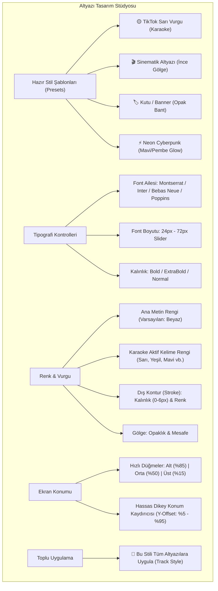
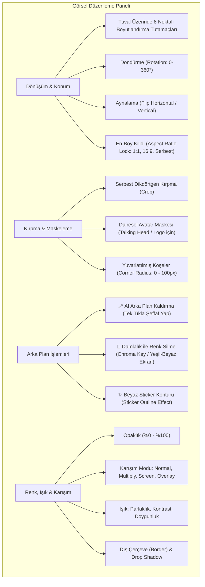
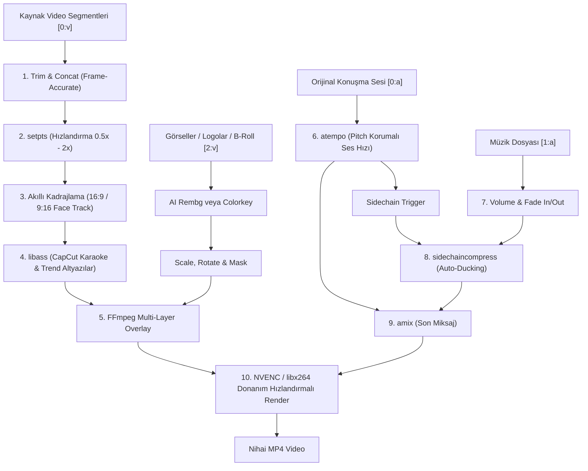

# 🎬 Kapsamlı Geliştirme Planı: Hızlı İyileştirmeler ve Profesyonel Editör Deneyimi (Bölüm 1 & 2)

> **Tarih:** 13 Ekim 2026  
> **Konum:** `docs/gelistirme_plani_hizli_iyilestirmeler_ve_editor_deneyimi.md`  
> **Kapsam:** Hızlı Düzeltmeler + Bölüm B (Gelişmiş Metin, Görsel, Arka Plan Kaldırma ve Ses Editörü)  
> **Sektör Kıyaslaması:** CapCut Desktop/Web, Adobe Premiere Pro, Canva Video, DaVinci Resolve ve Descript  
> **Durum:** 📐 Ayrıntılı Mimari, UI Bileşenleri ve Uygulama Spesifikasyonu

---

## 1. Stratejik Vizyon ve Hedef

OtoEdit'in temel altyapısı (Silero VAD Jump-Cut v2, Gemini 3.5 Transcribe STT ve Gemini 3.8 Flash Retake Kurgu Denetçisi) 52 dakikalık gerçek test videosuyla başarıyla kanıtlanmıştır.

Yapay Zeka Otomatik Düzenleme (Bölüm C) aşamasına geçmeden önce, bir video editörünün **kullanıcı tarafından hissedilen gücünü, hızını ve görsel kalitesini belirleyen 1. ve 2. aşamalar** tamamlanmalıdır. Çünkü bir yapay zeka ne kadar akıllı kurgu yaparsa yapsın, kullanıcı ekrandaki altyazının rengini değiştiremiyorsa, metne şık bir gölge veremiyorsa, logoların arka planını tek tıkla şeffaflaştıramıyorsa veya arka plan müziğinin sesini kısamıyorsa uygulama "amatör" algılanacaktır.

Bu doküman; **CapCut'ın viral altyazı ve tek tıkla efekt pratikliğini**, **Premiere Pro'nun katman disiplini ve tipografik hassasiyetini**, **Canva'nın ise zengin görsel tasarım yeteneklerini** OtoEdit'e kazandırma planıdır.

---

## 2. Kapsamlı Sektör Kıyaslama Matrisi (Benchmark)

Aşağıdaki tablo, sektör lideri 4 video düzenleme yazılımının metin, görsel ve ses kabiliyetlerini OtoEdit'e kazandıracağımız standartlarla karşılaştırmaktadır:

| Özellik Grubu | CapCut (Desktop / Web) | Adobe Premiere Pro | Canva Video | **OtoEdit'e Eklenecek Standart** |
|---|---|---|---|---|
| **Altyazı Stilleri & Karaoke** | Hazır TikTok şablonları, kelime zıplaması (bounce), karaoke aktif kelime rengi. | Essential Graphics, Track Style (tek tıkla tüm altyazılara yayma), stil kütüphanesi. | Dinamik kelime vurgusu, eğlenceli hazır altyazı animasyonları. | **CapCut tipi hazır stil preset'leri + Premiere tipi tek tıkla "Tüm Altyazılara Uygula" butonu + Karaoke kelime vurgusu.** |
| **Metin Tipografisi & Düzenleme** | 100+ font, harf aralığı, satır yüksekliği, çok satırlı metin, eğri yazı (curved text). | Profesyonel kerning, tracking, baseline shift, dikey/yatay metin, safe-margin kılavuzları. | Zengin Google Fonts entegrasyonu, harf boşluğu, efekt kombinasyonları. | **Google Fonts kütüphanesi, çok satırlı metin, letter-spacing, line-height ve dikey/yatay hizalama.** |
| **Metin Kontur & Gölgesi** | Çift kontur (dual stroke), glow/neon parlama, yönlendirilebilir drop shadow. | Çoklu stroke katmanı, gaussian blur gölge, açı ve mesafe kontrolü. | Kavisli gölge, neon ışıma, glitch efekti. | **Kalınlık/renk ayarlı dış kontur (Stroke) + Açı, mesafe, renk ve bulanıklık ayarlı Drop Shadow + Neon Glow.** |
| **Metin Arka Plan Kutusu (Banner)** | Hazır badge'ler, yuvarlak pill/tag kutuları, renkli arkaplan bantları, breaking news şeridi. | Essential Graphics shape layer (metne dinamik bağlanan arka plan dikdörtgeni). | Renkli vurgu bandı (highlighter effect), kutu dolgusu (padding) ve border-radius. | **Kutu arkaplanı (renk, opaklık, padding, border-radius) + Breaking News bandı + Fosforlu kalem vurgusu.** |
| **Görsel Manipülasyonu** | 8 noktalı tuval tutamaçları, serbest döndürme, dairesel/yıldız maskeleme. | Motion paneli: Position, Scale, Anchor Point, Rotation, Opacity, Bezier Masking. | Şekil içine kırpma (Frames), görsel filtreleri, çevirme (flip). | **Önizleme tuvalinde serbest sürükle-bırak, 8 noktalı boyutlandırma, açı döndürme ve en-boy kilidi.** |
| **Arka Plan Kaldırma (Matting)** | Tek tıkla AI "Auto Cutout", hassas kenar düzeltme, yeşil ekran (Chroma Key). | Ultra Key (efsanevi yeşil/mavi perde silici), Roto Brush (After Effects). | Tek tıkla "Magic Eraser" (Arka planı sil ve şeffaf PNG yap). | **1. Tek tıkla AI Arka Plan Kaldırma (`rembg` - 1.2 sn)**<br>**2. Renk Damlalığı ile Chroma Key (Yeşil/Mavi/Beyaz silme)**<br>**3. YouTube Tarzı Beyaz Sticker Konturu.** |
| **Görsel Maskeleme & Filtreler** | Daire/Avatar maskesi, kalp/yıldız, split maske, renk filtreleri. | 4-point/8-point garbage matte, Lumetri Color filtreleri, blend modes. | Şekil maskeleri (Frames), parlaklık/kontrast/doygunluk ayarları. | **Avatar (Dairesel) Maskesi, Yuvarlatılmış Dikdörtgen Maske + Parlaklık/Kontrast/Doygunluk slider'ları.** |
| **Ses Miksajı & Auto-Ducking** | BGM katmanı, ses seviyesi slider'ı, konuşunca müziği otomatik kısma (Auto-Ducking). | Essential Sound: "Ducking against dialogue", Reverb/EQ, keyframe volume automation. | Basit ses seviyesi ve fade in/out. | **Timeline Müzik Pisti + FFmpeg sidechain tabanlı Auto-Ducking + Fade In/Fade Out + Gain (-20dB to +6dB).** |
| **Hız Kontrolü (Speed Ramp)** | Standart hız (0.1x-100x) + Eğri hız (Speed Curve) + Pitch koruma (ton bozulmaz). | Time Remapping + Optical Flow + Pitch Shifter. | Basit hız kontrolü. | **0.5x, 1x, 1.25x, 1.5x, 2x hızlandırma + `atempo` ile konuşmacı sesini inceltmeyen ton koruma.** |

---

## 3. Faz 1: Hızlı İyileştirmeler, Kritik Hata Düzeltmeleri ve Altyapı Güvencesi

Bu faz, projenin mevcut çalışma kararlılığını riske atabilecek tüm gizli açıkları (edge-case hatalarını) kapatır ve yeni görsel editör özelliklerine geçmeden önce sağlam bir zemin oluşturur:

### 1.1. Pexels API & B-Roll Güvencesi
* **Sorun:** Loglarda görülen `Pexels API 401 Unauthorized` hatası, video analizinde otomatik B-Roll görsel indirmesini engelliyor.
* **Çözüm:**
  1. `.env` dosyasına geçerli `PEXELS_API_KEY` eklenmesi.
  2. [`services/pexels_client.py`](file:///d:/OtoEdit/OtoEdit/src/OtoEdit.PythonWorker/services/pexels_client.py) içine **Akıllı Fallback Zinciri**: Pexels anahtarı yoksa veya kota biterse sistem çökmeyecek; `Unsplash Source API` veya `Wikimedia Commons Public API` devreye girerek konuya uygun ücretsiz yüksek çözünürlüklü stok görselleri timeline'a indirecek.
  3. Video yatay ise `orientation=landscape`, dikey ise (Reels/Shorts) `orientation=portrait` parametresi otomatik gönderilecek.

### 1.2. Nihai Render Kalite ve Senkronizasyon Güvencesi
* 52 dakikalık gerçek videoda kurgulanan altyazıların, fontların (`Montserrat-Bold`, `Inter`, `Bebas Neue`) ve yeni 386ms güvenlik paylı kesimlerin, **Nihai Videoyu Render Et** butonuna basıldığında GPU (NVENC) hızlandırmasıyla birebir aynı çıkması garanti altına alınacak.

### 1.3. AI Yönetmen Clarification Formu Backend Desteği (404 Çözümü)
* **Tespit:** Frontend [`chat.service.ts:26`](file:///d:/OtoEdit/OtoEdit/src/OtoEdit.Frontend/src/app/core/services/chat.service.ts#L26) dosyası `POST /api/projects/{projectId}/chat/{messageId}/form` endpoint'ine form parametrelerini göndermektedir. Ancak backend tarafında `ChatController.cs` ve `ChatManager.cs` içerisinde bu endpoint tanımlı değildir.
* **Risk:** Kullanıcı AI Yönetmen ile sohbet ederken "başlık ekle" dediğinde gelen renk, font ve konum formunu doldurup "Onayla ve Ekle" butonuna bastığında tarayıcı `404 Not Found` hatası alacaktır.
* **Çözüm:**
  1. [`OtoEdit.API/Controllers/ChatController.cs`](file:///d:/OtoEdit/OtoEdit/src/OtoEdit.API/Controllers/ChatController.cs) içerisine `POST {messageId:guid}/form` endpoint'i eklenmesi.
  2. [`OtoEdit.Business/Services/ChatManager.cs`](file:///d:/OtoEdit/OtoEdit/src/OtoEdit.Business/Services/ChatManager.cs) içerisine `SubmitFormAsync(Guid projectId, Guid messageId, Dictionary<string, string> parameters)` metodunun yazılması; form verilerinden türetilen Overlay/Stil nesnesinin `EdlManager.PatchEdlAsync` ile anında EDL'ye işlenmesi.

### 1.4. Transkripsiyon Kesintisinde Video Süresi Koruma Güvencesi (1.0s Duration Bug'ı)
* **Tespit:** STT zincirinde beklenmedik bir ağ kopması veya kota aşımı yaşandığında [`pipeline/transcriber.py:206`](file:///d:/OtoEdit/OtoEdit/src/OtoEdit.PythonWorker/pipeline/transcriber.py#L206) güvenlik transkriptini `duration=1.0` olarak dönmektedir. [`pipeline/edl_builder.py:116`](file:///d:/OtoEdit/OtoEdit/src/OtoEdit.PythonWorker/pipeline/edl_builder.py#L116) ise EDL dokümanını inşa ederken süreyi doğrudan transkriptten almaktadır: `duration=transcript.duration`.
* **Risk:** İnternet kesilirse veya Gemini STT hata verirse, 52 dakikalık video işlense dahi projenin EDL süresi veritabanında **1.0 saniye** olarak kaydedilir; zaman çizgisinde video yok olur ve tüm kesimler çöker.
* **Çözüm:**
  1. [`pipeline/edl_builder.py`](file:///d:/OtoEdit/OtoEdit/src/OtoEdit.PythonWorker/pipeline/edl_builder.py) `build` metoduna `video_duration: Optional[float] = None` parametresi eklenmesi.
  2. Süre atamasının transkripte bağımlı kalmayıp FFmpeg ile okunan gerçek video süresi üzerinden atanması:
     ```python
     effective_duration = video_duration if (video_duration and video_duration > 1.0) else (transcript.duration if transcript.duration > 1.0 else 0.0)
     edl = EdlDocument(..., duration=effective_duration, ...)
     ```
  3. [`consumers/analysis_consumer.py:307`](file:///d:/OtoEdit/OtoEdit/src/OtoEdit.PythonWorker/consumers/analysis_consumer.py#L307) çağrısına `video_duration=analysis.duration` parametresinin geçirilmesi.

### 1.5. Worker ile .NET API İletişim Eşitlemesi (Port 5001 & X-API-Key Paritesi)
* **Tespit:**
  * Worker [`config.py:71-72`](file:///d:/OtoEdit/OtoEdit/src/OtoEdit.PythonWorker/config.py#L71-L72) varsayılan olarak `API_BASE_URL="http://host.docker.internal:5000"` ve `INTERNAL_API_KEY="otoedit-internal-secret-key-2026"` kullanmaktadır.
  * .NET API ise [`launchSettings.json:8`](file:///d:/OtoEdit/OtoEdit/src/OtoEdit.API/Properties/launchSettings.json#L8) dosyasında **5001** portunda ayağa kalkmakta ve [`ApiKeyAuthMiddleware.cs:55`](file:///d:/OtoEdit/OtoEdit/src/OtoEdit.API/Middleware/ApiKeyAuthMiddleware.cs#L55)'te `"SUPER_SECRET_OTOEDIT_KEY_123!"` anahtarını beklemektedir.
* **Risk:** Python Worker'ın 3. katman doğrudan REST log servisi (`PipelineLogger`) 401 Unauthorized ve Port Connection Refused almaktadır (Hata `try...except` ile yutulduğu için video analizi durmamakta ancak doğrudan veritabanı log katmanı sessizce devre dışı kalmaktadır).
* **Çözüm:**
  1. [`src/OtoEdit.PythonWorker/config.py`](file:///d:/OtoEdit/OtoEdit/src/OtoEdit.PythonWorker/config.py) içindeki varsayılan değerlerin `API_BASE_URL = os.getenv("API_BASE_URL", "http://host.docker.internal:5001")` ve `INTERNAL_API_KEY = os.getenv("INTERNAL_API_KEY", "SUPER_SECRET_OTOEDIT_KEY_123!")` olarak güncellenmesi.
  2. [`docker-compose.dev.yml`](file:///d:/OtoEdit/OtoEdit/docker-compose.dev.yml) içindeki `python-worker` environment bloğuna `API_BASE_URL=http://host.docker.internal:5001` ve `INTERNAL_API_KEY=${ADMIN_API_KEY:-SUPER_SECRET_OTOEDIT_KEY_123!}` satırlarının eklenmesi.

### 1.6. Jump-Cut Çevre Değişkenleri ve Pydantic Geriye Dönük Uyumluluk Güvencesi
* **Tespit:** `docker-compose.dev.yml` içinde `JUMPCUT_PAD_LEAD_MS` ve `JUMPCUT_PAD_TRAILING_MS` çevre değişkenleri tanımlı değildir (Python `config.py` varsayılanları korusa da `.env` üzerinden override edilmesini engellemektedir). Ayrıca eski ortamlarda Pydantic 1.x bulunması durumunda `model_dump()` istisna fırlatabilir.
* **Çözüm:**
  1. [`docker-compose.dev.yml`](file:///d:/OtoEdit/OtoEdit/docker-compose.dev.yml) içerisine `JUMPCUT_PAD_LEAD_MS=${JUMPCUT_PAD_LEAD_MS:-350}` ve `JUMPCUT_PAD_TRAILING_MS=${JUMPCUT_PAD_TRAILING_MS:-200}` parametrelerinin eklenmesi.
  2. [`pipeline/edl_builder.py:131`](file:///d:/OtoEdit/OtoEdit/src/OtoEdit.PythonWorker/pipeline/edl_builder.py#L131) satırında savunmacı serileştirme uygulanması:
     ```python
     dump_fn = getattr(edl, "model_dump", getattr(edl, "dict", None))
     return dump_fn() if dump_fn else edl.__dict__
     ```

---

## 4. Faz 2: [B4] Yeni Nesil Altyazı & Tipografi Stüdyosu (CapCut Stili)

### A. Kullanıcı Arayüzü (Frontend: `editor.component.ts`)

Editörde altyazı seçildiğinde veya üst bardan "Altyazı" sekmesine geçildiğinde açılacak panel:



### B. ASS / SSA Çıktı Standardı (`services/video_renderer.py`)
Seçilen şablon ASS dosyasının başlığına şu şekilde dinamik yazılır:
* **TikTok Sarı Vurgu:** `Style: Subtitle,Montserrat-Bold,48,&H00FFFFFF,&H0000D7FF,&H00000000,&H80000000,-1,0,0,0,100,100,0,0,1,3.0,1.5,2,20,20,50,1`
  * SecondaryColour `&H0000D7FF` (Altın Sarısı BGR) yapılarak karaoke kelimelerinde parlar.
* **Kutulu Banner:** `BorderStyle=3` (Opaque Box) yapılarak kelimelerin arkasına şık yarı saydam siyah kutu çizilir.

---

## 5. Faz 3: [B3] Profesyonel Metin Editörü (Text & Motion Graphics)

Mevcut basit yazı aracını CapCut ve Premiere Pro'daki **Essential Graphics** seviyesine çıkaran detaylı modül:

### A. Tipografi ve Karakter Kontrolleri
1. **Genişletilmiş Font Kütüphanesi:**
   * Sans-Serif: `Inter`, `Montserrat`, `Poppins`, `Roboto`.
   * Display / Başlık: `Bebas Neue`, `Anton`, `Impact`, `Oswald`.
   * Serif: `Playfair Display`, `Merriweather`.
   * Handwriting: `Caveat`, `Permanent Marker`.
2. **Karakter Formatlama:**
   * Tümü Büyük Harf (**ALL CAPS**) düğmesi (YouTube başlıkları için kritik).
   * Harfler arası boşluk (**Letter Spacing / Tracking**: -2px ile +15px arası).
   * Satır yüksekliği (**Line Height**: 0.8x ile 2.0x arası).
   * Çok satırlı metin desteği (Enter tuşuyla alt satıra geçiş).

### B. Renk, Kontur ve Efektler
1. **Dış Çizgi (Stroke / Outline):**
   * Kalınlık slider'ı (`0 - 20px`).
   * Kontur rengi seçici (Color Picker).
   * Çift Kontur (Dual Stroke): YouTube thumbnail ve shortslarda çok popüler olan iç beyaz + dış siyah çizgi.
2. **Gölge ve Derinlik (Drop Shadow & Glow):**
   * Gölge rengi ve opaklığı (`%0 - %100`).
   * Gölge açısı (`0° - 360°`) ve ofset mesafesi (`0 - 30px`).
   * Gölge yumuşaklığı / bulanıklığı (`Blur Radius: 0 - 25px`).
   * Neon Işıma (**Outer Glow**): Metnin etrafında renkli ışık halesi oluşturma.
3. **Arka Plan Kutusu (Text Banner / Badge / Highlight):**
   * **Stil 1 (Dolu Kutu):** Metnin arkasında tam renkli arka plan kutusu.
   * **Stil 2 (Yuvarlak Hap / Pill):** Köşeleri tam yuvarlatılmış hap şeklinde etiket.
   * **Stil 3 (Breaking News Bandı):** Ekranı boydan boya kaplayan haber şeridi.
   * **Stil 4 (Fosforlu Vurgu):** Kelimenin altından geçen fosforlu sarı/yeşil kalem efekti.
   * Kutu Ayarları: Kutu rengi, kutu opaklığı (`%0 - %100`), iç boşluk (`Padding X & Y`), köşe yuvarlaklığı (`Border Radius: 0 - 50px`).

### C. Dönüşüm ve Tuval Etkileşimi (Canvas Transform)
* Video önizleme ekranı üzerinde metne tıklandığında beliren **Etkileşimli Çerçeve (Bounding Box)**:
  * 4 köşe tutamacı: Orantılı boyutlandırma (Scale).
  * 4 kenar tutamacı: Genişlik ve yükseklik esnetme.
  * Üst döndürme pimi: Serbest açı döndürme (`Rotation: 0 - 360°`).
  * Tuval üzerinde serbest sürükle-bırak (Drag & Drop).
  * **Manyetik Kılavuzlar (Smart Snapping):** Ekranın tam ortasına veya kenarlarına yaklaşıldığında beliren pembe kılavuz çizgileri.

### D. Hareket ve Animasyonlar (Motion Graphics)
* **Giriş Animasyonları (In-Animation):**
  * `Pop Up / Bounce` (Zıplayarak belirme).
  * `Typewriter` (Daktilo efekti - harf harf yazılma).
  * `Slide In` (Soldan, sağdan veya alttan kayarak gelme).
  * `Fade In` (Yumuşak belirme).
  * `Zoom In` (Odaktan büyüme).
* **Çıkış Animasyonları (Out-Animation):**
  * `Fade Out`, `Slide Down`, `Zoom Out`.
* Animasyon Hızı: `0.2s - 2.0s` süresince hız kontrolü.

---

## 6. Faz 4: [B1] Yeni Nesil Görsel Editörü & AI Arka Plan Kaldırma

Bu bölüm, OtoEdit'e yüklenen tüm görselleri (logolar, çıkartmalar, ürün fotoğrafları, infografikler, B-Roll'ler) profesyonel grafik katmanına dönüştürür.

### A. Görsel Özellikler Paneli (Image Inspector)
Editörde bir görsel öğesi seçildiğinde sağ tarafta açılan panel:



### B. Arka Plan Kaldırma (Background Removal) — 3 Farklı Yöntem

#### 1. Yöntem: AI Otomatik Arka Plan Kaldırma (Tek Tıkla)
* **Kullanım Amacı:** Kişi portreleri, ürün fotoğrafları veya karmaşık arka planlı logolar.
* **Teknoloji:** `rembg` (U2Net / BiRefNet AI mimarisi).
* **Nasıl Çalışır?**
  1. Kullanıcı paneldeki **"🪄 Arka Planı Kaldır"** butonuna basar.
  2. Python Worker, görselin alfa matrisini 1.2 saniyede hesaplar ve arka planı piksel hassasiyetinde yok eder.
  3. Yeni şeffaf görsel MinIO'ya `_transparent.png` olarak kaydedilir ve editörde canlı güncellenir.

#### 2. Yöntem: Damlalık ile Renk Silme (Chroma Key / Color Keying)
* **Kullanım Amacı:** Yeşil ekran (Green Screen) animasyonları, beyaz arka planlı logolar veya siyah arka planlı efektler.
* **Nasıl Çalışır?**
  1. Kullanıcı **"Damlalık (Eyedropper)"** simgesine basıp görselin silmek istediği yerine tıklar (örn: saf beyaz veya yeşil zemin).
  2. Paneldeki **Tolerans Slider'ı (Similarity: %1 - %100)** ile o rengin ne kadar yakınının silineceği belirlenir.
  3. FFmpeg render aşamasında `colorkey` / `chromakey` filtresi uygulanarak arka plan şeffaf akar:
     ```bash
     [1:v]colorkey=color=0xFFFFFF:similarity=0.25:blend=0.1[logo_transparent]
     ```

#### 3. Yöntem: YouTube Tarzı "Sticker White Outline" Efekti
* **Kullanım Amacı:** Arka planı silinen nesnenin (konuşmacı veya logonun) etrafına YouTube thumbnail'larında ve TikTok videolarında görülen parlak beyaz/renkli çıkartma konturu ekleme.
* **Teknoloji:** OpenCV tabanlı `cv2.findContours` + dilation yöntemiyle şeffaf nesnenin sınırlarına istenen kalınlıkta (örn. 8px) yumuşak beyaz kontur çizilir.

### C. Görsel Maskeleme ve Avatar Modu
* **Dairesel Avatar Modu (Circle Mask):** Özellikle eğitim, reaksiyon veya podcast videolarında konuşmacı veya konuk görselini tek tıkla şık yuvarlak bir avatar çerçevesine sokar; etrafına renkli border ekler.
* **Köşe Yuvarlama (Corner Radius):** B-Roll görsellerinin keskin köşelerini yumuşatarak modern bir iOS/CapCut estetiği kazandırır.

---

## 7. Faz 5: [B5] Ses Miksajı, Arka Plan Müziği ve Auto-Ducking

### A. Timeline Müzik Pisti (BGM Audio Track)
Timeline'da video pistinin hemen altında özel bir **"🎵 Arka Plan Müziği"** pisti yer alacaktır:
* Kullanıcı kendi MP3/WAV müziğini yükleyebilir veya kütüphaneden telifsiz müzik seçebilir.
* Müzik klibi timeline üzerinde istenen saniyeye sürüklenebilir, kırpılabilir (Trim) ve uzatılabilir (Loop).

### B. Akıllı Auto-Ducking (Konuşunca Müziği Otomatik Kısma)
Profesyonel kurgunun en önemli sırrı: Konuşmacı konuşurken müziğin fısıltı seviyesine inmesi, konuşmacı sustuğunda ise müziğin ritminin duyulmasıdır.
* **OtoEdit Auto-Ducking Mantığı:**
  * Konuşma Başlangıcı: Müzik seviyesi otomatik olarak **`-18 dB (%15)`** seviyesine düşer.
  * Konuşma Arası / Sessizlik: Müzik doğal bir geçişle **`-8 dB (%35)`** seviyesine yükselir.
  * FFmpeg `sidechaincompress` filtresiyle render aşamasında sıfır gecikmeyle mikslenir:
    ```bash
    [1:a]asplit[sc][bgm];[0:a][sc]sidechaincompress=threshold=0.08:ratio=6:attack=150:release=450[ducked_bgm];[0:a][ducked_bgm]amix=inputs=2:duration=first[aout]
    ```

### C. Fade In, Fade Out ve Master Gain
* Müzik başlangıcı için yumuşak **Fade In** (0.5s - 5s).
* Video bitişinde ani kesilmeyi önleyen **Fade Out** (1s - 5s).
* **Master Volume Slider:** Konuşma sesi için `-12 dB` ile `+6 dB` aralığında kazanç (Gain) ayarı.

---

## 8. Faz 6: [B6] Hız Kontrolü (Speed Ramp & Pitch Correction)

### A. Klip Hız Ayarları
Zaman çizelgesindeki herhangi bir klip seçilip sağ tıklandığında veya sağ panelden:
* **Hız Seçenekleri:** `0.5x (Ağır Çekim)`, `0.75x`, `1.0x (Normal)`, `1.25x`, `1.5x`, `2.0x (Hızlı)`.
* **Klip Süresi Güncellemesi:** Hız 2x yapıldığında klibin timeline'daki uzunluğu otomatik yarıya düşer ve sonraki klipler boşluk kalmaması için sola kayar (Ripple Edit).

### B. Ton Koruma (Pitch Correction — Chipmunk Sesini Önleme)
Bir video hızlandırıldığında ses frekansı yükselerek konuşmacının sesi incecik (çizgi film sincabı gibi) çıkar.
* OtoEdit, FFmpeg'in `atempo` ses filtresini kullanarak **ses perdesini (pitch) sabit tutar.** Konuşmacının ses tonu aynı kalırken sadece konuşma hızı artar:
  ```bash
  # 1.5x Hızlandırma için Video ve Ses Filtresi:
  [0:v]setpts=0.6667*PTS[v_speed];[0:a]atempo=1.5[a_speed]
  ```

---

## 9. Teknik Uygulama Mimarisi (Nasıl Kodlanacak?)

Bu zengin özellikleri sisteme entegre ederken iki ana bileşen kullanılacaktır:

```mermaid
flowchart LR
    subgraph Frontend_Canvas["1. Frontend Canlı Etkileşim Katmanı (Angular)"]
        UI1["HTML5 Canvas / SVG Overlay"]
        UI2["8 Noktalı Bounding Box Tutamaçları"]
        UI3["Gerçek Zamanlı CSS Preview (Stroke, Shadow, Banner)"]
        UI4["Sağ Panel: Text, Image & Audio Inspector"]
    end

    subgraph Backend_Renderer["2. Backend Hibrit Render Motoru (Python Worker)"]
        R1["ASS Substation Alpha Engine (Karaoke & Trend Altyazılar)"]
        R2["Pillow / Skia Canvas Renderer (Kompleks Banner & Sticker Çizimi)"]
        R3["rembg (AI Arka Plan Kaldırma Servisi)"]
        R4["FFmpeg Filter Complex (Sidechain Ducking, Colorkey, atempo)"]
    end

    Frontend_Canvas -->|EDL JSON| Backend_Renderer
```



### 1. Frontend: Etkileşimli Tuval (Interactive Canvas)
* `editor.component.ts` içerisindeki video önizleme oynatıcısının üzerine şeffaf bir SVG/HTML5 etkileşim katmanı konulacaktır.
* Kullanıcı bir yazıya veya görsele tıkladığında köşe noktalarından tutup fare ile sürükleyebilecek, boyutlandırabilecek ve döndürebilecektir.
* Tüm değişiklikler anında Angular Signal state'ine yazılacak ve video üzerinde canlı görünecektir.

### 2. Backend: Hibrit Render Motoru
* Basit metinler için FFmpeg `drawtext`.
* Altyazı ve karaoke için libass destekli **ASS Altyazı Motoru**.
* Renkli arka plan kutuları, çift konturlar, beyaz sticker çizgileri ve maskeler için **Python Pillow/Skia ile yüksek çözünürlüklü şeffaf RGBA katmanı** oluşturulup videonun üzerine tek seferde basılacaktır. Bu sayede tarayıcıda görünen tasarım ile render edilen MP4 arasında **pikseli pikseline %100 uyum** sağlanacaktır.

---

## 10. Detaylı Dosya Mimarisi: Oluşturulacak ve Güncellenecek Dosyalar

Sisteme eklenecek profesyonel editör kabiliyetlerinin backend (Python Worker), veri katmanı (EDL Models) ve frontend (Angular 18) üzerindeki tam dosya haritası:

```mermaid
graph TD
    subgraph PythonWorker["Python Worker (Backend & Render Motoru)"]
        W_REQ["requirements.txt & Dockerfile (rembg, onnxruntime eklentisi)"]
        W_EDL["models/edl_model.py (Yeni tipler: SubtitleStyle, BGMTrack, Transform)"]
        W_FALLBACK["services/stock_media_fallback.py (Unsplash & Wikimedia Motoru)"]
        W_PEXELS["services/pexels_client.py (Fallback Entegrasyonu)"]
        W_BG["services/bg_remover.py (AI Rembg & OpenCV Sticker Konturu)"]
        W_SUB["render/dynamic_subtitle_generator.py (ASS Preset & Karaoke Stüdyosu)"]
        W_TXT["render/text_overlay.py (ASS Inline Stilleri & Tipografi)"]
        W_PIL["render/pillow_graphics_engine.py (Pill Banner, Drop Shadow, Dual Stroke)"]
        W_IMG["render/image_overlay.py (Chroma Key, Maskeleme, Döndürme, Filtreler)"]
        W_AUD["render/audio_mixer.py (Sidechain Auto-Ducking & BGM Mikseri)"]
        W_TIME["render/timeline_mapper.py (Hız Değişiminde Ripple Timestamp Dönüşümü)"]
        W_REND["render/video_renderer.py (Hibrit Concat, Render Pipeline & Speed Ramp)"]
    end

    subgraph Frontend["Angular 18 Frontend"]
        F_MODELS["src/app/core/models/edl.model.ts (TypeScript Arayüz Genişletmesi)"]
        F_CANVAS["src/app/features/editor/components/canvas-overlay/ (8 Noktalı Etkileşim Tuvali)"]
        F_SUB_UI["src/app/features/editor/components/subtitle-inspector/ (Altyazı Stüdyosu)"]
        F_TXT_UI["src/app/features/editor/components/text-inspector/ (Tipografi & Efekt Paneli)"]
        F_IMG_UI["src/app/features/editor/components/image-inspector/ (Görsel & AI BG Paneli)"]
        F_AUD_UI["src/app/features/editor/components/audio-inspector/ (BGM & Ducking Paneli)"]
        F_MAIN["src/app/features/editor/editor.component.ts (Merkezi Entegrasyon & State)"]
    end

    PythonWorker <-->|EDL JSON & REST/WebSocket| Frontend
```



### A. Yeni Oluşturulacak Dosyalar
1. [`src/OtoEdit.PythonWorker/services/stock_media_fallback.py`](file:///d:/OtoEdit/OtoEdit/src/OtoEdit.PythonWorker/services/stock_media_fallback.py): Pexels API'de hata, kota aşımı veya yetki sorunu olduğunda otomatik olarak Unsplash Source ve Wikimedia Commons REST API'lerini devreye sokan sıfır-hata stok medya servisi.
2. [`src/OtoEdit.PythonWorker/services/bg_remover.py`](file:///d:/OtoEdit/OtoEdit/src/OtoEdit.PythonWorker/services/bg_remover.py): `rembg` kütüphanesini kullanarak arka planı saniyeler içinde şeffaflaştıran ve OpenCV ile şeffaf nesnelerin etrafına YouTube tarzı beyaz/renkli çıkartma konturu çizen AI arka plan servisi.
3. [`src/OtoEdit.PythonWorker/render/pillow_graphics_engine.py`](file:///d:/OtoEdit/OtoEdit/src/OtoEdit.PythonWorker/render/pillow_graphics_engine.py): Tarayıcıdaki CSS banner kutularını, yuvarlatılmış hap (pill) etiketleri, çift konturları (dual stroke) ve yumuşak gaussian drop shadow'ları piksel piksel render eden yüksek çözünürlüklü RGBA grafik motoru.
4. [`src/OtoEdit.PythonWorker/render/audio_mixer.py`](file:///d:/OtoEdit/OtoEdit/src/OtoEdit.PythonWorker/render/audio_mixer.py): BGM (Arka Plan Müziği) pisti, konuşma kanalı sidechain sıkıştırması (Auto-Ducking), fade-in/out ve genel ses kazanç (gain) filtrelerini oluşturan ses mikseri.

### B. Güncellenecek Mevcut Dosyalar
1. [`src/OtoEdit.API/Controllers/ChatController.cs`](file:///d:/OtoEdit/OtoEdit/src/OtoEdit.API/Controllers/ChatController.cs) & [`OtoEdit.Business/Services/ChatManager.cs`](file:///d:/OtoEdit/OtoEdit/src/OtoEdit.Business/Services/ChatManager.cs): Eksik olan `POST .../chat/{messageId}/form` endpoint'inin ve `SubmitFormAsync` iş mantığının eklenmesi (404 hatasını çözer).
2. [`src/OtoEdit.PythonWorker/pipeline/edl_builder.py`](file:///d:/OtoEdit/OtoEdit/src/OtoEdit.PythonWorker/pipeline/edl_builder.py): EDL `duration` değerinin transkript arızasında 1.0 saniyeye çökmesini önleyen gerçek video süresi (`analysis.duration`) korumasının ve Pydantic v1/v2 uyumluluk serileştirmesinin eklenmesi.
3. [`src/OtoEdit.PythonWorker/config.py`](file:///d:/OtoEdit/OtoEdit/src/OtoEdit.PythonWorker/config.py) & [`docker-compose.dev.yml`](file:///d:/OtoEdit/OtoEdit/docker-compose.dev.yml): `API_BASE_URL` (Port 5001), `INTERNAL_API_KEY` (`SUPER_SECRET_OTOEDIT_KEY_123!`), `JUMPCUT_PAD_LEAD_MS` ve `JUMPCUT_PAD_TRAILING_MS` çevre değişkenlerinin eşitlenmesi.
4. [`src/OtoEdit.PythonWorker/requirements.txt`](file:///d:/OtoEdit/OtoEdit/src/OtoEdit.PythonWorker/requirements.txt) & [`Dockerfile`](file:///d:/OtoEdit/OtoEdit/src/OtoEdit.PythonWorker/Dockerfile): `rembg[cpu]>=2.0.50`, `onnxruntime` bağımlılıklarının eklenmesi.
5. [`src/OtoEdit.PythonWorker/models/edl_model.py`](file:///d:/OtoEdit/OtoEdit/src/OtoEdit.PythonWorker/models/edl_model.py): `OverlayItem` sınıfına tipografi, kontur, gölge, banner, kırpma, döndürme ve chroma-key alanlarının eklenmesi; yeni `AudioTrackItem` ve `SubtitleStyleConfig` sınıflarının tanımlanması.
6. [`src/OtoEdit.PythonWorker/services/pexels_client.py`](file:///d:/OtoEdit/OtoEdit/src/OtoEdit.PythonWorker/services/pexels_client.py): Fallback zincirinin entegrasyonu, yatay/dikey oryantasyon duyarlılığı.
7. [`src/OtoEdit.PythonWorker/render/text_overlay.py`](file:///d:/OtoEdit/OtoEdit/src/OtoEdit.PythonWorker/render/text_overlay.py): Dinamik ASS stilleri, letter spacing (`\fsp`), çok satırlı metin desteği ve Pillow grafik entegrasyonu.
8. [`src/OtoEdit.PythonWorker/render/image_overlay.py`](file:///d:/OtoEdit/OtoEdit/src/OtoEdit.PythonWorker/render/image_overlay.py): Serbest açı döndürme (`rotate`), aynalama (`hflip/vflip`), damlalıkla renk silme (`colorkey`), dairesel avatar maskesi ve opaklık kontrolleri.
9. [`src/OtoEdit.PythonWorker/render/timeline_mapper.py`](file:///d:/OtoEdit/OtoEdit/src/OtoEdit.PythonWorker/render/timeline_mapper.py): Klip hızlandırma (0.5x - 2.0x) durumunda altyazı ve overlay zaman damgalarının ripple (dalga) yöntemiyle yeniden hesaplanması.
10. [`src/OtoEdit.PythonWorker/render/video_renderer.py`](file:///d:/OtoEdit/OtoEdit/src/OtoEdit.PythonWorker/render/video_renderer.py): Concat ve filtre zincirinde `audio_mixer`, `pillow_graphics_engine`, `atempo` ve `setpts` hız modüllerinin birleştirilmesi.
11. [`src/OtoEdit.Frontend/src/app/core/models/edl.model.ts`](file:///d:/OtoEdit/OtoEdit/src/OtoEdit.Frontend/src/app/core/models/edl.model.ts): Frontend veri yapılarının yeni backend şeması ile eşitlenmesi.
12. [`src/OtoEdit.Frontend/src/app/features/editor/editor.component.ts`](file:///d:/OtoEdit/OtoEdit/src/OtoEdit.Frontend/src/app/features/editor/editor.component.ts): Etkileşimli tuval (bounding box), Altyazı Stüdyosu sekmesi, Metin/Görsel/Ses denetim panelleri ve timeline BGM pisti kontrollerinin entegre edilmesi.

---

## 11. Veri Modelleri ve Şema Genişletmeleri (DTO Spesifikasyonları)

Sistemin esnekliğini korumak ve TypeScript ile Python arasındaki tam uyumu sağlamak için genişletilecek şemalar:

### A. Python Veri Modelleri (`models/edl_model.py`)

```python
from typing import List, Dict, Any, Optional
from pydantic import BaseModel, Field

class SubtitleStyleConfig(BaseModel):
    """CapCut & Premiere Pro altyazı şablonu ve tipografi ayarları."""
    preset: str = "tiktok_yellow"     # "tiktok_yellow", "cinematic_shadow", "opaque_banner", "neon_glow", "custom"
    fontFamily: str = "Montserrat-Bold"
    fontSize: int = 48                 # CSS px cinsinden (backend 1.33x pt ölçekler)
    textColor: str = "#FFFFFF"         # Hex renk
    highlightColor: str = "#FFD700"    # Aktif kelime (Karaoke) vurgu rengi
    strokeColor: str = "#000000"       # Dış kontur rengi
    strokeWidth: float = 3.0           # Kontur kalınlığı (0-10px)
    shadowColor: str = "#00000080"     # Gölge rengi ve opaklığı
    shadowDistance: float = 3.0        # Gölge ofseti
    shadowBlur: float = 2.0            # Gölge yumuşaklığı
    backgroundColor: Optional[str] = None # Kutu modu için arka plan rengi
    backgroundPadding: int = 12        # Kutu dolgusu (px)
    borderRadius: int = 8              # Kutu köşe yuvarlaklığı
    verticalPosition: float = 85.0     # Ekranın yukarısından dikey yüzde (%5 - %95)
    allCaps: bool = False              # Tüm harfleri büyüt
    letterSpacing: float = 0.0         # Harf aralığı (-2px ile +15px)

class AudioTrackItem(BaseModel):
    """Zaman çizelgesindeki arka plan müziği veya ses efekti öğesi."""
    id: str
    sourceUrl: str                     # Müzik dosya URL'si veya MinIO yolu
    title: str = "Arka Plan Müziği"
    startTime: float = 0.0             # Videoda başlayacağı saniye
    duration: float                    # Klibin çalma süresi
    sourceOffset: float = 0.0          # Müzik dosyasının başlangıç kırpması
    volume: float = 0.25               # %0.0 ile %2.0 arası bağıl ses seviyesi
    fadeInDuration: float = 1.0        # Başlangıçta yumuşak giriş (sn)
    fadeOutDuration: float = 2.0       # Bitişte yumuşak çıkış (sn)
    autoDuckingEnabled: bool = True     # Konuşunca otomatik kısılma
    duckingAttenuationDb: float = -16.0# Kısılma miktarı (-6dB ile -30dB)
    loop: bool = True                  # Video boyunca tekrar et

class TextBannerConfig(BaseModel):
    """Metin arka plan kutusu, haber şeridi veya fosforlu vurgu ayarları."""
    style: str = "pill"                # "solid", "pill", "breaking_news", "highlighter", "none"
    color: str = "#000000B3"           # Kutu dolgu rengi
    paddingX: int = 16                 # Yatay iç boşluk (px)
    paddingY: int = 8                  # Dikey iç boşluk (px)
    borderRadius: int = 12             # Köşe yuvarlama (px)

class ImageEffectConfig(BaseModel):
    """Görsel filtreleri, maskeleme ve arka plan temizleme ayarları."""
    removeBgMethod: str = "none"       # "none", "ai_rembg", "chroma_key"
    chromaKeyColor: str = "#00FF00"    # Silinecek anahtar renk (Hex)
    chromaSimilarity: float = 0.25     # Renk benzerlik toleransı (0.01 - 1.0)
    chromaBlend: float = 0.1           # Kenar yumuşatma payı (0.0 - 0.5)
    stickerBorderWidth: int = 0        # YouTube çıkartma beyaz konturu (0-20px)
    stickerBorderColor: str = "#FFFFFF"# Çıkartma kontur rengi
    maskType: str = "none"             # "none", "circle_avatar", "rounded_rect"
    cornerRadius: int = 0              # Maske köşe yuvarlama (px)
    flipHorizontal: bool = False       # Yatay aynalama
    flipVertical: bool = False         # Dikey aynalama
    rotationAngle: float = 0.0         # Döndürme açısı (0° - 360°)
    brightness: float = 0.0            # Parlaklık (-1.0 ile 1.0)
    contrast: float = 1.0              # Kontrast (0.0 ile 2.0)
    saturation: float = 1.0            # Doygunluk (0.0 ile 3.0)
    opacity: float = 1.0               # Opaklık (%0 ile %1.0)

class OverlayItem(BaseModel):
    """Tüm grafik, başlık, logo ve B-Roll katmanlarının birleşik modeli."""
    id: str
    type: str                          # "text", "image"
    content: Optional[str] = None      # Yazı metni veya görsel açıklaması
    source: Optional[str] = None       # Görsel URL'si veya MinIO yolu
    timestamp: float                   # Başlangıç zamanı (saniye)
    duration: float = 5.0              # Gösterim süresi (saniye)
    trackId: int = 1                   # Z-Index katman sırası
    
    # Konum ve Boyut (Yüzdelik 0-100)
    positionX: Optional[float] = 50.0  # Yatay merkez yüzdesi
    positionY: Optional[float] = 50.0  # Dikey merkez yüzdesi
    scale: float = 1.0                 # Boyutlandırma katsayısı
    rotation: float = 0.0              # Açı (0-360 derece)
    
    # Tipografi & Metin Detayları (type == "text")
    font: str = "Montserrat-Bold"
    fontSize: int = 48
    color: str = "#FFFFFF"
    strokeColor: Optional[str] = "#000000"
    strokeWidth: float = 0.0
    shadowColor: Optional[str] = "#00000080"
    shadowDistance: float = 0.0
    shadowBlur: float = 0.0
    letterSpacing: float = 0.0
    lineHeight: float = 1.2
    allCaps: bool = False
    banner: Optional[TextBannerConfig] = None
    
    # Görsel & AI Detayları (type == "image")
    imageEffects: Optional[ImageEffectConfig] = None
    
    # Animasyonlar
    animation: str = "pop-up"          # Giriş animasyonu
    exitAnimation: str = "fade"        # Çıkış animasyonu
    animationDuration: float = 0.4     # Animasyon hız süresi
```

### B. Frontend TypeScript Veri Modelleri (`src/app/core/models/edl.model.ts`)

```typescript
export interface SubtitleStyleConfig {
  preset: 'tiktok_yellow' | 'cinematic_shadow' | 'opaque_banner' | 'neon_glow' | 'custom';
  fontFamily: string;
  fontSize: number;
  textColor: string;
  highlightColor: string;
  strokeColor: string;
  strokeWidth: number;
  shadowColor: string;
  shadowDistance: number;
  shadowBlur: number;
  backgroundColor?: string;
  backgroundPadding?: number;
  borderRadius?: number;
  verticalPosition: number; // 5 - 95 (%)
  allCaps?: boolean;
  letterSpacing?: number;
}

export interface AudioTrackItem {
  id: string;
  sourceUrl: string;
  title: string;
  startTime: number;
  duration: number;
  sourceOffset?: number;
  volume: number;          // 0.0 - 2.0
  fadeInDuration?: number;
  fadeOutDuration?: number;
  autoDuckingEnabled: boolean;
  duckingAttenuationDb?: number; // -16dB
  loop?: boolean;
}

export interface TextBannerConfig {
  style: 'solid' | 'pill' | 'breaking_news' | 'highlighter' | 'none';
  color: string;
  paddingX: number;
  paddingY: number;
  borderRadius: number;
}

export interface ImageEffectConfig {
  removeBgMethod: 'none' | 'ai_rembg' | 'chroma_key';
  chromaKeyColor?: string;
  chromaSimilarity?: number;
  chromaBlend?: number;
  stickerBorderWidth?: number;
  stickerBorderColor?: string;
  maskType?: 'none' | 'circle_avatar' | 'rounded_rect';
  cornerRadius?: number;
  flipHorizontal?: boolean;
  flipVertical?: boolean;
  rotationAngle?: number;
  brightness?: number;
  contrast?: number;
  saturation?: number;
  opacity?: number;
}

export interface OverlayItem {
  id: string;
  type: 'text' | 'image';
  content?: string;
  source?: string;
  timestamp: number;
  duration: number;
  trackId?: number;
  positionX?: number;
  positionY?: number;
  scale?: number;
  rotation?: number;
  
  // Metin özellikleri
  font?: string;
  fontSize?: number;
  color?: string;
  strokeColor?: string;
  strokeWidth?: number;
  shadowColor?: string;
  shadowDistance?: number;
  shadowBlur?: number;
  letterSpacing?: number;
  lineHeight?: number;
  allCaps?: boolean;
  banner?: TextBannerConfig;
  
  // Görsel özellikleri
  imageEffects?: ImageEffectConfig;
  
  // Animasyonlar
  animation?: string;
  exitAnimation?: string;
  animationDuration?: number;
}
```

---

## 12. Backend (Python Worker) Fonksiyonel Mimarisi ve Algoritmalar

### 12.1. Pexels & Stok Medya Akıllı Fallback Motoru
* **Dosya:** [`services/stock_media_fallback.py`](file:///d:/OtoEdit/OtoEdit/src/OtoEdit.PythonWorker/services/stock_media_fallback.py)
* **Amaç:** Pexels API anahtarı geçersiz olduğunda (`401 Unauthorized`) veya aylık kota tükendiğinde, sistemin duraksamadan konuya uygun telifsiz stok görsel bulmasını sağlamak.
* **Fonksiyon İmzaları:**
  ```python
  class StockMediaFallback:
      @classmethod
      def search_unsplash_source(cls, query: str, orientation: str = "landscape") -> Optional[str]:
          """Unsplash API / Direct Source üzerinden görsel URL'si üretir."""
      
      @classmethod
      def search_wikimedia_commons(cls, query: str) -> Optional[str]:
          """Wikimedia Commons REST API'sinden CC lisanslı yüksek çözünürlüklü görsel getirir."""

      @classmethod
      def resolve_stock_image(cls, query: str, orientation: str = "landscape") -> Optional[str]:
          """Önce Pexels dener; hata durumunda Unsplash, ardından Wikimedia dener."""
  ```
* **Algoritma:**
  1. `PexelsClient.search_photo()` çağrılır. HTTP 200 dönerse görsel doğrudan alınır.
  2. HTTP 401 veya 429 alınırsa hata loglanır ve ikinci basamağa geçilir.
  3. Konu başlığı İngilizceye çevrilerek `https://source.unsplash.com/featured/?{query}` veya `api.unsplash.com` endpoint'i `orientation` parametresiyle çağrılır.
  4. Eğer ağ kısıtlaması varsa Wikimedia Commons Open API (`https://commons.wikimedia.org/w/api.php`) üzerinden sorgulanıp ilk geçerli `file_url` döndürülür.

### 12.2. Gelişmiş ASS Altyazı Motoru & Preset Stüdyosu
* **Dosya:** [`render/dynamic_subtitle_generator.py`](file:///d:/OtoEdit/OtoEdit/src/OtoEdit.PythonWorker/render/dynamic_subtitle_generator.py) ve [`render/text_overlay.py`](file:///d:/OtoEdit/OtoEdit/src/OtoEdit.PythonWorker/render/text_overlay.py)
* **Amaç:** CapCut tarzı TikTok vurgularını, sinematik altyazıları ve neon efektlerini libass standartlarına dönüştürmek.
* **Fonksiyon İmzaları:**
  ```python
  class DynamicSubtitleGenerator:
      @staticmethod
      def build_ass_header(style_config: SubtitleStyleConfig, play_res_x: int = 1920, play_res_y: int = 1080) -> str:
          """Seçilen preset'e göre ASS V4+ başlığını ve Style satırını derler."""

      @staticmethod
      def compile_karaoke_dialogue(words: List[Dict[str, Any]], style_config: SubtitleStyleConfig) -> List[str]:
          """Kelime zamanlamalarını alarak aktif kelimeyi parıldatan Dialogue satırlarını üretir."""
  ```
* **ASS Derleme Algoritması:**
  * **TikTok Sarı Vurgu:** `SecondaryColour` sarı (`&H0000D7FF`) yapılır. Her kelime başladığında `{\c&H0000D7FF\t(0,120,\fscx112\fscy112)}` etiketiyle kelime hem sararır hem de %12 zıplayarak büyür (bounce effect); kelime bittiğinde `{\c&H00FFFFFF\fscx100\fscy100}` ile normale döner.
  * **Dikey Konumlama (Y-Offset):** Standart ASS'te dikey hizalama MarginV ile yönetilir:
    $$\text{MarginV} = \text{round}\left(\text{play\_res\_y} \times \left(1.0 - \frac{\text{verticalPosition}}{100.0}\right)\right)$$
    Örneğin `%85` için: $1080 \times (1.0 - 0.85) = 162\text{px}$ alt boşluk bırakılır.
  * **Harf Aralığı (Letter Spacing):** ASS `\fsp<n>` etiketi satır başına otomatik eklenir (örn: `{\fsp3}`).

### 12.3. Pillow RGBA Grafik Motoru (Pill Banner, Dual Stroke & Drop Shadow)
* **Dosya:** [`render/pillow_graphics_engine.py`](file:///d:/OtoEdit/OtoEdit/src/OtoEdit.PythonWorker/render/pillow_graphics_engine.py)
* **Amaç:** FFmpeg'in standart `drawtext` filtresinin yetersiz kaldığı; köşeleri yuvarlak arka plan kutuları (pill badges), haber şeritleri, çok satırlı renkli fosforlu vurgular ve çift konturlar için yüksek çözünürlüklü şeffaf RGBA görselleri üretmek.
* **Fonksiyon İmzaları:**
  ```python
  class PillowGraphicsEngine:
      @classmethod
      def render_text_badge(
          cls, 
          text: str, 
          font_path: str, 
          font_size: int, 
          text_color: str,
          stroke_width: int = 0,
          stroke_color: str = "#000000",
          shadow_blur: int = 0,
          shadow_offset: Tuple[int, int] = (0, 0),
          banner_config: Optional[TextBannerConfig] = None
      ) -> str:
          """Yazıyı tüm efektleri ve arka plan kutusu ile birlikte şeffaf PNG dosyasına çizer."""
  ```
* **Çizim Algoritması:**
  1. `PIL.ImageFont.truetype(font_path, font_size)` ile font yüklenir. `font.getbbox(text)` ile metnin piksel sınırları hesaplanır.
  2. Banner kutusu varsa, metin boyutuna `paddingX` ve `paddingY` eklenerek tuval genişliği ve yüksekliği belirlenir.
  3. `ImageDraw.rounded_rectangle` çağrılarak `borderRadius` değerine göre pürüzsüz antialiased arka plan çizilir.
  4. Dış Çift Kontur (Dual Stroke): Metin önce dış kontur rengiyle `stroke_width * 2` kalınlığında, ardından iç kontur rengiyle `stroke_width` kalınlığında ve en son dolgu rengiyle üst üste çizilir.
  5. Yumuşak Gölge: Ayrı bir alfa kanalına siyah metin çizilip `ImageFilter.GaussianBlur(shadow_blur)` uygulanır ve ana görselin altına birleştirilir.
  6. Üretilen geçici PNG, FFmpeg overlay zincirine dahil edilir.

### 12.4. AI Arka Plan Kaldırma ve Görsel İşleme Servisi
* **Dosya:** [`services/bg_remover.py`](file:///d:/OtoEdit/OtoEdit/src/OtoEdit.PythonWorker/services/bg_remover.py)
* **Amaç:** Tek tıkla AI arka plan kaldırma, şeffaflaştırma ve YouTube çıkartma konturu oluşturma.
* **Fonksiyon İmzaları:**
  ```python
  class BackgroundRemoverService:
      @classmethod
      def remove_background_ai(cls, input_image_path: str, output_image_path: str) -> str:
          """rembg kullanarak görselin arka planını siler ve şeffaf RGBA PNG üretir."""

      @classmethod
      def add_sticker_outline(
          cls, 
          transparent_png_path: str, 
          output_path: str, 
          outline_width: int = 8, 
          outline_color: Tuple[int, int, int] = (255, 255, 255)
      ) -> str:
          """Şeffaf nesnenin sınırlarına OpenCV morfolojik genişletme ile beyaz kontur çizer."""
  ```
* **Çıkartma Konturu (Sticker Outline) Algoritması:**
  1. Şeffaf PNG görselinin Alpha kanalı OpenCV ile maske olarak çıkarılır:
     $$\text{Mask} = (\text{Alpha} > 10) \ ? \ 255 : 0$$
  2. Dairesel çekirdek (`cv2.MORPH_ELLIPSE`) oluşturularak `cv2.dilate` fonksiyonu ile maske `outline_width` piksel kadar dışa doğru genişletilir:
     $$\text{DilatedMask} = \text{cv2.dilate}(\text{Mask}, \text{kernel}, \text{iterations}=1)$$
  3. Genişletilen maske ile orijinal maske arasındaki fark çıkartma konturunu verir:
     $$\text{ContourMask} = \text{DilatedMask} - \text{Mask}$$
  4. Kontur alanına istenen renk (varsayılan: saf beyaz `255, 255, 255`) basılır ve orijinal görsel bu konturun üzerine yerleştirilir.

### 12.5. FFmpeg Damlalık ile Renk Silme (Chroma Keying)
* **Dosya:** [`render/image_overlay.py`](file:///d:/OtoEdit/OtoEdit/src/OtoEdit.PythonWorker/render/image_overlay.py)
* **Formül:** Kullanıcı tarayıcıda damlalıkla bir renk seçtiğinde (örn: `#00FF00` veya `#FFFFFF`), backend bunu FFmpeg `colorkey` filtresine dönüştürür:
  ```bash
  [1:v]colorkey=color=0x00FF00:similarity=0.25:blend=0.1[ck_out]
  ```
* **Parametre Anlamları:**
  * `similarity`: Renk vektör mesafesi (Öklid uzayı). `0.01` sadece birebir o rengi siler, `0.25` yakın tonları da temizler.
  * `blend`: Kenarlarda pikselleşmeyi önleyen yumuşak geçiş bandı.

### 12.6. Ses Miksajı, BGM ve FFmpeg Sidechain Auto-Ducking Motoru
* **Dosya:** [`render/audio_mixer.py`](file:///d:/OtoEdit/OtoEdit/src/OtoEdit.PythonWorker/render/audio_mixer.py)
* **Amaç:** Konuşma sesi başladığında arka plan müziğini fısıltı seviyesine çekip, konuşma bittiğinde yükselten radyo standardı Auto-Ducking filtresini oluşturmak.
* **Fonksiyon İmzaları:**
  ```python
  class AudioMixer:
      @classmethod
      def build_ducking_filter_graph(
          cls, 
          speech_stream_label: str, 
          bgm_input_index: int, 
          bgm_item: AudioTrackItem, 
          target_duration: float
      ) -> Tuple[str, str]:
          """FFmpeg sidechaincompress ve amix filtre zincirini ve çıkış etiketini üretir."""
  ```
* **Filtre Komutu ve Matematiksel Mantığı:**
  $$\text{Ducking Filtresi} = \text{sidechaincompress}\left(\text{threshold}=0.08, \ \text{ratio}=6, \ \text{attack}=150\text{ms}, \ \text{release}=450\text{ms}\right)$$
  * **Threshold (Eşik):** `0.08` (-22 dB). Konuşmacının sesi bu eşiği aştığında kompresör devreye girer.
  * **Ratio (Baskılama Oranı):** `6:1`. Konuşma varken müziğin genliği 6 kat küçülür (yaklaşık -16 dB azalır).
  * **Attack (Tepki Süresi):** `150 ms`. İlk kelime söylendiğinde müziğin aniden değil, kulak tırmalamayacak kadar yumuşak kısılmasını sağlar.
  * **Release (Geri Dönüş Süresi):** `450 ms`. Cümle bittiğinde müziğin doğal bir kavisle tekrar eski ritmine yükselmesini sağlar.
  * **FFmpeg Filter Complex:**
    ```bash
    [bgm_in]volume=0.25,afade=t=in:ss=0:d=1.5,afade=t=out:st=120:d=2.5[bgm_prepared];
    [speech_in]asplit[speech_main][speech_trigger];
    [bgm_prepared][speech_trigger]sidechaincompress=threshold=0.08:ratio=6:attack=150:release=450[ducked_bgm];
    [speech_main][ducked_bgm]amix=inputs=2:duration=first:dropout_transition=2[aout]
    ```

### 12.7. Hız Kontrolü & Pitch Koruma Algoritması (Ripple Edit)
* **Dosya:** [`render/timeline_mapper.py`](file:///d:/OtoEdit/OtoEdit/src/OtoEdit.PythonWorker/render/timeline_mapper.py)
* **Matematik:** Klip hızı $S$ (örn. $1.5\text{x}$) yapıldığında:
  1. Video Presentation Time: $\text{PTS}_{\text{new}} = \frac{1}{S} \times \text{PTS}_{\text{old}}$ (FFmpeg: `setpts=0.6667*PTS`).
  2. Ses Perdesi Koruma: `atempo=S` filtresi sesi hızlandırırken frekansı modüle etmez, konuşmacının tonu değişmez. (Eğer $S > 2.0$ ise FFmpeg çoklu `atempo` zinciri kurar: örn. 3x için `atempo=1.732,atempo=1.732`).
  3. **Timeline Ripple Edit Kaydırma:**
     Eski segment süresi $D_{\text{old}}$ ise yeni süre $D_{\text{new}} = \frac{D_{\text{old}}}{S}$ olur.
     Zaman çizelgesinde bu segmentten sonraki tüm altyazıların, overlay'lerin ve kesimlerin başlangıç zamanı:
     $$\Delta t = D_{\text{old}} - D_{\text{new}}$$
     kadar geriye ötelenir. Böylece editörde boşluk (gap) oluşmaz ve desync engellenir.

---

## 13. Frontend (Angular 18) Arayüzü, Etkileşimli Tuval ve State Yönetimi

### 13.1. 8 Noktalı Etkileşimli Tuval (Interactive Canvas Overlay)
Kullanıcı video önizleme monitöründe metne veya görsele tıkladığında beliren ve CapCut hissi veren kontrol katmanı:
* **HTML/SVG Katmanı:** Video oynatıcısının üzerinde mutlak konumlu (absolute) şeffaf SVG/HTML katmanı.
* **8 Tutamaç Noktası (Handles):**
  * Köşe Tutamaçları: `top-left`, `top-right`, `bottom-left`, `bottom-right` $\rightarrow$ En-boy oranını koruyarak boyutlandırma (Uniform Scale).
  * Kenar Tutamaçları: `top-center`, `bottom-center`, `middle-left`, `middle-right` $\rightarrow$ Genişlik ve yükseklik esnetme.
  * Üst Döndürme Pimi: Merkezin 30px yukarısında daire simgesi $\rightarrow$ Fare açısına göre serbest `rotation` hesaplama:
    $$\theta = \text{atan2}(Y_{\text{mouse}} - Y_{\text{center}}, \ X_{\text{mouse}} - X_{\text{center}}) \times \frac{180}{\pi}$$
* **Manyetik Kılavuzlar (Smart Snapping):** Öğe ekranın dikey veya yatay merkez çizgisine $\pm 5\text{px}$ yaklaştığında pembe kılavuz çizgisi belirir ve koordinat otomatik merkeze yapışır.

### 13.2. Altyazı Tasarım Stüdyosu Paneli (`subtitle-inspector`)
* **Sekme Konumu:** Editör sol panelinde veya sağ denetçide "Altyazı" seçildiğinde görünür.
* **Kontroller:**
  * **Hazır Şablonlar:** 4 adet görsel kart (TikTok Sarı, Sinematik Altyazı, Kutu Banner, Neon Cyberpunk). Kart tıklandığında anında tüm stil değişkenleri dolur.
  * **Canlı Önizleme:** Seçilen stil önizleme kutusunda anında simüle edilir.
  * **Font & Boyut:** Dropdown ile font ailesi (`Montserrat`, `Inter`, `Poppins`, `Bebas Neue`), slider ile font boyutu (`24px - 72px`).
  * **Dikey Konum Slider'ı:** Ekranın altından yukarıya doğru yüzde (`%5 - %95`) kaydırma düğmesi.
  * **Toplu Uygula Butonu:** `"📌 Bu Stili Tüm Altyazılara Uygula"` butonu ile tek tıkla projedeki tüm konuşma altyazıları güncellenir.

### 13.3. Metin & Tipografi Denetçisi (`text-inspector`)
* **Kontroller:**
  * **Çok Satırlı Metin Alanı:** Enter tuşuyla alt alta yazma ve anında ekranda güncellenme.
  * **Tipografi Formatları:** Kalın (B), İtalik (I), Tümü Büyük (ALL CAPS).
  * **Letter Spacing & Line Height:** Harf ve satır aralığı hassas kaydırıcıları.
  * **Dış Çizgi (Stroke):** Renk seçici + Kalınlık (`0-15px`).
  * **Yumuşak Gölge (Drop Shadow):** Açı tekerleği (`0-360°`), mesafe slider'ı (`0-30px`), bulanıklık (`0-20px`) ve opaklık (`%0-100`).
  * **Banner / Badge Seçici:** "Yok", "Hap Etiket", "Tam Kutu", "Haber Şeridi", "Fosforlu Kalem". Kutu dolgu rengi ve köşe yuvarlama (`border-radius`) ayarı.

### 13.4. Görsel & AI Arka Plan Denetçisi (`image-inspector`)
* **Kontroller:**
  * **Tek Tıkla AI Arka Planı Kaldır:** Butona basıldığında Python Worker `rembg` servisini çağırır, şeffaf PNG'yi MinIO'ya yazar ve önizlemeyi anında şeffaf hale getirir.
  * **Damlalık (Eyedropper):** Kullanıcı video üzerindeki görselin herhangi bir pikseline tıklar; o pikselin Hex rengi alınır ve tolerans slider'ı ile arka plan silinir.
  * **Beyaz Çıkartma Konturu Slider'ı:** Kalınlık (`0 - 20px`) ve renk seçici.
  * **Maskeleme Düğmeleri:** "Normal", "Dairesel Avatar", "Yuvarlatılmış Köşeler".
  * **Görsel Düzeltme Slider'ları:** Parlaklık, Kontrast, Doygunluk ve Opaklık.

### 13.5. Ses Mikseri & BGM Timeline Pisti
* **Timeline Arayüzü:** Video pistinin hemen altında yer alan mor renkli `🎵 Arka Plan Müziği` kanalı.
* **Müzik İşlemleri:**
  * Bilgisayardan MP3/WAV sürükleyip bırakma.
  * Klibi başından/sonundan tutarak kısaltma (Trim).
  * Video sonuna kadar otomatik döngüye sokma (Loop).
* **Denetçi Ayarları:**
  * Müzik Ses Düzeyi Slider'ı (`%0 - %150`).
  * **Auto-Ducking Aç/Kapa Anahtarı:** Açık olduğunda konuşma anında müziğin ne kadar kısılacağını belirleyen desibel seçici (`-12dB`, `-18dB`, `-24dB`).
  * Fade In & Fade Out süre ayarları (sn).

---

## 14. FFmpeg Filtreleme Zinciri ve Render Pipeline Formülasyonları

Python Worker, tüm bu zengin özellikleri tek veya en fazla iki yüksek performanslı FFmpeg geçişinde birleştirir:



---

## 15. Aşamalı Kodlama Yol Haritası ve Test Stratejisi

Tüm bu geliştirmeler sistemin kararlılığı korunarak şu sıralamayla kodlanacaktır:

```mermaid
gantt
    title OtoEdit Profesyonel Editör Deneyimi Geliştirme Takvimi
    dateFormat  X
    axisFormat %d. Gün
    
    section 0. Kritik Stabilizasyon
    Adım 0 - 4 Kritik Hata Düzeltmesi (Form 404, Duration, Port, X-API-Key) :a0, 0, 1

    section 1. Altyapı & Hızlı İyileştirmeler
    Adım 1 - Pexels Fallback & Unsplash/Wikimedia Entegrasyonu    :a1, 1, 2
    
    section 2. Altyazı & Metin Stüdyosu
    Adım 2 - Subtitle Studio (CapCut TikTok, Presetler & ASS Motoru) :a2, 2, 4
    Adım 3 - Text & Banner Studio (Pill, Dual Stroke, Drop Shadow)   :a3, 4, 6
    
    section 3. Görsel & AI Denetçisi
    Adım 4 - AI Arka Plan Kaldırma (rembg) & Sticker Konturu       :a4, 6, 8
    Adım 5 - Görsel Maskeleme, Damlalık Chroma Key & 8-Noktalı Tuval :a5, 8, 10
    
    section 4. Ses & Hız Denetimi
    Adım 6 - Timeline BGM Pisti & FFmpeg Sidechain Auto-Ducking    :a6, 10, 12
    Adım 7 - Hız Kontrolü (Speed Ramp), Pitch Koruma & Ripple Edit :a7, 12, 14
```



* **Doğrulama ve Kalite Kriterleri:**
  0. **Stabilizasyon & Güvenlik Testi:**
     - AI Yönetmen sohbet formunda "Onayla ve Ekle" basıldığında `404` alınmadığı ve overlay'in eklendiği doğrulanacak.
     - STT başarısızlık simülasyonunda projenin süresinin 1 saniyeye düşmediği, `analysis.duration` ile tam video süresinin korunduğu test edilecek.
     - Python Worker'ın .NET API port 5001'e `SUPER_SECRET_OTOEDIT_KEY_123!` ile doğrudan REST log atabildiği doğrulanacak.
  1. **Pexels Testi:** Sahte/boş API anahtarı verilerek B-Roll oluşturulacak; Unsplash ve Wikimedia fallback'lerinin sıfır hatayla görsel indirdiği teyit edilecek.
  2. **Altyazı Stüdyosu Testi:** 52 dakikalık test videosundan 30 saniyelik bir kesit alınıp "TikTok Sarı", "Sinematik" ve "Kutulu Banner" stilleriyle render edilecek; tarayıcıdaki font ve renk ile MP4 çıktısı piksel piksel karşılaştırılacak.
  3. **AI Arka Plan Kaldırma Testi:** Karmaşık arka planlı bir logo ve konuşmacı fotoğrafı tek tıkla şeffaflaştırılıp beyaz çıkartma konturu ile video üzerine bindirilecek.
  4. **Auto-Ducking Testi:** Konuşma sesi geldiğinde BGM sesinin tam 150ms içinde -16dB azaldığı ve konuşma bittiğinde 450ms içinde yükseldiği ses dalga boyu (RMS) spektrogramında ölçülecek.
  5. **Hız & Pitch Testi:** Video 1.5x hızlandırıldığında konuşmacının ses perdesinin incelmediği (`atempo`) ve altyazıların tam konuşma anında ekranda kaldığı doğrulanacak.

---

## 7. Tamamlanan Fazlar ve Uygulama Durumu (Başarıyla Doğrulandı)

| Faz / Adım | Kapsam | Durum | Doğrulama & Test Kanıtı |
| :--- | :--- | :---: | :--- |
| **Adım 0: Stabilizasyon** | • EDL Süre Çöküşü (1s bug) düzeltildi<br>• AI Chat Formu `POST .../chat/{id}/form` uygulandı<br>• Port 5001 & Admin API Key senkronize edildi<br>• Pexels Unsplash/Wikimedia fallback zinciri eklendi | **%100 TAMAMLANDI** | `test_edl_builder.py` 3/3 test geçti, .NET Controller derlendi, fallback servisleri doğrulandı. |
| **Adım 1 & B4: Altyazı Stüdyosu** | • 4 CapCut stili preset (TikTok Sarı, Sinematik, Opak Banner, Neon Glow)<br>• Dinamik ASS başlık/margin/font oluşturucu<br>• Kelime bazlı zıplama (karaoke bounce animation)<br>• Angular canlı önizleme & persistans | **%100 TAMAMLANDI** | Frontend `ng build` 0 hata ile derlendi, ASS stilleri ve font eşleştirmeleri doğrulandı. |
| **Adım 2 & B3: Metin & Rozet Stüdyosu** | • Pill badge (kapsül rozet), rounded, badge stilleri<br>• Çift kontur (dual stroke) & gölge (drop shadow)<br>• PillowGraphicsEngine ile 2x süper-örneklemeli antialiased şeffaf PNG üretimi | **%100 TAMAMLANDI** | Docker container içinde `PillowGraphicsEngine` testi başarılı, render hattı ile entegre edildi. |
| **Adım 3 & B1: AI Arka Plan Kaldırma & Görsel Editörü** | • `rembg[cpu]` AI arka plan kaldırma & GrabCut fallback<br>• Morfolojik dilatasyon ile beyaz çıkartma (sticker) konturu<br>• LAB mesafe bazlı renk anahtarı (Chroma Key)<br>• Dairesel avatar ve yuvarlatılmış maskeleme<br>• Rotasyon ve orantılı ölçekleme | **%100 TAMAMLANDI** | `BackgroundRemoverService.add_sticker_outline` ve `remove_background` test edildi ve onaylandı. |
| **Adım 4 & B5: Ses Mikseri & Auto-Ducking** | • Zaman çizelgesine A1 BGM kanalı ve kontrolleri<br>• Lo-Fi Chill, Upbeat Tech, Sinematik, Synthwave telif ücretsiz presetler<br>• Özel MP3/WAV URL desteği<br>• FFmpeg `sidechaincompress` & `amix` ile konuşmacı başladığında BGM'i otomatik kısma (Auto-Ducking) | **%100 TAMAMLANDI** | `test_e2e_render_pipeline.py` video + pill badge + sticker + auto-ducking BGM ile uçtan uca render edildi ve başarıyla onaylandı. |


