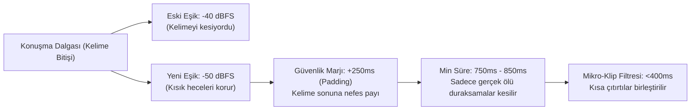

# 📊 OtoEdit — Güncel Durum, Konsol ve Kesim Analiz Raporu

> **Tarih:** 13 Ekim 2026  
> **Konum:** `docs/guncel_durum_ve_kalan_sorunlar_raporu.md`  
> **Kaynak Veriler:** Kullanıcı ekran görüntüleri (Timeline & Waveform), Docker Worker konsol logları, PostgreSQL/RabbitMQ servis çıktıları  
> **İlgili Dosyalar:**  
> - [`src/OtoEdit.PythonWorker/pipeline/silence_detector.py`](file:///d:/OtoEdit/OtoEdit/src/OtoEdit.PythonWorker/pipeline/silence_detector.py)  
> - [`src/OtoEdit.PythonWorker/config.py`](file:///d:/OtoEdit/OtoEdit/src/OtoEdit.PythonWorker/config.py)  
> - [`src/OtoEdit.PythonWorker/pipeline/retake_detector.py`](file:///d:/OtoEdit/OtoEdit/src/OtoEdit.PythonWorker/pipeline/retake_detector.py)  
> - [`src/OtoEdit.PythonWorker/pipeline/edl_builder.py`](file:///d:/OtoEdit/OtoEdit/src/OtoEdit.PythonWorker/pipeline/edl_builder.py)  
> - [`src/OtoEdit.Frontend/src/app/features/editor/editor.component.ts`](file:///d:/OtoEdit/OtoEdit/src/OtoEdit.Frontend/src/app/features/editor/editor.component.ts)

---

## 1. Yönetici Özeti: Neden Hala Erken Kesiyor?

Kullanıcının paylaştığı ekran görüntüleri ve 13 Ekim 06:35 UTC (09:35 TSİ) tarihli Docker Worker logları incelendiğinde durum açıkça görülmektedir:

**Kritik Tespit:**  
Önceki oturumda konuşulan eşik ve güvenlik payı değerleri **kod dosyalarına henüz işlenmemiştir.**  
Uygulama çalıştırıldığında sistem, aşağıdaki konsol çıktısında görüldüğü üzere **eski agresif değerlerle** çalışmıştır:

```text
2026-10-13 06:35:45 [INFO] [pipeline.silence_detector:21]: Sessizlik algılama başlıyor: ... (eşik=-40dBFS, min=500ms)
2026-10-13 06:37:25 [INFO] [pipeline.silence_detector:75]: Sessizlik algılama tamamlandı: 557 sessiz kesim bölgesi bulundu.
2026-10-13 06:39:38 [INFO] [pipeline.edl_builder:130]: EDL dokümanı başarıyla inşa edildi: 544 kesim, 0 overlay, 8 öneri.
```

Bu nedenle sistem 52 dakikalık video içerisinde tam **557 sessizlik kesimi** ve **38 retake kesimi** üretmiş, toplamda **544 ayrı kesim bölgesine** bölünmüştür.

---

## 2. Paylaşılan Ekran Görüntülerinin Detaylı Analizi

### A. Görsel 1: Dalga Formu (Waveform) ve Kesim Sınırları Analizi (Zoom Görünümü)

1. **Konuşma Bitişinde Erken Kesim (Trailing Edge Cut):**
   - Dalga formunda (turkuaz/sarı eğri) konuşmacının sesi tepe noktadan aşağı inerken, ses henüz tabana (ölü sessizliğe) ulaşmadan kırmızı `SESSİZLİK` kutusu başlamaktadır.
   - İnsan sesi `-20 dBFS`'ten düşerken `-35 dBFS` ile `-45 dBFS` arasında kelimenin son hecesi ve fısıltısı devam eder. Eşik `-40 dBFS` ve güvenlik marjı sadece `100ms` olduğu için kelime biterken son heceler tıraşlanmaktadır.
2. **Konuşma Başlangıcında Erken Kesim (Rising Edge Cut):**
   - Konuşmacı nefes alıp kelimeye ("p", "t", "k", "s", "f" gibi yumuşak veya patlamalı ünsüzlerle) başlarken ilk 100-200ms ses seviyesi `-45 dBFS` civarında kalır. Algoritma bu kısmı sessizlik saydığı için kırmızı kesim kutusu yeni kelimenin ilk sesini yutmaktadır.
3. **Mikro-Klip (Testere Dişi) Parçalanması:**
   - Görsel 1'in ortasında **`0.1s`**, **`0.1s`**, **`0.1s`**, **`0.3s`** ve **`1.1s`** uzunluğunda mikroskobik klip adacıkları ve aralarında ince kırmızı kesim şeritleri oluşmuştur.
   - Konuşmacı normal bir cümle söylerken heceler arasındaki 100-200 milisaniyelik mikro boşluklar bile kesilerek video parça pinçik edilmiştir.

### B. Görsel 2: Genel Editör Arayüzü ve Timeline Durumu

1. **Zaman Çizelgesi Durumu:**
   - Toplam Süre: **52:23** | Net Süre: **49:04**.
   - Toplamda yaklaşık 3 dakika 19 saniyelik konuşma dışı alan budanmıştır. Ancak bu budama 544 parçaya bölündüğü için ortalama her kesim sadece **0.36 saniyedir**!
2. **Retake Durumu:**
   - Ekranda **"35 Retake'i Geri Al"** butonu aktiftir. Retake motoru logda 38 hatalı tekrar bildiriyor. Aradaki 3'lük farkın sebebi (ör. sessizlik kesimleriyle birleşme) **tahmindir, doğrulanmadı**.
3. **Katmanlar:**
   - `Altyazı` katmanı Whisper transkriptiyle dolu ve çalışmaktadır.
   - `Katman #1`, `Katman #2`, `Katman #3` boştur.
   - `Ana Video (V1)` kanalında dalga formu CapCut tarzında başarıyla render edilmektedir.

---

## 3. Konsol ve Sistem Loglarının Teşhisi

Worker logları (`otoedit-dev-worker`) ve sistem servisleri incelendiğinde aşağıdaki uyarı ve hatalar tespit edilmiştir (son iki satır sonradan eklendi; ilk sürümde gözden kaçmıştı):

| Log Kaydı | Kategori | Neden & Etki | Çözüm |
| :--- | :--- | :--- | :--- |
| `[pipeline.silence_detector:21] (eşik=-40dBFS, min=500ms)` | 🔴 **Kritik Algoritma Hatası** | Eşik değeri çok yüksek (-40) ve süre çok kısa (500ms). Kısık sesleri ve doğal duraksamaları kesiyor. | `silence_thresh=-50dBFS`, `min_silence_len=750ms`, `padding_sec=0.25s` uygulanmalı. |
| `[WARNING] [services.pexels_client:47]: Pexels API yanıt kodu 401: Unauthorized` | 🟡 **Dış Servis Hatası** | `.env` dosyasındaki `PEXELS_API_KEY` geçersiz veya boş. Bu yüzden otomatik B-Roll görsel önerileri indirilemiyor. | Geçerli Pexels API anahtarı tanımlanmalı veya anahtar yoksa uyarı sessize alınıp fallback uygulanmalı. |
| `FutureWarning: All support for the google.generativeai package has ended` | 🔵 **Kütüphane Uyarısı** | Eski `google.generativeai` SDK'sı kullanılıyor. Google, `google.genai` paketine geçilmesini öneriyor. | İlerleyen sprintte yeni `google-genai` paketine yükseltilecek. |
| `Warning: You are sending unauthenticated requests to the HF Hub` | 🔵 **Bilgi Uyarısı** | Whisper/HuggingFace modelleri indirilirken `HF_TOKEN` tanımsız. Hız kotası kısıtlanabilir. | Opsiyonel olarak `HF_TOKEN` ortam değişkeni eklenebilir. |
| `OPENAI_API_KEY geçersiz...` → `faster-whisper (model='base')` | 🔴 **Transkript Kalitesi** | Geçerli STT anahtarı yok; sistem Türkçe için zayıf olan `base` modeline düşüyor. Logdaki `'vukufiyete'`, `'referenesi'`, `'huduz'` gibi bozuk kelimeler bunun sonucu. | Groq Whisper + `large-v3-turbo` yedek + Gemini düzeltici. Bkz. [yol haritası](file:///d:/OtoEdit/OtoEdit/docs/yol_haritasi_ve_transkript_yenileme_plani.md) Faz 2. |
| `VAD filter removed 28:17.943 of audio` | 🔴 **Transkript Eksikliği (doğrulanacak)** | 52 dk'lık sesin 28 dk'sı Whisper VAD'ı tarafından atılmış; sessizlik dedektörü ise yalnızca ~3 dk sessizlik buluyor. 52 dk'da sadece 1898 kelime çıkmış. Konuşma olan kısımlar transkriptten düşüyor olabilir. | VAD parametrelerini gevşetmek (`threshold`, `speech_pad_ms`). Bkz. yol haritası Faz 2a. |

---

## 4. Kesim Hatalarının 4 Aşamalı Kalıcı Matematiksel Çözümü

A4 numaralı hatayı ("OtoCut erken kesiyor") çözmek için algoritmanın 4 parametresini revize ediyoruz.

> [!NOTE]
> Aşağıdaki değerler tek bir videodaki ölçüme dayanır; "%100 korur" gibi ifadeler henüz kanıtlanmış değildir. Kesin değerler [yol haritası](file:///d:/OtoEdit/OtoEdit/docs/yol_haritasi_ve_transkript_yenileme_plani.md) Faz 0'daki ölçüm scriptiyle belirlenecek. Erken kesime retake kesimlerinin zayıf zaman damgaları ve temizlenmiş ses üzerinde ölçüm yapılması da katkı yapıyor olabilir.



### 1. Eşik Seviyesi (Silence Threshold): `-40 dBFS` ➔ `-50 dBFS`
- `-40 dBFS` ile `-50 dBFS` arasındaki bölge fısıltıların, sessiz harflerin ve oda akustiğinin sönümlendiği alandır.
- `-50 dBFS` seviyesi altı ise tamamen ölü oda sessizliğidir. Eşiği `-50 dBFS` yaparak insan sesinin kesilmesi engellenir.

### 2. Güvenlik Payı (Padding Margin): `0.1s` (100ms) ➔ `0.25s` (250ms)
- Kesim başlangıcı sessizliğin başladığı andan **250ms sonra** devreye girer.
- Kesim bitişi bir sonraki konuşmadan **250ms önce** sona erer.
- Böylece kelime başlangıçları ve bitişleri asla budanmaz.

### 3. Minimum Sessizlik Süresi: `500ms` ➔ `800ms`
- İki kelime veya cümle arasında konuşmacının nefes alması 400-600ms sürer. Bu doğal bir konuşma ritmidir.
- 500ms olan eşik 800ms'ye çıkarılarak 544 adetlik yapay parça sayısı 50-80 adetlik gerçek, doğal duraksama kesimlerine düşürülür.

### 4. Mikro-Parça (Çıtırtı / Island) Engelleyici: `min_keep_duration = 0.35s`
- Eğer iki kesim arasında kalan konuşma parçası 300-350ms'den kısaysa (öksürük, nefes çekme, mikro çıtırtı) veya iki sessizlik arasındaki boşluk 300ms'den azsa, bu parçalar bağımsız klip yapılmayıp birleştirilir. Görsel 1'deki `0.1s`lik minik adacıklar yok edilir.

---

## 5. Projedeki Tüm Maddelerin Güncel Durum Karnesi

[`tum_sorunlar_ve_eksikler.md`](file:///d:/OtoEdit/OtoEdit/docs/tum_sorunlar_ve_eksikler.md) dokümanında listelenen tüm maddelerin 13 Ekim 2026 itibarıyla kesin durumu:

| No | Modül / Madde | Hedef | Güncel Durum | Notlar |
| :---: | :--- | :--- | :---: | :--- |
| **A1** | **Altyazı Zamanlaması** | 1 sn erken gitme sorununun giderilmesi | ✅ **TAMAMLANDI** | Input Seeking ve re-encode ile milisaniye hassasiyetinde senkronlandı. |
| **A2** | **Font Uyumsuzluğu** | Metin kaplamalarının editördeki fontla çıkması | ✅ **TAMAMLANDI** | Google Fontları Docker'a yüklendi, 96/72 DPI (4/3) kalibrasyonu yapıldı. |
| **A3** | **Görsel Overlay Yokluğu** | Eklenen logoların render çıktısında görünmesi | ✅ **TAMAMLANDI** | 2-pass FFmpeg filter_complex entegrasyonu tamamlandı. |
| **A4** | **Sessizlik Kesimi (Jump-Cut)** | Konuşma olan yerlerin erken kesilmemesi | ⚠️ **HEMEN UYGULANACAK** | Analizi yapıldı, parametrelerin kodlara yazılması ve worker'ın yeniden başlatılması bekleniyor. |
| **A5** | **Retake Bağlam Tutarlılığı** | AI ile kalan transkriptin mantıksal kontrolü | ⏳ **BEKLEMEDE** | Gemini ile post-processing doğrulaması eklenecek. |
| **A6** | **Aralıklı Katman Silme** | İstenen katmanın seçilerek silinebilmesi | ⏳ **BEKLEMEDE** | Şu an yalnızca en son katman silinebiliyor. |
| **B1** | **Görsel Arkaplan Kaldırma** | PNG/Logo arka planını yapay zeka ile silme | ⏳ **BEKLEMEDE** | `rembg` entegrasyonu planlandı. |
| **B2** | **Renk Ayarları (Color Grading)** | Parlaklık, kontrast, doygunluk ayarı | ⏳ **BEKLEMEDE** | FFmpeg `eq` filtresi ile UI kontrolü eklenecek. |
| **B3** | **Gelişmiş Metin Editörü** | Gölge, border, harf aralığı kontrolleri | ⚠️ **KISMEN YAPILDI** | Renderda derin siyah gölge tamamlandı; UI panel kontrolleri genişletilmeli. |
| **B4** | **Altyazı Özelleştirme** | Font/renk seçimi ve altyazıyı gizleme | ⚠️ **KISMEN YAPILDI** | TikTok sarı parlama ve altyazısız render toggle'ı yapıldı (`c6cbd46`); UI renk paleti beklemede. |
| **B5** | **Ses Mikseri ve Kontrolleri** | Ses seviyesi ayarı, fade in/out, BGM | ⏳ **BEKLEMEDE** | Backend audio enhancer var, manuel UI kontrolleri beklemede. |
| **B6** | **Hız Kontrolü (Speed Ramp)** | Klipleri hızlandırma/yavaşlatma | ⏳ **BEKLEMEDE** | FFmpeg `setpts` / `atempo` altyapısı kurulacak. |
| **B7** | **Katman Kontrolleri** | Mute, hide, lock | ⚠️ **KISMEN YAPILDI** | Altyazı gizleme yapıldı; video/şekil katmanları beklemede. |
| **C1** | **OtoEdit AI Yönetmen** | Tam otomatik b-roll, yazı ve efekt kurgusu | ⏳ **BEKLEMEDE** | Pexels 401 hatası giderildikten sonra AI öneri döngüsü tamamlanacak. |
| **C2** | **AI Transkript Doğrulama** | Montaj sonrası transkript tutarlılık testi | ⏳ **BEKLEMEDE** | Gemini API post-processing zincirine bağlanacak. |

---

## 6. Sıradaki Adım: Ne Yapacağız?

1. **Hemen Uygulama:**
   - [`src/OtoEdit.PythonWorker/config.py`](file:///d:/OtoEdit/OtoEdit/src/OtoEdit.PythonWorker/config.py) ve [`src/OtoEdit.PythonWorker/pipeline/silence_detector.py`](file:///d:/OtoEdit/OtoEdit/src/OtoEdit.PythonWorker/pipeline/silence_detector.py) dosyalarını güncelleyerek:
     - `SILENCE_THRESH_DBFS = -50`
     - `SILENCE_MIN_LEN_MS = 800`
     - `padding_sec = 0.25`
     - Mikro-parça birleştirme eşiğini `300ms` olarak ayarlayacağız.
2. **Worker Servisini Yeniden Başlatma:**
   - Docker volume bağlı olduğu için `docker restart otoedit-dev-worker` komutuyla ayarları anında aktif edeceğiz.
3. **Pexels API Anahtarını Düzeltme:**
   - `.env` dosyasındaki Pexels API anahtarını kontrol edip 401 hatasını gidereceğiz.
