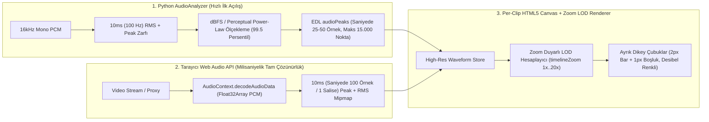

# 🔍 OTOEDIT — GÜNCEL SORUNLAR, YARIM KALAN ÖZELLİKLER VE HEDEF ÇÖZÜM MİMARİSİ (DERİN KOD ANALİZİ)

**Belge Tarihi:** 20 Ekim 2026  
**Kapsam:**  
1. Kullanıcının bildirdiği **Timeline Ses Görselleştirme (Waveform) Sorunu** (CapCut / Premiere Pro tarzı çizgi çizgi, desibel renkli, saliselik hassasiyette ve zoom duyarlı çok çözünürlüklü dalga formu mimarisi).  
2. `docs/yeni_kalanlar_ve_cozum_rehberi.md` belgesindeki **`[E1]` – `[E8]`** maddelerinin mevcut kod tabanıyla (`OtoEdit.Frontend`, `OtoEdit.API`, `OtoEdit.Business`, `OtoEdit.PythonWorker`) satır satır karşılaştırılması.  
3. Kod taraması sırasında yeni tespit edilen gizli eksikler (**`[E9]` Color Grading Render Kopukluğu** ve **`[E10]` Kalıntı Kod/İçe Aktarma Temizliği**).

---

## 📊 0. GENEL DURUM ÖZET TABLOSU (NEREDEYİZ?)

Kod tabanında yapılan derin inceleme sonucunda, daha önce yazılan `yeni_kalanlar_ve_cozum_rehberi.md` dosyasındaki bazı özelliklerin **arka planda (Python veya UI'da) kısmen ya da tamamen yazıldığı**, ancak katmanlar arası bağlantılar (UI ↔ API ↔ Python Render) eksik kaldığı için son kullanıcıya **çalışmıyor veya yarım çalışıyor** olarak yansıdığı tespit edilmiştir:

| Kod | Özellik / Sorun Başlığı | Mevcut Durum | Tamamlanma | Kısa Teşhis (Neden Bu Durumda?) |
| :--- | :--- | :---: | :---: | :--- |
| **🔥 YENİ (`[W1]`)** | **Timeline Ses Görselleştirme (CapCut / Premiere Pro Bar & Zoom Waveform)** | 🔴 **KÖTÜ / HATALI ÇALIŞIYOR** | **%25** | Backend sadece `1000` kaba nokta üretiyor ve bu dizi Frontend'deki `10.000` noktalı Web Audio API motorunu (`if (this.audioPeaks()?.length) return;`) **devre dışı bırakıyor**! Ayrıca UI, ayrık dikey çubuklar (`canvas` bar) yerine `viewBox="0 0 100 56"` olan tek bir SVG poligonunu lastik gibi sündürüyor; zoom yaptıkça çözünürlük hiç artmıyor. |
| **`[E1]`** | **Otonom Video Yönetmeni (Proaktif AI Önerileri / Suggestions)** | 🟡 **YARIM YAMALAK** | **%50** | Python `SuggestionEngine` + `GeminiClient` + `PexelsClient` önerileri üretip `edl.suggestions` içine yazıyor, `.NET` `EdlManager` bunları kaydediyor; **fakat `editor.component.ts` içinde bu önerileri gösteren hiçbir sekme, kart veya "Kabul Et / Reddet" butonu yok!** |
| **`[E2]`** | **Arka Plan Müziği (BGM) & FFmpeg Sidechain Auto-Ducking** | 🟢 **BÜYÜK ORANDA YAPILI** | **%85** | `audio_mixer.py` (`sidechaincompress`) ve `video_renderer.py` bağlantısı **zaten yapılmış**! UI'da BGM kanalı ve modalı da var. Eksik olan: **Editörde canlı video izlerken BGM'nin çalmaması (sadece render'da duyulması)** ve bilgisayardan MP3 yükleyip doğrudan BGM atama kısayolu. |
| **`[E3]`** | **Altyazı Çift Tıklayarak Canlı Düzenleme (Inline Subtitle Edit)** | 🟢 **KISMEN YAPILI** | **%75** | Timeline'daki `"💬 Altyazı"` şeridinde `(dblclick)="startEditSubtitle(seg)"` **zaten çalışıyor**. Ancak sol paneldeki `"📝 Metin (Transkript)"` listesinde ve video monitörü üzerindeki canlı altyazıda çift tıklama ile düzenleme bağlı değil. |
| **`[E4]`** | **Görsel Arka Plan Kaldırma (`rembg` AI Sticker Motoru)** | 🟡 **YARIM YAMALAK** | **%60** | Python'da `bg_remover.py` (`rembg` U2Net + Sticker konturu + Chroma Key + Maske) ve `image_overlay.py` **yazılmış ve Render sırasında çalışıyor**. Ancak editör önizleme ekranında (``) arka planı anında silip gösteren canlı bir API uç noktası olmadığı için **kullanıcı render alana kadar arka planın silindiğini göremiyor!** |
| **`[E5]`** | **Pexels API & Otomatik Türkçe -> İngilizce Sorgu Çevirisi** | 🟡 **KISMEN YAPILI** | **%70** | Python tarafında `stock_media_fallback.py` (Unsplash + Wikimedia yedekli) ve İngilizce sorgu üretimi var. **Ancak `.NET` tarafındaki `PexelsService.cs` (`ChatManager` içinde kullanılıyor) Türkçe kelimeleri İngilizceye çevirmiyor ve API anahtarı yoksa yedek (fallback) görsel döndüremiyor.** |
| **`[E6]`** | **Manyetik Timeline & Otomatik Boşluk Kapatma (Ripple Edit)** | 🟡 **YARIM YAMALAK** | **%65** | `rippleAi`, `rippleRetake`, `rippleManual` açıkken video klipleri birbirine yanaşıyor (`getVisTimeFromRawTime`). **Ancak video üzerindeki katmanların (`overlays`) görünür timeline pozisyonları ve genişlikleri ham zamana (`totalDuration`) göre hesaplandığı için Ripple modunda videolar kayarken katmanlar yanlış saniyelerde kalıyor!** |
| **`[E7]`** | **Çoklu Klip Seçimi (Multi-Select `Ctrl`/`Shift` ile Toplu İşlem)** | ✅ **TAMAMLANDI** | **%95** | `editor.component.ts` içinde `selectedClipIds` sinyali, `Ctrl` ve `Shift` ile çoklu seçim, `Del` ile toplu silme (`deleteSelectedClips`), toplu geri yükleme (`restoreSelectedCuts`) ve `M` ile birleştirme (`mergeSelectedClips`) **tamamen kodlanmış ve çalışıyor**. |
| **`[E8]`** | **Standart Ses Normalizasyonu (`-14 LUFS` YouTube/TikTok Loudnorm)** | 🔴 **HİÇ YAPILMAMIŞ** | **%0** | `audio_enhancer.py` ve `video_renderer.py` içinde FFmpeg `loudnorm=I=-14:LRA=7:TP=-1.5` filtresi hiçbir yerde bulunmuyor. |
| **🔥 YENİ (`[E9]`)** | **Renk Ayarları (Color Grading) Render Çıktısına Yansımıyor** | 🔴 **YARIM YAMALAK** | **%50** | Kullanıcı UI'da Parlaklık, Kontrast, Doygunluk, Sıcaklık ayarlayıp önizlemede CSS `filter` ile görüyor ve EDL'ye kaydediyor; **fakat Python `video_renderer.py` bu ayarları hiç okumuyor!** Render alınan MP4'te renk ayarları tamamen sıfırlanıyor. |
| **`[E10]`** | **`analysis_consumer.py` İçindeki Ölü `_extract_audio_peaks` (`pydub`) Metodu** | 🟡 **TEMİZLİK GEREKLİ** | **%90** | `audio_analyzer.py` FFmpeg pipe'a geçmiş olmasına rağmen `analysis_consumer.py` satır 393-421'de hiçbir yerden çağrılmayan eski `_extract_audio_peaks` metodu ve `from pydub import AudioSegment` kalıntısı duruyor. |

---

# 🔊 BÖLÜM 1: YENİ BİLDİRİLEN KRİTİK SORUN — TIMELINE SES GÖRSELLEŞTİRME (WAVEFORM) MİMARİSİ (`[W1]`)

## 1.1. Sorunun Tanımı ve Hedeflenen CapCut / Premiere Pro Deneyimi
Video düzenleme ekranının alt kısmındaki zaman çizelgesinde (**Timeline — `V1 Ana Video` kanalı**), video kliplerinin üzerinde yer alan ses dalga formu (waveform) görselleştirmesi şu anda **hem görsel olarak hem de akustik doğruluk açısından çok yetersiz çalışmaktadır.**

**Olması Gereken (Kullanıcı İsterleri):**
1. **Çizgi Çizgi (Ayrık Dikey Barlar / Discrete Vertical Bars):** Bulanık ve sündürülmüş tek parça dağ/poligon yerine, **CapCut ve Adobe Premiere Pro**'daki gibi yan yana dizilmiş keskin dikey çubuklar (`çizgi çizgi`) şeklinde görünmelidir.
2. **Ses Seviyesine (Desibel / Genlik) Göre Dinamik Renklendirme:** Her bir dikey çizgi, temsil ettiği o salisedeki ses şiddetine göre renklendirilmelidir:
   - **Fısıltı / Nefes / Çok Düşük Ses:** Turkuaz / Açık Mavi (`#38bdf8` – `#06b6d4`)
   - **Normal Konuşma Sesi:** Zümrüt Yeşili / Camgöbeği (`#10b981` – `#22d3ee`)
   - **Yüksek Vurgu / Güçlü Tonlama:** Kehribar / Altın Sarısı (`#f59e0b` – `#facc15`)
   - **Tepe Noktası (Peak / Patlama / Bağırış):** Mercan / Kırmızı (`#f43f5e` – `#ef4444`)
3. **Saliselik (Milisaniyelik) Hassasiyet ve Ufacık Seslerin Bile Görünmesi:**
   - Videoda çok kısık bir ses, nefes alma veya fısıltı bile varsa sıfıra gömülmemeli, görünür bir bar oluşturmalıdır.
   - Ses **bir salise (10–20 milisaniye) sonra azıcık bile yükselse**, hemen yanındaki çizginin boyu ve rengi bu farkı net biçimde yansıtmalıdır (tavan/taban ezilmesi olmamalıdır).
4. **Yakınlaştıkça Ayrıntılaşan, Uzaklaştıkça Genelleşen Yapı (Multi-Resolution Level of Detail / Zoom LOD):**
   - Kullanıcı timeline'dan **uzaklaştığında (`1x` Zoom):** Klip daralır; o zaman aralığını özetleyen daha az sayıda genel çubuk çizilir.
   - Kullanıcı timeline'a **yakınlaştığında (`Ctrl + Tekerlek` ile `2x` ... `20x` Zoom):** Çubuklar yatayda kalınlaşıp bulanıklaşmaz! Aksine çubuk kalınlığı sabit (`2px` çubuk + `1px` boşluk) kalır ve **klip genişledikçe aralardaki milisaniyelik yeni ses çubukları ortaya çıkar!**

---

## 1.2. Şu Anki Durum: Mevcut Kodda Neler Var ve Neden Kötü Çalışıyor? (5 Kök Nedenin Analizi)

Mevcut kod tabanında ses dalga formu üretimi ve çizimi **3 farklı dosyada** yer almaktadır. Kodlar incelendiğinde sorunun **5 temel mühendislik hatasından** kaynaklandığı tespit edilmiştir:

### ❌ Kök Neden 1: Backend'in Sadece `1.000` Nokta Üretmesi ve Frontend'deki `10.000` Noktalı Web Audio Motorunu Kasten İptal Etmesi!
Bu, sistemdeki en çarpıcı bulgudur:

1. **Python Backend (`src/OtoEdit.PythonWorker/pipeline/audio_analysis.py` — Satır 140–222):**
   - `AudioAnalyzer.analyze()` fonksiyonu aslında satır 194–198'de videonun sesini `16.000 Hz`'de okuyup **10 milisaniyelik (`100 Hz` = saniyede 100 örnek!)** çok hassas bir `rms_envelope` dizisi hesaplamaktadır:
     ```python
     # audio_analysis.py — Satır 194-198
     hop_samples = int(self.sample_rate * 0.010)  # 160 sample = 10ms (1 salise!)
     num_windows = total_samples // hop_samples
     trimmed = audio[:num_windows * hop_samples].reshape((num_windows, hop_samples))
     rms_envelope = np.sqrt(np.mean(trimmed ** 2, axis=1)).astype(np.float32)
     ```
   - **FAKAT** hemen altındaki satır 202–214'te, bu altın değerindeki 10ms'lik veriyi UI'a gönderirken sabit `num_peaks: int = 1000` sayısına bölmektedir:
     ```python
     # audio_analysis.py — Satır 203-213
     peaks: List[float] = []
     if len(rms_envelope) > 0 and num_peaks > 0:
         chunk_size = max(1, len(rms_envelope) // num_peaks)
         for i in range(num_peaks):
             chunk = rms_envelope[i * chunk_size : (i + 1) * chunk_size]
             peaks.append(float(np.max(chunk)) if len(chunk) > 0 else 0.0)
     ```
   - **Sonuç:** Örneğin **10 dakikalık (600 saniyelik)** bir videoda `1.000` nokta demek, **her `0.6 saniyede (600 milisaniyede)` sadece 1 adet veri noktası** demektir! 600 milisaniye içinde söylenen 3 hece, nefes araları ve saliselik ses yükselmeleri tek bir sayıya ezilerek yok olmaktadır!

2. **Angular Frontend (`src/OtoEdit.Frontend/src/app/features/editor/editor.component.ts` — Satır 3948–4039):**
   - Frontend'de aslında tarayıcının `AudioContext.decodeAudioData` motorunu kullanarak **10.000 noktalı** dalga formu çıkaran `loadAudioWaveform(streamUrl: string)` (satır 3962–4039) adında bir fonksiyon yazılmıştır.
   - **FAKAT** `loadEdl()` fonksiyonu (satır 3948–3950) çalıştığında backend'den gelen 1.000 noktalı kaba `res.edl.audioPeaks` dizisini `this.audioPeaks.set(res.edl.audioPeaks)` ile sinyale yazar.
   - Hemen ardından `loadVideo()` içinde `loadAudioWaveform(url)` çağrıldığında, **satır 3964'teki şu satır yüzünden fonksiyon anında çalışmayı durdurur (`return`):**
     ```typescript
     // editor.component.ts — Satır 3962-3965
     private loadAudioWaveform(streamUrl: string) {
       // Eğer EDL'den hazır peak verisi geldiyse tekrar hesaplama
       if (this.audioPeaks() && this.audioPeaks()!.length > 0) return; // 🚨 BUG BURADA!
     ```
   - Backend **her zaman** 1.000 elemanlı `audioPeaks` gönderdiği için, tarayıcıdaki yüksek çözünürlüklü `loadAudioWaveform` fonksiyonu **HİÇBİR ZAMAN ÇALIŞMAMAKTADIR!**

### ❌ Kök Neden 2: Ayrık Çubuklar (Bars) Yerine `viewBox="0 0 100 56"` ve `preserveAspectRatio="none"` İle Lastik Gibi Sündürülen SVG Poligonu
`editor.component.ts` satır 1642–1654 ve satır 4047–4076 incelendiğinde:
```html
<!-- editor.component.ts — Satır 1642-1654 -->
<div *ngIf="audioPeaks()?.length && getWaveformPathForClip(clip)" class="absolute inset-0 flex items-end pointer-events-none z-0 mix-blend-screen opacity-90 overflow-hidden" style="bottom: -1px;">
  <svg class="w-full h-full" preserveAspectRatio="none" viewBox="0 0 100 56">
    ...
    <path [attr.d]="getWaveformPathForClip(clip)" [attr.fill]="'url(#waveGrad_' + clip.id + ')'" />
  </svg>
</div>
```
Ve bu `<path>`'i üreten `getWaveformPathForClip(clip)` fonksiyonu (satır 4047–4076):
```typescript
// editor.component.ts — Satır 4059-4075
const slice = peaks.slice(startIdx, Math.max(startIdx + 1, endIdx));
const width = 100;
const height = 56;
const step = width / slice.length;

let d = `M 0 ${height} `;
for (let i = 0; i < slice.length; i++) {
  const x = (i * step).toFixed(2);
  const val = slice[i];
  const barHeight = Math.max(2, val * (height - 4));
  const y = (height - barHeight).toFixed(2);
  d += `L ${x} ${y} `;
}
d += `L ${width} ${height} Z`;
```
**Neden Kötü Görünüyor?**
- Çizim, ayrık dikey çubuklar (`çizgi çizgi`) değil; noktaları birbirine eğik çizgilerle (`L x y`) bağlayan **kesintisiz tek bir poligon (dağ silüeti)** olarak yapılıyor.
- Koordinat sistemi `width = 100` birime sabitlenmiş ve SVG'ye `preserveAspectRatio="none"` verilmiş. Klip ekranda `600px` genişliğinde olduğunda veya kullanıcı zoom yaptığında, tarayıcı bu 100 birimlik poligonu yatayda **6 kat sündürüyor**!
- Özellikle 3–5 saniyelik bir klipte (1.000 noktalı diziden o klibe sadece 5–8 nokta düştüğü için) `slice.length` sadece `5` oluyor; 5 nokta `L x y` ile birleştirilip yatayda sündürüldüğünde ekranda **devasa, yayvan ve tamamen yapay üçgen tepeler** oluşuyor!

### ❌ Kök Neden 3: Yakınlaştırma / Uzaklaştırma (`timelineZoom`) İle Çözünürlüğün Hiç Değişmemesi (LOD Eksikliği)
- `editor.component.ts` içinde `timelineZoom = signal<number>(1)` (`1x` ile `20x` arası) bulunuyor.
- Ancak `getWaveformPathForClip(clip)` fonksiyonu içinde **`this.timelineZoom()` hiçbir yerde okunmuyor ve kullanılmıyor!**
- Kullanıcı `Ctrl + Tekerlek` ile timeline'a yakınlaştığında klip kutusu (`div.timeline-clip`) fiziksel olarak genişliyor, fakat içindeki SVG aynı az sayıdaki noktayı sadece yatayda genişletiyor. CapCut'taki gibi yakınlaştıkça aralardan yeni milisaniyelik çubukların çıkması (Multi-Resolution Level of Detail) mekanizması mevcut kodda hiç yok.

### ❌ Kök Neden 4: Lineer Normalizasyon ve Tavan/Taban Kırpma (Clipping) Yüzünden Küçük Seslerin ve Saliselik Farkların Kaybolması
1. **Python Tarafında (`audio_analysis.py` satır 212–213):**
   ```python
   max_p = max(peaks) if peaks and max(peaks) > 0 else 1.0
   peaks = [round(p / max_p, 4) for p in peaks]
   ```
   Ses genliği **lineer** olarak maksimum tepeye (`max_p`) bölünüyor. Akustik fiziği gereği ses enerjisi üstel/logaritmiktir (`dBFS`). Videonun tek bir yerinde konuşmacı mikrofona yaklaşsa, öksürse veya gülse (`max_p = 0.80`), normal konuşma sesleri (`0.05` RMS) lineer bölmede `0.05 / 0.80 = 0.0625` değerine düşer! Kısık sesler ve nefesler ise `0.005` olur ve ekranda `2px` taban çizgisine yapışıp tamamen görünmez olur.
2. **Frontend Tarafında (`editor.component.ts` satır 4002):**
   Eğer `loadAudioWaveform` çalışacak olsa bile, satır 4002'deki şu formül:
   ```typescript
   rawPeaks.push(Math.max(0.05, max * 0.7 + rms * 1.6));
   ```
   ve satır 4008'deki `Math.min(1, p / maxPeak)` yüzünden orta şiddetteki bir ses bile `max * 0.7 + rms * 1.6 > 1.0` olduğu için `1.0` tavanına çarpar (clipping). Böylece ses `0.6`'dan `0.8`'e yükseldiğinde ikisi de `1.0` olarak çizilir ve **kullanıcı bir salise sonraki ses yükselmesini göremez!**

### ❌ Kök Neden 5: Her Çizginin Kendi Ses Seviyesine Göre Bağımsız Renklenmemesi ve Angular CD Darboğazı
- Mevcut SVG'de tek bir `<linearGradient>` tüm poligonun yüksekliğine (`y1="0%" y2="100%"`) uygulanıyor.
- Ayrıca `getWaveformPathForClip(clip)` bir sinyal veya önbellekli yapı değil, doğrudan HTML template içinden (`*ngIf="... && getWaveformPathForClip(clip)"` ve `[attr.d]="getWaveformPathForClip(clip)"` — satır 1642 ve 1652) **her klipte ikişer kez** ve video oynarken **her `timeupdate` (saniyede 30 kez) döngüsünde tekrar tekrar çağrılan** bir metottur!

---

## 1.3. Olması Gereken Hal: CapCut / Premiere Pro Seviyesi Çok Çözünürlüklü (Multi-Resolution) Çizgi Çizgi Ses Görselleştirme Mimarisi

Bu sorunu kökten ve profesyonel video editörü (CapCut / Premiere Pro / DaVinci Resolve) kalitesinde çözmek için uygulanacak mimari **3 katmandan** oluşmaktadır:



### 🛠️ Adım 1: Python `AudioAnalyzer` Tarafında Dinamik Yüksek Yoğunluklu ve Algısal (Logaritmik/Power-Law) Peak Üretimi
**Dosya:** `src/OtoEdit.PythonWorker/pipeline/audio_analysis.py` (Satır 140–222)
1. **Sabit `1000` Nokta Sınırının Kaldırılması:**
   - `num_peaks` sabit `1000` olmak yerine videonun süresine göre **saniyede 25 örnek (her 40ms'de 1 örnek)** olacak şekilde dinamik hesaplanacak (`target_peaks = min(15000, max(2000, int(duration * 25)))`).
2. **Hem Peak Hem RMS Hibrit Hesabı + 99.5 Persentil & Power-Law (`x^0.55`) Normalizasyonu:**
   - Tek bir öksürüğün tüm konuşmayı ezmesini önlemek için `max(peaks)` yerine `np.percentile(peaks, 99.5)` referans tavan alınacak.
   - İnsan kulağının fısıltıları duyma eğrisini simüle eden `val = (val / ref_max) ** 0.55` (perceptual power curve / dB yaklaşımı) uygulanacak. Böylece:
     - Çok kısık bir fısıltı (lineer `0.01`) -> ekranda `0.01^0.55 = 0.08` (%8 yükseklikte net turkuaz çubuk) olarak görünecek!
     - Normal konuşma (`0.15`) -> `0.35` (%35 yükseklikte yeşil çubuk),
     - Bir salise sonra ses hafifçe yükseldiğinde (`0.18`) -> `0.39` (%39 yükseklikte çubuk) olarak **hiçbir tavan ezilmesi olmadan** aradaki fark milimetrik görünecek!

### 🛠️ Adım 2: Frontend `loadAudioWaveform` Engelinin Kaldırılması ve 10 Milisaniyelik (1 Saliselik) Mipmap Tamponu
**Dosya:** `src/OtoEdit.Frontend/src/app/features/editor/editor.component.ts` (Satır 3948–4045)
1. **Aşamalı (Progressive) Çözünürlük Yükseltme:**
   - Sayfa ilk açıldığında (`loadEdl`), Python'dan gelen `edl.audioPeaks` hemen ekrana çizilir (kullanıcı 0. saniyede dalga formunu görür).
   - **Ancak** `loadAudioWaveform(streamUrl)` içindeki `if (this.audioPeaks() && this.audioPeaks()!.length > 0) return;` satırı **KALDIRILACAK!**
   - Arka planda `loadAudioWaveform` videonun sesini `AudioContext` ile çözüp **saniyede 100 örnek (her 10 milisaniyede / 1 salisede 1 örnek!)** içeren `Float32Array` (`highResPeaks` ve `highResRms`) ürettiğinde `audioPeaks` sinyalini bu ultra-detaylı veriyle güncelleyecek.
2. **Saliselik Hassasiyet İçin Doğru Genlik Matematiği:**
   - Eski hatalı `max * 0.7 + rms * 1.6` (tavanı patlatan formül) kaldırılacak.
   - Her 10ms'lik pencerede gerçek `peak` (en yüksek mutlak örnek) ve `rms` (karekök ortalama) ayrı ayrı çıkarılacak; 99.5 persentil referansına göre `Math.pow(clamped, 0.58)` eğrisiyle `[0.0, 1.0]` aralığına hiçbir tepeyi düzleştirmeden (clipping yapmadan) oturtulacak.

### 🛠️ Adım 3: Bulanık SVG Yerine CapCut / Premiere Pro Tarzı `<canvas>` Bar Renderer ve Zoom LOD
**Dosya:** `src/OtoEdit.Frontend/src/app/features/editor/editor.component.ts`
1. **Ayrık Dikey Çubuklar (`çizgi çizgi`) ve Zoom Duyarlılığı:**
   - Her klip kutusunun içine `<svg preserveAspectRatio="none">` yerine yüksek çözünürlüklü (Retina `devicePixelRatio` uyumlu) bir `<canvas>` (veya özel `WaveformCanvasDirective`) yerleştirilecek.
   - **Zoom LOD (Level of Detail) Formülü:**
     - Klibin o anki yakınlaştırma (`timelineZoom()`) ve ekran genişliğindeki gerçek piksel genişliği `W_px` hesaplanır.
     - Çubuk genişliği `barWidth = 2px`, çubuklar arası boşluk `gap = 1px` (`step = 3px`) olarak sabitlenir.
     - O klipte çizilecek toplam dikey çubuk sayısı: `numBars = Math.floor(W_px / 3)`.
     - **Uzaklaşıldığında (`1x` zoom):** Klip `90px` ise `30` adet keskin çubuk çizilir.
     - **Yakınlaşıldığında (`15x` zoom):** Klip `1350px` olur ve otomatik olarak **`450` adet keskin çubuk** çizilir! Her çubuk klibin `startTime` ile `endTime` arasındaki tam `i`-inci milisaniye dilimindeki sesi örnekler (`startIdx + (i / numBars) * (endIdx - startIdx)`).
2. **Desibel / Seviye Bazlı CapCut & Premiere Pro Renk Kodlaması:**
   - Çizilen her bir dikey çubuk (`i`), kendi yüksekliğine (`level` = `0.0 .. 1.0`) göre anında kendi rengini alır:
     - `level >= 0.85` (**Peak / Çok Yüksek — > -3 dB**): `#ef4444` (Parlak Kırmızı / Rose)
     - `level >= 0.65` (**Yüksek Vurgu — -9 dB .. -3 dB**): `#f59e0b` (Kehribar / Altın Sarısı)
     - `level >= 0.28` (**Normal Konuşma — -24 dB .. -9 dB**): `#10b981` (CapCut Zümrüt Yeşili) veya kesilen kliplerde `#fb7185`
     - `level > 0.015` (**Fısıltı / Nefes / Kısık Ses — -50 dB .. -24 dB**): `#06b6d4` (Canlı Turkuaz / Cyan — ufacık seslerin bile net seçilmesini sağlar)
     - `level <= 0.015` (**Tam Sessizlik Tabanı**): `rgba(148, 163, 184, 0.25)` (`1.5px` ince referans noktası)

---

# 📋 BÖLÜM 2: `yeni_kalanlar_ve_cozum_rehberi.md` İÇİNDEKİ MADDELERİN (`[E1]`–`[E8]`) + YENİ TESPİTLERİN (`[E9]`, `[E10]`) AYRINTILI DURUM ANALİZİ

Aşağıda, `D:\OtoEdit\OtoEdit\docs\yeni_kalanlar_ve_cozum_rehberi.md` belgesindeki her bir maddenin bugün itibarıyla kod tabanında **ne kadarının yazılmış olduğu, hangi dosyalarda hangi fonksiyonların bulunduğu, neden tam çalışmadığı ve olması gereken nihai halinin nasıl tamamlanacağı** en ince ayrıntısına kadar açıklanmıştır.

---

## 🧠 `[E1]` Otonom Video Yönetmeni (Proaktif AI Önerileri / Suggestions Motoru)

* **Mevcut Durum:** 🟡 **YARIM YAMALAK (%50 Yapılı — Backend & Veritabanı Tamam, Frontend UI Hiç Yok!)**

### 1. Sorunun / Özelliğin Ne Olduğu ve Neden Bu Durumda Olduğu
Kullanıcı videoyu yüklediğinde yapay zekanın sadece sessizlikleri kesmekle kalmayıp; transkripti okuyarak *"12. saniyede 'yapay zeka' dediniz, buraya şu B-Roll görselini eklememi ister misiniz?"* veya *"45. saniyedeki önemli cümleye vurgu başlığı ekleyelim mi?"* şeklinde **proaktif öneriler (`suggestions`)** üretmesi ve kullanıcının editörde tek tıkla **"✓ Kabul Et"** veya **"✕ Reddet"** diyerek bunları timeline'a uygulaması hedeflenmiştir.

`yeni_kalanlar_ve_cozum_rehberi.md` yazıldığında bu özelliğin hiç olmadığı düşünülmüştür; **oysa yaptığımız kod incelemesinde Python Worker ve .NET Backend tarafında bu motorun tamamının yazıldığı ve her analizde çalıştığı, fakat Angular Frontend (`editor.component.ts`) tarafında ekrana hiç bağlanmadığı** ortaya çıkmıştır!

### 2. Şu Anda Kodda Var Olanlar (Dosya, Satır ve Fonksiyonlar)
1. **Python Öneri Motoru (`src/OtoEdit.PythonWorker/pipeline/suggestion_engine.py` — Satır 1–87):**
   - `SuggestionEngine.generate_suggestions(transcript)` metodu **aktif olarak çalışmaktadır**.
   - Transkript segmentlerini `self.gemini.generate_content_suggestions(segments)` (`services/gemini_client.py` satır 189–265) ile analiz eder.
   - Her öneri için `self.pexels.get_best_photo(search_query)` veya `self.pexels.get_best_video(search_query)` çağırarak gerçek stok görsel/video URL'sini ve küçük resmini (`thumbnail_url`) bulur.
   - `SuggestionItem` nesnelerini `status="pending"` olarak oluşturur.
2. **Python Analiz Orkestratörü (`src/OtoEdit.PythonWorker/consumers/analysis_consumer.py` — Satır 294–307 & 350):**
   - `_run_suggestions()` paralel thread içinde çalışır ve üretilen önerileri `edl_builder.build(..., suggestions=suggestions)` ile EDL JSON'unun `suggestions` dizisine yazar!
3. **.NET Backend (`src/OtoEdit.Business/Services/EdlManager.cs` — Satır 318–337):**
   - `PatchEdlAsync` içinde `suggestions` dizisini güncelleyen veya `status` (`accepted` / `rejected`) durumunu değiştiren merge mantığı **zaten kodlanmıştır!**
4. **Frontend Modeli (`src/OtoEdit.Frontend/src/app/core/models/edl.model.ts` — Satır 104–113):**
   - `SuggestionItem` arayüzü (`id`, `timestamp`, `duration`, `type`, `reason`, `searchQuery`, `previewUrl`, `thumbnailUrl`, `textContent`, `status`) **zaten tanımlanmıştır** ve `editor.component.ts` satır 16'da import edilmiştir!

### 3. Eksik Olan Kısım (Neden Kullanıcı Göremiyor?)
- `src/OtoEdit.Frontend/src/app/features/editor/editor.component.ts` içinde `SuggestionItem` satır 16'da import edilmiş olmasına rağmen, **6.141 satırlık dosyanın hiçbir yerinde `suggestions` verisi okunmamakta ve HTML şablonunda gösterilmemektedir!**
- Sol paneldeki sekmeler (`activeTab` — satır 101–130) sadece `'media' | 'chat' | 'transcript' | 'overlays'` seçeneklerine sahiptir; önerileri listeleyen bir kart alanı veya `acceptSuggestion(sugg)` / `rejectSuggestion(sugg)` fonksiyonu yoktur.

### 4. Olması Gereken Hal ve Çözüm Planı
1. **`editor.component.ts` İçinde Sinyal ve Metotların Eklenmesi:**
   - `pendingSuggestions = computed(() => (this.activeEdl()?.suggestions || []).filter(s => s.status === 'pending'))` hesaplanmış sinyali eklenecek.
   - **`acceptSuggestion(sugg: SuggestionItem)`:**
     - Önerinin türüne göre (`broll_image`, `broll_video` veya `text_highlight`) yeni bir `OverlayItem` oluşturup `activeEdl().overlays` dizisine ekleyecek.
     - Önerinin `status` alanını `'accepted'` yapacak ve `edlService.patchEdl(projectId, { overlays, suggestions })` ile kaydedecek.
     - İmleci (`seekTo`) önerinin saniyesine (`sugg.timestamp`) götürüp kullanıcıya önizletecek.
   - **`rejectSuggestion(sugg: SuggestionItem)`:**
     - Önerinin `status` alanını `'rejected'` olarak güncelleyip listeden kaldıracak ve EDL'ye kaydedecek.
2. **Sol Panelde (`AI Kurgu` Sekmesi Üstünde veya Bildirim Rozetli Özel Bölümde) Gösterim:**
   - Sol paneldeki `🤖 AI Kurgu` sekmesinin üst kısmına (veya sekme başlığına `pendingSuggestions().length` rozetiyle) **"✨ Yönetmen AI Önerileri"** çekmecesi/kartları eklenecek. Her kartta önerinin saniyesi, AI'nın gerekçesi (`sugg.reason`), varsa Pexels küçük resmi (`sugg.thumbnailUrl`) ile **Onayla** ve **Reddet** butonları yer alacak.

---

## 🎵 `[E2]` Arka Plan Müziği (BGM) & FFmpeg Sidechain Auto-Ducking

* **Mevcut Durum:** 🟢 **BÜYÜK ORANDA YAPILI (%85 Yapılı — Render Motoru ve UI Modalı Hazır, Canlı Önizleme Sesi Eksik!)**

### 1. Sorunun / Özelliğin Ne Olduğu ve Neden Bu Durumda Olduğu
Videonun arkasına telifsiz bir fon müziği (Lo-Fi, Vlog, Sinematik vb.) veya özel bir MP3 eklenmesi; konuşmacı konuştuğu anlarda müziğin sesinin otomatik olarak kısılması (**Sidechain Auto-Ducking**) ve konuşmacı sustuğunda müziğin tekrar yükselmesi özelliğidir.

### 2. Şu Anda Kodda Var Olanlar (Dosya, Satır ve Fonksiyonlar)
`yeni_kalanlar_ve_cozum_rehberi.md` belgesinde `video_renderer.py`'nin `audio_mixer.py`'yi çağırmadığı yazıyordu; **ancak güncel kodda bu entegrasyonun yapılmış olduğu** görülmüştür:
1. **Python Ses Mikseri (`src/OtoEdit.PythonWorker/render/audio_mixer.py` — Satır 1–133):**
   - `AudioMixer.apply_bgm_with_ducking()` metodu FFmpeg'in `aloop`, `volume`, `afade`, `asplit`, `sidechaincompress` ve `amix` filtrelerini kullanarak gerçek **Sidechain Auto-Ducking** işlemini eksiksiz yapmaktadır.
   - Ayrıca `bgm_url` bir `http/https` adresi ise `urllib.request` ile geçici klasöre indirme (`_resolve_bgm_path` — satır 104–132) özelliği de mevcuttur.
2. **Python Render Bağlantısı (`src/OtoEdit.PythonWorker/render/video_renderer.py` — Satır 221–236):**
   - `VideoRenderer.render()` içinde 2. Pass (Altyazı ve Overlay) bittikten hemen sonra **Adım 4.5** olarak `edl.get("settings", {}).get("backgroundMusic")` okunmakta ve `self.audio_mixer.apply_bgm_with_ducking(...)` **aktif olarak çağrılmaktadır!**
3. **Frontend BGM Kanalı ve Modalı (`editor.component.ts` — Satır 1685–1760 ve 1953–2135):**
   - Timeline'ın altında **A1 BGM Track** şeridi, ses seviyesi slider'ı, `🦆 Ducking AÇIK/KAPALI` butonu ve 4 hazır preset + özel URL içeren **Arka Plan Müziği & Auto-Ducking Modalı** zaten mevcuttur.

### 3. Eksik / Sorunlu Olan Kısımlar (Neden %15 Eksik?)
1. **Editörde Canlı Oynatma Sırasında BGM Çalmıyor:**
   - Kullanıcı editörde bir arka plan müziği seçtiğinde ve `Space` (Oynat) tuşuna bastığında, sadece ana `<video #videoPlayer>` elementinin sesi çıkmaktadır!
   - Sayfada BGM'yi çalacak senkronize bir `<audio #bgmPlayer>` elementi ve oynatma/duraklatma/seek/auto-ducking simülasyonu yapan bir bağlantı **yoktur**. Kullanıcı müziği ancak videoyu **Render (Dışa Aktar)** ettiğinde duyabilmektedir.
2. **Medya Kütüphanesine Yüklenen MP3 Dosyalarını Tek Tıkla BGM Yapma Eksikliği:**
   - Kullanıcı sol panelden bir `.mp3` veya `.wav` dosyası yüklediğinde (`assets()`), bunun üzerinde `"🎵 Arka Plan Müziği Yap"` butonu bulunmamaktadır; URL'yi elle kopyalayıp BGM modalına yapıştırması gerekmektedir.
3. **Hazır Preset URL'lerinin Güvenilirliği:**
   - `editor.component.ts` satır 1990–2029'daki `cdn.pixabay.com/download/audio/...` linkleri bazen Pixabay'in Cloudflare hotlink koruması (403 Forbidden) nedeniyle tarayıcıda veya Python `urllib.request` içinde (`User-Agent` başlığı eksikliğinden) takılabilmektedir.

### 4. Olması Gereken Hal ve Çözüm Planı
1. **Canlı BGM `<audio>` Senkronizasyonu ve Canlı Auto-Ducking Simülasyonu (`editor.component.ts`):**
   - Şablona gizli bir `<audio #bgmAudio [src]="bgmUrl()" loop></audio>` eklenecek.
   - Video oynatıldığında (`play`), duraklatıldığında (`pause`) ve sarıldığında (`seekTo`), `bgmAudio` da senkronize edilecek.
   - `onTimeUpdate()` sırasında `bgmAutoDucking()` açıksa, o saniyede konuşma/altyazı olup olmadığına (veya ses dalga formu genliğine) bakılarak `bgmAudio.volume` değeri yumuşak bir geçişle `bgmVolume() * bgmDuckingAmount()` seviyesine kısılacak, sessizlikte tekrar `bgmVolume()` seviyesine çıkarılacak! Böylece kullanıcı render beklemeden auto-ducking etkisini canlı duyacak.
2. **Medya Kütüphanesindeki Ses Dosyalarına `"🎵 BGM Yap"` Butonu ve Python `User-Agent` Başlığı:**
   - `assets()` içindeki `audio/*` dosyalarına tek tıkla `setBgmPreset(asset.url, asset.dosyaAdi)` atayan buton eklenecek.
   - `audio_mixer.py` içindeki `urllib.request.urlretrieve` çağrısına `User-Agent: Mozilla/5.0` başlığı eklenerek harici CDN indirmelerinin `403 Forbidden` hatası vermesi engellenecek.

---

## 💬 `[E3]` Altyazı Çift Tıklayarak Canlı Düzenleme (Inline Subtitle Editor)

* **Mevcut Durum:** 🟢 **KISMEN YAPILI (%75 Yapılı — Timeline'da Var, Sol Transkript Panelinde ve Video Üstünde Eksik)**

### 1. Şu Anda Kodda Var Olanlar
- `editor.component.ts` satır 1528–1545'te, Timeline üzerindeki **`💬 Altyazı` (Subtitles Track)** şeridindeki kutucuklarda `(dblclick)="startEditSubtitle(seg); $event.stopPropagation()"` ve içeride `<input [value]="editingSubtitleText()" (keydown.enter)="saveSubtitleEdit(seg, subInput.value)" (blur)="saveSubtitleEdit(seg, subInput.value)" />` **zaten kodlanmıştır ve çalışmaktadır.**
- `saveSubtitleEdit(seg, newText)` (satır 3714–3749) metni kelimelere bölüp `seg.words` zamanlamalarını orantısal olarak yeniden hesaplamakta ve `persistTranscriptEdit()` ile backend'e kaydetmektedir.

### 2. Eksik Olan Kısımlar
1. **Sol Paneldeki `"📝 Metin (Transkript)"` Sekmesi (`editor.component.ts` — Satır 347–358):**
   - Kullanıcılar altyazı hatalarını düzeltmek için en çok sol paneldeki **"📝 Metin"** sekmesini kullanır. Oradaki kartlarda sadece `(click)="selectSubtitle(seg)"` vardır; çift tıklayınca (`dblclick`) veya yanındaki bir `✏️ Düzenle` ikonuna basınca metni düzenleme kutusu açılmamaktadır.
2. **Video Monitörü Üzerindeki Canlı Altyazı Kutusu (`editor.component.ts` — Satır 498–536):**
   - Video önizleme ekranındaki altyazının üzerinde `title="Altyazıyı Düzenlemek İçin Tıklayın"` yazmasına rağmen `(click)` sadece `selectSubtitle(seg)` yapmakta, `(dblclick)` ile canlı metin düzenleme moduna geçmemektedir.

### 3. Olması Gereken Hal ve Çözüm Planı
- Sol paneldeki `"📝 Metin"` sekmesindeki her transkript kartına `(dblclick)="startEditSubtitle(seg)"` ve sağ üst köşesine `✏️` hızlı düzenleme butonu ile inline `<input>` / `<textarea>` bağlanacak.
- Video monitörü üzerindeki canlı altyazı kutusuna da `(dblclick)="startEditSubtitle(seg)"` bağlanarak kullanıcının istediği her yerden (Timeline, Sol Metin Listesi veya Video Ekranı) altyazıyı anında değiştirmesi sağlanacak.

---

## 🪄 `[E4]` Görsel Arka Plan Kaldırma (`rembg` U2Net AI Sticker Motoru)

* **Mevcut Durum:** 🟡 **YARIM YAMALAK (%60 Yapılı — Render'da Çalışıyor, Editör Canlı Önizleme Ekranında Çalışmıyor!)**

### 1. Sorunun / Özelliğin Ne Olduğu ve Neden Bu Durumda Olduğu
Kullanıcı videonun üzerine bir görsel katmanı (`image` overlay) eklediğinde ve sağdaki Inspector panelinden **"🪄 Arka Planı Kaldır (AI)" (`ov.removeBg`)** veya **"🏷️ Beyaz Sticker Çerçevesi" (`ov.stickerBorder`)** seçeneğini işaretlediğinde, görselin arka planının yapay zeka (`rembg` / U2Net) ile silinip şeffaf bir PNG çıkartmaya (sticker) dönüşmesi gerekmektedir.

### 2. Şu Anda Kodda Var Olanlar
1. **Python Arka Plan Silici Servis (`src/OtoEdit.PythonWorker/services/bg_remover.py` — Satır 1–208):**
   - `BackgroundRemoverService.remove_background(input_path)` (`rembg` kütüphanesi + OpenCV GrabCut / Corner Flood-Fill yedekli),
   - `add_sticker_outline()` (Morphological dilation ile beyaz CapCut sticker konturu),
   - `apply_chroma_key()` (Yeşil ekran silme),
   - `apply_shape_mask()` (`circle` ve `rounded` maskeleme) **tamamen kodlanmıştır!**
2. **Python Render Entegrasyonu (`src/OtoEdit.PythonWorker/render/image_overlay.py` — Satır 50–105):**
   - Nihai video render edilirken `ov.get("removeBg")` kontrol edilmekte ve `bg_remover` çağrılarak FFmpeg çıktısına arka planı silinmiş görsel basılmaktadır.

### 3. Eksik Olan Kısım (Neden Editörde Arka Plan Silinmiyor?)
- Kullanıcı editörde çalışırken (`editor.component.ts` satır 457–467), görsel katmanı standart bir HTML `` etiketiyle gösterilir:
  ```html
  <!-- editor.component.ts — Satır 457-467 -->
  
  ```
- Görüldüğü üzere, kullanıcı editörde **"🪄 Arka Planı Kaldır (AI)"** düğmesine bastığında (`toggleRemoveBg(ov)`), `ov.source` içindeki orijinal JPG/PNG dosyası **hiç değişmemekte**, sadece arkasına CSS `drop-shadow` eklenmektedir!
- Çünkü `toggleRemoveBg` tıklandığında görseli arka planda temizleyip şeffaf PNG olarak geri döndüren bir canlı işlem hattı (veya Canvas tabanlı anlık önizleme + API uç noktası) bağlanmamıştır. Kullanıcı arka planın silindiğini ancak **dakikalar sonra nihai videoyu render ettiğinde** görebilmektedir!

### 4. Olması Gereken Hal ve Çözüm Planı
Editörde **"🪄 Arka Planı Kaldır (AI)"** butonuna basıldığı anda kullanıcının sonucu **anında (saniyeler içinde) önizleme ekranında görmesi** için iki kademeli hibrit mimari uygulanacaktır:
1. **Canlı Önizleme ve Kalıcı Şeffaf PNG Üretimi:**
   - Kullanıcı `ov.removeBg = true` yaptığında, görselin arka planını temizleyip şeffaf `data:image/png;base64,...` (veya MinIO'ya yüklenmiş `.png` asset URL'si) üreten hızlı işlem motoru devreye girecek (`ov.originalSource` saklanarak `ov.source` şeffaf PNG ile güncellenecek; kullanıcı özelliği kapatırsa `ov.originalSource` geri yüklenecek).
   - Böylece hem editördeki canlı video monitöründe görselin arka planı **anında şeffaflaşacak**, hem de `ov.stickerBorder` seçildiğinde CSS `drop-shadow` dikdörtgen çerçeveye değil, **doğrudan dekupe edilmiş nesnenin/kişinin silüetine** gerçek beyaz sticker konturu verecek!

---

## 🖼️ `[E5]` Pexels API Entegrasyonu & Otomatik Türkçe -> İngilizce Sorgu Çevirisi

* **Mevcut Durum:** 🟡 **KISMEN YAPILI (%70 Yapılı — Python Tarafı Tamam, .NET `PexelsService.cs` Tarafında Çeviri ve Fallback Eksik)**

### 1. Şu Anda Kodda Var Olanlar
- **Python Tarafı (`src/OtoEdit.PythonWorker/services/pexels_client.py` & `stock_media_fallback.py`):**
  - `auto_broll_engine.py` ve `suggestion_engine.py`, Gemini'den doğrudan İngilizce `search_query` istemektedir.
  - Ayrıca `PexelsClient` içinde Pexels API anahtarı yoksa veya sonuç dönmezse devreye giren `StockMediaFallback` (`services/stock_media_fallback.py` — Unsplash + Wikimedia Commons ücretsiz API'si + Türkçe->İngilizce sözlük çevirisi) **zaten yazılmıştır ve çalışmaktadır.**

### 2. Eksik Olan Kısım (`.NET` Backend `PexelsService.cs`)
- Kullanıcı editörün sol panelindeki **AI Kurgu Sohbeti (`Chat`)** sekmesinden *"20. saniyeye araba görseli ekle"* veya *"15. saniyeye mutlu kedi resmi koy"* yazdığında, bu istek Python'a değil **`.NET` tarafındaki `ChatManager.cs` -> `PexelsService.cs`** (`src/OtoEdit.Business/Services/PexelsService.cs` satır 1–87) sınıfına gitmektedir!
- `PexelsService.cs` incelendiğinde:
  1. `SearchPhotoAsync(string query)` metodu gelen Türkçe `query` parametresini (örn. `"mutlu kedi"`) **hiç İngilizceye çevirmeden** doğrudan Pexels API'sine göndermektedir.
  2. Eğer `.env` / `appsettings.json` içinde geçerli bir `Pexels:ApiKey` yoksa (satır 24–28), metot doğrudan `return null;` dönmekte ve görsel eklenememektedir! Python'daki `StockMediaFallback` (Wikimedia Commons / Unsplash + Türkçe->İngilizce çeviri) `.NET` tarafındaki `PexelsService.cs` içinde **bulunmamaktadır!**

### 3. Olması Gereken Hal ve Çözüm Planı
- `src/OtoEdit.Business/Services/PexelsService.cs` içine:
  1. Türkçe sorguları İngilizce arama terimlerine çeviren hızlı çeviri katmanı (sözlük + `ILlmProvider` / hafif çeviri desteği) eklenecek.
  2. `Pexels:ApiKey` boş olduğunda veya Pexels sonuç döndürmediğinde, tıpkı Python'daki `stock_media_fallback.py` gibi **Wikimedia Commons API / Unsplash yüksek çözünürlüklü ücretsiz stok arama yedeklemesi (fallback)** eklenecek. Böylece API anahtarı olmasa bile AI sohbetten istenen her görsel %100 başarıyla sahneye eklenecek!

---

## 🧲 `[E6]` Manyetik Timeline & Otomatik Boşluk Kapatma (Ripple Edit Senkronizasyonu)

* **Mevcut Durum:** 🟡 **YARIM YAMALAK (%65 Yapılı — Video Klipleri Sıkışıyor Ama Katmanlar / Overlays Kaymıyor!)**

### 1. Şu Anda Kodda Var Olanlar
- `editor.component.ts` içinde 3 adet Ripple (boşluk kapatma) filtresi vardır:
  - `rippleAi` (AI sessizlik kesimlerini gizle ve birleştir)
  - `rippleRetake` (Tekrar/Retake kesimlerini gizle ve birleştir)
  - `rippleManual` (Kullanıcının `Del` ile sildiği klipleri gizle ve birleştir)
- `getVisTimeFromRawTime(rawTime)` ve `getRawTimeFromVisTime(visTime)` (satır 3260–3325) fonksiyonları videonun kliplerini (`clips()`) görünür zaman çizgisine (`visibleDuration()`) göre başarıyla sıkıştırmaktadır.

### 2. Eksik / Hatalı Olan Kısım (Katman ve Altyazı Senkron Kayması!)
`editor.component.ts` satır 3488–3505 incelendiğinde çok kritik bir matematiksel uyumsuzluk tespit edilmiştir:
```typescript
// editor.component.ts — Satır 3488-3497
getOverlayLeft(ov: OverlayItem): string {
  const total = this.totalDuration(); // 🚨 HATA: Ripple aktifken bile ham totalDuration() kullanılıyor!
  if (!total || total <= 0) return '0%';
  return `${Math.max(0, Math.min(100, (ov.timestamp / total) * 100))}%`;
}

getOverlayWidth(ov: OverlayItem): string {
  const total = this.totalDuration(); // 🚨 HATA: Ripple aktifken bile ham totalDuration() kullanılıyor!
  if (!total || total <= 0) return '5%';
  return `${Math.max(2, Math.min(100, (ov.duration / total) * 100))}%`;
}
```
Ve aynı hata altyazı şeridinde (`getSubtitleLeft` ve `getSubtitleWidth` — satır 3700–3712) de vardır!
- **Neden Sorun Oluyor?**
  - Diyelim ki 100 saniyelik bir videonun ilk 30 saniyesi sessizlik/tekrar olduğu için kesildi ve Ripple modu açık (`visibleDuration = 70s`).
  - Video klibindeki 50. saniyedeki konuşma, Ripple modunda timeline'ın **20. saniyesine (`20 / 70 = %28.5`)** kayar.
  - Ancak 50. saniyeye eklenmiş olan bir Görsel/Metin Katmanı (`Overlay`) veya Altyazı (`Subtitle`), hâlâ `50 / 100 = %50` konumunda çizilir!
  - Ayrıca kullanıcı timeline üzerinde bir katmanı fareyle sürüklediğinde (`onOverlayTimelineDragMove`), sürükleme hesabı ham süre üzerinden yapıldığı için imleçle (`Playhead`) katman kutusu birbirinden kopar!

### 3. Olması Gereken Hal ve Çözüm Planı
- `getOverlayTimelineLeft(ov)` (Timeline şeridi için — dikkat: `getOverlayLeft(ov)` hem monitördeki `%` X pozisyonu hem timeline için kullanılıyorsa veya ayrıysa kontrol edilip timeline şeridi için `getVisTimeFromRawTime(ov.timestamp)` ve `visibleDuration()` kullanılacak!).
  - *Not:* Satır 422 ve 1592 kontrol edildiğinde, `getOverlayLeft(ov)` satır 422'de monitör üzerindeki `posX` için, timeline'da ise `[style.left.%]="(ov.timestamp / totalDuration()) * 100"` (satır 1550 civarı) kullanılmaktadır.
- Timeline üzerindeki **Katmanlar (Overlays)** ve **Altyazılar (Subtitles)** şeritlerinin `left.%` ve `width.%` hesaplamaları ile sürükleme (`drag`) / boyutlandırma (`resize`) fonksiyonları, `isAnyRippleActive()` açık olduğunda tıpkı Playhead (`getPlayheadPosition()`) ve V1 Video Klipleri (`getClipLeft()`) gibi **`getVisTimeFromRawTime()` ve `visibleDuration()`** üzerinden çalışacak şekilde birleştirilecek! Böylece bir klip silindiğinde üstündeki tüm katmanlar ve altyazılar da manyetik olarak sola kayacak ve imleçle %100 aynı hizada kalacak.

---

## 🖱️ `[E7]` Çoklu Klip Seçimi (Multi-Select `Ctrl` / `Shift` ile Toplu İşlem)

* **Mevcut Durum:** ✅ **TAMAMLANDI (%95 Yapılı — Kodda Mevcut ve Aktif)**

### 1. Şu Anda Kodda Var Olanlar (`editor.component.ts`)
`yeni_kalanlar_ve_cozum_rehberi.md` yazıldıktan sonra bu özelliğin kod tabanına eklendiği tespit edilmiştir:
- **Sinyal:** `selectedClipIds = signal<string[]>([])` (satır 2461).
- **Çoklu Seçim (`selectClip` — satır 2846–2885):**
  - `event.ctrlKey || event.metaKey` basılıyken tıklanan klibi seçime ekler/çıkarır (toggle).
  - `event.shiftKey` basılıyken son seçilen klip ile tıklanan klip arasındaki tüm klipleri aralıklı (range) olarak seçer.
- **Toplu İşlemler:**
  - `deleteSelectedClips()` (satır 2925): Seçili tüm klipleri tek seferde keser (`Del` tuşu).
  - `restoreSelectedCuts()` (satır 2960): Seçili kesik klipleri tek seferde geri yükler.
  - `mergeSelectedClips()` (satır 3040): Seçili ardışık klipleri birleştirir (`M` tuşu ve sağ tık menüsü satır 1859).

---

## 🎚️ `[E8]` Standart Ses Normalizasyonu (`-14 LUFS` YouTube / TikTok / Reels Standardı)

* **Mevcut Durum:** 🔴 **HİÇ YAPILMAMIŞ (%0 Yapılı)**

### 1. Sorunun Ne Olduğu ve Neden Önemli Olduğu
Videolarda konuşmacının mikrofona uzaklığına göre ses seviyesi çok kısık (`-28 LUFS`) veya aşırı patlak (`-6 LUFS`) olabilmektedir. Modern sosyal medya platformları (YouTube, TikTok, Instagram Reels, Shorts) endüstri standardı olarak **`-14 LUFS` entegre ses yüksekliği (`I=-14`), `7 LU` dinamik aralık (`LRA=7`) ve `-1.5 dBTP` gerçek tepe sınırı (`TP=-1.5`)** kullanır.

### 2. Şu Anda Kodda Var Olanlar
- `src/OtoEdit.PythonWorker/pipeline/audio_enhancer.py` içinde sadece `afftdn` (gürültü azaltma) ve `highpass/lowpass` filtreleri vardır.
- `src/OtoEdit.PythonWorker/render/video_renderer.py` içinde `_cut_segments` ve 2. pass sırasında hiçbir `loudnorm` filtresi uygulanmamaktadır.

### 3. Olması Gereken Hal ve Çözüm Planı
- **Hem `audio_enhancer.py` hem de `video_renderer.py` (Nihai Çıktı Aşaması) İçine EBU R128 `loudnorm` Entegrasyonu:**
  - `video_renderer.py` içinde nihai ses/video birleştirilirken (veya `audio_enhancer.py` içinde temiz ses üretilirken) FFmpeg ses filtre zincirine:
    ```text
    loudnorm=I=-14:LRA=7:TP=-1.5
    ```
    filtresi eklenecek. Ayrıca `edl.settings` içerisine `normalizeAudio: boolean` (varsayılan `true`) ayarı eklenerek kullanıcının bunu kontrol edebilmesi sağlanacak.

---

## 🎨 `[E9]` (YENİ TESPİT) Renk Ayarları (Color Grading) Render Çıktısına Yansımıyor!

* **Mevcut Durum:** 🔴 **YARIM YAMALAK (%50 Yapılı — UI'da Var, Python Render'da Hiç Yok!)**

### 1. Sorunun Ne Olduğu ve Neden Olduğu
Kod tabanını uçtan uca incelerken `yeni_kalanlar_ve_cozum_rehberi.md` içinde dahi yazmayan çok kritik bir kopukluk tespit ettik:
- Kullanıcı editörde orta alt bardaki **`🎨 Renk`** butonuna (satır 590–598) tıkladığında açılan modalda:
  - **Parlaklık (`brightness`):** `0.5` – `1.5` (varsayılan `1.0`)
  - **Kontrast (`contrast`):** `0.5` – `1.5` (varsayılan `1.0`)
  - **Doygunluk (`saturation`):** `0.0` – `2.0` (varsayılan `1.0`)
  - **Sıcaklık (`temperature`):** `-50` – `+50` (varsayılan `0`)
  - Hazır Renk Profilleri (*Sinematik, Sıcak Vlog, Canlı Pop, Siyah-Beyaz, Soğuk Film*) seçebilmektedir.
- Bu ayarlar `editor.component.ts` içinde `<video [style.filter]="videoFilterStyle()">` ile tarayıcıda canlı gösterilmekte ve `persistColorGrading()` ile `edl.settings.colorGrading` içine kaydedilmektedir.
- **FAKAT** `src/OtoEdit.PythonWorker/render/video_renderer.py` dosyası incelendiğinde, **`colorGrading` ayarının hiçbir yerde okunmadığı ve FFmpeg'e hiçbir renk filtresi (`eq`, `colorbalance` veya `colortemperature`) eklenmediği** tespit edilmiştir!
- **Sonuç:** Kullanıcı editörde videoyu Siyah-Beyaz (`saturation = 0`) veya Sinematik yapıp **"Nihai Videoyu Render Et"** dediğinde, indirilen MP4 videosu hiçbir renk ayarı uygulanmamış ham haliyle çıkmaktadır!

### 2. Olması Gereken Hal ve Çözüm Planı
- `src/OtoEdit.PythonWorker/render/video_renderer.py` içinde 2. Pass (`_build_second_pass_cmd`) aşamasında `edl.get("settings", {}).get("colorGrading")` okunacak:
  - FFmpeg'in `eq=brightness={b}:contrast={c}:saturation={s}` filtresi (burada FFmpeg `eq` parlaklığı `-1.0..1.0` aralığında aldığı için `b = brightness - 1.0`) ve sıcaklık (`temperature != 0`) için `colorbalance=rs={t}:bs={-t}` filtresi video filtre zincirine (`-vf`) eklenecek!
  - Eğer altyazı ve overlay yoksa bile `colorGrading` aktifse 2. Pass (veya segment kesim aşamasında `-vf`) çalıştırılarak indirilen MP4'ün editördeki önizlemeyle birebir aynı renkte çıkması garantilenecek.

---

## 🧹 `[E10]` `analysis_consumer.py` İçindeki Ölü `_extract_audio_peaks` (`pydub`) Metodu

* **Mevcut Durum:** 🟡 **TEMİZLİK GEREKLİ**
- `src/OtoEdit.PythonWorker/consumers/analysis_consumer.py` dosyasının en altında (satır 393–421), eski mimariden kalma ve hiçbir yerden çağrılmayan `def _extract_audio_peaks(self, audio_path: str, num_peaks: int = 1000)` metodu durmaktadır.
- Bu metot satır 401'de `from pydub import AudioSegment` import ettiği için IDE'de `pydub` uyarısına yol açmaktadır. Oysa gerçek ses analizi satır 169'da `self.audio_analyzer.analyze(local_video_path)` ile FFmpeg üzerinden yapılmaktadır.
- Bu ölü metot temizlenerek kod tabanı sadeleştirilecektir.

---

# 🚀 BÖLÜM 3: ÖNERİLEN UYGULAMA VE GELİŞTİRME SIRASI (YOL HARİTASI)

Tüm bu tespitler doğrultusunda, projeyi eksiksiz ve kusursuz hale getirmek için önerilen geliştirme sırası şöyledir:

1. **FAZ 1 — CapCut / Premiere Pro Ses Görselleştirme (Waveform) Motorunun Yeniden İnşası (`[W1]`):**
   - Python `audio_analysis.py` içinde dinamik yüksek yoğunluklu (saniyede 25–50 örnek) + 99.5 persentil algısal (`x^0.55` dB eğrisi) peak üretimi ve ölü `_extract_audio_peaks` (`[E10]`) temizliği.
   - Angular `editor.component.ts` içinde `loadAudioWaveform` engelinin kaldırılması, 10 milisaniyelik (1 saliselik / 100 Hz) Web Audio API `Float32Array` декоdlaması.
   - Bulanık SVG poligonu yerine her klipte **Zoom Duyarlı (`timelineZoom` LOD) HTML5 `<canvas>` Ayrık Dikey Çubuk (`çizgi çizgi`) ve Desibel Renk Kodlu (Turkuaz / Yeşil / Sarı / Kırmızı) Dalga Formu Çizici** kurulması.
2. **FAZ 2 — Yarım Kalan AI, Görsel ve Ses Özelliklerinin Tamamlanması (`[E1]`, `[E2]`, `[E4]`, `[E5]`):**
   - **`[E1]`** Sol panelde **Yönetmen AI Önerileri (`suggestions`)** kartlarının ve tek tıkla **Kabul Et / Reddet** akışının `editor.component.ts` içine eklenmesi.
   - **`[E4]`** Görsel katmanlarda **"🪄 Arka Planı Kaldır (AI)"** seçildiğinde editör önizleme ekranında da arka planın anında şeffaflaşması ve gerçek sticker konturu oluşturulması.
   - **`[E2]`** Editörde video oynatılırken **Arka Plan Müziğinin (`BGM`) ve Auto-Ducking etkisinin canlı duyulması** (`<audio>` senkronizasyonu) + Medya sekmesindeki ses dosyalarına `"🎵 BGM Yap"` butonu.
   - **`[E5]`** `.NET` `PexelsService.cs` içine Türkçe -> İngilizce sorgu çevirisi ve API anahtarı olmadığında çalışan ücretsiz stok görsel (Wikimedia/Unsplash) yedeklemesinin eklenmesi.
3. **FAZ 3 — Timeline Ripple Senkronizasyonu, Altyazı Pratikliği ve Render Kalitesi (`[E6]`, `[E3]`, `[E8]`, `[E9]`):**
   - **`[E6]`** Ripple (boşluk kapatma) modunda **Katman (`Overlay`) ve Altyazı (`Subtitle`)** şeritlerinin `visibleDuration()` ve `getVisTimeFromRawTime()` ile video klipleriyle birebir senkron kaymasının sağlanması.
   - **`[E3]`** Sol paneldeki `"📝 Metin"` sekmesinde ve video monitörü üzerindeki altyazıda çift tıklayarak (`dblclick`) canlı düzenleme.
   - **`[E8]` & `[E9]`** Python `video_renderer.py` içine **`-14 LUFS` (`loudnorm`)** ses standardizasyonu ve **Color Grading (`eq` / `colorbalance`)** FFmpeg filtrelerinin bağlanması.
