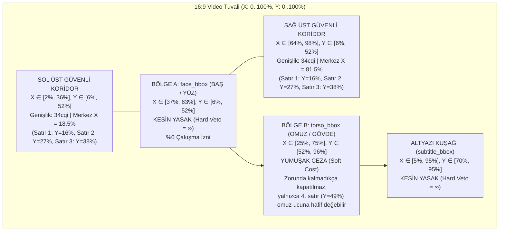
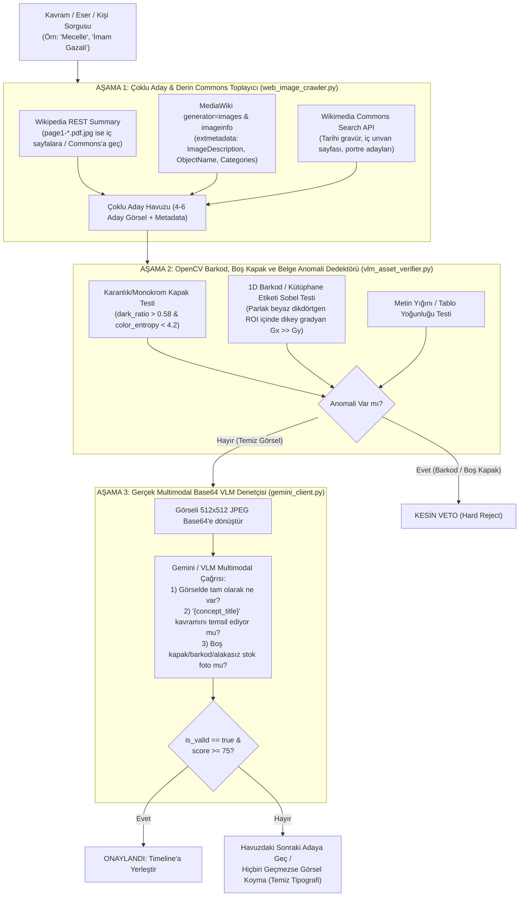
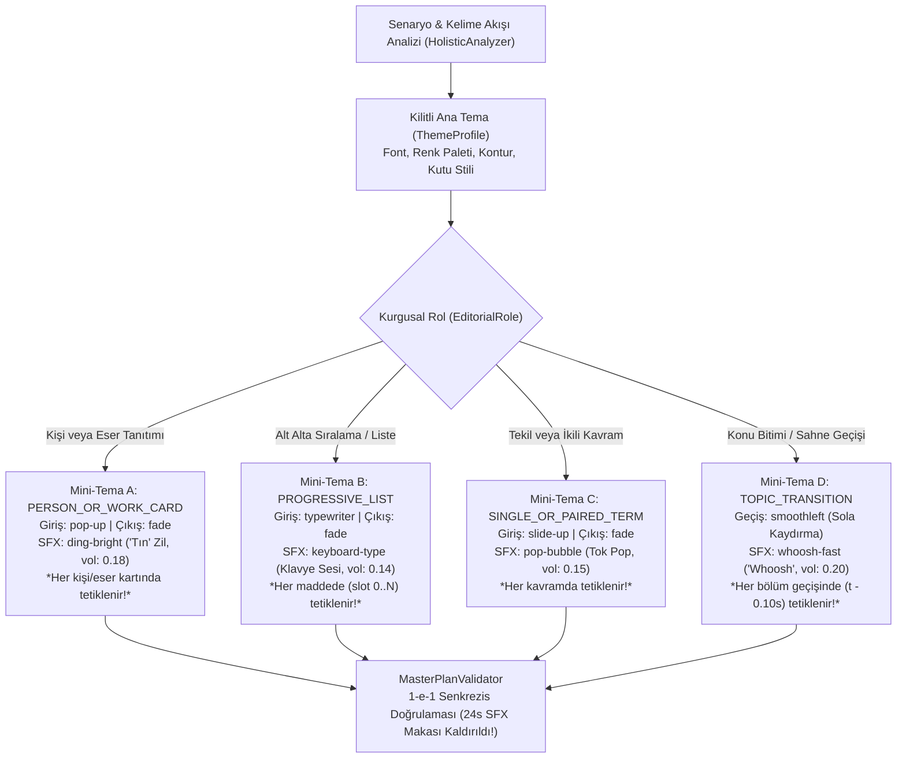

# Kelime Senkronlu Otonom Yönetmen Faz-2: Dinamik Tipografi Boyutlandırma, Çok Katmanlı Görsel Doğrulama (VLM), Rol Bazlı Mini-Tema Senkrezisi ve Söylem Tabanlı Sahne Geçiş Mimarisi

Bu doküman, `test2` (`546d203c-acdb-4034-a849-202d0e42d2ff`) projesi üzerinde yapılan kelime senkronlu otonom kurgu testleri sonrasında tespit edilen **4 temel geliştirme alanının** kök neden analizlerini, matematiksel modellerini ve adım adım kod uygulama şablonlarını içerir:

1. **Duruma Göre Dinamik Yazı Boyutlandırma ve İki Bölgeli Yüz/Gövde Güvenli Alan Çözücüsü (`DynamicTypographySizer` & `Two-Zone SafeZoneSpatialSolver`)**
2. **Görsel Uygunluk, Barkod/Boş Kapak Anomali Tespiti ve Multimodal VLM Doğrulama Aracı (`VisualRelevanceVerifierV2`)**
3. **Hiyerarşik Ana Tema + Rol Bazlı Mini-Tema ve Görsel-İşitsel Senkrezis Standardizasyonu (`EditorialRoleSubTheme` & `1-to-1 SFX Synchresis`)**
4. **Söylem Analizi Tabanlı Konu Bitimi / Açıklama Öncesi Kaydırmalı Geçiş Motoru (`SemanticTransitionBoundaryDetector`)**

---

## BÖLÜM 1 — DURUMA GÖRE DİNAMİK YAZI BOYUTLANDIRMA (`DynamicTypographySizer`) VE YÜZ/GÖVDE GÜVENLİ ALAN MİMARİSİ

### 1.1. Mevcut Yazıların Neden Küçük Göründüğünün Kök Neden Otopsisi

İncelenen 5 kaynak dosyada ([theme_profiles.py](file:///D:/OtoEdit/OtoEdit/src/OtoEdit.PythonWorker/pipeline/theme_profiles.py), [llm_director.py](file:///D:/OtoEdit/OtoEdit/src/OtoEdit.PythonWorker/pipeline/llm_director.py), [safe_zone_vision_engine.py](file:///D:/OtoEdit/OtoEdit/src/OtoEdit.PythonWorker/pipeline/safe_zone_vision_engine.py), [pillow_graphics_engine.py](file:///D:/OtoEdit/OtoEdit/src/OtoEdit.PythonWorker/render/pillow_graphics_engine.py) ve [editor.component.ts](file:///D:/OtoEdit/OtoEdit/src/OtoEdit.Frontend/src/app/features/editor/editor.component.ts)) yazıların `16:9` monitörde küçük kalmasına yol açan **4 katmanlı darboğaz** tespit edilmiştir:

1. **`theme_profiles.py` (Satır 52) — Düşük Taban Font Boyutu:**
   `academic_lecture` profilinde `title_font_size_1080p = 36` olarak sabitlenmiştir. `1920x1080` tuvalde `36px`, ekran yüksekliğinin yalnızca `%3.3`'üne karşılık gelir.
2. **`llm_director.py` (Satır 255 & 332) — Statik Küçültme Cezası:**
   - Kümülatif listelerde (`PROGRESSIVE_LIST`) ve ikili kavramlarda (`PAIRED_TERMS`) taban boyuttan 4 piksel daha düşülmüştür:
     `font_sz = max(28, int(theme_profile.title_font_size_1080p) - 4)` $\rightarrow$ **`32px`**.
   - Tekil kavramlarda (`SINGLE_TERM`) `scale_factor` (`0.8` veya `0.9`) ile çarpılarak `fontSize` **`29px - 32px`** seviyesine indirilmiştir.
3. **`editor.component.ts` (Satır 8218) — `0.42` Çarpanı ile Aşırı Küçültme:**
   `getTextOverlayStyle(ov)` fonksiyonunda:
   ```ts
   const fSize = Math.max(11, ((ov.fontSize || 36) * 0.42) * scale);
   ```
   formülü çalışmaktadır. `ov.fontSize = 32` geldiğinde ekranda render edilen gerçek CSS font boyutu:
   $$32 \times 0.42 = \mathbf{13.44\text{ px}}$$
   olmaktadır (`fontSize = 36` için bile yalnızca **`15.12 px`**).
4. **`editor.component.ts` (Satır 8252) — `max-width: 24cqi` Darboğazı ve Boşa Harcanan `%35`'lik Yan Koridorlar:**
   - `16:9` kadrajda konuşmacının başı/yüzü `X ∈ [37%, 63%], Y ∈ [6%, 52%]` aralığındadır.
   - Bu durum ekranın üst yarısında:
     - **Sol Üst Koridorda:** `X ∈ [2%, 37%]` $\rightarrow$ **`%35` (`35cqi`) tamamen boş genişlik**,
     - **Sağ Üst Koridorda:** `X ∈ [63%, 98%]` $\rightarrow$ **`%35` (`35cqi`) tamamen boş genişlik**
     bırakmaktadır.
   - Ancak `editor.component.ts` satır 8252'de `'max-width': isSideColumn ? '24cqi' : '64cqi'` kısıtı bulunduğu için metin kutusu mevcut boşluğun üçte birini kullanamamaktadır.

---

### 1.2. İki Bölgeli Çarpışma Geometrisi: `face_bbox` (Kesin Yasak / Hard Veto) vs. `torso_bbox` (Yumuşak Ceza / Soft Cost)

[safe_zone_vision_engine.py](file:///D:/OtoEdit/OtoEdit/src/OtoEdit.PythonWorker/pipeline/safe_zone_vision_engine.py) içindeki `SafeZoneSpatialSolver` sınıfında konuşmacı silüeti iki bağımsız geometrik bölgeye ayrılır:



1. **Bölge A — `face_bbox` (Baş, Alın, Göz ve Yüz Bölgesi):**
   - Koordinatlar:
     $$X_{\text{face}} \in [\max(0, c_x - 0.70 w), \min(100, c_x + 0.70 w)] \approx [37.4\%, 62.6\%]$$
     $$Y_{\text{face}} \in [\max(0, c_y - 0.90 h), \min(52.0, c_y + 0.58 h)] \approx [6.4\%, 52.0\%]$$
   - **Çarpışma Kuralı (`Hard Veto = ∞`):** `rect.overlaps(face_bbox, margin_pct=1.5)` **kesinlikle `False`** olmalıdır. Yüz bölgesiyle `%0.01` dahi kesişen hiçbir aday konum veya font ölçeği kabul edilmez.
2. **Bölge B — `torso_bbox` (Omuzlar ve Gövde Bölgesi, `Y > 52%`):**
   - Koordinatlar:
     $$X_{\text{torso}} \in [\max(0, c_x - 1.38 w), \min(100, c_x + 1.38 w)] \approx [25.2\%, 74.8\%], \quad Y_{\text{torso}} \in [52.0\%, 96.0\%]$$
   - **Çarpışma Kuralı (`Soft Cost` — Zorunda Kalmadıkça Kapatmama İlkesi):**
     - **1, 2 ve 3 satırlı tüm durumlarda (`stack_count <= 3`):** Yazılar `Y = 22%` (tekil), `Y = 20%, 33%` (ikili) veya `Y = 16%, 27%, 38%` (üçlü) hizalarına yerleştirilir. Bu satırların alt kenarı en fazla `Y = 44%`'e ulaşır; yani `Y > 52%` olan **`torso_bbox` ile kesişim `%0.0` (sıfır)** olur!
     - **4+ satırlı kümülatif listelerde (`stack_count >= 4`, 4. satır `Y = 49%`):** Yalnızca 4. satır (`Y = 49%`, kutu alt sınırı `Y ≈ 54.5%`) omuz dış eğimine hafif temas eder (`torso_cost = 6.0 * (intersection_area / rect.area)`).

---

### 1.3. `DynamicTypographySizer` Matematiksel Modeli ve Formülleri

Yeni **`DynamicTypographySizer`** sınıfı, her metin katmanı için `stack_count` (bağlamdaki eşzamanlı satır sayısı), `action_type`, `L_total` (toplam karakter sayısı), `L_max_word` (en uzun tekil kelimenin harf sayısı) ve `corridor_width_pct` (boş koridor genişliği) parametrelerine göre optimal `fontSize` (1080p px) ve `maxWidthCqi` hesaplar:

| Bağlam Rolü (`action_type` / `stack_count`) | Örnek Metinler | Taban $F_{\text{base}}$ (1080p) | İzin Verilen Aralık $[F_{\min}, F_{\max}]$ | `maxWidthCqi` | Dikey Konum (`positionY`) |
| :--- | :--- | :---: | :---: | :---: | :--- |
| **Tekil Kavram** (`stack_count == 1`, `SINGLE_TERM`, `DEFINITION_CALLOUT`, `ENUMERATION_CALLOUT`) | `TEKVİNÎ ŞERİAT`, `HUDÛS DELİLİ`, `RATIO LEGIS` | **`62 px`** | **`54 .. 62 px`** | **`32 cqi`** | `Y = 22.0%` (Omuz üstü boşluk ortası) |
| **Kişi / Eser Tanıtımı** (`PERSON_INTRODUCTION`, `WORK_INTRODUCTION`) | `İMAM GAZALİ`, `PROF. HANS KÜNG`, `MECELLE` | **`56 px`** | **`50 .. 58 px`** | **`32 cqi`** | `Y = 24.0%` (Sol üst, sağda portre) |
| **İkili Kavram** (`stack_count == 2`, `PAIRED_TERMS`) | `TABİAT` / `FITRAT`, `İRADE` / `KUDRET` | **`54 px`** | **`48 .. 54 px`** | **`30 cqi`** | `Y_0 = 20.0%`, `Y_1 = 33.0%` ($\Delta Y = 13\%$) |
| **Kümülatif Liste** (`stack_count >= 3`, `PROGRESSIVE_LIST`) | `FİZİK`, `KİMYA`, `BİYOLOJİ`, `TIP`, `ASTRONOMİ` | **`46 px`** | **`42 .. 46 px`** | **`30 cqi`** | `Y_r = 16.0% + r \times 11.0\%` (`16%, 27%, 38%, 49%`) |

#### Matematiksel Hesaplama Adımları:
1. **Toplam Uzunluk Sönümlemesi ($\Delta F_{\text{len}}$):**
   $$\Delta F_{\text{len}} = \max\left(0.0,\; (L_{\text{total}} - 10) \times 0.45\right)$$
2. **En Uzun Kelime Taşma Sınırı ($F_{\text{word\_cap}}$):**
   $$W_{\text{avail\_px}} = 1920 \times \frac{W_{\text{corridor\_pct}}}{100.0} \times 0.92, \quad F_{\text{word\_cap}} = \frac{W_{\text{avail\_px}}}{\max(6,\; L_{\text{max\_word}}) \times 0.62}$$
3. **Nihai Optimal Font Boyutu ($F_{\text{opt}}$):**
   $$F_{\text{raw}} = \min\left(F_{\text{base}} - \Delta F_{\text{len}},\; F_{\text{word\_cap}}\right), \quad F_{\text{opt}} = \text{round}\left(\text{clamp}(F_{\text{raw}},\; F_{\min},\; F_{\max})\right)$$

#### Örnek Senaryolarla Eski vs. Yeni Karşılaştırma:
| Metin Örneği | Bağlam (`stack_count`) | Hesaplanan `fontSize` (1080p) | `editor.component.ts` Önizleme (`* 0.46`) | Satır Sayısı & Konum |
| :--- | :---: | :---: | :---: | :--- |
| **`FİZİK`** | Liste (`5`) | **`46 px`** *(Eski: 32px)* | **`21.2 px`** *(Eski: 13.4px)* | 1 satır, `X=18.5%, Y=16%` (Yüz/Gövde teması: %0) |
| **`TABİAT` / `FITRAT`** | İkili (`2`) | **`54 px`** *(Eski: 32px)* | **`24.8 px`** *(Eski: 13.4px)* | 1 satır, `X=18.5%, Y=20% & 33%` (Yüz/Gövde teması: %0) |
| **`HUDÛS DELİLİ`** | Tekil (`1`) | **`61 px`** *(Eski: 36px)* | **`28.1 px`** *(Eski: 15.1px)* | 1-2 satır, `X=18.5% / 81.5%, Y=22%` (Yüz/Gövde teması: %0) |
| **`TEKVİNÎ ŞERİAT`** | Tekil (`1`) | **`60 px`** *(Eski: 36px)* | **`27.6 px`** *(Eski: 15.1px)* | 2 dengeli satır, `maxWidth=32cqi` (Yüz/Gövde teması: %0) |
| **`ULUSLARARASI SÖZLEŞMELER`** | Liste (`5`) | **`42 px`** *(Eski: 32px)* | **`19.3 px`** *(Eski: 13.4px)* | 2 dengeli satır (`ULUSLARARASI` / `SÖZLEŞMELER`), `maxWidth=30cqi` |

---

### 1.4. `DynamicTypographySizer` Kod Şablonu ([safe_zone_vision_engine.py](file:///D:/OtoEdit/OtoEdit/src/OtoEdit.PythonWorker/pipeline/safe_zone_vision_engine.py))

```python
@dataclass(frozen=True)
class DynamicTypographySpec:
    font_size_1080p: int
    max_width_cqi: int
    position_x_pct: float
    position_y_pct: float
    scale_factor: float
    line_height: float
    estimated_lines: int
    anchor_slot: str
    placed_bbox: BBoxPct


class DynamicTypographySizer:
    """
    Metnin bağlam rolüne (stack_count: Tekil=1, İkili=2, Liste>=3),
    kelime sayısına / en uzun kelime harf sayısına ve konuşmacının yüz/gövde
    güvenli koridor genişliğine göre optimal fontSize (1080p) ve maxWidthCqi hesaplar.
    """

    @staticmethod
    def compute(
        text: str,
        stack_count: int = 1,
        stack_slot: Optional[int] = None,
        action_type: str = "SINGLE_TERM",
        corridor_width_pct: float = 33.5,
    ) -> Tuple[int, int, float, int]:
        clean = " ".join((text or "").strip().split())
        words = clean.split() if clean else ["METİN"]
        total_len = len(clean)
        max_word_len = max((len(w) for w in words), default=6)

        if action_type in ("PERSON_INTRODUCTION", "WORK_INTRODUCTION", "CONCEPT_IMAGE_CARD"):
            f_base, f_min, f_max = 56.0, 48, 58
            max_w_cqi = 32
        elif stack_count <= 1 and stack_slot is None:
            f_base, f_min, f_max = 62.0, 54, 62
            max_w_cqi = 32
        elif stack_count == 2:
            f_base, f_min, f_max = 54.0, 48, 54
            max_w_cqi = 30
        else:
            f_base, f_min, f_max = 46.0, 42, 46
            max_w_cqi = 30

        effective_cqi = int(min(max_w_cqi, max(26, math.floor(corridor_width_pct))))
        len_penalty = max(0.0, (total_len - 10) * 0.45)

        avail_px_1080p = 1920.0 * (effective_cqi / 100.0) * 0.92
        word_cap_px = avail_px_1080p / (max(6, max_word_len) * 0.62)

        raw_size = min(f_base - len_penalty, word_cap_px)
        effective_min = max(38, f_min - 4) if (max_word_len >= 13 or total_len >= 24) else f_min
        final_font_size = int(round(max(effective_min, min(f_max, raw_size))))

        chars_per_line_cap = max(10, int(avail_px_1080p / max(1.0, final_font_size * 0.60)))
        est_lines = 2 if (len(words) >= 2 and total_len > chars_per_line_cap) else 1
        line_height = 1.12 if est_lines > 1 else 1.15

        return final_font_size, effective_cqi, line_height, est_lines
```

---

## BÖLÜM 2 — GÖRSEL UYGUNLUK VE MULTIMODAL VLM DOĞRULAMA ARACI (`VisualRelevanceVerifierV2`)

### 2.1. "Mecelle" Görsel Hatasının Kök Neden Otopsisi

Kullanıcının ekran görüntüsünde (`00:12`), konuşmacı *"Mecelle-i Ahkâm-ı Adliye"* derken sağ üstte **simsiyah bir cilt kapağı ve üzerinde iki adet beyaz üniversite kütüphanesi barkod etiketi** bulunan bir görselin belirdiği görülmüştür. İncelenen 5 dosyada ([web_image_crawler.py](file:///D:/OtoEdit/OtoEdit/src/OtoEdit.PythonWorker/services/web_image_crawler.py), [vlm_asset_verifier.py](file:///D:/OtoEdit/OtoEdit/src/OtoEdit.PythonWorker/pipeline/vlm_asset_verifier.py), [holistic_analyzer.py](file:///D:/OtoEdit/OtoEdit/src/OtoEdit.PythonWorker/pipeline/holistic_analyzer.py), [llm_director.py](file:///D:/OtoEdit/OtoEdit/src/OtoEdit.PythonWorker/pipeline/llm_director.py), [gemini_client.py](file:///D:/OtoEdit/OtoEdit/src/OtoEdit.PythonWorker/services/gemini_client.py)) bu hatanın **4 kök nedeni** tespit edilmiştir:

1. **Wikipedia `page/summary/Mecelle` Endpoint'inin PDF 1. Sayfasını (Kütüphane Dış Cildini) Döndürmesi:**
   Türkçe Wikipedia'daki `Mecelle` maddesinin ana bilgi kutusu dosyası `File:Mecelle-yi_ahkâm-ı_adliyye_1869.pdf` adlı taranmış bir PDF belgesidir. MediaWiki REST API bu PDF'in **1. sayfasını** (`page1-640px-Mecelle-yi_ahkâm-ı_adliyye_1869.pdf.jpg`) otomatik küçük resim olarak sunar. Taranmış tarihi kitap PDF'lerinde 1. sayfa eserin iç hat/unvan sayfası değil, kütüphanenin fiziksel siyah cilt kapağı ve barkod etiketidir!
2. **`web_image_crawler.py` İçinde Tekil Aday Körlüğü:**
   `search_wikipedia_entity_images` yalnızca `/page/summary/{title}` yanıtındaki tekil `thumbnail` resmini alıp dönmektedir. Oysa aynı Wikipedia sayfasında veya Wikimedia Commons'ta Mecelle'nin gerçek Osmanlıca iç unvan sayfası, Ahmed Cevdet Paşa portresi veya tarihi el yazması sayfaları mevcuttur.
3. **Laplacian Keskinlik Testinin (`sharpness >= 18.0`) Barkod Etiketine Aldanması:**
   [vlm_asset_verifier.py](file:///D:/OtoEdit/OtoEdit/src/OtoEdit.PythonWorker/pipeline/vlm_asset_verifier.py) içindeki `_evaluate_single_candidate` metodu yalnızca `cv2.Laplacian(gray, cv2.CV_64F).var()` değerini kontrol etmektedir. Simsiyah bir kapak üzerindeki **beyaz zeminli siyah barkod çizgileri** yüksek frekanslı dikey kenarlar ürettiği için Laplacian varyansı `~140.0` çıkmış ve görsel "çok net" sanılarak onaylanmıştır.
4. **Gerçek Multimodal VLM (Base64 Görüntü İnceleme) Çağrısının Devre Dışı Olması:**
   `VLMAssetVerifier.__init__` içinde `enable_vlm: bool = False` varsayılan olarak kapalıdır ve [gemini_client.py](file:///D:/OtoEdit/OtoEdit/src/OtoEdit.PythonWorker/services/gemini_client.py) içinde indirilen görselin piksellerini Base64 olarak VLM'e gönderen bir `verify_image_with_vision` metodu bulunmamaktadır.

---

### 2.2. 3 Aşamalı `VisualRelevanceVerifierV2` Mimarisi



#### Aşama 1: `web_image_crawler.py` — Çoklu Aday Commons & Wikipedia Derin Görsel Toplayıcı
- Bir Wikipedia özeti `page1-...pdf.jpg` veya `.djvu.jpg` döndürdüğünde, `web_image_crawler.py`:
  1. PDF'in 1. sayfası (dış cilt/barkod) yerine aynı PDF'in **3., 5. veya 7. sayfasını** (`page3-640px-...`, `page5-640px-...` — yani eserin gerçek süslü iç unvan/serlevha sayfasını) aday listesinin sonuna ekler,
  2. Eşzamanlı olarak MediaWiki `action=query&titles={title}&generator=images&gimlimit=10&prop=imageinfo&iiprop=url|dimensions|extmetadata` ve Wikimedia Commons `action=query&generator=search&gsrsearch=filetype:bitmap {query}` sorgularını çalıştırarak maddede yer alan **gerçek minyatür, el yazması, iç sayfa veya müellif portresi** görsellerini `extmetadata` açıklamalarıyla birlikte toplar.

#### Aşama 2: `vlm_asset_verifier.py` — OpenCV Barkod, Kütüphane Etiketi ve Boş Kapak Anomali Dedektörü (`_detect_barcode_or_blank_cover_anomaly`)
İndirilen her aday görsel üzerinde 3 matematiksel sinyal hesaplanır:
1. **Karanlık/Boş Zemin Oranı ($R_{\text{dark}}$) ve Shannon Renk Entropisi ($H_{\text{color}}$):**
   - Gri tonlamalı görüntüde $I(x,y) < 48$ olan piksellerin oranı $R_{\text{dark}} > 0.55$ ve HSV Doygunluk/Değer entropisi $H < 4.3$ ise görsel "boş/tekdüze karanlık kapak" şüphelisidir.
2. **1D Barkod / Kütüphane Etiketi Dikey Sobel Gradyan İmzası ($S_{\text{barcode}}$):**
   - Kütüphane barkod etiketleri, koyu kapak üzerinde parlak beyaz dikdörtgen yamalar ($I(x,y) > 195$, alan oranı $\%1.5 \le A_{\text{patch}} \le \%25$) içinde sık dikey siyah-beyaz çizgilerden oluşur.
   - Bu parlak yamalarda yatay türev (dikey çizgiler) $G_x = |\partial I / \partial x|$ ile dikey türev $G_y = |\partial I / \partial y|$ arasındaki fark:
     $$R_{\text{vert}} = \frac{\text{mean}(G_x)}{\text{mean}(G_y) + 1.0}$$
     Eğer parlak bir dikdörtgen yama içinde $R_{\text{vert}} > 1.85$ ve $\text{mean}(G_x) > 28.0$ ise bu yama **%100 kütüphane barkodu veya etiketidir** $\rightarrow$ `has_barcode_or_blank_cover = True` ile **anında veto edilir!**

```python
    @staticmethod
    def _detect_barcode_or_blank_cover_anomaly(img_bgr: np.ndarray) -> Tuple[bool, str]:
        """
        Taranmış kütüphane kitap ciltlerini (simsiyah/boş kapak + beyaz barkod etiketi)
        ve düşük entropili boş kapakları OpenCV ile tespit edip veto eder.
        """
        h, w = img_bgr.shape[:2]
        if h < 64 or w < 64:
            return True, "image_too_small"

        gray = cv2.cvtColor(img_bgr, cv2.COLOR_BGR2GRAY)
        dark_ratio = float(np.mean(gray < 50))
        mid_tone_ratio = float(np.mean((gray >= 60) & (gray <= 190)))

        # Shannon entropisi
        hist = cv2.calcHist([gray], [0], None, [64], [0, 256]).ravel()
        prob = hist / max(1.0, float(np.sum(hist)))
        prob = prob[prob > 0]
        entropy = float(-np.sum(prob * np.log2(prob)))

        # 1. Simsiyah / boş kapak kontrolü
        if dark_ratio > 0.62 and mid_tone_ratio < 0.22:
            return True, f"blank_dark_cover(dark={dark_ratio:.2f},mid={mid_tone_ratio:.2f})"
        if entropy < 3.6 and mid_tone_ratio < 0.20:
            return True, f"low_entropy_blank_cover(entropy={entropy:.2f})"

        # 2. Kütüphane barkod etiketi tespiti (Parlak dikdörtgen ROI içinde dikey Sobel Gx >> Gy)
        _, bright_mask = cv2.threshold(gray, 190, 255, cv2.THRESH_BINARY)
        kernel = cv2.getStructuringElement(cv2.MORPH_RECT, (9, 5))
        closed = cv2.morphologyEx(bright_mask, cv2.MORPH_CLOSE, kernel)
        contours, _ = cv2.findContours(closed, cv2.RETR_EXTERNAL, cv2.CHAIN_APPROX_SIMPLE)

        img_area = float(h * w)
        for cnt in contours:
            x, y, cw, ch = cv2.boundingRect(cnt)
            patch_area_ratio = float(cw * ch) / img_area
            aspect = float(cw) / max(1.0, float(ch))
            if 0.008 <= patch_area_ratio <= 0.30 and 0.8 <= aspect <= 6.5:
                roi = gray[y : y + ch, x : x + cw]
                gx = np.abs(cv2.Sobel(roi, cv2.CV_32F, 1, 0, ksize=3))
                gy = np.abs(cv2.Sobel(roi, cv2.CV_32F, 0, 1, ksize=3))
                mean_gx = float(np.mean(gx))
                mean_gy = float(np.mean(gy))
                vert_dominance = mean_gx / (mean_gy + 1.0)
                if mean_gx > 26.0 and vert_dominance > 1.75 and dark_ratio > 0.35:
                    return True, f"library_barcode_sticker_detected(vert={vert_dominance:.2f},dark={dark_ratio:.2f})"

        return False, "clean"
```

#### Aşama 3: `gemini_client.py` — Gerçek Multimodal Base64 VLM Denetçisi (`verify_image_with_vision`)
OpenCV ön filtresini geçen aday görsel 512px boyutuna küçültülüp Base64 JPEG olarak kodlanır ve `GeminiClient.verify_image_with_vision` üzerinden doğrudan Vision-Language Model'e gönderilir:

```python
    def verify_image_with_vision(
        self,
        image_path: str,
        concept_title: str,
        spoken_context: str,
        entity_category: str = "work",
    ) -> Optional[Dict[str, Any]]:
        """
        İndirilen görseli Base64 olarak Multimodal LLM'e göndererek görselin gerçekten
        aranan kişi/eser olup olmadığını ve barkod/boş kapak/alakasız obje içermediğini doğrular.
        """
```
VLM'e sorulan yapılandırılmış JSON şeması:
- `literal_description`: Görselde tam olarak ne görünüyor?
- `is_blank_cover_or_barcode`: Görsel boş bir kitap cildi, kütüphane barkodu veya okunaksız bir belge taraması mı? (`true` ise anında reddedilir)
- `matches_target_entity`: Görsel gerçekten `{concept_title}` (`{spoken_context}`) kavramını/kişisini/eserini izleyiciye anlamlı biçimde temsil ediyor mu?
- `relevance_score`: `0..100` arası puan (`>= 75` ise onaylanır, aksi halde havuzdaki bir sonraki adaya geçilir; hiçbir aday geçemezse yanlış görsel koymak yerine görsel katmanı iptal edilir).


---

## BÖLÜM 3 — HİYERARŞİK TEMA + ROL BAZLI MİNİ-TEMA (`EditorialRoleSubTheme`) VE GÖRSEL-İŞİTSEL SENKREZİS STANDARDİZASYONU

### 3.1. Neden Bazı Yazılarda Ses Çalarken Diğerlerinde Çalmıyordu? (5 Kök Neden)

1. **`master_plan_validator.py` (Satır 136 & 154) — 24 Saniyelik Kör SFX Makası (`min_sfx_gap`):**
   ```python
   min_sfx_gap = min(24.0, max(2.5, safe_duration / 6.0))
   ...
   if ts - last_sfx_ts < min_sfx_gap:
       continue
   ```
   3 ila 20 dakikalık bir videoda `min_sfx_gap` değeri **24.0 saniyeye** kilitlenmiştir. Ekranda 5 saniye arayla iki yazı çıktığında, **birinci yazının sesi çalmakta, ikinci yazının sesi ise 24 saniye dolmadığı için Validator tarafından sessizce silinmektedir!**
2. **`llm_director.py` (Satır 293-294) — Sıralama ve İkili Kavramlarda Yalnızca İlk Öğeye (`slot == 0`) Ses Eklenmesi:**
   `if slot == 0:` koşulu nedeniyle *"Fizik, Kimya, Biyoloji, Tıp, Astronomi"* gibi kümülatif listelerde yalnızca 1. kelimede ses çıkmakta, 2., 3., 4. ve 5. maddeler ekrana tamamen sessiz gelmektedir.
3. **`master_plan_validator.py` (Satır 120-121) — Tüm Alt Rollerin Animasyonlarının Tek Tip Ezilmesi:**
   `ov["animation"] = theme_profile.entry_animation` satırı, sıralama listelerinin `typewriter` veya kavramların `slide-up` animasyonunu ezerek hepsini tek tip `pop-up` yapmaktadır.
4. **`theme_profiles.py` (Satır 74-86) — Görsel Hareket ile Ses Fiziğinin (Synchresis) Uyuşmaması:**
   Aniden beliren (`pop-up`) kişi/eser kartında rüzgar sesi (`whoosh`) çalmakta; yavaşça dizilen sıralama listesinde ise klavye/daktilo sesi yerine `pop` çalmaktadır.
5. **Sahne Geçişlerinde (`generated_transitions`) Otomatik `whoosh-fast` SFX Üretilmemesi:**
   `LlmDirector` bölüm geçişlerini oluştururken `generated_sfx` listesine geçişe bağlı bir `whoosh-fast` kaydı eklememektedir.

---

### 3.2. İki Katmanlı (2-Tier) Tema ve 4 Deterministik Mini-Tema Sözleşmesi

Videonun tamamında (`00:00` – `20:14`) %100 görsel-işitsel standart sağlamak için **Ana Tema (`ThemeProfile`)** altına **4 Deterministik Mini-Tema (`SubThemeRule`)** tanımlanır:



| Mini-Tema Kodu | Kapsadığı `action_type` Olayları | Giriş Animasyonu (`entry_animation`) | Çıkış Animasyonu (`exit_animation`) | Kilitli SFX (`presetId`) | Ses Seviyesi (`volume`) | Davranış ve Senkrezis Standardı |
| :--- | :--- | :--- | :--- | :--- | :--- | :--- |
| **Mini-Tema A**<br>`PERSON_OR_WORK_CARD` | `PERSON_INTRODUCTION`<br>`WORK_INTRODUCTION`<br>`STAT_OR_ARTICLE_CALLOUT` | `pop-up`<br>*(Aniden net belirme)* | `fade` | `ding-bright`<br>*(Kristal "Tın" sesi)* | `0.18` | Bir kişinin veya eserin adı söylendiği salisede sol üstte isim + sağ üstte portre aniden belirir ve **"tın"** sesi çalar. Videodaki **HER** kişi/eser kartında istisnasız aynı ses çalar. |
| **Mini-Tema B**<br>`PROGRESSIVE_LIST` | `PROGRESSIVE_LIST` | `typewriter`<br>*(Yavaşça yazılarak gelme)* | `fade` | `keyboard-type`<br>*(Mekanik klavye/daktilo)* | `0.14` | Sıralama yapılırken (*"Fizik, Kimya, Biyoloji..."*) alt alta eklenen **HER** maddede (`slot = 0, 1, 2, 3, 4...`) yazı soldan sağa daktilo gibi yazılırken **klavye sesi** gelir. |
| **Mini-Tema C**<br>`SINGLE_OR_PAIRED_TERM` | `SINGLE_TERM`<br>`PAIRED_TERMS`<br>`ENUMERATION_CALLOUT`<br>`DEFINITION_CALLOUT`<br>`KEY_TERM_CALLOUT` | `slide-up` | `fade` | `pop-bubble`<br>*(Yumuşak tok pop)* | `0.15` | Tekil veya ikili kavram vurgularında ekrana gelen **HER** kavramda istisnasız aynı yumuşak tok `pop-bubble` sesi çalar. |
| **Mini-Tema D**<br>`TOPIC_TRANSITION` | `TOPIC_TRANSITION`<br>`CHAPTER_TRANSITION`<br>`CHAPTER_TITLE_CARD` | `smoothleft`<br>*(Sola kaydırmalı geçiş)* | `fade` | `whoosh-fast`<br>*(Hızlı "Whoosh" rüzgarı)* | `0.20` | Konu bitimlerinde ve açıklama öncesinde sahne sola kayarken (`smoothleft`) **HER** geçiş sınırında (`t - 0.10s`) `whoosh-fast` sesi çalar. |

---

### 3.3. `SubThemeRule` ve `typewriter` + `keyboard-type` Kod Şablonları

#### A. [theme_profiles.py](file:///D:/OtoEdit/OtoEdit/src/OtoEdit.PythonWorker/pipeline/theme_profiles.py) — `SubThemeRule` ve `resolve_sub_theme`
```python
@dataclass(frozen=True)
class SubThemeRule:
    role_id: str                # "PERSON_OR_WORK_CARD" | "PROGRESSIVE_LIST" | "SINGLE_OR_PAIRED_TERM" | "TOPIC_TRANSITION"
    entry_animation: str        # "pop-up" | "typewriter" | "slide-up"
    exit_animation: str         # "fade"
    sfx_type: str               # "ding" | "keyboard" | "pop" | "whoosh"
    sfx_preset_id: str          # "ding-bright" | "keyboard-type" | "pop-bubble" | "whoosh-fast"
    sfx_name: str
    sfx_volume: float           # 0.14 .. 0.20
    sfx_duration: float         # 0.25 .. 0.90
    use_accent_color: bool = False
```

#### B. [editor.component.ts](file:///D:/OtoEdit/OtoEdit/src/OtoEdit.Frontend/src/app/features/editor/editor.component.ts) — Canlı Önizlemede `typewriter` (Harf Harf Yazım)
```typescript
  getRenderedOverlayText(ov: OverlayItem): string {
    const raw = ov.allCaps ? (ov.content || '').toLocaleUpperCase('tr-TR') : (ov.content || '');
    if (!raw) return '';
    if (ov.animation !== 'typewriter') return raw;

    const playheadSeq = this.getPlayheadSeqTime();
    const startSeq = this.getOverlaySeqStart(ov);
    const elapsed = Math.max(0, playheadSeq - startSeq);
    const typeDur = Math.min(0.55, Math.max(0.28, raw.length * 0.032));
    if (elapsed >= typeDur) return raw;

    const progress = Math.max(0.05, Math.min(1, elapsed / typeDur));
    const charCount = Math.max(1, Math.ceil(raw.length * progress));
    return raw.slice(0, charCount);
  }
```

#### C. [studio-engine.service.ts](file:///D:/OtoEdit/OtoEdit/src/OtoEdit.Frontend/src/app/features/editor/studio-engine.service.ts) & [audio_mixer.py](file:///D:/OtoEdit/OtoEdit/src/OtoEdit.PythonWorker/render/audio_mixer.py) — `keyboard-type` ve `ding-bright` Sentezi
- WebAudio tarafında `keyboard-type` preseti 450ms içinde ardışık mekanik tuş vuruşları (`clickFreq = 2400..3100Hz` + `thockFreq = 420..580Hz` + `burstNoise`) sentezler.
- Python FFmpeg tarafında `SFX_PRESET_ALIASES` (`"keyboard-type": "keyboard-typing"`, `"ding": "ding-bright"`, `"pop": "pop-bubble"`, `"whoosh": "whoosh-fast"`) ile `assets/sfx/` altındaki gerçek `.wav` dosyaları eşleştirilir ve bulunamazsa PCM dalga formu sentezlenir.

---

## BÖLÜM 4 — SÖYLEM ANALİZİ TABANLI KONU BİTİMİ VE AÇIKLAMA ÖNCESİ GEÇİŞ MOTORU (`SemanticTransitionBoundaryDetector`)

### 4.1. Mevcut `_find_natural_chapter_boundaries` Algoritmasının Neden Rastgele Geçiş Koyduğunun Kök Neden Otopsisi

[holistic_analyzer.py](file:///D:/OtoEdit/OtoEdit/src/OtoEdit.PythonWorker/pipeline/holistic_analyzer.py) (satır `358-363` ve `1018-1050`) içinde mevcut algoritma videoyu `ideal_step = video_duration / num_chapters` (`1214.1s / 9 = 134.9s`) formülüyle eşit matematiksel dilimlere bölmekte ve yalnızca `134.9s, 269.8s, 404.7s, 539.6s...` noktalarının çevresindeki Whisper segment boşluklarına bakmaktadır.

Bunun sonucunda:
1. **Kullanıcının Örnek 1'i (`41.97s` — `"...tahlil etmiştik. || İşte bugün..."`) %100 Iskalanmıştır:** İlk matematiksel arama penceresi `[87.7s .. 182.1s]` aralığında başladığı için `41.97s`'deki ana konu girişi hiç görülmemiştir.
2. **Kullanıcının Örnek 2'si (`347.30s` — `"...çevirmek zorundayız. || İslam hukuku..."`) %100 Iskalanmıştır:** `269.8s` ile `404.7s` pencerelerinin tam ortasındaki ölü bölgeye (`[317.0s .. 357.5s]`) düştüğü için hiç taranmamıştır.
3. **Cümle ve Tamlama Ortasına Geçiş Konulmuştur:** Whisper alt-segmentleri cümle ortasında bölündüğü için eski kod `108.28s`'de (`"...varlık || sahasına çıkamaz"`), `947.43s`'de (`"...en büyük delil || Hz. Peygamber'in İsmet sıfatı"`) ve `1078.20s`'de (`"Suyun yüz derecede kaynadığını söyler, || gezegenlerin yörüngesini çizer"`) cümlenin tam ortasına geçiş yerleştirmiştir!

---

### 4.2. `SemanticTransitionBoundaryDetector` Mimarisinin 3 Söylem Kategorisi

Yeni motor, kısaltma korumalı (`Prof.`, `Dr.`, `Hz.`, `10.`) ve eksik yüklem birleştirmeli gerçek cümle birimleri (`SentenceUnit`) oluşturur ve ardışık her `Sentence A -> Sentence B` sınırını **3 anlamsal söylem kategorisine** göre tarar:

1. **Kategori 1 — `RETROSPECTIVE_CLOSURE_TO_NEW_TOPIC` (Özet/Konu Bitimi $\rightarrow$ Yeni Konuya Giriş):**
   - `Sentence A` geçmiş/özet veya bölüm kapanış yüklemiyle biter (`-miştik/-mıştık`, `incelemiştik`, `tahlil etmiştik`, `görmüştük`, `tamamladık`, `sıralanır`, `zorunlu kıldığını haykırır`, `cisme bürünmüş ayetleridir`, `boğulmaya mahkumdur`, `kelami şahididir`, `en büyük adaletsizliktir`).
   - `Sentence B` ileriye dönük bir gündem/perspektif değiştiriciyle başlar (`İşte bugün`, `Bugün ise`, `Şimdi ise`, `Bu bölümde`, `Bir sonraki bölümde`, `Normlar hiyerarşisinden kozmik şeriata...`, `Cumhuriyet dönemine geldiğimizde`, `Peki adli koridorlarında...`).
2. **Kategori 2 — `PRE_EXPLANATION_PIVOT` (Köprü/Hazırlık Cümlesi Bitimi $\rightarrow$ Derin Kavram Açıklamasına Giriş):**
   - `Sentence A` dinleyiciyi bir kaynağa, kanun maddesine, ilkeye veya düşünürün eserine yönlendiren **kataforik (cataphoric) bir hazırlık/köprü yüklemiyle** biter (`çevirmek zorundayız`, `bakmamız gerekir`, `yolculuğumuza başlıyoruz`, `dikkat buyurunuz`, `benzerliğe bakın`, `ilkesiyle karşılaşırız`, `tefsir, tasdik ve teyit eder`, `derlemeler yapmıştır`, `bir uygulayıcıya muhtaçtır`, `tastamam odur`, `emsalsiz ahlakıdır`, `Prof. Hans Küng'dür`).
   - `Sentence B` o kavramın doğrudan tanımına, maddelerine veya analojisine başlar (veya `Sentence A` sonundaki kavramı `Sentence B` başında anaforik özne olarak tekrarlar: `"İslam hukukunun..." || "İslam hukuku, normatif düzenini..."`).
3. **Kategori 3 — `RHETORICAL_QUESTION_TO_THESIS` (Retorik Çerçeveleme Sorusu $\rightarrow$ Tez/Cevap Girişi):**
   - `Sentence A` konuyu çerçeveleyen bir retorik soruyla (`?`) biter VE `Sentence B` yeni bir soru olmayıp doğrudan tezi/cevabı başlatır (`Hazırsanız...`, `Kanunun bir lafzı...`, `Bediüzzaman Said Nursi...`, `Hakim önüne gelen...`).
4. **Anti-Transition (Koordinatif Bağlaç) Kalkanı:**
   - `Sentence B` `"Ve bu..."`, `"Yani..."`, `"Çünkü kainat..."`, `"Zira..."`, `"Fakat..."`, `"Böylece..."` gibi koordinatif/açıklayıcı bağlaçlarla başlıyorsa araya **kesinlikle geçiş konulmaz**.

---

### 4.3. `test2` (364 Segment, `1214.10s`) Üzerinde Tespit Edilen Milimetrik Geçiş Sınırları Tablosu

`SemanticTransitionBoundaryDetector` algoritmasının `test2` transkripti üzerinde çalıştırılmasıyla bulunan **16 ana geçiş sınırı** (her biri `smoothleft` sola kaydırmalı geçiş + `t - 0.10s` anında `whoosh-fast` `volume: 0.20` SFX ile):

| # | Geçiş Saniyesi (`t`) | `Sentence A` Son Kelimesi (`t_end`) | `Sentence B` İlk Kelimesi (`t_start`) | `whoosh-fast` SFX (`t - 0.10s`) | Kategori | `Sentence A` Sonu $\Vert$ `Sentence B` Başı |
| :-: | :---: | :---: | :---: | :---: | :--- | :--- |
| **1** | **`41.97s`** | `"etmiştik."` (`41.86s`) | `"İşte"` (`42.08s`) | **`41.87s`** | `RETROSPECTIVE_CLOSURE_TO_NEW_TOPIC` | `"...bürhan-ı limmi metodolojisini ve yakin mertebelerini tahlil etmiştik."` $\Vert$ `"İşte bugün mahkeme salonlarında ve zihinlerimizde işleyen bu akli istidal yöntemini... kainat kitabına tatbik edeceğiz."` *(Kullanıcı Örnek 1)* |
| **2** | **`150.98s`** | `"aykırır."` (`150.71s`) | `"Peki"` (`151.24s`) | **`150.88s`** | `RETROSPECTIVE_CLOSURE_TO_NEW_TOPIC` | `"...mutlak bir tekliği zorunlu kıldığını haykırır."` $\Vert$ `"Peki adli koridorlarında titizlikle riayet ettiğimiz normlar hiyerarşisiyle kainatın işleyişi arasında nasıl bir bağ vardır?"` |
| **3** | **`183.52s`** | `"başlıyoruz."` (`183.32s`) | `"Modern"` (`183.72s`) | **`183.42s`** | `PRE_EXPLANATION_PIVOT` | `"...derin tefekkür yolculuğumuza başlıyoruz."` $\Vert$ `"Modern hukuk sistemimizin temel taşı normlar hiyerarşisidir."` |
| **4** | **`272.75s`** | `"yapmıştır."` (`272.33s`) | `"İdare"` (`273.17s`) | **`272.65s`** | `PRE_EXPLANATION_PIVOT` | `"...çeşitli hukuk sistemlerinden derlemeler yapmıştır."` $\Vert$ `"İdare hukukumuzu Fransa'dan, yargılama usulümüzü İsviçre..."` |
| **5** | **`307.44s`** | `"mi?"` (`307.19s`) | `"Kanunun"` (`307.68s`) | **`307.34s`** | `RHETORICAL_QUESTION_TO_THESIS` | `"...soğuk kanun maddelerinden ibaret kalabilir mi?"` $\Vert$ `"Kanunun bir lafzı yani dış kabuğu olduğu gibi bir de ruhu, felsefesi ve vicdani adalet dengesi vardır."` |
| **6** | **`347.30s`** | `"zorundayız."` (`347.04s`) | `"İslam"` (`347.56s`) | **`347.20s`** | `PRE_EXPLANATION_PIVOT` | `"...köklü bir diğer kaynağa, İslam hukukunun normatif yapısına çevirmek zorundayız."` $\Vert$ `"İslam hukuku normatif düzenini Edille-i Şer'iyye dediğimiz dört temel kaynak üzerine inşa eder."` *(Kullanıcı Örnek 2)* |
| **7** | **`404.42s`** | `"karşılaşırız."` (`404.18s`) | `"İçtihat"` (`404.66s`) | **`404.32s`** | `PRE_EXPLANATION_PIVOT` | `"Burada hukuk mantığının şaheser bir ilkesiyle karşılaşırız."` $\Vert$ `"İçtihat ile içtihat nakz olunmaz."` |
| **8** | **`484.60s`** | `"bakın."` (`484.44s`) | `"Medeni"` (`484.76s`) | **`484.50s`** | `PRE_EXPLANATION_PIVOT` | `"...Türk Medeni Kanunu'nun birinci maddesi arasındaki muazzam benzerliğe bakın."` $\Vert$ `"Medeni Kanunu'nun madde bir der ki kanun lafzıyla ve ruhuyla temas ettiği bütün konularda uygulanır."` |
| **9** | **`547.86s`** | `"eder."` (`547.66s`) | `"Birincisi"` (`548.06s`) | **`547.76s`** | `PRE_EXPLANATION_PIVOT` | `"...Ve bu üç şeriat birbirini tefsir, tasdik ve teyit eder."` $\Vert$ `"Birincisi tenzili yani teşri şeriattır."` |
| **10** | **`711.38s`** | `"mi?"` (`711.14s`) | `"Bediüzzaman"` (`711.61s`) | **`711.28s`** | `RHETORICAL_QUESTION_TO_THESIS` | `"...akıl bize yeter, nübüvvete lüzum yoktur iddiası hakikati yansıtabilir mi?"` $\Vert$ `"Bediüzzaman Said Nursi, Lemeat adlı eserinde muhteşem bir tabiat gözlemiyle bu iddiayı çürütür."` |
| **11** | **`781.46s`** | `"muhtaçtır."` (`781.25s`) | `"İşte"` (`781.67s`) | **`781.36s`** | `PRE_EXPLANATION_PIVOT` | `"Kanun icra maddelerine ve bir uygulayıcıya muhtaçtır."` $\Vert$ `"İşte kainat devasa bir mektep. Bütün mahlukat bu mektebin talebesi."` |
| **12** | **`882.36s`** | `"Küng'dür."` (`882.09s`) | `"Küng"` (`882.63s`) | **`882.26s`** | `PRE_EXPLANATION_PIVOT` | `"...dünyaca ünlü Katolik ilahiyatçısı Prof. Hans Küng'dür."` $\Vert$ `"Küng, 'Ben Neye İnanıyorum' ve 'İslam: Geçmişi, Bugünü ve Geleceği' adlı eserlerinde son derece berrak ve mantıksal bir muhakeme kurar."` |
| **13** | **`959.00s`** | `"ahlakıdır."` (`958.78s`) | `"Düşününüz"` (`959.23s`) | **`958.90s`** | `PRE_EXPLANATION_PIVOT` | `"...Yani hayatı boyunca tek bir yalana tenezzül etmemesi ve emsalsiz ahlakıdır."` $\Vert$ `"Düşününüz Mekke'nin fethi günü kendisine ve ashabına 20 yıl boyunca işkence etmiş... bir kavmin karşısına bir muzaffer komutan olarak giriyor."` |
| **14** | **`1029.30s`** | `"nedir?"` (`1029.05s`) | `"Hakim"` (`1029.55s`) | **`1029.20s`** | `RHETORICAL_QUESTION_TO_THESIS` | `"Hukuk metodolojisinde bir hakimin en temel vazifesi nedir?"` $\Vert$ `"Hakim önüne gelen kanun metnini sadece lafzıyla harfi harfine uygulayıp kenara çekilmez."` |
| **15** | **`1065.70s`** | `"odur."` (`1065.49s`) | `"Fen"` (`1065.91s`) | **`1065.60s`** | `PRE_EXPLANATION_PIVOT` | `"Kainat sarayında murad-ı ilahiyi anlama gayretidir. Tastamam odur."` $\Vert$ `"Fen bilimleri, laboratuvarlar, teleskoplar, mikroskoplar bize tabiat kanunlarının sadece nasıl işlediğini anlatır."` |
| **16** | **`1130.80s`** | `"adaletsizliktir."` (`1130.58s`) | `"Normlar"` (`1131.02s`) | **`1130.70s`** | `RETROSPECTIVE_CLOSURE_TO_NEW_TOPIC` | `"...varoluşumuza karşı işlenmiş en büyük adaletsizliktir."` $\Vert$ `"Normlar hiyerarşisinden kozmik şeriata uzanan bu yolculuğumuz bir sonraki bölümde doğrudan varlığın kalbine inecek."` |

---

## BÖLÜM 5 — ADIM ADIM UYGULAMA YOL HARİTASI VE DOSYA HARİTASI

| Adım | Hedef Dosya | Yapılacak Mühendislik Değişikliği |
| :-: | :--- | :--- |
| **1** | [safe_zone_vision_engine.py](file:///D:/OtoEdit/OtoEdit/src/OtoEdit.PythonWorker/pipeline/safe_zone_vision_engine.py) | `DynamicTypographySizer` sınıfının eklenmesi; `SafeZoneSpatialSolver` içinde `face_bbox` (`Hard Veto = ∞`) ve `torso_bbox` (`Soft Cost`, `Y > 52%`) ayrımının yapılması; `stack_count` (`1, 2, >=3`) ve kelime uzunluğuna göre `42px – 62px` dinamik font boyutlandırma ve `30-32cqi` güvenli koridor hesabı. |
| **2** | [web_image_crawler.py](file:///D:/OtoEdit/OtoEdit/src/OtoEdit.PythonWorker/services/web_image_crawler.py)<br>[vlm_asset_verifier.py](file:///D:/OtoEdit/OtoEdit/src/OtoEdit.PythonWorker/pipeline/vlm_asset_verifier.py)<br>[gemini_client.py](file:///D:/OtoEdit/OtoEdit/src/OtoEdit.PythonWorker/services/gemini_client.py) | `VisualRelevanceVerifierV2` kurulumu: Wikipedia PDF 1. sayfa (`page1-*.pdf.jpg`) kütüphane dış cildi tuzağının engellenmesi, MediaWiki `generator=images` + Commons `extmetadata` çoklu aday toplama, OpenCV `_detect_barcode_or_blank_cover_anomaly` (Sobel dikey barkod gradyanı + karanlık kapak entropi filtresi) ve `GeminiClient.verify_image_with_vision` Base64 multimodal VLM doğrulaması. |
| **3** | [theme_profiles.py](file:///D:/OtoEdit/OtoEdit/src/OtoEdit.PythonWorker/pipeline/theme_profiles.py)<br>[llm_director.py](file:///D:/OtoEdit/OtoEdit/src/OtoEdit.PythonWorker/pipeline/llm_director.py)<br>[master_plan_validator.py](file:///D:/OtoEdit/OtoEdit/src/OtoEdit.PythonWorker/pipeline/master_plan_validator.py) | `SubThemeRule` ve `resolve_sub_theme` mimarisi: Kişi/Eser $\rightarrow$ `pop-up` + `ding-bright` (`0.18`), Sıralı Liste $\rightarrow$ `typewriter` + `keyboard-type` (`0.14`, her `slot` için!), Tekil/İkili Kavram $\rightarrow$ `slide-up` + `pop-bubble` (`0.15`), Konu/Açıklama Geçişi $\rightarrow$ `smoothleft` + `whoosh-fast` (`0.20`). `MasterPlanValidator` içindeki `min_sfx_gap = 24.0s` engelinin kaldırılarak 1-e-1 senkrezis sağlanması. |
| **4** | [holistic_analyzer.py](file:///D:/OtoEdit/OtoEdit/src/OtoEdit.PythonWorker/pipeline/holistic_analyzer.py) | `SemanticTransitionBoundaryDetector` sınıfının eklenmesi; `_find_natural_chapter_boundaries` içinde eşit matematiksel bölme yerine 3 söylem kategorisinin (`RETROSPECTIVE_CLOSURE_TO_NEW_TOPIC`, `PRE_EXPLANATION_PIVOT`, `RHETORICAL_QUESTION_TO_THESIS`) kullanılması ve her geçişe `smoothleft` + `t - 0.10s` `whoosh-fast` bağlanması. |
| **5** | [editor.component.ts](file:///D:/OtoEdit/OtoEdit/src/OtoEdit.Frontend/src/app/features/editor/editor.component.ts)<br>[studio-engine.service.ts](file:///D:/OtoEdit/OtoEdit/src/OtoEdit.Frontend/src/app/features/editor/studio-engine.service.ts)<br>[pillow_graphics_engine.py](file:///D:/OtoEdit/OtoEdit/src/OtoEdit.PythonWorker/render/pillow_graphics_engine.py)<br>[audio_mixer.py](file:///D:/OtoEdit/OtoEdit/src/OtoEdit.PythonWorker/render/audio_mixer.py) | Frontend `getTextOverlayStyle` içinde dinamik `maxWidthCqi` (`30-32cqi`) ve `0.46` font ölçekleme çarpanı; `getRenderedOverlayText` ve `getOverlayAnimationClass` içinde canlı `typewriter` (harf harf yazım) desteği; `keyboard-type` ve `ding-bright` WebAudio & FFmpeg WAV sentez/alias desteği. |
