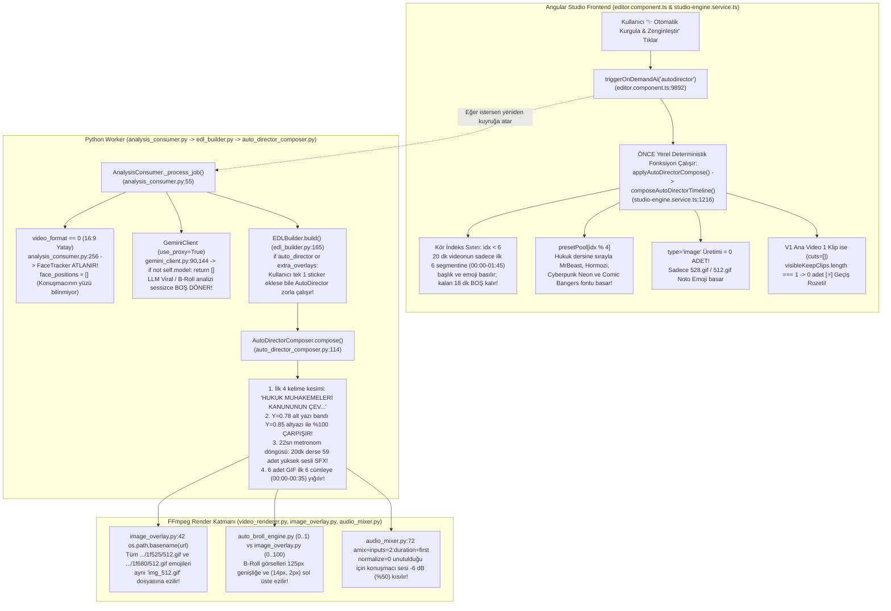
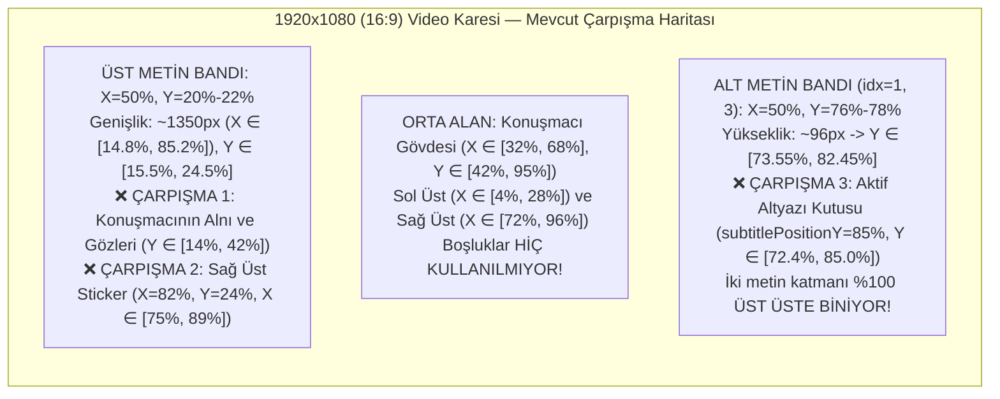
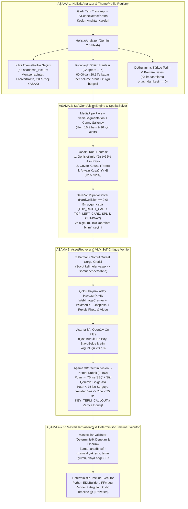

# Otonom Video Yönetmeni ve Akıllı Kurgu Mimarisi: Kök Neden Otopsisi, Açık Kaynak Derin Analizi ve Uçtan Uca Uygulama Rehberi

> **Doküman Kimliği:** `OTOEDIT-ARCH-2026-AUTODIRECTOR-V2`  
> **Kapsam:** Python Worker (`src/PythonWorker`), .NET 9 Backend (`src/Backend`), Angular Studio Frontend (`src/Frontend`)  
> **Hedef:** Mevcut deterministik/modulo tabanlı `AutoDirectorComposer` ve `composeAutoDirectorTimeline` yığınlarının uçtan uca kök neden otopsisini çıkarmak; dünyadaki en gelişmiş açık kaynaklı AI Video Kurgu / Multimodal Yönetmen sistemlerini (`ShortGPT`, `MoneyPrinterTurbo/Plus`, `NarratoAI`, `VideoLingo`, `PySceneDetect`, `Katna`, `MediaPipe AutoFlip`, `openshorts`, `HKUDS/VideoAgent`, `LAVE`, `Remotion AI Agents`) mimari düzeyde incelemek ve **OtoEdit** için **5 Aşamalı Multimodal Otonom Yönetmen Mimarisi**'ni (Bütüncül Tema Analizi + Uzamsal Güvenli Bölge Çözücü + VLM Doğrulamalı Görsel/Video Arama + Deterministik Master Plan Doğrulayıcı + Kusursuz FFmpeg/Timeline Yürütücü) üretime hazır tam kod şablonlarıyla tanımlamak.

---

## İçindekiler

1. **[BÖLÜM 1 — Mevcut Sistemimizin ("Bizimki Nasıl Çalışıyor ve Neden Çöküyor?") Uçtan Uca Kök Neden Otopsisi](#bolum-1)**
   - 1.1. Planlama ve Transkript Analizi Kusurları (`1A`)
   - 1.2. Görsel Arama, Uygunluk Tartma (VLM Verification) ve Konumlandırma Kusurları (`1B`)
   - 1.3. Tipografi, Rastgele Modulo Stilleri ve Uzamsal Çarpışma Matematiği (`1C`)
   - 1.4. Ses Efektleri (SFX) 22 Saniyelik Metronom Döngüsü ve FFmpeg `-6 dB` Miksaj Hatası (`1D`)
   - 1.5. Sahne Geçişleri (`Transitions`), Tekil Klip Körlüğü ve `xfade` Kayması (`1E`)
   - 1.6. GIF/Sticker İlk 6 Cümle Yığılması ve B-Roll Video Klip Eksikliği (`1F`)
2. **[BÖLÜM 2 — Dışarıda Neler Var? (Açık Kaynak AI Video Kurgu ve Multimodal Yönetmen Repolarının Derin Analizi)](#bolum-2)**
   - 2.1. `RayVentura/ShortGPT`: Düzenleme Adımı Durum Makinesi ve Somut Görsel Sorgu Mühendisliği
   - 2.2. `harry0703/MoneyPrinterTurbo` & `ddean2009/MoneyPrinterPlus`: Senaryo Sıralı Arama, En Küçük Yeterli HD Seçimi ve Kümülatif `xfade` Matematiği
   - 2.3. `linyqh/NarratoAI`: Çok Aşamalı Yönetmen LLM, VLM Kare Örnekleme ve Kendi Kendini Onaran Doğrulama Döngüsü
   - 2.4. `Huanshere/VideoLingo`: 4 Aşamalı Sözdizimsel NLP Bölücü, 2 Hipotezli LLM Kesimi ve Küresel Terminoloji Çıkarımı
   - 2.5. `PySceneDetect`, `Katna`, `MediaPipe AutoFlip` ve `mutonby/openshorts`: Görsel Belirginlik (Saliency), Genişletilmiş Yüz Kutusu ve Keskinlik Analizi
   - 2.6. `HKUDS/VideoAgent`, `LAVE (arXiv:2402.10294)`, `video-context-mcp` ve Remotion Ajanları: 2 Aşamalı VLM Öz-Eleştiri Rubriği ve Kilitli Tasarım Jetonları (`taste.yaml`)
3. **[BÖLÜM 3 — Bize Hangisi Uygun? (Seçilen 5 Aşamalı Multimodal Otonom Yönetmen Mimarisi ve Matematiksel Modeller)](#bolum-3)**
   - 3.1. Mimari Karşılaştırma Matrisi ve Mimari Karar Kayıtları (ADR)
   - 3.2. Aşama 1: `HolisticAnalyzer` ve Kilitli `ThemeProfile` Kayıt Defteri
   - 3.3. Aşama 2: `SafeZoneVisionEngine` ve `SafeZoneSpatialSolver` Matematiksel Modeli
   - 3.4. Aşama 3: `AssetRetrieverAndVLMVerifier` (Çoklu Kaynak Görsel/Video Arama + OpenCV Ön Filtre + VLM Rubrik + Zarif Geri Çekilme)
   - 3.5. Aşama 4 & 5: `MasterPlanValidator` ve `DeterministicTimelineExecutor`
4. **[BÖLÜM 4 — Adım Adım Kod Uygulama Kılavuzu (Python Worker, .NET Backend ve Angular Frontend Tam Kod Şablonları)](#bolum-4)**
   - Adım 1: `pipeline/theme_profiles.py` & `pipeline/holistic_analyzer.py` (Yeni)
   - Adım 2: `pipeline/safe_zone_vision_engine.py` & `pipeline/face_tracker.py` (Yeni/Güncelleme)
   - Adım 3: `services/web_image_crawler.py`, `services/pexels_client.py` & `pipeline/vlm_asset_verifier.py` (Yeni/Güncelleme)
   - Adım 4: `pipeline/master_plan_validator.py` & `pipeline/llm_director.py` (Yeni)
   - Adım 5: Kritik Render ve Servis Bug Düzeltmeleri (`image_overlay.py`, `audio_mixer.py`, `video_renderer.py`, `gemini_client.py`, `edl_builder.py`)
   - Adım 6: Angular Frontend (`studio-engine.service.ts` & `editor.component.ts`) Refaktörü
5. **[BÖLÜM 5 — Uçtan Uca Doğrulama Matrisi, Test Senaryoları ve Migrasyon Kontrol Listesi](#bolum-5)**

---

<a id="bolum-1"></a>
## BÖLÜM 1 — Mevcut Sistemimizin ("Bizimki Nasıl Çalışıyor ve Neden Çöküyor?") Uçtan Uca Kök Neden Otopsisi

Kullanıcının 20 dakikalık **"Hukuk Muhakemeleri Kanunu (HMK)"** ders videosu üzerinde **"✨ Otomatik Kurgula & Zenginleştir"** (`auto_director` / `composeAutoDirectorTimeline`) özelliğini çalıştırdığında karşılaştığı semptomlar tesadüfi hatalar değil; hem Python Worker hem de Angular Studio katmanlarında yer alan **deterministik modulo döngüleri**, **koordinat sistemi uyuşmazlıkları**, **kör indeks kesmeleri** ve **eksik görsel zekâ (VLM/CV) katmanlarının** doğrudan matematiksel sonucudur.

Aşağıdaki mimari akış diyagramı, mevcut sistemde bir video yüklendiğinde veya editörde **"✨ Otomatik Kurgula & Zenginleştir"** butonuna basıldığında gerçekleşen hatalı yürütme zincirini göstermektedir:



Şimdi bu 6 ana kusur kümesini dosya adları, satır numaraları, birebir kod alıntıları ve matematiksel kanıtlarıyla tek tek inceleyelim.

---

### 1.1. Planlama ve Transkript Analizi Kusurları (`1A`)

Mevcut sistemde "Otonom Yönetmen" olarak adlandırılan yapı aslında videoyu izlemez, videonun konusunu anlamaz ve bütünsel bir kurgu planı (Master Plan) çıkarmaz. Bunun yerine birbirinden kopuk üç farklı mekanizma (`AutoDirectorComposer`, `ProactiveDirector`, `composeAutoDirectorTimeline`) kör döngüler çalıştırır:

#### 1.1.1. `pipeline/auto_director_composer.py` (Satır 1–356): Sıfır LLM, Sıfır Görüntü Analizi, Kör İndeks Döngüsü
[`auto_director_composer.py`](file:///d:/OtoEdit/src/PythonWorker/pipeline/auto_director_composer.py#L1-L356) dosyası incelendiğinde hiçbir LLM servisine, hiçbir VLM kare analizine veya konu sınıflandırıcısına bağlı olmadığı görülür:

```python
# src/PythonWorker/pipeline/auto_director_composer.py (Satır 114-166)
def compose(
    self,
    segments: list[dict],
    cuts: list[tuple[float, float]],
    video_duration: float,
    existing_overlays: list[dict] | None = None,
    existing_sfx: list[dict] | None = None,
    existing_transitions: list[dict] | None = None,
) -> dict:
    ...
    active_segments = self._filter_active_segments(segments, cuts)
    # 1. Text / Title Overlays (Max 8, ~20sn aralıklarla)
    text_overlays = self._generate_text_overlays(
        active_segments, video_duration, existing_overlays
    )
    # 2. SFX (22sn sabit aralıklarla)
    sfx_list = self._generate_sfx(
        text_overlays, active_segments, video_duration, existing_sfx
    )
    # 3. Transitions (Mevcut kesimlere veya 1/4, 2/4, 3/4 noktalarına)
    transitions = self._generate_transitions(
        cuts, active_segments, video_duration, existing_transitions
    )
    # 4. GIF/Sticker (İlk 6 segmente!)
    gif_overlays = self._generate_gif_overlays(
        active_segments, video_duration, existing_overlays + text_overlays
    )
```

Bu sınıfın metin seçimi (`_score_segment_impact`, satır 49–74) yalnızca cümle içinde `?`, `!` veya `["ama", "fakat", "ancak", "aslında", "dikkat", "önemli", ...]` kelimelerinin geçip geçmediğine ve karakter uzunluğunun `15 <= len <= 120` olmasına bakar. Videonun bir **Hukuk Muhakemeleri Kanunu** dersi mi, bir **oyun yayını** mı yoksa **kurumsal tanıtım** mı olduğuna dair hiçbir fikri yoktur.

#### 1.1.2. `pipeline/proactive_director.py` (Satır 1–295): Yalnızca 3 Saniyelik İlk Kanca (Hook) ve Sadece Dikey Video Kısıtı
[`proactive_director.py`](file:///d:/OtoEdit/src/PythonWorker/pipeline/proactive_director.py#L46-L115) içindeki `ProactiveDirector.enhance_edl()` metodu yalnızca iki şey yapar:
1. `_inject_hook_overlay()` (satır 117–178): Videonun yalnızca `t = 0.2s` ile `t = 3.2s` arasındaki ilk 3 saniyesine sarı (`#FFD700`), kırmızı (`#FF0055`) veya cam (`glass`) kutulu tek bir metin basar.
2. `_generate_virtual_camera_keyframes()` (satır 180–265): Yalnızca dikey videolarda (`video_format in (1, 2)`) sanal kamera yakınlaştırması yapar. `16:9` (`video_format == 0`) ders ve eğitim videolarında tamamen devre dışıdır (`analysis_consumer.py` satır 538: `enable_virtual_camera=(video_format in (1, 2))`).

#### 1.1.3. `pipeline/edl_builder.py` (Satır 165): Tek Bir Overlay Eklendiğinde `AutoDirectorComposer`'ın Zorla Tetiklenmesi Bug'ı
[`edl_builder.py`](file:///d:/OtoEdit/src/PythonWorker/pipeline/edl_builder.py#L165) satır 165'te çok kritik bir mantık hatası vardır:

```python
# src/PythonWorker/pipeline/edl_builder.py (Satır 165-174)
if auto_director or extra_overlays:
    composer = AutoDirectorComposer()
    composed = composer.compose(
        segments=segments,
        cuts=cuts,
        video_duration=video_duration,
        existing_overlays=extra_overlays,
        existing_sfx=extra_sfx,
        existing_transitions=extra_transitions,
    )
```

Buradaki `if auto_director or extra_overlays:` koşulu yüzünden, kullanıcı `auto_director` seçeneğini **kapatsa bile** (`auto_director = False`), eğer timeline üzerinde manuel olarak tek bir görsel veya metin katmanı (`extra_overlays` boş değil) eklemişse, `EDLBuilder` arka planda `AutoDirectorComposer.compose()` fonksiyonunu zorla çalıştırmakta ve kullanıcının videosuna rastgele metinler, 22 saniyede bir ses efektleri ve GIF'ler enjekte etmektedir!

#### 1.1.4. `consumers/analysis_consumer.py` (Satır 256): `16:9` Yatay Videolarda `FaceTracker`'ın Tamamen Atlanması
[`analysis_consumer.py`](file:///d:/OtoEdit/src/PythonWorker/consumers/analysis_consumer.py#L254-L265) içindeki `_track_faces` metodu şu şekildedir:

```python
# src/PythonWorker/consumers/analysis_consumer.py (Satır 254-260)
def _track_faces(self, video_path: str, video_format: int, cuts: list[tuple[float, float]]) -> list[dict]:
    if video_format not in (1, 2):
        return []
```

`video_format == 0` (`16:9` Orijinal/Yatay) olduğunda `_track_faces` anında boş liste (`[]`) döner! Bunun sonucunda:
- Konuşmacının ekranda nerede durduğu (merkezde mi, sağda mı, solda mı, başının üst boşluğu ne kadar) hiç hesaplanmaz.
- Üretilen tüm metin ve görsel katmanları konuşmacının yüzünün, alnının ve gözlerinin tam üzerine (`X=50%, Y=20%`) körlemesine yerleştirilir.

#### 1.1.5. `services/gemini_client.py` (Satır 90 ve 144): `use_proxy=True` İken LLM Metodlarının Sessizce Boş Dönmesi
[`gemini_client.py`](file:///d:/OtoEdit/src/PythonWorker/services/gemini_client.py#L51-L148) dosyasında `BACKEND_API_URL` tanımlı olduğunda istemci `self.use_proxy = True` ve `self.model = None` olarak başlatılır (satır 51–55). Ancak hemen altındaki `analyze_viral_segments` (satır 90) ve `suggest_broll` (satır 144) metodlarında şu kontrol unutulmuştur:

```python
# src/PythonWorker/services/gemini_client.py (Satır 90 ve 144)
if not self.model:
    return []
```

`self.use_proxy == True` olduğunda `self.model` her zaman `None` olduğu için, hem `analyze_viral_segments` hem de `suggest_broll` fonksiyonları `_call_gemini()` metoduna hiç ulaşamadan **her zaman boş liste (`[]`)** dönmektedir!

#### 1.1.6. `studio-engine.service.ts` (Satır 1216–1456) ve `editor.component.ts` (Satır 9892–10031): Çift Yürütme ve `idx < 6` Sınırı Yüzünden 20 Dakikalık Videonun 18 Dakikasının Boş Kalması
Kullanıcı Angular editöründe **"✨ Otomatik Kurgula & Zenginleştir"** butonuna tıkladığında [`editor.component.ts`](file:///d:/OtoEdit/src/Frontend/src/app/features/editor/editor.component.ts#L9892-L10031) içindeki `triggerOnDemandAi('autodirector')` tetiklenir ve ilk olarak yerel `this.applyAutoDirectorCompose()` (satır 9906) çağrılır. Bu metod da [`studio-engine.service.ts`](file:///d:/OtoEdit/src/Frontend/src/app/features/editor/services/studio-engine.service.ts#L1216-L1456) içindeki `composeAutoDirectorTimeline()` fonksiyonunu çalıştırır.

`composeAutoDirectorTimeline()` içindeki segment filtreleme ve döngü mantığına bakalım:

```typescript
// src/Frontend/src/app/features/editor/services/studio-engine.service.ts (Satır 1291-1305)
// Pick impactful segments (questions, exclamations, or every ~18 seconds)
const chosenSegments: TranscriptSegmentDto[] = [];
let lastPickedTime = -999;
for (const seg of validSegments) {
  const gap = seg.startSeconds - lastPickedTime;
  const isImpactful = /[?!]/.test(seg.text) || seg.text.split(/\s+/).length >= 5;
  if (gap >= 16 && isImpactful) {
    chosenSegments.push(seg);
    lastPickedTime = seg.startSeconds;
  }
}
```

20 dakikalık (1214 saniyelik) bir Hukuk dersinde neredeyse her cümle 5 kelimeden uzundur (`seg.text.split(/\s+/).length >= 5`). Dolayısıyla `chosenSegments` dizisine `t = 0s, 17s, 35s, 52s, 70s, 88s, 105s, ..., 1200s` olmak üzere yaklaşık **70 adet segment** kronolojik sırayla eklenir. Ancak hemen altındaki döngüye (`satır 1344`) bakıldığında:

```typescript
// src/Frontend/src/app/features/editor/services/studio-engine.service.ts (Satır 1344-1371)
chosenSegments.forEach((seg, idx) => {
  const startTime = Math.max(0.2, seg.startSeconds);
  const duration = Math.min(3.5, Math.max(2.0, seg.endSeconds - seg.startSeconds));

  // Add Title Overlay (up to 6 across video)
  if (idx < 6 && !hasNearbyOverlay(startTime, 8)) {
     ...
  }
```

**Kök Neden Kanıtı:** `chosenSegments` kronolojik sırada olduğu için `idx = 0, 1, 2, 3, 4, 5` yalnızca videonun **ilk 6 seçilen segmentine** (`00:00` ile `~01:40` arasına) karşılık gelir! `idx >= 6` olan diğer 64 segment (`01:40` ile `20:14` arasındaki **18 dakika 34 saniye**) `if (idx < 6)` koşuluna takılarak tamamen çöpe atılır! Aynı durum satır 1397'deki `if (idx < 5)` sticker koşulu için de geçerlidir. İşte 20 dakikalık videonun ilk 1.5 dakikasında her şeyin üst üste binip kalan 18.5 dakikasında hiçbir görsel/başlık çıkmamasının birebir matematiksel nedeni budur.

---

### 1.2. Görsel Arama, Uygunluk Tartma (VLM Verification) ve Konumlandırma Kusurları (`1B`)

Kullanıcının en önemli şikayetlerinden biri şudur: *"Konuyla alakalı internetten görsel arayıp bulma, uygunluğunu tartıp videoda uygun yere uygun boyutta koyma hiç çalışmıyor veya bozuk."* Kod tabanında yaptığımız otopsi, bunun 5 somut nedenden kaynaklandığını kanıtlamaktadır:

#### 1.2.1. `AutoDirectorComposer` ve `composeAutoDirectorTimeline` İçinde Bağlamsal Görsel (`type="image"`) Üretiminin Sıfır (`0`) Olması
- [`auto_director_composer.py`](file:///d:/OtoEdit/src/PythonWorker/pipeline/auto_director_composer.py#L254-L303) yalnızca sabit kodlanmış 6 adet Google Noto Emoji URL'si (`https://fonts.gstatic.com/s/e/notoemoji/latest/1f525/512.gif` vb.) üretir. Hiçbir resim arama servisini çağırmaz.
- [`studio-engine.service.ts`](file:///d:/OtoEdit/src/Frontend/src/app/features/editor/services/studio-engine.service.ts#L1397-L1429) içindeki `composeAutoDirectorTimeline` da yalnızca 5 adet Noto Emoji GIF URL'si (`type: 'sticker'`) ekler; **0 adet** `type: 'image'` katmanı üretir.

#### 1.2.2. Mimari Olarak Eksik Servisler ve VLM (Vision LLM) Doğrulama Katmanının Bulunmaması
Kod tabanında (`src/PythonWorker/services/` ve `src/PythonWorker/pipeline/`):
- İnternetten kavram/konu görseli arayacak bir `web_image_crawler.py` **yoktur**.
- Bulunan aday görsellerin gerçekten konuyla ilgili olup olmadığını, üzerinde dev filigran (watermark) veya okunaksız slayt metni bulunup bulunmadığını kontrol edecek bir **VLM Doğrulayıcı (`vlm_asset_verifier.py`) yoktur**.
- [`pexels_client.py`](file:///d:/OtoEdit/src/PythonWorker/services/pexels_client.py#L41-L45) satır 42'de `per_page=1` ile yalnızca tek bir fotoğraf çeker ve `photos[0]`'ı hiçbir uygunluk kontrolü yapmadan doğrudan kabul eder:

```python
# src/PythonWorker/services/pexels_client.py (Satır 41-55)
response = requests.get(
    f"{self.BASE_URL}/search",
    headers=headers,
    params={"query": query, "per_page": 1, "orientation": orientation},
    timeout=10,
)
...
photos = data.get("photos", [])
if not photos:
    return None
photo_url = photos[0].get("src", {}).get("large2x") or photos[0].get("src", {}).get("large")
```

Aynı şekilde [`stock_media_fallback.py`](file:///d:/OtoEdit/src/PythonWorker/services/stock_media_fallback.py#L31-L115) içindeki `search_unsplash` ve `search_wikimedia` fonksiyonları da dönen ilk sonucu (`results[0]`) körlemesine indirir. Örneğin `"Hukuk Muhakemeleri Kanunu"` veya `"mahkeme"` arandığında Wikimedia'dan taranmış eski bir PDF kitap sayfası veya alakasız bir tablo gelebilmekte ve VLM filtresi olmadığı için doğrudan ekrana basılmaktadır.

#### 1.2.3. Koordinat Birimi Uyuşmazlığı Bug'ı: `0..1` vs `0..100` (`auto_broll_engine.py` vs `image_overlay.py`)
[`auto_broll_engine.py`](file:///d:/OtoEdit/src/PythonWorker/pipeline/auto_broll_engine.py#L74-L86) içinde B-Roll görsellerinin konum ve ölçek değerleri **`0.0 .. 1.0` normalize oran** olarak atanmıştır:

```python
# src/PythonWorker/pipeline/auto_broll_engine.py (Satır 74-86)
pos_x, pos_y, scale = 0.5, 0.25, 0.45
if not is_fullscreen and face_positions:
    ...
    if avg_face_x < 0.45:
        pos_x, pos_y, scale = 0.75, 0.25, 0.35
    elif avg_face_x > 0.55:
        pos_x, pos_y, scale = 0.25, 0.25, 0.35
    else:
        pos_x, pos_y, scale = 0.80, 0.20, 0.30
```

Ancak bu katmanları FFmpeg filtre grafiğine dönüştüren [`render/image_overlay.py`](file:///d:/OtoEdit/src/PythonWorker/render/image_overlay.py#L204-L243) dosyası, `positionX` ve `positionY` değerlerini **`0 .. 100` yüzdelik birim** olarak bekler ve `100.0`'a böler! Dahası `scale <= 2.5` olduğunda `base_w = 358` (`width * 0.33` veya `358px`) üzerinden çarpar:

```python
# src/PythonWorker/render/image_overlay.py (Satır 204-243)
pos_x = float(ov.get("positionX", 50.0))
pos_y = float(ov.get("positionY", 50.0))
raw_scale = float(ov.get("scale", 1.0))
...
target_w = max(32, int(base_w * scale_factor))
...
x_expr = f"(W-w)*{pos_x / 100.0:.4f}"
y_expr = f"(H-h)*{pos_y / 100.0:.4f}"
```

**Matematiksel Sonuç (`1920x1080` Tuvalde):**
- `auto_broll_engine.py` tarafından `pos_x = 0.75`, `pos_y = 0.25`, `scale = 0.35` olarak üretilen bir görsel `image_overlay.py`'ye girdiğinde:
  $$\text{target\_w} = \lfloor 358 \times 0.35 \rfloor = 125\text{ piksel (1920px ekranın sadece \%6.5'i!)}$$
  $$x = (1920 - 125) \times \frac{0.75}{100.0} = 1795 \times 0.0075 = 13.46\text{ piksel (Sol üst köşeye yapışık!)}$$
  $$y = (1080 - 125) \times \frac{0.25}{100.0} = 955 \times 0.0025 = 2.38\text{ piksel (En tepeye yapışık!)}$$
- Yani sağ üst çeyrekte `672px` genişliğinde durması gereken görsel, **`125px` boyutunda pul kadar küçülüp `(14px, 2px)` sol üst köşeye** sıkışmaktadır!

#### 1.2.4. `render/image_overlay.py` (Satır 39–43): `os.path.basename` Önbellek Çarpışması (Cache Collision) ve Base64 Eksikliği
[`render/image_overlay.py`](file:///d:/OtoEdit/src/PythonWorker/render/image_overlay.py#L39-L47) içindeki `_resolve_source` metodu uzak URL'leri indirirken dosya adını şu şekilde oluşturur:

```python
# src/PythonWorker/render/image_overlay.py (Satır 39-45)
if source.startswith(("http://", "https://")):
    safe_name = os.path.basename(source.split("?")[0]) or f"ov_{idx}.png"
    local_path = os.path.join(self.work_dir, f"img_{safe_name}")
    if not os.path.exists(local_path):
        self._download_asset(source, local_path)
    return local_path if os.path.exists(local_path) else None
```

Google Noto Emoji URL'lerinin yapısına bakalım:
- 🔥 Ateş emojisi: `https://fonts.gstatic.com/s/e/notoemoji/latest/1f525/512.gif` -> `os.path.basename` = **`512.gif`** -> `local_path` = **`img_512.gif`**
- 💡 Ampul emojisi: `https://fonts.gstatic.com/s/e/notoemoji/latest/1f4a1/512.gif` -> `os.path.basename` = **`512.gif`** -> `local_path` = **`img_512.gif`**
- 🚀 Roket emojisi: `https://fonts.gstatic.com/s/e/notoemoji/latest/1f680/512.gif` -> `os.path.basename` = **`512.gif`** -> `local_path` = **`img_512.gif`**
- ⚡ Şimşek emojisi: `https://fonts.gstatic.com/s/e/notoemoji/latest/26a1/512.gif` -> `os.path.basename` = **`512.gif`** -> `local_path` = **`img_512.gif`**

İlk indirilen emoji `img_512.gif` olarak kaydedildikten sonra, `if not os.path.exists(local_path):` koşulu yüzünden sonraki tüm emojiler indirilmeden atlanır ve **videodaki bütün emojiler aynı ilk emoji (`img_512.gif`) olarak render edilir!** Ayrıca `source.startswith("data:image/")` durumu hiç ele alınmadığı için, frontend'den Base64 (`data:image/png;base64,...`) olarak gelen çıkartmalar `os.path.exists(source)` kontrolünden geçemeyip render sırasında tamamen kaybolmaktadır.

---

### 1.3. Tipografi, Rastgele Modulo Stilleri ve Uzamsal Çarpışma Matematiği (`1C`)

Kullanıcının ekran görüntüsünde görülen **"HUKUK MUHAKEMELERİ KANUNUNUN ÇEV..."** şeklindeki yarım kesilmiş başlık, konuşmacının alnının ortasına binen yazılar, altyazının (`Subtitle`) tam üstüne binen alt bant yazıları ve Hukuk dersinde aniden beliren Cyberpunk/Comic fontlarının tamamı aşağıdaki 4 kod hatasından kaynaklanmaktadır:

#### 1.3.1. Kelime ve Cümle Ortasından Kör Kesim (`words[:4]` ve `.slice(0, 3)`)
1. **Python Worker (`auto_director_composer.py` satır 77–87):**
   ```python
   # src/PythonWorker/pipeline/auto_director_composer.py (Satır 77-87)
   def _extract_impact_phrase(self, text: str) -> str:
       cleaned = re.sub(r"[^\w\sğüşıöçĞÜŞİÖÇ?!]", "", text).strip()
       words = cleaned.split()
       if len(words) <= 4:
           return cleaned.upper()
       # İlk 4 anlamlı kelimeyi al
       phrase = " ".join(words[:4])
       return phrase.upper()
   ```
2. **Angular Frontend (`studio-engine.service.ts` satır 1349–1352):**
   ```typescript
   // src/Frontend/src/app/features/editor/services/studio-engine.service.ts (Satır 1349-1352)
   const words = seg.text.trim().replace(/[.,!?;:]+$/g, '').split(/\s+/).slice(0, 3);
   const impactPhrase = words.join(' ').toUpperCase();
   ```
3. **Pillow Grafik Motoru (`pillow_graphics_engine.py` satır 165–176):**
   ```python
   # src/PythonWorker/render/pillow_graphics_engine.py (Satır 171-174)
   if len(title_text) > 34:
       title_text = title_text[:32].rstrip() + "..."
   ```

**Sonuç:** Konuşmacı *"Hukuk Muhakemeleri Kanununun çevresinde şekillenen dava şartları..."* dediğinde:
- `words[:4]` ilk 4 kelimeyi alır: `"HUKUK MUHAKEMELERİ KANUNUNUN ÇEVRESİNDE"` (39 karakter).
- `pillow_graphics_engine.py` bunu 32. karakterde körlemesine keser: **`"HUKUK MUHAKEMELERİ KANUNUNUN ÇEV..."`**!
- Türkçe isim tamlaması ve zarf tümleci tam kelimenin ortasından (`ÇEV...`) bölünerek ekrana basılır.

#### 1.3.2. Rastgele Modulo (`idx % 4` ve `idx % 5`) ile Tema/Font Seçimi
- **Angular Frontend (`studio-engine.service.ts` satır 1317–1323 ve 1354):**
  ```typescript
  const presetPool: TextStylePresetId[] = [
    'mrbeast_viral',          // idx=0: Anton, #FFD700 Sarı, Kalın Siyah Kontur, Pop-in
    'hormozi_pill',           // idx=1: Montserrat, #00E676 Yeşil Hap Kutu
    'cyberpunk_neon',         // idx=2: Orbitron, #00F5D4 Neon Camgöbeği, Glitch efekti!
    'photoshop_double_stroke' // idx=3: Bangers (Çizgi Roman fontu!), #FFBE0B
  ];
  const presetId = presetPool[idx % presetPool.length];
  ```
- **Python Worker (`auto_director_composer.py` satır 25–31 ve 183):**
  ```python
   TITLE_PRESETS = [
      {"preset": "mrbeast_viral", ...},
      {"preset": "hormozi_pill", ...},
      {"preset": "glass_card_modern", ...},
      {"preset": "cyberpunk_neon", ...},
      {"preset": "marker_highlighter", ...},
  ]
  preset_cfg = self.TITLE_PRESETS[idx % len(self.TITLE_PRESETS)]
  ```
Hiçbir konu/ton analizi yapılmadığı için, ağırbaşlı bir **Hukuk Muhakemeleri Kanunu** dersinde 1. başlık **MrBeast YouTube eğlence fontuyla (`Anton`)**, 2. başlık **Alex Hormozi yeşil hap kutusuyla**, 3. başlık **Cyberpunk 2077 bilimkurgu neon glitch efektiyle (`Orbitron`)**, 4. başlık ise **çizgi roman (`Bangers`) fontuyla** ekrana basılmaktadır!

#### 1.3.3. `1920x1080` Tuval Üzerinde Uzamsal Çarpışma Matematiği (Spatial Collision Proof)
Mevcut sistemde katmanların koordinatları sabit dizilerden (`positions = [(50.0, 22.0), (50.0, 78.0), (50.0, 25.0)]` veya `posY = idx % 2 === 0 ? 20 : 76`) atanmaktadır. `1920x1080` (`16:9`) bir ders videosunda bu koordinatların piksel karşılıklarını hesaplayalım:



1. **Çarpışma 1 (Üst Başlık vs. Konuşmacı Yüzü):**
   - `16:9` eğitim videolarında konuşmacının baş bölgesi (alın, gözler, saç) yatayda $X \in [38\%, 62\%]$, dikeyde $Y \in [14\%, 42\%]$ (`151px – 453px`) aralığındadır.
   - `idx = 0` ve `idx = 2` için atanan metin konumu `X = 50.0%`, `Y = 20.0% - 22.0%` (`216px – 237px`) olup tam olarak konuşmacının gözlerinin ve alnının ortasına oturur.
2. **Çarpışma 2 (Üst Başlık vs. Sağ Üst Sticker/GIF):**
   - Üst başlık (`30+` karakter, `fontSize: 46-52`, `backgroundBox: true`) yatayda `~1350px` genişlik kaplar:
     $$X_{\text{text}} \in \left[\frac{960 - 675}{1920}, \frac{960 + 675}{1920}\right] = [14.84\%, 85.15\%]$$
   - Aynı saniyede (`seg.startSeconds + 0.3s`) basılan Sticker/GIF ise `X = 82%`, `Y = 24%` konumundadır ve genişliği $X_{\text{sticker}} \in [75\%, 89\%]$ aralığını kaplar.
   - Yatay kesişim aralığı $[75.0\%, 85.15\%]$ (`~195px`), dikey kesişim aralığı $[18\%, 26\%]$ olduğundan **Sticker tam olarak başlığın sağ ucunun üstüne biner!**
3. **Çarpışma 3 (Alt Başlık `Y=76-78%` vs. Altyazı `Y=85%`):**
   - `idx = 1` için başlık `Y = 76% - 78%` (`820px – 842px`) merkezine yerleştirilir; kutu dikeyde $Y_{\text{title}} \in [73.55\%, 82.45\%]$ aralığını kaplar.
   - Sistemin varsayılan altyazısı (`subtitlePositionY = 85%`, 2 satırlı ASS/Canvas altyazı) dikeyde $Y_{\text{sub}} \in [72.4\%, 85.0\%]$ aralığını kaplar.
   - **Intersection over Union (IoU):** Dikey eksende $[73.55\%, 82.45\%] \subset [72.4\%, 85.0\%]$ olduğu için **alt başlık kutusu %100 oranında aktif altyazının üstüne biner** ve her ikisini de okunaksız hale getirir!

#### 1.3.4. `render/image_overlay.py` (Satır 217–221): `PillowGraphicsEngine` PNG Başlıklarının `358px` Genişliğe Ezilmesi Bug'ı
`EDLBuilder` (`edl_builder.py:300-355`), `PillowGraphicsEngine` ile `860x220` boyutunda yüksek kaliteli PNG metin kartları üretir ve bunları `scale: 160` (`160%`) ile `image_overlays` listesine ekler. Ancak [`render/image_overlay.py`](file:///d:/OtoEdit/src/PythonWorker/render/image_overlay.py#L217-L221) satır 217–221'de şu hesaplama yapılır:

```python
# src/PythonWorker/render/image_overlay.py (Satır 217-221)
if raw_scale > 2.5:
    scale_factor = raw_scale / 160.0
else:
    scale_factor = raw_scale
target_w = max(32, int(base_w * scale_factor))
```

Burada `base_w = int(width * 0.1865) = 358` pikseldir! `raw_scale = 160` geldiğinde `scale_factor = 160.0 / 160.0 = 1.0` olur ve `860px` genişliğindeki cam kart PNG'si **`target_w = 358px` genişliğe (orijinal boyutunun %41'ine!) küçültülerek** okunaksız hale getirilir!

---

### 1.4. Ses Efektleri (SFX) 22 Saniyelik Metronom Döngüsü ve FFmpeg `-6 dB` Miksaj Hatası (`1D`)

#### 1.4.1. `auto_director_composer.py` (Satır 200–252): 22 Saniyelik Sonsuz Metronom Döngüsü
[`auto_director_composer.py`](file:///d:/OtoEdit/src/PythonWorker/pipeline/auto_director_composer.py#L200-L252) içindeki `_generate_sfx` fonksiyonu videodaki görsel olaylardan tamamen bağımsız bir `while cursor < video_duration - 2.0:` döngüsü çalıştırır:

```python
# src/PythonWorker/pipeline/auto_director_composer.py (Satır 225-248)
interval = 22.0
cursor = 8.0
ambient_idx = 0
while cursor < video_duration - 2.0:
    if not self._is_near_any(cursor, used_timestamps, min_gap=10.0):
        in_active = any(s["start"] <= cursor <= s["end"] for s in active_segments)
        if in_active:
            sfx_cfg = self.SFX_ROTATION[ambient_idx % len(self.SFX_ROTATION)]
            sfx_list.append({
                "type": sfx_cfg["type"],
                "timestamp": round(cursor, 2),
                "volume": sfx_cfg["volume"], # 0.70 - 0.80!
            })
            ...
    cursor += interval
```

**Kök Neden Kanıtı:**
- 20 dakikalık (`1214s`) bir Hukuk dersinde bu `while` döngüsü `t = 8s, 30s, 52s, 74s, ..., 1196s` noktalarında toplam **~54 kez** tetiklenir; ilk 6 başlığın SFX'leriyle birlikte videoya **~60 adet** `whoosh`, `pop`, `ding`, `impact` ses efekti eklenir!
- Üstelik atanan ses seviyeleri `0.70` ile `0.80` (`-3 dB` ile `-1.9 dB`) arasındadır; yani konuşmacının kendi ses yüksekliğiyle yarışacak kadar gürültülüdür ve konuşmacının cümlesinin tam ortasında hiçbir görsel olay yokken "ÇIN!" (`ding`) veya "GÜM!" (`impact`) sesi patlar.

#### 1.4.2. `render/audio_mixer.py` (Satır 65–81): FFmpeg `amix` Filtresinde `normalize=0` Unutulması (`-6 dB` Konuşma Sesi Kaybı)
[`render/audio_mixer.py`](file:///d:/OtoEdit/src/PythonWorker/render/audio_mixer.py#L65-L81) içindeki `apply_bgm_with_ducking` metoduna bakalım:

```python
# src/PythonWorker/render/audio_mixer.py (Satır 70-75)
filter_complex = (
    f"[1:a]volume={bgm_volume},aloop=loop=-1:size=2e+09[bgm];"
    f"[bgm][0:a]sidechaincompress=threshold=0.02:ratio=6:attack=200:release=1000[ducked_bgm];"
    f"[0:a][ducked_bgm]amix=inputs=2:duration=first:dropout_transition=2[aout]"
)
```

FFmpeg'in `amix` filtresinde `normalize` parametresinin varsayılan değeri `1` (`true`)'dur ve her giriş kanalının genliğini `1 / inputs` oranında böler! `inputs=2` olduğunda konuşmacının ana ses kanalı (`[0:a]`) otomatik olarak **`1/2 = 0.50` (`-6.02 dB`) oranında kısılır!** Oysa aynı dosyanın 164. satırındaki `mix_sfx_into_video` fonksiyonunda `amix=inputs=2:duration=first:normalize=0[aout]` doğru kullanılmışken, 72. satırda `:normalize=0` unutulmuştur.

#### 1.4.3. `editor.component.ts` (Satır 6957 ve 6965): Tarayıcı Önizlemesinde Özel SFX URL'sinin Yutulması ve `bgmVolume` Uyumsuzluğu
[`editor.component.ts`](file:///d:/OtoEdit/src/Frontend/src/app/features/editor/editor.component.ts#L6945-L6970) içindeki `onTimeUpdate` metodunda:
1. Satır 6957: `this.playSynthesizedSfx(sfx.type, sfx.volume ?? 0.8);` çağrısında 3. parametre olan `sfx.sourceUrl` **gönderilmemiştir** (`playSynthesizedSfx(type, volume, sourceUrl)`). Bu yüzden özel yüklenen veya Freesound'dan gelen tüm SFX'ler tarayıcı önizlemesinde sentetik osilatör (`whoosh`/`pop`) sesi olarak çalar.
2. Satır 6965: `this.bgmAudio.volume = (this.settings.bgmVolume ?? 15) / 100;` satırı `this.settings.backgroundMusic?.volume` yerine eski `bgmVolume` alanını okuduğu için kullanıcının müzik ses ayarı önizlemede dikkate alınmaz.

---

### 1.5. Sahne Geçişleri (`Transitions`), Tekil Klip Körlüğü ve `xfade` Kayması (`1E`)

Kullanıcının ekran görüntüsünde V1 Ana Video kanalında **"1 Klip"** yazmakta ve timeline üzerinde **hiçbir `[⚡]` geçiş rozeti görünmemektedir**. Bunun kök nedeni iki katmanlıdır:

#### 1.5.1. Angular Frontend (`editor.component.ts` Satır 3366–3405 ve 3488–3545): Tekil Klip Körlüğü (`visibleKeepClips.length === 1`)
[`editor.component.ts`](file:///d:/OtoEdit/src/Frontend/src/app/features/editor/editor.component.ts#L3488-L3545) içindeki `clipTransitionBoundaries` computed sinyaline bakalım:

```typescript
// src/Frontend/src/app/features/editor/editor.component.ts (Satır 3488-3500)
clipTransitionBoundaries = computed(() => {
  const visibleKeepClips = this.clips().filter(c => !c.isCut);
  if (visibleKeepClips.length <= 1) return [];
  const boundaries: ClipTransitionBoundary[] = [];
  for (let i = 0; i < visibleKeepClips.length - 1; i++) {
     ...
  }
  return boundaries;
});
```

Ve `this.clips()` computed sinyaline (`satır 3366–3405`) bakalım:
```typescript
// src/Frontend/src/app/features/editor/editor.component.ts (Satır 3366-3385)
const cuts = this.settings?.cuts || [];
const manualSplits = this.manualSplitPoints();
const allPoints = new Set<number>([0, dur]);
cuts.forEach(c => { allPoints.add(c.start); allPoints.add(c.end); });
manualSplits.forEach(p => allPoints.add(p));
```

**Kök Neden Kanıtı:**
1. Eğer videoda sessizlik kesimi (`cuts`) yoksa veya kullanıcı sessizlikleri silmemişse, `allPoints` kümesinde sadece `[0, dur]` vardır. Dolayısıyla `this.clips()` yalnızca **1 adet klip** (`[0, 1214.8s]`) üretir (`V1 Ana Video: 1 Klip`).
2. `composeAutoDirectorTimeline()` (`studio-engine.service.ts:1388`) bile yalnızca `cuts.length > 0` ise geçiş ekler:
   ```typescript
   if (cuts.length > 0) {
     cuts.slice(0, 8).forEach((cut, idx) => { ... });
   }
   ```
3. Dahası, `settings.transitions` dizisinde geçiş nesneleri bulunsa bile, `this.clips()` fonksiyonu `settings.transitions` içindeki `timestamp` değerlerini `allPoints` kesim noktalarına **eklemediği** için `visibleKeepClips.length` hâlâ `1` kalır ve `clipTransitionBoundaries()` **her zaman boş dizi (`[]`)** döner! Sonuçta timeline üzerinde **0 adet `[⚡]` geçiş butonu** çizilir.

#### 1.5.2. `auto_director_composer.py` (Satır 326–346) ve `video_renderer.py` (Satır 520–621): Cümle Ortasında Sahte Geçiş ve Kümülatif `xfade` Kayması
Python tarafında `cuts` boş olduğunda `_generate_transitions` (`auto_director_composer.py:326-346`) videoyu körlemesine `1/4`, `2/4`, `3/4` noktalarından böler. Konuşmacı cümlenin tam ortasında konuşurken yapılan `0.45s` süreli `xfade` geçişi:
- `render/video_renderer.py:591` içindeki `acrossfade=d=0.45` nedeniyle konuşmacının ağzından çıkan hecenin `0.45` saniye boyunca üst üste binip yankı yapmasına yol açar.
- Her `xfade` geçişi videoyu `duration` (`0.45s`) kadar kısaltır; `N` geçiş sonunda video `N * 0.45s` kısalır ancak `TimelineMapper` (`render/timeline_mapper.py`) yalnızca `cuts` listesini hesaba kattığı için videonun sonuna doğru tüm altyazılar ve overlay'ler `N * 0.45` saniye kayar!
- Ayrıca `auto_director_composer.py:44` içinde `"radial"` geçişi üretilirken `video_renderer.py:520` (`XFADE_TRANSITION_MAP`) sözlüğünde `"radial"` anahtarı unutulmuştur ve `"fade"`'e düşmektedir.

---

### 1.6. GIF/Sticker İlk 6 Cümle Yığılması ve B-Roll Video Klip Eksikliği (`1F`)

#### 1.6.1. `auto_director_composer.py` (Satır 273–274): 6 Adet GIF'in İlk 6 Cümleye (`00:00 - 00:35`) Yığılması
[`auto_director_composer.py`](file:///d:/OtoEdit/src/PythonWorker/pipeline/auto_director_composer.py#L254-L303) içindeki `_generate_gif_overlays` metoduna bakalım:

```python
# src/PythonWorker/pipeline/auto_director_composer.py (Satır 269-280)
step = max(25.0, video_duration / (max_gifs + 1))

for idx in range(max_gifs): # idx = 0, 1, 2, 3, 4, 5
    raw_ts = step * (idx + 1)
    if idx < len(active_segments):
        raw_ts = active_segments[idx]["start"] + 0.4
```

**Kök Neden Kanıtı:**
- Satır 270'te `step = video_duration / 7` (`1214 / 7 = 173.4s`) olarak doğru hesaplanır (`raw_ts = 173s, 346s, 520s...`).
- **FAKAT hemen 2 satır altında (`satır 273-274`):** `if idx < len(active_segments): raw_ts = active_segments[idx]["start"] + 0.4` satırı, `active_segments` (20 dakikalık videoda ~400 cümle vardır, yani `idx < 400` her zaman `True`!) içindeki **0., 1., 2., 3., 4. ve 5. cümlenin** başlangıç zamanını (`t = 1.2s, 6.5s, 12.1s, 18.4s, 24.0s, 31.2s`) `raw_ts` üzerine yazar!
- Böylece `step` hesabı tamamen ezilir ve 6 adet GIF'in tamamı videonun **ilk 35 saniyesindeki ilk 6 cümleye** yığılır! Kalan 19 dakika 30 saniye boyunca 0 adet GIF çıkar.

#### 1.6.2. B-Roll Video Klip (`Pexels Videos API`) Eksikliği ve `"technology workspace"` Sabit Kodlaması
- [`pexels_client.py`](file:///d:/OtoEdit/src/PythonWorker/services/pexels_client.py#L14) yalnızca `BASE_URL = "https://api.pexels.com/v1"` (Fotoğraf API'si) içerir; `https://api.pexels.com/videos/search` (Video B-Roll API'si) hiç yazılmamıştır.
- [`auto_broll_engine.py`](file:///d:/OtoEdit/src/PythonWorker/pipeline/auto_broll_engine.py#L149-L152) satır 149–152'de ise Gemini boş döndüğünde videonun konusu ne olursa olsun `t = 2.0s` anına sabit kodlanmış `"technology workspace"` araması yapılmaktadır:

```python
# src/PythonWorker/pipeline/auto_broll_engine.py (Satır 149-152)
if not suggestions and segments:
    suggestions.append({
        "timestamp": min(2.0, max(0.0, total_duration - 4.0)),
        "duration": 3.5,
        "search_query": "technology workspace",
    })
```
Bu yüzden bir Hukuk, Tarih veya Tıp ders videosunun 2. saniyesinde ekrana bir yazılım ofisi/bilgisayar masası (`"technology workspace"`) fotoğrafı basılmaktadır!


---

<a id="bolum-2"></a>
## BÖLÜM 2 — Dışarıda Neler Var? (Açık Kaynak AI Video Kurgu ve Multimodal Yönetmen Repolarının Derin Analizi)

Mevcut sistemimizdeki kör modulo döngülerini, rastgele tema atamalarını, VLM doğrulamasız görsel indirmeleri ve uzamsal çarpışmaları kökten çözmek için dünyadaki en başarılı açık kaynaklı AI Video Kurgu, Otomatik Yönetmen, Multimodal Kare Analizi ve Bilgisayarlı Görü (CV) repolarını dosya ve algoritma düzeyinde inceledik.

Aşağıdaki diyagram, incelediğimiz 14 açık kaynak projenin otonom bir video yönetmeni boru hattındaki (pipeline) hangi katmana karşılık geldiğini göstermektedir:

```mermaid
flowchart LR
    subgraph Layer1["1. Bütüncül Anlama & NLP Kesim"]
        VL["Huanshere/VideoLingo<br/>(_4_1_summarize.py, _3_1_split_nlp.py)"]
        NA1["linyqh/NarratoAI<br/>(PlotAnalysisPrompt, SegmentPlanningPrompt)"]
    end

    subgraph Layer2["2. Sahne, Keskinlik & Güvenli Bölge (CV)"]
        PSD["Breakthrough/PySceneDetect<br/>(AdaptiveDetector HSV+Canny)"]
        KTN["keplerlab/katna<br/>(LUV + K-Means + Laplacian Sharpness)"]
        AF["MediaPipe AutoFlip & openshorts<br/>(+35% Alın Payı, Gövde Kutusu, Saliency)"]
    end

    subgraph Layer3["3. Somut Görsel Arama & VLM Doğrulama"]
        SGPT["RayVentura/ShortGPT<br/>(editing_generate_images.yaml, used_links)"]
        MPT["MoneyPrinterTurbo/Plus<br/>(match_script_order, min HD seçimi)"]
        VA["HKUDS/VideoAgent & LAVE<br/>(2 Aşamalı Arama + VLM Self-Critique)"]
    end

    subgraph Layer4["4. Kilitli Tasarım & Kendi Kendini Onaran Plan"]
        REM["Remotion AI Agents<br/>(taste.yaml Design Tokens, Component Taxonomy)"]
        NA2["NarratoAI Validator<br/>(short_drama_narration_validation.py -> Repair)"]
        MPP_XF["MoneyPrinterPlus texiao_service.py<br/>(Kümülatif xfade Offset Matematiği)"]
    end

    Layer1 --> Layer2 --> Layer3 --> Layer4
```



---

### 2.1. `RayVentura/ShortGPT`: Düzenleme Adımı Durum Makinesi (`EditingStep`) ve Somut Görsel Sorgu Mühendisliği

`RayVentura/ShortGPT` reposu, ham metin/ses girdisinden tam kurgulanmış, görsel ve ses efektleriyle zenginleştirilmiş video üreten en popüler açık kaynak motorlardan biridir. Mimarisinde bizim doğrudan adapte edeceğimiz 4 kritik mühendislik deseni bulunur:

#### 2.1.1. `AbstractContentEngine` Adım Durum Makinesi (`shortGPT/engine/abstract_content_engine.py`)
ShortGPT, kurgu sürecini tek bir dev fonksiyonda çalıştırmak yerine numaralandırılmış deterministik bir durum makinesi (`step_dict`) olarak yürütür:
1. Zamanlı altyazı/transkript çıkarma (`_time_captions`),
2. Görsel/video arama sorgularını LLM ile üretme (`_generate_image_search_terms`),
3. Görsel ve video URL'lerini indirme ve tekilleştirme (`_generate_image_urls`),
4. Deklaratif Kurgu İşaretleme Dili (`EditingStep` JSON şablonları) üzerinden zaman çizelgesini derleme (`_edit_and_render_short`).

Her adım tamamlandığında durum (`_db_last_completed_step`) veritabanına yazılır; böylece 3. adımda bir API hatası olursa 1. ve 2. adımlar tekrar çalıştırılmaz.

#### 2.1.2. Deklaratif EML (`EditingStep`) JSON Şablonları ve `CoreEditingEngine` Z-İndeks Sıralaması (`shortGPT/editing_framework/`)
`shortGPT/editing_framework/editing_steps/` altında her görsel eylem bir JSON şablonu olarak tanımlanmıştır (`show_top_image.json`, `make_caption.json`, `subscribe_animation.json`). `CoreEditingEngine.generate_video()` (`core_editing_engine.py`) bu JSON şemasını okur ve katmanları katı bir **Z-İndeks hiyerarşisiyle** birleştirir:
1. `Z=0`: Arka plan / Ana A-Roll video (`process_video_asset`),
2. `Z=1`: Tam ekran veya kesme B-Roll video katmanları,
3. `Z=2`: Bağlamsal resim kartları (`show_image`, `max_height` ve `(x, y)` çapa kurallarıyla),
4. `Z=3`: Başlık ve altyazı metin katmanları (`process_text_asset`).

#### 2.1.3. Soyut Kavram Yasağı İçeren `editing_generate_images.yaml` ve `editing_generate_videos.yaml` Prompt Mimarisi
ShortGPT'nin `shortGPT/prompt_templates/editing_generate_images.yaml` ve `editing_generate_videos.yaml` dosyaları, stok/web aramasında neden bizim sistemimizin başarısız olup ShortGPT'nin başarılı olduğunu açıklar:
- **Kural 1 (Soyut Kelime Yasağı):** LLM'e *"ASLA 'adalet', 'başarı', 'hukuki süreç', 'gelecek' gibi soyut kavramlar yazma; yalnızca bir fotoğrafta fiziksel olarak görülebilen somut nesneler, kişiler veya mekanlar ('wooden gavel on judge desk', 'supreme court courtroom interior', 'lawyer reading legal code book') yaz"* talimatı verilir.
- **Kural 2 (Tarihsel/Özel Varlık Çapası):** Eğer metin belirli bir kurumdan, kişiden veya kanundan bahsediyorsa sorgu genel bir kelime olamaz; varlığın tam adını içermek zorundadır.
- **Kural 3 (Zaman Aralığı Eşleşmesi):** Üretilen her sorgu `[[t_start, t_end], "concrete visual query"]` formatında tam olarak konuşmacının o kavramı telaffuz ettiği zaman aralığına bağlanır.

#### 2.1.4. `AssetDatabase` ve `used_links` Tekilleştirme Mekanizması (`shortGPT/api_utils/pexels_api.py`)
ShortGPT, aynı video içinde aynı görselin veya B-Roll klibinin iki kez kullanılmasını engellemek için bir `used_links: set[str]` kümesi tutar. API'den `per_page=15` aday çekilir, daha önce `used_links` içinde yer alan URL'ler elenir ve uygun olan ilk benzersiz medya seçilir.

---

### 2.2. `harry0703/MoneyPrinterTurbo` & `ddean2009/MoneyPrinterPlus`: Senaryo Sıralı Arama, En Küçük Yeterli HD Seçimi ve Kümülatif `xfade` Matematiği

#### 2.2.1. `app/services/llm.py` (`generate_terms`) ve Senaryo Sırası Koruma (`match_script_order=True`)
`MoneyPrinterTurbo` içindeki `generate_terms(video_subject, video_script, amount)` fonksiyonu iki kritik yenilik getirir:
1. **Konu Çapası (Subject Anchoring):** LLM'e hem tüm metin (`video_script`) hem de videonun ana konusu (`video_subject`) birlikte verilir. Böylece tek bir cümlede geçen belirsiz bir kelime (ör. Hukuk dersinde geçen *"taraf"* veya *"çekişme"* kelimesi) futbol maçı veya kavga görseli olarak değil, ana konu (`"Medeni Usul Hukuku / Mahkeme"`) bağlamında yorumlanır.
2. **Kronolojik Sıra Zorunluluğu (`match_script_order=True`):** Üretilen arama terimleri videodaki cümlelerin akış sırasıyla birebir eşleşir. Ayrıca `DeepSeek-R1` veya `Gemini-2.5` gibi akıl yürüten modellerin döndürdüğü `<think>...</think>` blokları regex ile temizlenerek JSON ayrıştırma hataları önlenir.

#### 2.2.2. `app/services/material.py`: En-Boy Oranı Doğrulaması ve "En Küçük Yeterli HD" Seçim Algoritması
`MoneyPrinterTurbo/app/services/material.py` içindeki `search_videos_pexels` ve `search_videos_pixabay` fonksiyonları ilk gelen medyayı körlemesine indirmez:
1. `per_page=20` ile aday havuzu çekilir.
2. Her adayın süresi (`duration >= minimum_duration`) ve yönelimi (yatay video için `width > height`, dikey için `height > width`) kontrol edilir.
3. Bir videonun birden fazla çözünürlük dosyası (`video_files`: `4K`, `1440p`, `1080p`, `720p`, `360p`) arasından, hedef çözünürlüğü karşılayan (`w >= target_w and h >= target_h`) fakat **piksel çarpımı `w * h` en küçük olan** dosya seçilir! Bu sayede `1080p` bir proje için gereksiz yere `80 MB` boyutunda `4K` dosya indirilip FFmpeg bellek/süre darboğazı yaratılmaz; tam `1920x1080` olan dosya saniyeler içinde indirilir.
4. `download_videos` fonksiyonu iki aşamalı (Round-Robin) indirme yapar: İlk geçişte her arama teriminden yalnızca `1` medya alarak tüm konuların kapsanmasını garanti eder; eksik süre kalırsa ikinci geçişe geçer.

#### 2.2.3. `MoneyPrinterPlus/services/video/texiao_service.py`: Kümülatif `xfade` Offset Matematiği
Bölüm 1.5.2'de tespit ettiğimiz *"FFmpeg `xfade` geçişleri eklendikçe videonun kısalması ve sonraki geçiş/altyazı zamanlarının kayması"* probleminin tam matematiksel çözümü `MoneyPrinterPlus/services/video/texiao_service.py` içinde yer almaktadır.

FFmpeg'de $N$ adet ardışık klip ($i = 0, 1, \dots, N-1$) ve her birinin süresi $L_i$ olsun. Her iki klip arasına $d_{\text{trans}}$ (`transition_duration`) uzunluğunda bir `xfade` ve `acrossfade` uygulandığında, $i$-inci geçişin (`0`-indeksli, yani klip $i$ ile klip $i+1$ arasındaki geçişin) başlaması gereken gerçek FFmpeg `offset` zamanı $\text{ offset}_i$ şu formülle hesaplanır:

$$\text{offset}_i = \left(\sum_{k=0}^{i} L_k\right) - (i + 1) \cdot d_{\text{trans}}$$

**Örnek Kanıt:**
- 3 adet klip olsun: $L_0 = 10\text{s}$, $L_1 = 10\text{s}$, $L_2 = 10\text{s}$ ve geçiş süresi $d_{\text{trans}} = 0.5\text{s}$.
- 1. geçiş ($i = 0$, Klip 0 -> Klip 1):
  $$\text{offset}_0 = 10.0 - (1 \times 0.5) = 9.5\text{s}$$
  Bu geçişten sonra birleşik akışın (`[v01]`) toplam süresi $10 + 10 - 0.5 = 19.5\text{s}$ olur.
- 2. geçiş ($i = 1$, `[v01]` -> Klip 2):
  Eğer safça $10 + 10 - 0.5 = 19.5\text{s}$ yazılırsa geçiş klibin en sonunda biter! Doğru formülle:
  $$\text{offset}_1 = (10.0 + 10.0) - (2 \times 0.5) = 20.0 - 1.0 = 19.0\text{s}$$
- Ayrıca $t_{\text{orig}}$ zamanındaki bir altyazı veya overlay'in, $t_{\text{orig}}$ anından önce gerçekleşen $m$ adet `xfade` geçişi sonrasındaki yeni zamanı:
  $$t_{\text{mapped}} = t_{\text{orig}} - \sum_{j=1}^{m} d_{\text{trans}, j}$$
  olarak güncellenmelidir.

---

### 2.3. `linyqh/NarratoAI`: Çok Aşamalı Yönetmen LLM, VLM Kare Örnekleme ve Kendi Kendini Onaran Doğrulama Döngüsü

`linyqh/NarratoAI`, uzun videoları (belgesel, ders, dizi/film) analiz edip yeniden kurgulayan en kapsamlı multimodal açık kaynak mimarisidir. `OtoEdit`'in 20 dakikalık ders videolarını bütünsel olarak yönetmesi için `NarratoAI`'den 4 temel mimari bileşen alıyoruz:

#### 2.3.1. `VideoProcessor` Hızlı Anahtar Kare (Keyframe) Çıkarımı ve Milisaniye Kodlu Dosya Adlandırma (`app/services/video_processor.py`)
`NarratoAI`, 20 dakikalık bir videonun her karesini VLM'e göndermek yerine FFmpeg'in `-skip_frame nokey` (yalnızca I-frame / anahtar kare) bayrağını kullanarak saniyeler içinde sahne temsili kareleri çıkarır ve her karenin dosya adına hem kare numarasını hem de milisaniye cinsinden zaman damgasını yazar:
`keyframe_{frame_idx:06d}_{HHMMSSmmm}.jpg` (ör. `keyframe_001450_000058000.jpg` -> `00:00:58.000`).
Böylece Vision LLM bir kareye baktığında dosya adından o karenin tam saniyesini deterministik olarak bilir.

#### 2.3.2. `DocumentaryFrameAnalysisService`: Parti (Batch) Halinde Multimodal VLM Analizi (`app/services/vision_frame_analysis.py`)
Çıkarılan anahtar kareler `batch_size = 20` veya `30` (Gemini 2.5 Flash için düşük çözünürlüklü 30–50 kare tek istekte gönderilebilir) gruplar halinde VLM'e gönderilir. VLM her zaman aralığı için:
- Ekranda kimin/neyin göründüğünü (`visual_content`),
- Kameranın açısını ve konuşmacının ekrandaki konumunu (`shot_composition`),
- Sahnenin duygusal/akademik tonunu (`scene_tone`) JSON olarak döndürür.

#### 2.3.3. 3 Aşamalı Yönetmen LLM Zinciri (`PlotAnalysis` -> `SegmentPlanning` -> `ScriptGeneration`)
`NarratoAI`, tek bir LLM çağrısıyla hem videoyu anlamaya hem de timeline üretmeye çalışmaz (çünkü uzun videolarda LLM dikkati dağılır ve ilk 2 dakikadan sonrasını unutur!). Bunun yerine 3 aşamalı bir boru hattı çalıştırır:
1. **`PlotAnalysisPrompt` (Bütüncül Yapı ve Bölüm Haritası):** Tüm transkripti ve görsel özetleri okuyarak videoyu kronolojik **Bölümlere (`Chapters`)** ayırır, her bölümün ana fikrini ve genel `ThemeProfile` (tema arketipi) kararını çıkarır.
2. **`SegmentPlanningPrompt` (Bölüm Başına Kurgu Bütçesi Planlama):** Her bölüm (`Chapter`) için süreyle orantılı bir kurgu bütçesi (ör. 3 dakikalık Bölüm 4 için: 2 adet anahtar kavram kartı, 1 adet görsel kart, 1 adet bölüm geçişi) tahsis eder. **Bu sayede 20 dakikalık videonun 1. dakikası ile 19. dakikası aynı kalitede ve yoğunlukta zenginleştirilir!**
3. **`EditorialActionPrompt`:** Tahsis edilen her kurgu noktası için somut metin, görsel arama terimi ve zaman damgalarını üretir.

#### 2.3.4. Deterministik Doğrulayıcı ve Kendi Kendini Onaran Döngü (`short_drama_narration_validation.py` -> `ScriptRepairPrompt`)
`NarratoAI`'nin en güçlü yanı LLM çıktısına körü körüne güvenmemesidir. LLM'den dönen kurgu planı FFmpeg'e girmeden önce `validate_narration_script()` adlı saf Python doğrulayıcısından geçer:
- Zaman damgaları monoton artıyor mu (`start < end`)?
- İki görsel/metin katmanı birbiriyle çakışıyor mu?
- Metin uzunlukları izin verilen karakter sınırını aşıyor mu?
- Toplam süre video süresini aşıyor mu?

Eğer herhangi bir kural ihlali (`ValidationError`) varsa, hatalar yapılandırılmış bir liste halinde `ScriptRepairPrompt`'a geri beslenir veya deterministik onarım kurallarıyla (`auto_repair`) anında düzeltilir.

---

### 2.4. `Huanshere/VideoLingo`: 4 Aşamalı Sözdizimsel NLP Bölücü, 2 Hipotezli LLM Kesimi ve Küresel Terminoloji Çıkarımı

Bölüm 1.3.1'de gördüğümüz **`"HUKUK MUHAKEMELERİ KANUNUNUN ÇEV..."`** gibi kelime ve tamlama ortasından kesilen başlıkların çözümü için `Huanshere/VideoLingo` reposunun NLP ve LLM mimarisi altın standarttır:

#### 2.4.1. 4 Aşamalı SpaCy Sözdizimsel Cümle Bölücü (`core/spacy_utils/`)
`VideoLingo`, uzun konuşma metinlerini asla kelime sayısına (`words[:4]`) veya karakter sayısına (`text[:32]`) göre bölmez. 4 aşamalı bir dilbilimsel boru hattı uygular:
1. **`split_by_mark.py`:** Noktalama işaretlerinden (`.`, `?`, `!`, `;`) böler, ancak kısaltmaları (`Prof. Dr.`, `Md. 114`, `vb.`) korur.
2. **`split_by_comma.py` (`analyze_comma`):** Her virgülden bölmez! Virgülden önceki sol parçada ve virgülden sonraki sağ parçada bağımsız birer yüklem/özne olup olmadığını kontrol eder; isim tamlaması veya sıfat serisi içindeki virgülleri bölmez.
3. **`split_by_connector.py` (`analyze_connectors`):** Bağlaçlardan (`ama`, `fakat`, `ancak`, `çünkü`, `dolayısıyla`, `buna karşın`, `ki`) önce ve sonra en az 5 kelimelik anlamlı yan cümlecikler varsa böler.
4. **`split_long_by_root.py` (`split_extremely_long_sentence`):** Hâlâ çok uzun olan cümleleri, bağımlılık ağacındaki (`Dependency Tree`) kök (`ROOT`) ve yan tümce sınırlarını koruyarak **Dinamik Programlama (DP)** ile en dengeli ve dilbilimsel olarak tam noktalardan böler.

#### 2.4.2. 2 Hipotezli LLM Anlamsal Kesim + `difflib.SequenceMatcher` Hizalama (`core/_3_2_split_meaning.py`)
`VideoLingo`, LLM'in metni değiştirme (halüsinasyon) riskini sıfırlamak için çok zekice bir yöntem kullanır:
- LLM'den metni doğrudan değiştirmesini istemez; yalnızca `[br]` ayracı koyarak iki alternatif bölme hipotezi (`split1` ve `split2`) üretmesini ister.
- Ardından Python'un `difflib.SequenceMatcher` algoritması ile LLM'in `[br]` koyduğu noktaları orijinal Whisper kelimelerinin indekslerine (`word_timestamps`) birebir eşler. Böylece tek bir harf bile değişmeden veya yutulmadan tam kelime sınırlarından kesim yapılır.

#### 2.4.3. Küresel Terminoloji ve Tema Çıkarımı (`core/_4_1_summarize.py` -> `terminology.json`)
`VideoLingo` işlemeye başlamadan önce tüm transkripti tarayarak videonun **Alanını (`Domain`)**, **Tonunu (`Tone`)** ve **Anahtar Terimler Sözlüğünü (`terminology.json`)** çıkarır. Örneğin HMK ders videosu için `terminology.json` içinde `["Hukuk Muhakemeleri Kanunu", "Dava Şartları", "Görevli Mahkeme", "Yetki Sözleşmesi", "İhtiyati Tedbir", "Kesin Hüküm"]` gibi tam ve eksiksiz hukuki terimler yer alır. Başlık kartları (`KEY_TERM_CALLOUT`) rastgele ilk 4 kelimeden değil, doğrudan bu doğrulanmış terim sözlüğünden beslenir!

---

### 2.5. `Breakthrough/PySceneDetect`, `keplerlab/katna`, `MediaPipe AutoFlip` ve `mutonby/openshorts`: Görsel Belirginlik (Saliency), Genişletilmiş Yüz Kutusu ve Keskinlik Analizi

Görsel ve metin katmanlarını konuşmacının yüzüne veya altyazının üstüne bindirmeden yerleştirmek ve gerçek sahne geçişlerini yakalamak için incelediğimiz 4 bilgisayarlı görü (CV) reposunun temel algoritmaları şunlardır:

#### 2.5.1. `Breakthrough/PySceneDetect` (`AdaptiveDetector` — HSV + Canny Kenar Yoğunluğu)
`scenedetect/detectors/adaptive_detector.py`, ardışık kareler arasındaki HSV renk kanalları farkını (`delta_hue`, `delta_sat`, `delta_lum`) ve Canny kenar haritası değişimini (`delta_edges`) birleştirerek her kare için bir `content_val` skoru hesaplar. Sabit bir eşik yerine kayan pencereli (`window_width=2`) ortalamaya göre yerel tepe noktalarını (`adaptive_ratio=3.0`) yakalar ve `min_scene_len=15` (en az 0.5 saniye) kuralıyla flaş patlamalarını veya anlık kamera titremelerini eler.

#### 2.5.2. `keplerlab/katna` (LUV Histogram + K-Means Kümeleme + Laplacian Keskinlik Skoru)
Bir sahne veya bölüm içinden VLM'e gönderilecek veya küçük resim yapılacak **en net (bulanık olmayan, konuşmacının gözü kapalı olmayan)** anahtar kareyi seçmek için `katna/image_selector.py` şu iki aşamalı algoritmayı kullanır:
1. Aday karelerin LUV renk uzayı histogramlarını çıkarır ve `K-Means` ile kümeler.
2. Her küme içindeki en keskin (odaklanmış, hareket bulanıklığı olmayan) kareyi **Laplacian Varyansı** ile seçer:
   $$\text{Sharpness}(I) = \text{Var}\left(\nabla^2 I_{\text{gray}}\right) = \text{cv2.Laplacian}(\text{gray}, \text{cv2.CV\_64F}).\text{var}()$$
   Laplacian varyansı en yüksek olan kare, hareket bulanıklığının (`motion blur`) en az olduğu en net karedir.

#### 2.5.3. `google-ai-edge/mediapipe (AutoFlip)` ve `mutonby/openshorts`: Genişletilmiş Yüz Kutusu (`+35%` Alın/Saç Payı) ve Görsel Belirginlik (Saliency)
`MediaPipe AutoFlip` (`scene_cropping_calculator.cc`, `padding_effect_generator.cc`) ve `mutonby/openshorts` (`ActiveSpeakerTracker`, `SaliencyDetector`) repoları, yüz algılayıcıların (`FaceDetector`) döndürdüğü ham sınırlayıcı kutunun (`raw_bbox`) doğrudan güvenli bölge hesabında kullanılmasının **büyük bir hata** olduğunu gösterir:
- Ham yüz kutusu (`raw_bbox`) yalnızca kaşların hemen üstünden çenenin altına kadar olan bölgeyi kapsar. Eğer bu kutunun hemen üstüne metin koyarsanız metin **konuşmacının alnının üst kısmını ve saçlarını kapatır!**
- Bu yüzden `AutoFlip` ve `openshorts`, ham yüz kutusunu yukarı doğru **`+35%` (alın ve saç payı)**, yanlara doğru **`+20%` (kulak ve baş hareketi payı)** genişletir ve hemen altına omuz genişliğinde (`2.6 * face_width`) bir **Gövde Kutusu (`torso_bbox`)** projekte eder.
- Ayrıca ekranda yüz dışında bir sunum tahtası, grafik veya nesne varsa `MediaPipe SelfieSegmentation` maskesi ile `Canny` kenar yoğunluğunu birleştirerek bir **Görsel Belirginlik Haritası (`Saliency Map`)** çıkarır.

---

### 2.6. `HKUDS/VideoAgent`, `LAVE (arXiv:2402.10294)`, `video-context-mcp` ve Remotion AI Ajanları: 2 Aşamalı VLM Öz-Eleştiri Rubriği ve Kilitli Tasarım Jetonları (`taste.yaml`)

#### 2.6.1. `HKUDS/VideoAgent` & `LAVE`: Coarse-to-Fine 2 Aşamalı Görsel Arama ve VLM Öz-Eleştiri (Self-Critique) Döngüsü
`HKUDS/VideoAgent` ve `LAVE (LLM-Powered AgentAssistance and Language-Augmented Video Editing)` mimarileri, internetten veya stok kütüphanelerinden bulunan görsellerin **asla doğrudan timeline'a konulmaması gerektiğini**, mutlaka 2 aşamalı bir **Aday Havuzu + VLM Öz-Eleştiri (Self-Critique)** süzgecinden geçirilmesi gerektiğini ortaya koyar:
1. **Aşama 1 (Coarse Candidate Retrieval):** Her görsel ihtiyacı için tek bir fotoğraf (`per_page=1`) değil, çoklu kaynaklardan (`WebImageCrawler` + `Wikimedia` + `Unsplash` + `Pexels Photo/Video`) en az `K = 6` aday görsel çekilir ve deterministik çözünürlük/en-boy/metin-yoğunluğu filtresinden geçirilir.
2. **Aşama 2 (Fine VLM Self-Critique Rubric):** Kalan en iyi 3–4 aday görsel, tek bir çoklu-görsel (multi-image) Gemini Flash Vision çağrısında 5 kriterli ağırlıklı bir rubrikle (`Anlamsal Uyum %35`, `Ton/Atmosfer Uyumu %25`, `Görsel Temizlik/Filigransızlık %20`, `Teknik Kalite %10`, `Kompozisyon Uyumu %10`) puanlanır (`0–100`).
3. **Metinsel Gradyan ile Sorgu Yeniden Yazımı (Textual-Gradient Query Rewriting) ve Zarif Geri Çekilme (Graceful Degradation):**
   - En yüksek puanlı aday `>= 75` ise seçilir.
   - Hiçbir aday `75` puanı geçemezse VLM *"Neden reddedildi?"* teşhisini (`critique_reason`) üretir, sorguyu somutlaştırarak 1 kez daha dener.
   - İkinci denemede de `>= 75` puanlı temiz bir görsel bulunamazsa sistem **asla kalitesiz/alakasız bir görseli zorla ekrana basmaz**; o kurgu eylemini zarifçe şık bir **Tipografik Anahtar Kavram Kartına (`KEY_TERM_CALLOUT`)** dönüştürür!

#### 2.6.2. Remotion AI Video Ajanları (`EverythingAI-Pro/ai-video-editor`, `0xsline/OpenChatCut`, `jongan69/ClipCaptionAI`): Kilitli `ThemeProfile` (`taste.yaml`) Tasarım Jetonları
Remotion tabanlı AI video kurgu ajanları, bir videonun profesyonel görünmesinin sırrının **"Kilitli Tasarım Jetonları (Locked Design Tokens / `taste.yaml`)"** olduğunu kanıtlar:
- Bir video için başlangıçta **tek bir `ThemeProfile`** seçilir ve video boyunca kullanılan tüm bileşenler (`SectionHeader`, `KeyTermCallout`, `StatCounter`, `ConceptImageCard`, `LowerThird`) aynı font ailesini, aynı renk paletini, aynı köşe yuvarlaklığını (`borderRadius`) ve aynı animasyon eğrisini kullanır.
- Asla bir bileşende `Anton` (MrBeast), bir sonrakinde `Orbitron` (Cyberpunk), bir sonrakinde `Bangers` (Comic) kullanılmaz!


---

<a id="bolum-3"></a>
## BÖLÜM 3 — Bize Hangisi Uygun? (Seçilen 5 Aşamalı Multimodal Otonom Yönetmen Mimarisi ve Matematiksel Modeller)

### 3.1. Mimari Karşılaştırma Matrisi ve Mimari Karar Kayıtları (ADR)

İncelediğimiz açık kaynak projelerin hiçbirisi tek başına `OtoEdit`'in hem **20+ dakikalık yatay (`16:9`) akademik/eğitim/kurumsal videoları** hem de **dikey (`9:16`) viral Shorts/Reels videolarını** aynı anda, uzamsal çarpışma olmadan ve Türkçe dilbilgisine sadık kalarak işleyebilecek eksiksiz yapıya sahip değildir. Bu nedenle her projenin en güçlü mekanizmasını birleştiren **5 Aşamalı Hibrit Multimodal Otonom Yönetmen Mimarisi**'ni tasarladık:

| Mimari İhtiyaç / Kriter | Mevcut `OtoEdit` (`AutoDirectorComposer`) | İncelenen Açık Kaynak Referansı | `OtoEdit` V2 İçin Seçilen Çözüm Mimarisi |
| :--- | :--- | :--- | :--- |
| **Bütüncül Konu & Tema Tespiti** | Yok (`idx % 4` rastgele MrBeast / Cyberpunk döngüsü) | `VideoLingo (_4_1_summarize)` + `Remotion (taste.yaml)` | **Aşama 1 (`HolisticAnalyzer` + Kilitli `ThemeProfile`):** Videonun tamamı için tek bir kilitli tema (`academic_lecture`, `corporate_explainer` vb.) seçilir. |
| **20+ Dakikalık Uzun Video Dağılımı** | `idx < 6` sınırı yüzünden ilk 1.5 dakikadan sonrası boş kalıyor | `NarratoAI (PlotAnalysis -> SegmentPlanning)` | **Bölüm (`Chapter`) Orantılı Bütçeleme:** Video anlamsal bölümlere (`ChapterSegment`) ayrılır; her bölüme süresiyle orantılı kurgu eylemi dağıtılır (`00:00` – `20:14+`). |
| **Türkçe Başlık & Terim Çıkarımı** | `words[:4]` ve `[:32]+"..."` (`"HUKUK MUHAKEMELERİ KANUNUNUN ÇEV..."`) | `VideoLingo (4-Stage NLP + Terminology JSON)` | **Türkçe Morfo-Sözdizimsel Terim Çıkarıcı:** Asla kelime/tamlama ortasından bölmez; tam hukuki/teknik terimleri (`18–36` karakter) üretir. |
| **Yüz, Gövde ve Altyazıdan Kaçınma** | `16:9` videolarda `FaceTracker` kapalı; `Y=78%` altyazıyla %100 çarpışıyor | `MediaPipe AutoFlip` + `openshorts` + `Katna` | **Aşama 2 (`SafeZoneVisionEngine` & `SafeZoneSpatialSolver`):** `16:9` dahil tüm videolarda `+35%` alın paylı yüz, gövde ve `Y ∈ [72%, 92%]` altyazı yasaklı bölgelerinden kaçan matematiksel çözücü. |
| **Görsel/Video Arama ve Doğrulama** | Web görsel araması yok; Pexels `results[0]` kör seçim; VLM yok | `ShortGPT` + `MoneyPrinterTurbo` + `HKUDS/VideoAgent` | **Aşama 3 (`AssetRetrieverAndVLMVerifier`):** Çoklu kaynak (`Web + Wikimedia + Unsplash + Pexels Photo/Video`) + OpenCV metin/slayt filtresi + Gemini Flash VLM 5-kriterli rubrik (`>= 75` puan) + Zarif Geri Çekilme. |
| **Ses Efektleri (SFX) ve Miksaj** | 22sn metronom döngüsü (`~60` adet `0.80` vol SFX) + `-6 dB` `amix` hatası | `ShortGPT (EditingStep)` + `NarratoAI Validator` | **Olaya Bağlı (Event-Bound) Mikro-SFX:** Metronom döngüsü kaldırıldı; yalnızca gerçek görsel/bölüm geçişlerine `0.15–0.24` (`-16 dB`) zarif ses efekti ve `normalize=0` miksaj. |
| **Sahne Geçişleri (`Transitions`)** | `V1` tek klipken `0` adet `[⚡]` rozeti; cümle ortası yankılı `xfade` | `PySceneDetect` + `MoneyPrinterPlus (texiao_service.py)` | **Bölüm Sınırı Klip Bölme + Kümülatif `xfade`:** `V1` tek klip olsa bile bölüm (`Chapter`) sınırlarından bölünerek `[⚡]` rozetleri oluşturulur ve kümülatif offset uygulanır. |



---

### 3.2. Aşama 1 — `HolisticAnalyzer` ve Kilitli `ThemeProfile` Kayıt Defteri

#### 3.2.1. Beş Kilitli `ThemeProfile` Arketipinin Tam JSON Spesifikasyonu
Videonun başında `HolisticAnalyzer` tarafından seçilen `theme_profile_id`, video boyunca **kilitlenir (locked)** ve hiçbir katman bu profilin dışındaki bir fontu, rengi, kutu stilini veya SFX'i kullanamaz:

```json
{
  "academic_lecture": {
    "id": "academic_lecture",
    "display_name": "Akademik Ders & Hukuk/Bilim Semineri",
    "preset_id": "glass_card_modern",
    "font_family": "Montserrat",
    "secondary_font_family": "Inter",
    "title_font_size_1080p": 42,
    "text_color_hex": "#F8FAFC",
    "accent_color_hex": "#38BDF8",
    "secondary_accent_hex": "#F59E0B",
    "background_box": true,
    "box_color_hex": "#0F172A",
    "box_opacity": 0.86,
    "border_color_hex": "#334155",
    "border_width_px": 2,
    "border_radius_px": 14,
    "shadow_blur_px": 16,
    "text_case": "TITLE_CASE_TR",
    "max_chars_per_line": 34,
    "max_lines": 2,
    "entry_animation": "fade",
    "exit_animation": "fade",
    "allow_gifs": false,
    "allow_emojis": false,
    "min_gap_between_overlays_sec": 24.0,
    "max_overlays_per_minute": 2.2,
    "allowed_transitions": ["fade", "dissolve", "smoothleft"],
    "transition_duration_sec": 0.45,
    "allowed_sfx_map": {
      "CHAPTER_TITLE_CARD": { "type": "whoosh", "volume": 0.18 },
      "KEY_TERM_CALLOUT": { "type": "pop", "volume": 0.15 },
      "CONCEPT_IMAGE_CARD": { "type": "whoosh", "volume": 0.16 },
      "STAT_OR_ARTICLE_CALLOUT": { "type": "ding", "volume": 0.16 }
    }
  },
  "corporate_explainer": {
    "id": "corporate_explainer",
    "display_name": "Kurumsal Sunum & İş Dünyası",
    "preset_id": "glass_card_modern",
    "font_family": "Inter",
    "secondary_font_family": "Roboto",
    "title_font_size_1080p": 44,
    "text_color_hex": "#FFFFFF",
    "accent_color_hex": "#10B981",
    "secondary_accent_hex": "#3B82F6",
    "background_box": true,
    "box_color_hex": "#111827",
    "box_opacity": 0.88,
    "border_color_hex": "#1F2937",
    "border_width_px": 2,
    "border_radius_px": 16,
    "shadow_blur_px": 18,
    "text_case": "UPPERCASE_TR",
    "max_chars_per_line": 32,
    "max_lines": 2,
    "entry_animation": "slide-up",
    "exit_animation": "fade",
    "allow_gifs": false,
    "allow_emojis": false,
    "min_gap_between_overlays_sec": 18.0,
    "max_overlays_per_minute": 3.0,
    "allowed_transitions": ["fade", "wipeleft", "smoothleft"],
    "transition_duration_sec": 0.40,
    "allowed_sfx_map": {
      "CHAPTER_TITLE_CARD": { "type": "whoosh", "volume": 0.20 },
      "KEY_TERM_CALLOUT": { "type": "pop", "volume": 0.18 },
      "CONCEPT_IMAGE_CARD": { "type": "whoosh", "volume": 0.18 },
      "STAT_OR_ARTICLE_CALLOUT": { "type": "ding", "volume": 0.18 }
    }
  },
  "tech_review": {
    "id": "tech_review",
    "display_name": "Teknoloji, Yazılım & Ürün İncelemesi",
    "preset_id": "apple_minimal",
    "font_family": "Inter",
    "secondary_font_family": "JetBrains Mono",
    "title_font_size_1080p": 44,
    "text_color_hex": "#F9FAFB",
    "accent_color_hex": "#06B6D4",
    "secondary_accent_hex": "#8B5CF6",
    "background_box": true,
    "box_color_hex": "#090D16",
    "box_opacity": 0.84,
    "border_color_hex": "#06B6D4",
    "border_width_px": 2,
    "border_radius_px": 18,
    "shadow_blur_px": 20,
    "text_case": "UPPERCASE_TR",
    "max_chars_per_line": 30,
    "max_lines": 2,
    "entry_animation": "slide-left",
    "exit_animation": "fade",
    "allow_gifs": false,
    "allow_emojis": true,
    "min_gap_between_overlays_sec": 14.0,
    "max_overlays_per_minute": 3.8,
    "allowed_transitions": ["smoothleft", "wipeleft", "circleopen"],
    "transition_duration_sec": 0.38,
    "allowed_sfx_map": {
      "CHAPTER_TITLE_CARD": { "type": "whoosh", "volume": 0.22 },
      "KEY_TERM_CALLOUT": { "type": "pop", "volume": 0.20 },
      "CONCEPT_IMAGE_CARD": { "type": "whoosh", "volume": 0.20 },
      "STAT_OR_ARTICLE_CALLOUT": { "type": "ding", "volume": 0.20 }
    }
  },
  "cinematic_documentary": {
    "id": "cinematic_documentary",
    "display_name": "Sinematik Belgesel & Tarih/Hikaye Anlatımı",
    "preset_id": "cinematic_serif",
    "font_family": "Playfair Display",
    "secondary_font_family": "Montserrat",
    "title_font_size_1080p": 46,
    "text_color_hex": "#FEF3C7",
    "accent_color_hex": "#D97706",
    "secondary_accent_hex": "#92400E",
    "background_box": true,
    "box_color_hex": "#0C0A09",
    "box_opacity": 0.78,
    "border_color_hex": "#78350F",
    "border_width_px": 1,
    "border_radius_px": 8,
    "shadow_blur_px": 24,
    "text_case": "TITLE_CASE_TR",
    "max_chars_per_line": 34,
    "max_lines": 2,
    "entry_animation": "fade",
    "exit_animation": "fade",
    "allow_gifs": false,
    "allow_emojis": false,
    "min_gap_between_overlays_sec": 22.0,
    "max_overlays_per_minute": 2.5,
    "allowed_transitions": ["dissolve", "fade", "fadeblack"],
    "transition_duration_sec": 0.60,
    "allowed_sfx_map": {
      "CHAPTER_TITLE_CARD": { "type": "whoosh", "volume": 0.18 },
      "KEY_TERM_CALLOUT": { "type": "whoosh", "volume": 0.14 },
      "CONCEPT_IMAGE_CARD": { "type": "whoosh", "volume": 0.16 }
    }
  },
  "energetic_vlog": {
    "id": "energetic_vlog",
    "display_name": "Yüksek Enerjili Vlog, Eğlence & Viral Shorts",
    "preset_id": "hormozi_pill",
    "font_family": "Montserrat",
    "secondary_font_family": "Anton",
    "title_font_size_1080p": 50,
    "text_color_hex": "#FFFFFF",
    "accent_color_hex": "#00E676",
    "secondary_accent_hex": "#FFD700",
    "background_box": true,
    "box_color_hex": "#111111",
    "box_opacity": 0.90,
    "border_color_hex": "#00E676",
    "border_width_px": 3,
    "border_radius_px": 22,
    "shadow_blur_px": 16,
    "text_case": "UPPERCASE_TR",
    "max_chars_per_line": 26,
    "max_lines": 2,
    "entry_animation": "pop-in",
    "exit_animation": "zoom-out",
    "allow_gifs": true,
    "allow_emojis": true,
    "min_gap_between_overlays_sec": 9.0,
    "max_overlays_per_minute": 5.5,
    "allowed_transitions": ["wipeleft", "Slidedown", "circleopen", "fade"],
    "transition_duration_sec": 0.35,
    "allowed_sfx_map": {
      "CHAPTER_TITLE_CARD": { "type": "impact", "volume": 0.24 },
      "KEY_TERM_CALLOUT": { "type": "pop", "volume": 0.22 },
      "CONCEPT_IMAGE_CARD": { "type": "whoosh", "volume": 0.22 },
      "EMPHASIS_STICKER": { "type": "pop", "volume": 0.20 }
    }
  }
}
```

> [!IMPORTANT]
> Dikkat edilirse `academic_lecture`, `corporate_explainer` ve `cinematic_documentary` profillerinde **`allow_gifs: false`** ve **`allow_emojis: false`** olarak kilitlenmiştir! Böylece bir Hukuk, Tıp, Mühendislik veya Kurumsal eğitim videosuna **asla ateş (`🔥`), roket (`🚀`) veya yüz (`💯`) emojisi basılamaz** ve asla Cyberpunk/Comic fontu seçilemez.

#### 3.2.2. 20+ Dakikalık Videolar İçin Bölüm Orantılı Bütçeleme (`Chapter-Proportional Budgeting`)
20 dakikalık (`D = 1214.8s`) bir videonun ilk 1.5 dakikasında tüm kurgunun bitip kalan 18.5 dakikasının boş kalmasını önlemek için `HolisticAnalyzer` şu matematiksel bölümleme modelini uygular:

1. Transkript segmentleri $T_{\text{window}} = 180\text{s}$ (3 dakikalık) pencereler halinde taranarak anlamsal konu geçiş noktalarından $C_1, C_2, \dots, C_M$ bölümlerine (`ChapterSegment`) ayrılır:
   $$M = \text{clamp}\left(\left\lfloor \frac{D}{150\text{s}} \right\rfloor, 3, 16\right)$$
   Örneğin $D = 1214.8\text{s}$ için $M = 8$ bölüm oluşturulur (her bölüm ortalama `~151 saniye` = `2.5 dakika`).
2. Her bölüm $C_m = [t_{\text{start}, m}, t_{\text{end}, m}]$ için bölüm süresi $\Delta t_m = t_{\text{end}, m} - t_{\text{start}, m}$ ile orantılı bir **Kurgu Eylemi Bütçesi ($B_m$)** hesaplanır:
   $$B_m = \max\left(2, \left\lfloor \frac{\Delta t_m}{60.0} \times \text{profile.max\_overlays\_per\_minute} \right\rfloor\right)$$
3. Her bölüm $C_m$'nin kendi bütçesi $B_m$ şu şekilde dağıtılır:
   - `1 adet` **`CHAPTER_TITLE_CARD`**: Bölümün başlangıcında ($t_{\text{start}, m} + 0.5\text{s}$), yeni konuyu tanıtan şık bölüm başlığı ve bölüm geçişi (`Transition`).
   - `1–2 adet` **`CONCEPT_IMAGE_CARD`** veya **`BROLL_VIDEO_CUTAWAY`**: Bölümün ortasındaki somut örnek/kavram noktalarında VLM doğrulanmış görsel kart veya stok video kesmesi.
   - `1–2 adet` **`KEY_TERM_CALLOUT`** veya **`STAT_OR_ARTICLE_CALLOUT`**: Bölüm içindeki kanun maddesi (`"HMK Md. 114"`), temel kavram (`"Görevli Mahkeme"`) veya istatistiği vurgulayan tipografik kart.

Bu matematiksel model sayesinde **1. bölüm (`00:00 - 02:30`), 4. bölüm (`07:30 - 10:00`) ve 8. bölüm (`17:45 - 20:14`) birebir aynı zenginlikte kurgulanır!**

#### 3.2.3. Türkçe Morfo-Sözdizimsel Anahtar Terim Çıkarımı (Sıfır Yarım Kelime Kuralı)
`words[:4]` ve `[:32] + "..."` tamamen kaldırılmıştır. Bunun yerine iki katmanlı **Türkçe Anlamsal Başlık Çıkarıcı** kullanılır:
1. **Birincil (LLM Özlü Başlık Üretimi):** `HolisticAnalyzer`, her kurgu noktası için konuşmacının cümlesini kopyalamak yerine o cümlenin anlattığı kavramı **en fazla 4 kelimelik ve en fazla 32 karakterlik tam bir Türkçe İsim Tamlaması / Başlık** olarak özetler:
   - *Konuşmacının Cümlesi:* `"Hukuk Muhakemeleri Kanununun çevresinde şekillenen dava şartları mahkemece re'sen gözetilir."`
   - *Eski Bozuk Çıktı:* `"HUKUK MUHAKEMELERİ KANUNUNUN ÇEV..."` ❌
   - *Yeni Anlamsal Başlık:* `"HMK DAVA ŞARTLARI"` veya `"RE'SEN GÖZETİLEN ŞARTLAR"` ✅
2. **İkincil (Deterministik Türkçe Morfo-Sözdizimsel Geri Çekilme / Kırpma Koruması):** Eğer LLM erişilemezse veya yerel önizleme çalışıyorsa:
   - Cümle sonundaki çekim ekleri, bağlaçlar (`ve`, `ile`, `ancak`, `fakat`, `için`, `gibi`, `olan`, `olarak`, `çevresinde`, `kapsamında`, `üzerinde`) ve tamlayan ekiyle (`-nın/-nin/-nun/-nün`) bitip tamlananı gelmemiş yarım tamlamalar **asla son kelime olamaz!**
   - Karakter sınırı (`34` karakter) aşılıyorsa asla kelimenin ortasından (`[:32]`) kesilmez; tam kelime sınırından geriye gidilir ve eğer son kelime tamlayan eki (`-in/-un/-ün/-nın`) taşıyorsa bir önceki tam kavramda durulur (`"HUKUK MUHAKEMELERİ KANUNU"`).

---

### 3.3. Aşama 2 — `SafeZoneVisionEngine` ve `SafeZoneSpatialSolver` Matematiksel Modeli

Görsel kartların ve başlıkların konuşmacının yüzüne, gövdesine veya altyazının üstüne binmesini **sıfıra (`HardCollision == 0.0`)** indiren matematiksel modelimiz şu şekildedir:

#### 3.3.1. Normalize Koordinat Uzayı ve Yasaklı Kutular (Forbidden Bounding Boxes)
Tüm iç hesaplamalar $[0, 100] \times [0, 100]$ yüzdelik tuval uzayında yapılır (böylece `image_overlay.py` ve Angular `studio-engine.service.ts` ile %100 birim uyumu sağlanır; `0..1` vs `0..100` hatası tamamen ortadan kalkar!).

Bir $[t_s, t_e]$ zaman aralığında 4 adet yasaklı dikdörtgen kutu tanımlanır:

1. **Genişletilmiş Baş ve Saç Kutusu ($B_{\text{head}}$):**
   MediaPipe `FaceDetector` tarafından $[t_s, t_e]$ aralığındaki karelerde tespit edilen ham yüz kutularının birleşimi (union) $B_{\text{raw}} = [x_1, y_1, x_2, y_2]$ (`w = x_2 - x_1`, `h = y_2 - y_1`) olsun. `AutoFlip` / `openshorts` standardına göre alın, saç ve baş hareketi payı eklenir:
   $$B_{\text{head}} = \left[\max(0, x_1 - 0.25w),\; \max(0, y_1 - 0.38h),\; \min(100, x_2 + 0.25w),\; \min(100, y_2 + 0.12h)\right]$$
2. **Konuşmacı Gövde Kutusu ($B_{\text{torso}}$):**
   Konuşmacının omuz ve göğüs bölgesini korumak için baş kutusunun altından başlayan gövde projeksiyonu:
   $$x_{\text{mid}} = \frac{x_1 + x_2}{2}, \quad w_{\text{torso}} = 2.6 \cdot w$$
   $$B_{\text{torso}} = \left[\max(0, x_{\text{mid}} - 0.5 w_{\text{torso}}),\; y_2,\; \min(100, x_{\text{mid}} + 0.5 w_{\text{torso}}),\; \min(100, y_2 + 2.2h)\right]$$
3. **Aktif Altyazı Koruma Kuşağı ($B_{\text{sub}}$):**
   Videoda altyazılar (`showSubtitles != false`) aktif olduğunda, altyazının bulunduğu alt bant **kesin yasaklı bölge** ilan edilir:
   $$B_{\text{sub}} = [5.0,\; 71.0,\; 95.0,\; 94.0] \quad (\text{Yatay } 16:9 \text{ için})$$
   $$B_{\text{sub}, 9:16} = [4.0,\; 66.0,\; 96.0,\; 88.0] \quad (\text{Dikey } 9:16 \text{ için})$$
4. **Eşzamanlı Diğer Katman Kutuları ($B_{\text{active}, j}$):**
   $[t_s - 0.5\text{s}, t_e + 0.5\text{s}]$ zaman penceresinde ekranda bulunan diğer tüm metin veya görsel katmanların sınır kutularıdır (15 piksellik / `%1.5` güvenlik marjı eklenmiş olarak).

#### 3.3.2. Aday Çapa Noktaları ($A_k$) ve Maliyet Fonksiyonu ($J(A_k, s)$)
`SafeZoneSpatialSolver`, yerleştirilecek bir katman (ör. `CONCEPT_IMAGE_CARD` veya `KEY_TERM_CALLOUT`) için 8 aday çapa noktası ($A_k$) ve 4 aday ölçek çarpanı ($s \in \{1.0, 0.9, 0.8, 0.7\}$) değerlendirir:

| Çapa Kimliği ($A_k$) | Merkez $(X\%, Y\%)$ | Varsayılan Genişlik $\times$ Yükseklik ($\%$) | İdeal Kullanım Senaryosu (`16:9` ve `9:16`) |
| :--- | :--- | :--- | :--- |
| **`TOP_RIGHT_CARD`** | `(78.0%, 24.0%)` | `28% x 32%` (Görsel) / `34% x 14%` (Metin) | Konuşmacı merkezde (`X ≈ 50%`) veya solda (`X < 48%`) durduğunda sağ üst boşluk. |
| **`TOP_LEFT_CARD`** | `(22.0%, 24.0%)` | `28% x 32%` (Görsel) / `34% x 14%` (Metin) | Konuşmacı merkezde veya sağda (`X > 52%`) durduğunda sol üst boşluk. |
| **`UPPER_RIGHT_BADGE`** | `(76.0%, 16.0%)` | `32% x 12%` | Kısa anahtar kavram kartları (`KEY_TERM_CALLOUT`) ve kanun maddesi rozetleri. |
| **`UPPER_LEFT_BADGE`** | `(24.0%, 16.0%)` | `32% x 12%` | Sol üst anahtar kavram kartı / bölüm numarası rozeti. |
| **`RIGHT_THIRD_SPLIT`** | `(77.0%, 42.0%)` | `32% x 44%` | Konuşmacı sol üçte birde (`X < 40%`) konumlandığında sağ yarıda büyük diyagram/görsel. |
| **`LEFT_THIRD_SPLIT`** | `(23.0%, 42.0%)` | `32% x 44%` | Konuşmacı sağ üçte birde (`X > 60%`) konumlandığında sol yarıda büyük diyagram/görsel. |
| **`TOP_CENTER_HEADER`** | `(50.0%, 11.0%)` | `52% x 11%` | Yalnızca konuşmacının baş tepe noktası $y_{\text{head\_top}} > 20\%$ olduğunda üst bölüm başlığı. |
| **`FULL_SCREEN_CUTAWAY`** | `(50.0%, 50.0%)` | `100% x 100%` | B-Roll video kesmesi veya konuşmacı yüzünün çok büyük olduğu (`Area > 42%`) durumlarda tam ekran görsel. |

Her $(A_k, s)$ çiftinin oluşturduğu aday kutu $R(A_k, s)$ için **Kesin Çarpışma Kısıtı (`HardCollision`)** kontrol edilir:

$$\text{HardCollision}(R) = \text{IoU}(R, B_{\text{head}}) + \text{IoU}(R, B_{\text{sub}}) + \sum_{j} \text{IoU}(R, B_{\text{active}, j})$$

- **Kesin Kural:** Yalnızca $\text{HardCollision}(R) == 0.0$ olan (yani konuşmacının yüzüne, altyazıya ve mevcut bir başka katmana **sıfır temas eden**) adaylar geçerli kabul edilir!
- Geçerli adaylar arasından aşağıdaki **Yumuşak Maliyet Fonksiyonu $J(A_k, s)$** değerini minimize eden $(A_k^*, s^*)$ seçilir:
  $$J(A_k, s) = 3.5 \cdot \text{OverlapRatio}(R, B_{\text{torso}}) + 2.0 \cdot \overline{S_{\text{saliency}}}(R) + 1.2 \cdot (1.0 - s) + 0.8 \cdot P_{\text{balance}}(A_k, x_{\text{face}})$$
  Burada:
  - $\text{OverlapRatio}(R, B_{\text{torso}})$: Gövde/omuz kutusuyla kesişim oranı,
  - $\overline{S_{\text{saliency}}}(R)$: Aday kutu içindeki arka plan Canny kenar/metin yoğunluğu (tahtada yazı varsa üzerine binmemek için),
  - $1.0 - s$: Küçültme cezası (mümkün olan en büyük okunaklı ölçeği tercih etmek için),
  - $P_{\text{balance}}(A_k, x_{\text{face}})$: Konuşmacı ekranın solundaysa sağ çapayı (`TOP_RIGHT_CARD`), sağındaysa sol çapayı (`TOP_LEFT_CARD`) ödüllendiren görsel denge terimidir.

---

### 3.4. Aşama 3 — `AssetRetrieverAndVLMVerifier` (Çoklu Kaynak Görsel/Video Arama + OpenCV Ön Filtre + VLM Öz-Eleştiri Rubriği)

Kullanıcının *"Konuyla alakalı internetten görsel arayıp bulma, uygunluğunu tartıp videoda uygun yere uygun boyutta koyma"* talebini karşılayan 3 katmanlı boru hattımız şu şekilde çalışır:

#### 3.4.1. Somut Görsel Sorgu Mühendisliği (3 Katmanlı Sorgu Çevirisi)
`HolisticAnalyzer` ve `AssetRetriever`, konuşmacının cümlesindeki soyut ifadeleri doğrudan arama motoruna yazmaz. Her görsel ihtiyacı için 3 somut sorgu üretir:
1. **`primary_web_query_tr` (Türkçe Spesifik Kurum/Kavram Sorgusu):** Ör. `"Adalet sarayı duruşma salonu hakim kürsüsü"`,
2. **`secondary_stock_query_en` (İngilizce Somut Fiziksel Nesne/Sahne Sorgusu):** Ör. `"wooden judge gavel law book courtroom desk"`,
3. **`fallback_minimal_query_en` (Genel Somut Sinematik Sorgu):** Ör. `"scales of justice bronze statue courthouse"`.

#### 3.4.2. Çoklu Kaynak Aday Havuzu (`WebImageCrawler` + Stok Fotoğraf & Video)
Tek bir API'den `per_page=1` çekmek yerine `WebImageCrawler` paralel olarak 4 kaynağı tarar ve `K = 6` aday toplar:
1. **Web Görsel Arama Motoru (`Bing / DuckDuckGo Image Search Scraper`):** Türkçe ve İngilizce spesifik kavramlar için yüksek çözünürlüklü (`width >= 800`) doğrudan resim URL'lerini çeker.
2. **Wikimedia Commons API (`search_wikimedia_candidates`):** Tarihsel olaylar, kanunlar, coğrafi yerler, bilim insanları ve mimari yapılar için `5` aday çeker (`application/pdf`, `.djvu`, `.svg` taranmış sayfa uzantılarını baştan reddeder).
3. **Pexels Photo & Video API (`search_photo_candidates` & `search_video_candidates`):** Hem `/v1/search` (`per_page=6`) hem de yeni eklediğimiz `/videos/search` (`per_page=6`) uç noktalarından `used_links` kümesinde olmayan benzersiz HD adayları çeker.
4. **Unsplash API (`search_unsplash_candidates`):** Yüksek estetikli fotoğraf adaylarını çeker.

#### 3.4.3. Aşama 3A: Deterministik Teknik ve OpenCV Metin/Slayt/Filigran Ön Filtresi
İndirilen her aday görsel VLM'e gönderilmeden önce milisaniyeler içinde çalışan OpenCV filtresinden geçer:
1. **Minimum Çözünürlük ve Bozuk Dosya Kontrolü:** $\min(W, H) < 480\text{px}$ olan veya açılmayan görseller elenir.
2. **En-Boy Oranı Uyumu:** Yatay/dikey kart yuvasına göre aşırı ince şerit ($\text{AR} > 3.2$ veya $\text{AR} < 0.35$) görseller elenir.
3. **Laplacian Keskinlik Kontrolü:** $\text{Var}(\nabla^2 I_{\text{gray}}) < 45.0$ olan aşırı bulanık görseller elenir.
4. **OpenCV MSER / Morfolojik Gradyan Metin Yoğunluğu Tespiti (`Text-Clutter Detector`):**
   İnternetten yapılan aramalarda en sık karşılaşılan çöp görsel tipi **PowerPoint slayt görüntüleri, ders notu ekran görüntüleri, taranmış kitap sayfaları ve infografiklerdir**. Videoda zaten konuşmacı ve altyazı varken üzerine küçük yazılarla dolu bir slayt resmi koymak görsel kirlilik yaratır.
   OpenCV ile görüntünün morfolojik yatay gradyanı (`cv2.Sobel` + `cv2.morphologyEx(MORPH_CLOSE)`) hesaplanarak metin satırı benzeri yüksek frekanslı kutuların toplam alana oranı ($\rho_{\text{text}}$) bulunur:
   $$\rho_{\text{text}} = \frac{\sum \text{Area}(\text{TextRegions})}{W \times H}$$
   Eğer $\rho_{\text{text}} > 0.18$ (%18'den fazlası metin/tablo/slayt yazısı) ise aday görsel VLM'e bile gitmeden **anında reddedilir!**

#### 3.4.4. Aşama 3B: Gemini Flash Vision 5-Kriterli Öz-Eleştiri Rubriği (`VLMAssetVerifier`)
Ön filtreden geçen en iyi `4` aday görsel tek bir Gemini Flash Vision çağrısında aşağıdaki ağırlıklı rubrikle puanlanır:

$$S_{\text{total}} = 0.35 \cdot R_{\text{sem}} + 0.25 \cdot T_{\text{tone}} + 0.20 \cdot C_{\text{clean}} + 0.10 \cdot Q_{\text{tech}} + 0.10 \cdot F_{\text{comp}} - P_{\text{fatal}}$$

- **$R_{\text{sem}} \in [0, 100]$ (Anlamsal Doğruluk — %35):** Görsel gerçekten konuşmacının o saniyede anlattığı kavramı mı gösteriyor? (Ör. Hukuk dersinde "Mahkeme" denirken basketbol sahası "court" gelmişse $R_{\text{sem}} = 0$).
- **$T_{\text{tone}} \in [0, 100]$ (Tema ve Ton Uyumu — %25):** Görselin ciddiyeti `ThemeProfile` ile uyumlu mu? (Ör. Akademik hukuk dersinde karikatür/meme/çizgi film görseli gelmişse $T_{\text{tone}} = 0$).
- **$C_{\text{clean}} \in [0, 100]$ (Görsel Temizlik ve Filigransızlık — %20):** Üzerinde Shutterstock/iStock/Getty filigranı, web sitesi logosu, sosyal medya arayüzü veya yoğun yazı var mı?
- **$Q_{\text{tech}} \in [0, 100]$ (Teknik Kalite — %10):** Aydınlatma, netlik ve renk doygunluğu profesyonel mi?
- **$F_{\text{comp}} \in [0, 100]$ (Kompozisyon ve Kırpılabilirlik — %10):** Görsel `28% x 32%` boyutunda yuvarlatılmış bir kart (`rounded card`) içinde gösterildiğinde ana özne net seçilebiliyor mu?
- **$P_{\text{fatal}} \in \{0, 100\}$ (Kesin Veto Cezası):** Görselde filigran (`has_watermark`), yoğun metin/slayt (`has_heavy_text`), yanlış anlam (`polysemy_mismatch`) veya uygunsuz içerik varsa $P_{\text{fatal}} = 100$ uygulanır.

**Karar Kuralı ve Zarif Geri Çekilme (Graceful Degradation):**
1. $S_{\text{total}} \ge 75$ olan en yüksek puanlı aday seçilir.
2. Ayrıca VLM o görsel için en uygun **Görsel Sunum Stilini (`VisualStyling`)** belirler:
   - Fotoğraf/Sahne ise: `maskShape: "rounded"`, `borderRadius: 18`, `dropShadow: true`, `shadowBlur: 18`, `removeBg: false`, `animation: "zoom-in"`.
   - İzole Nesne/İkon ise: `removeBg: true` (`rembg`), `dropShadow: true`, `animation: "pop-in"`.
   - Geniş Sinematik Mekan / B-Roll ise: `fullScreen: true` (veya `aspectRatio` uyumlu kesme), `animation: "fade"`.
3. Eğer hiçbir aday $75$ puanı geçemezse, VLM'in döndürdüğü `rewritten_query` ile 1 kez daha arama yapılır. Yine $75$ puanı geçen görsel çıkmazsa eylem otomatik olarak **`KEY_TERM_CALLOUT` (Şık Tipografik Kavram Kartı)** olarak değiştirilir! Böylece ekrana **asla** alakasız veya çirkin bir görsel çıkmaz.

---

### 3.5. Aşama 4 & 5 — `MasterPlanValidator` ve `DeterministicTimelineExecutor`

#### 3.5.1. `AutoEditMasterPlan` Tam JSON Şeması
Aşama 1, 2 ve 3 tamamlandığında üretilen ve hem Python Worker hem de Angular Frontend tarafından kullanılan birleşik `AutoEditMasterPlan` şeması şöyledir:

```json
{
  "version": "2.0",
  "video_duration_sec": 1214.8,
  "video_aspect_ratio": "16:9",
  "theme_profile_id": "academic_lecture",
  "subject_summary": "Hukuk Muhakemeleri Kanunu (HMK) kapsamında dava şartları, görevli ve yetkili mahkeme kuralları.",
  "chapters": [
    {
      "chapter_id": 1,
      "start_sec": 0.0,
      "end_sec": 152.4,
      "title_tr": "HMK ve Dava Şartlarına Giriş",
      "key_terms": ["Hukuk Muhakemeleri Kanunu", "Dava Şartları", "Usul Ekonomisi"]
    }
  ],
  "editorial_events": [
    {
      "event_id": "evt_ch1_01",
      "chapter_id": 1,
      "action_type": "CHAPTER_TITLE_CARD",
      "start_sec": 0.8,
      "end_sec": 4.2,
      "anchor_slot": "UPPER_LEFT_BADGE",
      "position_x_pct": 24.0,
      "position_y_pct": 16.0,
      "scale_pct": 100.0,
      "text_primary": "HMK VE DAVA ŞARTLARI",
      "text_secondary": "Bölüm 1 • Medeni Usul Hukuku",
      "preset_id": "glass_card_modern",
      "sfx": { "type": "whoosh", "volume": 0.18, "timestamp_sec": 0.8 },
      "transition": null
    },
    {
      "event_id": "evt_ch1_02",
      "chapter_id": 1,
      "action_type": "CONCEPT_IMAGE_CARD",
      "start_sec": 34.5,
      "end_sec": 39.0,
      "anchor_slot": "TOP_RIGHT_CARD",
      "position_x_pct": 78.0,
      "position_y_pct": 24.0,
      "scale_pct": 95.0,
      "asset_url": "https://images.pexels.com/photos/5668473/pexels-photo-5668473.jpeg",
      "asset_type": "image",
      "vlm_score": 88.5,
      "styling": {
        "mask_shape": "rounded",
        "border_radius_px": 18,
        "drop_shadow": true,
        "shadow_blur_px": 18,
        "remove_bg": false,
        "entry_animation": "fade",
        "exit_animation": "fade"
      },
      "sfx": { "type": "whoosh", "volume": 0.16, "timestamp_sec": 34.5 }
    }
  ],
  "chapter_transitions": [
    {
      "timestamp_sec": 152.4,
      "type": "smoothleft",
      "duration_sec": 0.45,
      "reason": "Bölüm 1 -> Bölüm 2 Konu Geçişi (Cümle Arası Sessizlik Sınırı)"
    }
  ]
}
```

#### 3.5.2. `MasterPlanValidator` Deterministik Denetim ve Onarım Kuralları
Plan yürütücüye (`DeterministicTimelineExecutor`) teslim edilmeden önce `MasterPlanValidator.validate_and_repair(plan)` şu 6 kuralı deterministik olarak denetler ve onarır:
1. **Tam Süre Kapsama Kuralı (Full-Duration Coverage Check):** Her bölümde (`Chapter`) en az 1 kurgu eylemi bulunmalıdır. Eğer bir bölüm boş kalmışsa o bölümün en yüksek önemli cümlesine otomatik olarak `SafeZone` onaylı bir `KEY_TERM_CALLOUT` eklenir.
2. **Minimum Zaman Boşluğu Kuralı (`min_gap_between_overlays_sec`):** Ardışık iki görsel/metin olayı arasındaki süre `theme_profile.min_gap_between_overlays_sec` değerinden küçükse düşük öncelikli olan kaydırılır veya elenir.
3. **Sıfır Uzamsal Çakışma ve Altyazı Koruma Kuralı (`HardCollision == 0.0`):** `showSubtitles == True` iken hiçbir `text_overlay` veya `image_overlay` $Y \in [70\%, 92\%]$ aralığına giremez. Giren varsa anında `UPPER_RIGHT_BADGE` (`Y = 16%`) veya `UPPER_LEFT_BADGE` (`Y = 16%`) yuvasına taşınır.
4. **Tema Saflığı Kuralı (`Theme Purity`):** `allow_gifs == False` olan bir temada plan içinde `type == "sticker"` veya `.gif` uzantılı emoji varsa anında silinir. Tüm metinlerin `fontFamily` ve `preset` değerleri `ThemeProfile` ile eşitlenir.
5. **Olaya Bağlı Mikro-SFX Kuralı (`Event-Bound SFX`):** Bir görsel veya bölüm başlığı olayına bağlı olmayan tüm bağımsız (metronom) SFX'ler silinir ve tüm SFX ses seviyeleri `0.12 <= volume <= 0.25` aralığına kırpılır (`clamp`).
6. **Cümle Arası Geçiş Hizalama Kuralı (`Sentence-Boundary Transition Snapping`):** Her `chapter_transition` zaman damgası, o noktaya en yakın ($\pm 2.5\text{s}$ içindeki) **iki cümle arasındaki boşluğa (`seg[i].end <= ts <= seg[i+1].start`)** mıknatıslanır (`snap`). Böylece konuşmacı kelimenin ortasındayken asla `xfade` geçişi yapılmaz!


---

<a id="bolum-4"></a>
## BÖLÜM 4 — Adım Adım Kod Uygulama Kılavuzu (Python Worker, .NET Backend ve Angular Frontend Tam Kod Şablonları)

Bu bölümde, Bölüm 3'te tasarladığımız **5 Aşamalı Multimodal Otonom Yönetmen Mimarisi**'nin üretime hazır (production-ready) tam kod şablonları yer almaktadır.

---

### Adım 1: Kilitli Tema Profilleri (`pipeline/theme_profiles.py`) ve Bütüncül Analizci (`pipeline/holistic_analyzer.py`)

#### 1.1. `src/PythonWorker/pipeline/theme_profiles.py` (Yeni Dosya)
Videonun konusuna göre bir kez seçilip tüm kurgu boyunca kilitlenen `ThemeProfile` veri yapısı, 5 ana arketip ve **Türkçe Morfo-Sözdizimsel Başlık Çıkarıcı (`extract_turkish_semantic_title`)** bu modülde tanımlanır:

```python
# src/PythonWorker/pipeline/theme_profiles.py
"""
Kilitli Tasarım Jetonları (Locked ThemeProfile Registry) ve
Türkçe Morfo-Sözdizimsel Anahtar Terim/Başlık Çıkarıcı.
"""

from dataclasses import dataclass, field
import re


@dataclass(frozen=True)
class ThemeProfile:
    id: str
    display_name: str
    preset_id: str
    font_family: str
    secondary_font_family: str
    title_font_size_1080p: int
    text_color_hex: str
    accent_color_hex: str
    secondary_accent_hex: str
    background_box: bool
    box_color_hex: str
    box_opacity: float
    border_color_hex: str
    border_width_px: int
    border_radius_px: int
    shadow_blur_px: int
    text_case: str  # "UPPERCASE_TR" | "TITLE_CASE_TR"
    max_chars_per_line: int
    max_lines: int
    entry_animation: str
    exit_animation: str
    allow_gifs: bool
    allow_emojis: bool
    min_gap_between_overlays_sec: float
    max_overlays_per_minute: float
    allowed_transitions: list[str] = field(default_factory=list)
    transition_duration_sec: float = 0.45
    allowed_sfx_map: dict[str, dict] = field(default_factory=dict)


THEME_PROFILE_REGISTRY: dict[str, ThemeProfile] = {
    "academic_lecture": ThemeProfile(
        id="academic_lecture",
        display_name="Akademik Ders & Hukuk/Bilim Semineri",
        preset_id="glass_card_modern",
        font_family="Montserrat",
        secondary_font_family="Inter",
        title_font_size_1080p=42,
        text_color_hex="#F8FAFC",
        accent_color_hex="#38BDF8",
        secondary_accent_hex="#F59E0B",
        background_box=True,
        box_color_hex="#0F172A",
        box_opacity=0.86,
        border_color_hex="#334155",
        border_width_px=2,
        border_radius_px=14,
        shadow_blur_px=16,
        text_case="UPPERCASE_TR",
        max_chars_per_line=34,
        max_lines=2,
        entry_animation="fade",
        exit_animation="fade",
        allow_gifs=False,
        allow_emojis=False,
        min_gap_between_overlays_sec=24.0,
        max_overlays_per_minute=2.2,
        allowed_transitions=["fade", "dissolve", "smoothleft"],
        transition_duration_sec=0.45,
        allowed_sfx_map={
            "CHAPTER_TITLE_CARD": {"type": "whoosh", "volume": 0.18},
            "KEY_TERM_CALLOUT": {"type": "pop", "volume": 0.15},
            "CONCEPT_IMAGE_CARD": {"type": "whoosh", "volume": 0.16},
            "STAT_OR_ARTICLE_CALLOUT": {"type": "ding", "volume": 0.16},
        },
    ),
    "corporate_explainer": ThemeProfile(
        id="corporate_explainer",
        display_name="Kurumsal Sunum & İş Dünyası",
        preset_id="glass_card_modern",
        font_family="Inter",
        secondary_font_family="Roboto",
        title_font_size_1080p=44,
        text_color_hex="#FFFFFF",
        accent_color_hex="#10B981",
        secondary_accent_hex="#3B82F6",
        background_box=True,
        box_color_hex="#111827",
        box_opacity=0.88,
        border_color_hex="#1F2937",
        border_width_px=2,
        border_radius_px=16,
        shadow_blur_px=18,
        text_case="UPPERCASE_TR",
        max_chars_per_line=32,
        max_lines=2,
        entry_animation="slide-up",
        exit_animation="fade",
        allow_gifs=False,
        allow_emojis=False,
        min_gap_between_overlays_sec=18.0,
        max_overlays_per_minute=3.0,
        allowed_transitions=["fade", "wipeleft", "smoothleft"],
        transition_duration_sec=0.40,
        allowed_sfx_map={
            "CHAPTER_TITLE_CARD": {"type": "whoosh", "volume": 0.20},
            "KEY_TERM_CALLOUT": {"type": "pop", "volume": 0.18},
            "CONCEPT_IMAGE_CARD": {"type": "whoosh", "volume": 0.18},
            "STAT_OR_ARTICLE_CALLOUT": {"type": "ding", "volume": 0.18},
        },
    ),
    "tech_review": ThemeProfile(
        id="tech_review",
        display_name="Teknoloji, Yazılım & Ürün İncelemesi",
        preset_id="apple_minimal",
        font_family="Inter",
        secondary_font_family="Roboto",
        title_font_size_1080p=44,
        text_color_hex="#F9FAFB",
        accent_color_hex="#06B6D4",
        secondary_accent_hex="#8B5CF6",
        background_box=True,
        box_color_hex="#090D16",
        box_opacity=0.84,
        border_color_hex="#06B6D4",
        border_width_px=2,
        border_radius_px=18,
        shadow_blur_px=20,
        text_case="UPPERCASE_TR",
        max_chars_per_line=30,
        max_lines=2,
        entry_animation="slide-left",
        exit_animation="fade",
        allow_gifs=False,
        allow_emojis=True,
        min_gap_between_overlays_sec=14.0,
        max_overlays_per_minute=3.8,
        allowed_transitions=["smoothleft", "wipeleft", "circleopen"],
        transition_duration_sec=0.38,
        allowed_sfx_map={
            "CHAPTER_TITLE_CARD": {"type": "whoosh", "volume": 0.22},
            "KEY_TERM_CALLOUT": {"type": "pop", "volume": 0.20},
            "CONCEPT_IMAGE_CARD": {"type": "whoosh", "volume": 0.20},
            "STAT_OR_ARTICLE_CALLOUT": {"type": "ding", "volume": 0.20},
        },
    ),
    "cinematic_documentary": ThemeProfile(
        id="cinematic_documentary",
        display_name="Sinematik Belgesel & Tarih/Hikaye Anlatımı",
        preset_id="cinematic_serif",
        font_family="Playfair Display",
        secondary_font_family="Montserrat",
        title_font_size_1080p=46,
        text_color_hex="#FEF3C7",
        accent_color_hex="#D97706",
        secondary_accent_hex="#92400E",
        background_box=True,
        box_color_hex="#0C0A09",
        box_opacity=0.78,
        border_color_hex="#78350F",
        border_width_px=1,
        border_radius_px=8,
        shadow_blur_px=24,
        text_case="TITLE_CASE_TR",
        max_chars_per_line=34,
        max_lines=2,
        entry_animation="fade",
        exit_animation="fade",
        allow_gifs=False,
        allow_emojis=False,
        min_gap_between_overlays_sec=22.0,
        max_overlays_per_minute=2.5,
        allowed_transitions=["dissolve", "fade", "fadeblack"],
        transition_duration_sec=0.60,
        allowed_sfx_map={
            "CHAPTER_TITLE_CARD": {"type": "whoosh", "volume": 0.18},
            "KEY_TERM_CALLOUT": {"type": "whoosh", "volume": 0.14},
            "CONCEPT_IMAGE_CARD": {"type": "whoosh", "volume": 0.16},
        },
    ),
    "energetic_vlog": ThemeProfile(
        id="energetic_vlog",
        display_name="Yüksek Enerjili Vlog, Eğlence & Viral Shorts",
        preset_id="hormozi_pill",
        font_family="Montserrat",
        secondary_font_family="Anton",
        title_font_size_1080p=50,
        text_color_hex="#FFFFFF",
        accent_color_hex="#00E676",
        secondary_accent_hex="#FFD700",
        background_box=True,
        box_color_hex="#111111",
        box_opacity=0.90,
        border_color_hex="#00E676",
        border_width_px=3,
        border_radius_px=22,
        shadow_blur_px=16,
        text_case="UPPERCASE_TR",
        max_chars_per_line=26,
        max_lines=2,
        entry_animation="pop-in",
        exit_animation="zoom-out",
        allow_gifs=True,
        allow_emojis=True,
        min_gap_between_overlays_sec=9.0,
        max_overlays_per_minute=5.5,
        allowed_transitions=["wipeleft", "Slidedown", "circleopen", "fade"],
        transition_duration_sec=0.35,
        allowed_sfx_map={
            "CHAPTER_TITLE_CARD": {"type": "impact", "volume": 0.24},
            "KEY_TERM_CALLOUT": {"type": "pop", "volume": 0.22},
            "CONCEPT_IMAGE_CARD": {"type": "whoosh", "volume": 0.22},
            "EMPHASIS_STICKER": {"type": "pop", "volume": 0.20},
        },
    ),
}


# Türkçe başlık sonuna asla gelemeyecek bağlaç, edat, zarf ve yarım tamlayan ekleri
TR_DANGLING_STOPWORDS = {
    "ve", "veya", "ile", "için", "gibi", "kadar", "ಗöre", "göre", "karşı",
    "ama", "fakat", "ancak", "lakin", "çünkü", "dolayısıyla", "örneğin",
    "mesela", "yani", "ise", "de", "da", "ki", "bu", "şu", "o", "bir",
    "olarak", "olan", "olup", "olduğu", "olduğunu", "çevresinde",
    "kapsamında", "üzerinde", "içerisinde", "hakkında", "tarafından",
    "arasında", "sonucunda", "nedeniyle", "sebebiyle", "ilgili", "ilişkin",
}

TR_GENITIVE_SUFFIXES = (
    "nın", "nin", "nun", "nün", "ın", "in", "un", "ün",
    "ndan", "nden", "dan", "den", "nda", "nde",
)


def to_turkish_upper(text: str) -> str:
    """Türkçe i -> İ ve ı -> I dönüşümünü doğru yapan büyük harf fonksiyonu."""
    return text.replace("i", "İ").replace("ı", "I").upper()


def extract_turkish_semantic_title(text: str, max_chars: int = 32) -> str:
    """
    Cümleden ASLA kelime veya isim tamlaması ortasından kesilmeyen,
    maksimum `max_chars` uzunluğunda tam ve anlamlı bir Türkçe başlık çıkarır.
    Örn: "Hukuk Muhakemeleri Kanununun çevresinde şekillenen dava şartları..."
         -> "HUKUK MUHAKEMELERİ KANUNU" veya "DAVA ŞARTLARI"
    """
    if not text or not text.strip():
        return ""

    # Noktalama işaretlerinden ilk anlamlı yan cümleciği ayır
    clauses = re.split(r"[.!?;:—–\-]+", text.strip())
    clause = next((c.strip() for c in clauses if len(c.strip()) >= 6), text.strip())

    # Sadece harf, rakam ve boşlukları koru
    cleaned = re.sub(r"[^\w\sğüşıöçĞÜŞİÖÇ0-9/']", " ", clause)
    words = [w for w in cleaned.split() if len(w) > 1 or w.isdigit()]
    if not words:
        return ""

    # Baştaki dolgu kelimelerini temizle ("Arkadaşlar", "Şimdi", "Bakın", "Dolayısıyla" vb.)
    filler_prefixes = {
        "arkadaşlar", "şimdi", "bakın", "tabii", "elbette", "burada",
        "dolayısıyla", "öncelikle", "mesela", "örneğin", "aslında", "peki",
    }
    while len(words) > 2 and words[0].lower() in filler_prefixes:
        words.pop(0)

    # Maksimum 4 kelime ve max_chars sınırı içinde kalacak şekilde tam kelimeleri birleştir
    selected: list[str] = []
    for w in words[:5]:
        candidate = " ".join(selected + [w])
        if len(candidate) <= max_chars:
            selected.append(w)
        else:
            break

    if not selected:
        selected = [words[0][:max_chars]]

    # Sondaki asılı kalan bağlaç/edatları ("çevresinde", "ve", "ile", "olarak") temizle
    while len(selected) > 1 and selected[-1].lower() in TR_DANGLING_STOPWORDS:
        selected.pop()

    # Eğer son kelime tamlayan ekiyle ("Kanununun", "Mahkemenin") bitiyorsa:
    # Ya bir sonraki kelime sığıyorsa onu kontrol et ya da tamlayan ekini yalın hale ("Kanunu") indirge
    last_lower = selected[-1].lower()
    if last_lower.endswith(("nun", "nün", "nın", "nin")) and len(last_lower) >= 6:
        # Örn: "Kanununun" -> "Kanunu", "Davanın" -> "Dava"
        for suf in ("unun", "ünün", "ının", "inin", "nun", "nün", "nın", "nin"):
            if last_lower.endswith(suf) and len(selected[-1]) - len(suf) >= 3:
                stem_len = len(selected[-1]) - (3 if suf.startswith(("u", "ü", "ı", "i")) else len(suf))
                selected[-1] = selected[-1][:stem_len]
                break

    return to_turkish_upper(" ".join(selected))


def detect_theme_profile_heuristic(full_transcript: str) -> ThemeProfile:
    """
    LLM erişilemediğinde veya hızlı ön-sınıflandırma gerektiğinde
    transkriptteki alan kelimelerinden en uygun ThemeProfile'ı seçer.
    """
    lower = full_transcript.lower()
    academic_kw = (
        "kanun", "mahkeme", "dava", "hukuk", "madde", "fıkra", "mevzuat",
        "teori", "hipotez", "ders", "sınav", "fakülte", "kavram", "literatür",
        "analiz", "formül", "denklem", "tarih", "felsefe", "anatomi", "tıp",
    )
    corporate_kw = (
        "şirket", "yatırım", "bütçe", "strateji", "pazarlama", "müşteri",
        "büyüme", "finans", "rapor", "kurumsal", "yönetim", "satış", "bilanço",
    )
    tech_kw = (
        "yazılım", "kod", "algoritma", "yapay zeka", "uygulama", "donanım",
        "işlemci", "ekran kartı", "api", "sunucu", "veritabanı", "teknoloji",
    )
    doc_kw = (
        "belgesel", "yüzyıl", "imparatorluk", "savaş", "keşif", "doğa",
        "evren", "antik", "medeniyet", "hikaye",
    )

    scores = {
        "academic_lecture": sum(3 for k in academic_kw if k in lower),
        "corporate_explainer": sum(2 for k in corporate_kw if k in lower),
        "tech_review": sum(2 for k in tech_kw if k in lower),
        "cinematic_documentary": sum(2 for k in doc_kw if k in lower),
        "energetic_vlog": 1,
    }
    best_id = max(scores, key=scores.get)
    return THEME_PROFILE_REGISTRY[best_id]
```

---

#### 1.2. `src/PythonWorker/pipeline/holistic_analyzer.py` (Yeni Dosya)
20+ dakikalık bir videonun tüm transkriptini (ve anahtar kare özetlerini) okuyarak:
1. Kilitli `ThemeProfile` seçimini yapan,
2. Videonun **tamamını (`00:00` – `20:14+`)** kronolojik bölümlere (`ChapterSegment`) ayıran,
3. Her bölüme süresiyle orantılı kurgu eylemleri (`CHAPTER_TITLE_CARD`, `CONCEPT_IMAGE_CARD`, `KEY_TERM_CALLOUT`, `STAT_OR_ARTICLE_CALLOUT`) planlayan `HolisticAnalyzer` sınıfı:

```python
# src/PythonWorker/pipeline/holistic_analyzer.py
"""
Aşama 1: Bütüncül Video Analizcisi (HolisticAnalyzer).
Videonun tamamını (00:00 -> son saniye) anlamsal bölümlere (Chapters) ayırır,
tek bir kilitli ThemeProfile seçer ve her bölüme orantılı kurgu eylemleri planlar.
"""

import json
import math
import re
from dataclasses import dataclass, field
from pipeline.theme_profiles import (
    THEME_PROFILE_REGISTRY,
    ThemeProfile,
    detect_theme_profile_heuristic,
    extract_turkish_semantic_title,
)
from utils.logger import get_logger

logger = get_logger("HolisticAnalyzer")


@dataclass
class PlannedEditorialEvent:
    event_id: str
    chapter_id: int
    action_type: str  # "CHAPTER_TITLE_CARD" | "CONCEPT_IMAGE_CARD" | "KEY_TERM_CALLOUT" | "STAT_OR_ARTICLE_CALLOUT"
    start_sec: float
    end_sec: float
    text_primary: str
    text_secondary: str = ""
    primary_web_query_tr: str = ""
    secondary_stock_query_en: str = ""
    fallback_minimal_query_en: str = ""
    prefer_video_broll: bool = False


@dataclass
class ChapterPlan:
    chapter_id: int
    start_sec: float
    end_sec: float
    title_tr: str
    key_terms: list[str] = field(default_factory=list)
    events: list[PlannedEditorialEvent] = field(default_factory=list)


class HolisticAnalyzer:
    """
    Uzun veya kısa videoları bütünsel olarak analiz edip Bölüm Orantılı
    (Chapter-Proportional) kurgu eylem planı çıkaran yönetmen katmanı.
    """

    def __init__(self, gemini_client=None):
        self.gemini = gemini_client

    def analyze_video(
        self,
        segments: list[dict],
        video_duration: float,
        cuts: list[tuple[float, float]] | None = None,
    ) -> tuple[ThemeProfile, str, list[ChapterPlan]]:
        """
        Döndürür: (locked_theme_profile, subject_summary, chapter_plans)
        """
        active_segments = self._filter_active_segments(segments, cuts or [])
        full_text = " ".join(s.get("text", "").strip() for s in active_segments)

        # 1. Kilitli ThemeProfile tespiti
        theme_profile = detect_theme_profile_heuristic(full_text)

        # 2. Videoyu kronolojik bölümlere (Chapters) ayır (00:00 -> video_duration)
        # 20 dk (1200sn) video -> ~8 bölüm (her biri ~150sn)
        target_chapter_len = 150.0 if video_duration >= 300.0 else max(30.0, video_duration / 3.0)
        num_chapters = max(1, min(16, int(round(video_duration / target_chapter_len))))
        chapter_boundaries = self._find_natural_chapter_boundaries(
            active_segments, video_duration, num_chapters
        )

        # 3. Her bölüm için LLM (varsa) veya Morfo-Sözdizimsel Analizci ile kurgu planı üret
        chapter_plans: list[ChapterPlan] = []
        for ch_idx in range(len(chapter_boundaries) - 1):
            ch_start = chapter_boundaries[ch_idx]
            ch_end = chapter_boundaries[ch_idx + 1]
            ch_segs = [
                s for s in active_segments
                if float(s.get("start", 0)) >= ch_start - 0.5 and float(s.get("end", 0)) <= ch_end + 0.5
            ]
            if not ch_segs:
                continue

            ch_plan = self._plan_single_chapter(
                chapter_id=ch_idx + 1,
                ch_start=ch_start,
                ch_end=ch_end,
                ch_segments=ch_segs,
                theme_profile=theme_profile,
            )
            chapter_plans.append(ch_plan)

        subject_summary = (
            f"{theme_profile.display_name} ({len(chapter_plans)} Bölüm, {video_duration:.1f}s)"
        )
        logger.info(
            f"[HolisticAnalyzer] Tamamlandı: Tema='{theme_profile.id}', "
            f"Bölüm Sayısı={len(chapter_plans)}, "
            f"Toplam Olay={sum(len(c.events) for c in chapter_plans)}"
        )
        return theme_profile, subject_summary, chapter_plans

    def _find_natural_chapter_boundaries(
        self,
        active_segments: list[dict],
        video_duration: float,
        num_chapters: int,
    ) -> list[float]:
        """
        İdeal eşit zaman noktalarına (i * D / M) en yakın cümle arası boşluğu
        (seg[k].end -> seg[k+1].start) bularak cümle ortasında kesmeyi önler.
        """
        if num_chapters <= 1 or not active_segments:
            return [0.0, video_duration]

        boundaries = [0.0]
        ideal_step = video_duration / num_chapters

        for i in range(1, num_chapters):
            ideal_ts = i * ideal_step
            # ideal_ts civarındaki [-18s, +18s] penceresinde en büyük cümle arası duraksamayı bul
            best_ts = ideal_ts
            best_score = -999.0
            for k in range(len(active_segments) - 1):
                gap_start = float(active_segments[k].get("end", 0))
                gap_end = float(active_segments[k + 1].get("start", gap_start))
                mid_gap = (gap_start + gap_end) / 2.0
                dist = abs(mid_gap - ideal_ts)
                if dist <= 20.0:
                    pause_dur = max(0.0, gap_end - gap_start)
                    score = pause_dur * 5.0 - (dist / 20.0)
                    if score > best_score:
                        best_score = score
                        best_ts = round(mid_gap, 2)
            if best_ts > boundaries[-1] + 15.0 and best_ts < video_duration - 15.0:
                boundaries.append(best_ts)

        boundaries.append(video_duration)
        return boundaries

    def _plan_single_chapter(
        self,
        chapter_id: int,
        ch_start: float,
        ch_end: float,
        ch_segments: list[dict],
        theme_profile: ThemeProfile,
    ) -> ChapterPlan:
        """
        Tek bir bölüm (ör. 07:30 - 10:00) için LLM destekli veya deterministik
        anlamsal olayları (Bölüm Başlığı + Görsel Kart + Anahtar Terim) üretir.
        """
        ch_duration = max(1.0, ch_end - ch_start)
        max_events = max(
            2,
            min(
                6,
                int(math.floor((ch_duration / 60.0) * theme_profile.max_overlays_per_minute)),
            ),
        )

        # Eğer GeminiClient aktifse bu bölüm için yapılandırılmış JSON plan iste
        if self.gemini:
            llm_plan = self._call_llm_for_chapter(
                chapter_id, ch_start, ch_end, ch_segments, theme_profile, max_events
            )
            if llm_plan:
                return llm_plan

        # Deterministik Anlamsal Planlayıcı (Yedek & Hızlı Yol)
        first_seg_text = ch_segments[0].get("text", "")
        chapter_title = extract_turkish_semantic_title(first_seg_text, max_chars=30) or f"BÖLÜM {chapter_id}"

        events: list[PlannedEditorialEvent] = []
        min_gap = theme_profile.min_gap_between_overlays_sec
        last_event_ts = -999.0

        # 1. Bölüm Başlığı Kartı (CHAPTER_TITLE_CARD)
        first_ts = max(0.4, float(ch_segments[0].get("start", ch_start)) + 0.3)
        events.append(
            PlannedEditorialEvent(
                event_id=f"evt_ch{chapter_id}_01",
                chapter_id=chapter_id,
                action_type="CHAPTER_TITLE_CARD",
                start_sec=round(first_ts, 2),
                end_sec=round(min(ch_end - 0.5, first_ts + 3.6), 2),
                text_primary=chapter_title,
                text_secondary=f"Bölüm {chapter_id}",
            )
        )
        last_event_ts = first_ts

        # 2. Bölüm içi aday segmentleri önem skoruna göre değerlendir
        scored_candidates = []
        for s in ch_segments[1:]:
            s_start = float(s.get("start", 0))
            s_text = s.get("text", "").strip()
            if len(s_text) < 18:
                continue
            score = self._score_semantic_importance(s_text)
            scored_candidates.append((score, s_start, s))

        # Bölüm boyunca eşit dağılacak şekilde seç
        scored_candidates.sort(key=lambda x: x[1])  # Kronolojik sıra
        step_sec = max(min_gap, ch_duration / max(2, max_events))

        evt_counter = 2
        for score, s_start, seg in scored_candidates:
            if len(events) >= max_events:
                break
            if s_start - last_event_ts < step_sec:
                continue

            s_text = seg.get("text", "").strip()
            semantic_title = extract_turkish_semantic_title(s_text, max_chars=32)
            if not semantic_title or len(semantic_title) < 4:
                continue

            # Rakam/Madde geçiyorsa STAT_OR_ARTICLE_CALLOUT, aksi halde sırayla CONCEPT_IMAGE_CARD ve KEY_TERM_CALLOUT
            has_number = bool(re.search(r"\b(\d+|madde|md\.|fıkra|yüzde|%)\b", s_text.lower()))
            if has_number:
                action_type = "STAT_OR_ARTICLE_CALLOUT"
            elif evt_counter % 2 == 0:
                action_type = "CONCEPT_IMAGE_CARD"
            else:
                action_type = "KEY_TERM_CALLOUT"

            web_q_tr, stock_q_en, fallback_q_en = self._build_visual_queries(
                semantic_title, s_text, theme_profile.id
            )

            events.append(
                PlannedEditorialEvent(
                    event_id=f"evt_ch{chapter_id}_{evt_counter:02d}",
                    chapter_id=chapter_id,
                    action_type=action_type,
                    start_sec=round(s_start, 2),
                    end_sec=round(min(ch_end - 0.3, s_start + 4.0), 2),
                    text_primary=semantic_title,
                    text_secondary="",
                    primary_web_query_tr=web_q_tr,
                    secondary_stock_query_en=stock_q_en,
                    fallback_minimal_query_en=fallback_q_en,
                )
            )
            last_event_ts = s_start
            evt_counter += 1

        return ChapterPlan(
            chapter_id=chapter_id,
            start_sec=round(ch_start, 2),
            end_sec=round(ch_end, 2),
            title_tr=chapter_title,
            key_terms=[e.text_primary for e in events],
            events=events,
        )

    def _call_llm_for_chapter(
        self,
        chapter_id: int,
        ch_start: float,
        ch_end: float,
        ch_segments: list[dict],
        theme_profile: ThemeProfile,
        max_events: int,
    ) -> ChapterPlan | None:
        """GeminiClient üzerinden bölüm için yapılandırılmış JSON kurgu planı üretir."""
        try:
            lines = [
                f"[{float(s.get('start', 0)):.1f}s - {float(s.get('end', 0)):.1f}s] {s.get('text', '').strip()}"
                for s in ch_segments[:45]
            ]
            transcript_block = "\n".join(lines)
            prompt = (
                f"Sen profesyonel bir kurgu yönetmenisin. Video teması: {theme_profile.display_name}.\n"
                f"Bu bölüm [{ch_start:.1f}s - {ch_end:.1f}s] aralığındadır.\n"
                f"Aşağıdaki transkriptten en fazla {max_events} adet kurgu olayı seç.\n"
                "KURALLAR:\n"
                "1. 'text_primary' TAM BİR TÜRKÇE KAVRAM VEYA İSİM TAMLAMASI olmalıdır (en fazla 30 karakter). "
                "ASLA cümleyi ortasından kesme, ASLA '...' kullanma!\n"
                "2. 'CONCEPT_IMAGE_CARD' için 'secondary_stock_query_en' alanında SOYUT KELİME YASAKTIR; "
                "fotoğrafta fiziksel olarak görünen SOMUT NESNE veya MEKAN yaz (örn. 'wooden judge gavel law book desk').\n"
                "3. Olaylar arasında en az 20 saniye boşluk bırak.\n"
                "Sadece aşağıdaki JSON formatında yanıt ver:\n"
                '{"chapter_title": "...", "events": [{"action_type": "CHAPTER_TITLE_CARD|CONCEPT_IMAGE_CARD|KEY_TERM_CALLOUT", '
                '"start_sec": 12.5, "text_primary": "...", "primary_web_query_tr": "...", "secondary_stock_query_en": "..."}]}\n\n'
                f"TRANSKRİPT:\n{transcript_block}"
            )
            raw = self.gemini._call_gemini(prompt, json_mode=True)
            cleaned = re.sub(r"<think>.*?</think>", "", raw, flags=re.DOTALL).strip()
            data = json.loads(cleaned)
            raw_events = data.get("events", [])
            if not raw_events:
                return None

            events: list[PlannedEditorialEvent] = []
            for idx, ev in enumerate(raw_events[:max_events]):
                st = max(ch_start + 0.2, min(ch_end - 2.0, float(ev.get("start_sec", ch_start))))
                title = extract_turkish_semantic_title(ev.get("text_primary", ""), max_chars=32)
                if not title:
                    continue
                events.append(
                    PlannedEditorialEvent(
                        event_id=f"evt_ch{chapter_id}_{idx + 1:02d}",
                        chapter_id=chapter_id,
                        action_type=ev.get("action_type", "KEY_TERM_CALLOUT"),
                        start_sec=round(st, 2),
                        end_sec=round(min(ch_end - 0.2, st + 3.8), 2),
                        text_primary=title,
                        primary_web_query_tr=ev.get("primary_web_query_tr", title),
                        secondary_stock_query_en=ev.get("secondary_stock_query_en", ""),
                        fallback_minimal_query_en="professional workspace clean background",
                    )
                )
            if not events:
                return None
            return ChapterPlan(
                chapter_id=chapter_id,
                start_sec=round(ch_start, 2),
                end_sec=round(ch_end, 2),
                title_tr=extract_turkish_semantic_title(data.get("chapter_title", ""), 30) or events[0].text_primary,
                key_terms=[e.text_primary for e in events],
                events=events,
            )
        except Exception as exc:
            logger.warning(f"[HolisticAnalyzer] Bölüm {chapter_id} LLM çağrısı yedek plana düştü: {exc}")
            return None

    def _score_semantic_importance(self, text: str) -> float:
        lower = text.lower()
        score = 1.0
        for kw in ("önemli", "dikkat", "şart", "kural", "madde", "kanun", "temel", "birincisi", "ikincisi", "sonuç"):
            if kw in lower:
                score += 1.5
        if "?" in text or "!" in text:
            score += 1.0
        return score

    def _build_visual_queries(
        self, title_tr: str, sentence_tr: str, theme_id: str
    ) -> tuple[str, str, str]:
        """Türkçe kavramı somut Türkçe web sorgusuna ve somut İngilizce stok sorgusuna çevirir."""
        lower = (title_tr + " " + sentence_tr).lower()
        if any(k in lower for k in ("mahkeme", "dava", "hukuk", "kanun", "hakim", "hmk", "yargı")):
            return (
                f"{title_tr} adalet hukuk",
                "wooden judge gavel law book courtroom desk",
                "scales of justice law library",
            )
        if any(k in lower for k in ("sözleşme", "imza", "borç", "taraflar", "dilekçe")):
            return (
                f"{title_tr} hukuki belge sözleşme",
                "signing legal contract document fountain pen desk",
                "business contract signature close up",
            )
        if theme_id == "corporate_explainer":
            return (
                f"{title_tr} iş dünyası",
                "modern executive boardroom presentation analytics",
                "minimalist corporate office architecture",
            )
        if theme_id == "tech_review":
            return (
                f"{title_tr} teknoloji",
                "modern software engineering monitor code close up",
                "clean minimal technology desk hardware",
            )
        return (
            title_tr,
            "minimalist academic study books library desk",
            "clean modern architectural interior light",
        )

    def _filter_active_segments(
        self, segments: list[dict], cuts: list[tuple[float, float]]
    ) -> list[dict]:
        active = []
        for s in segments:
            mid = (float(s.get("start", 0)) + float(s.get("end", 0))) / 2.0
            if not any(c_start <= mid <= c_end for c_start, c_end in cuts):
                active.append(s)
        return active
```

---

### Adım 2: Uzamsal Güvenli Bölge Çözücü (`pipeline/safe_zone_vision_engine.py`) ve `16:9` Yüz Takibi Düzeltmesi

#### 2.1. `src/PythonWorker/pipeline/safe_zone_vision_engine.py` (Yeni Dosya)
Konuşmacının yüzünü (`+35%` alın/saç payıyla), gövdesini ve aktif altyazı kuşağını ($Y \in [71\%, 94\%]$) kesin yasaklı bölge ilan ederek metin ve görseller için sıfır çarpışmalı (`HardCollision == 0.0`) koordinat (`0..100` yüzdelik birimde!) bulan çözücü:

```python
# src/PythonWorker/pipeline/safe_zone_vision_engine.py
"""
Aşama 2: SafeZoneVisionEngine & SafeZoneSpatialSolver.
Hem 16:9 yatay hem 9:16 dikey videolarda konuşmacının yüzünü (+35% alın payı),
gövdesini ve altyazı kuşağını (Y ∈ [71%, 94%]) koruyarak sıfır çarpışmalı
(HardCollision == 0.0) çapa (Anchor) ve ölçek (Scale) hesaplar.
"""

from dataclasses import dataclass
from utils.logger import get_logger

logger = get_logger("SafeZoneVisionEngine")


@dataclass(frozen=True)
class BBoxPct:
    """[0.0 .. 100.0] yüzdelik tuval koordinatlarında dikdörtgen kutu."""
    x1: float
    y1: float
    x2: float
    y2: float

    @property
    def width(self) -> float:
        return max(0.0, self.x2 - self.x1)

    @property
    def height(self) -> float:
        return max(0.0, self.y2 - self.y1)

    @property
    def area(self) -> float:
        return self.width * self.height

    @property
    def center_x(self) -> float:
        return (self.x1 + self.x2) / 2.0

    @property
    def center_y(self) -> float:
        return (self.y1 + self.y2) / 2.0

    def intersection_area(self, other: "BBoxPct") -> float:
        ix1 = max(self.x1, other.x1)
        iy1 = max(self.y1, other.y1)
        ix2 = min(self.x2, other.x2)
        iy2 = min(self.y2, other.y2)
        if ix2 <= ix1 or iy2 <= iy1:
            return 0.0
        return (ix2 - ix1) * (iy2 - iy1)

    def overlaps(self, other: "BBoxPct", margin_pct: float = 1.5) -> bool:
        expanded = BBoxPct(
            max(0.0, self.x1 - margin_pct),
            max(0.0, self.y1 - margin_pct),
            min(100.0, self.x2 + margin_pct),
            min(100.0, self.y2 + margin_pct),
        )
        return expanded.intersection_area(other) > 0.01


@dataclass(frozen=True)
class AnchorCandidate:
    slot_id: str
    center_x_pct: float
    center_y_pct: float
    base_w_pct: float
    base_h_pct: float


# 16:9 ve 9:16 için aday çapalar (Tüm koordinatlar 0..100 yüzdelik birimdedir!)
IMAGE_CARD_ANCHORS: list[AnchorCandidate] = [
    AnchorCandidate("TOP_RIGHT_CARD", 78.0, 24.0, 26.0, 30.0),
    AnchorCandidate("TOP_LEFT_CARD", 22.0, 24.0, 26.0, 30.0),
    AnchorCandidate("RIGHT_THIRD_SPLIT", 77.0, 38.0, 28.0, 36.0),
    AnchorCandidate("LEFT_THIRD_SPLIT", 23.0, 38.0, 28.0, 36.0),
]

TEXT_CALLOUT_ANCHORS: list[AnchorCandidate] = [
    AnchorCandidate("UPPER_RIGHT_BADGE", 75.0, 16.0, 34.0, 13.0),
    AnchorCandidate("UPPER_LEFT_BADGE", 25.0, 16.0, 34.0, 13.0),
    AnchorCandidate("TOP_RIGHT_CARD", 76.0, 24.0, 34.0, 14.0),
    AnchorCandidate("TOP_LEFT_CARD", 24.0, 24.0, 34.0, 14.0),
    AnchorCandidate("TOP_CENTER_HEADER", 50.0, 11.0, 48.0, 11.0),
]


class SafeZoneSpatialSolver:
    """
    Konuşmacının yüz/gövde kutularını, aktif altyazı kuşağını ve eşzamanlı diğer
    katmanları hesaba katarak en uygun (positionX, positionY, scale, box_rect)
    değerlerini döndürür.
    """

    def __init__(self, face_positions: list[dict] | None = None, subtitles_enabled: bool = True):
        self.face_positions = face_positions or []
        self.subtitles_enabled = subtitles_enabled
        self.placed_events: list[tuple[float, float, BBoxPct]] = []

    def solve_placement(
        self,
        start_sec: float,
        end_sec: float,
        is_image_card: bool,
    ) -> tuple[str, float, float, float, BBoxPct]:
        """
        Döndürür: (slot_id, position_x_pct, position_y_pct, scale_factor, placed_bbox)
        Not: position_x_pct ve position_y_pct 0..100 aralığındadır!
        """
        head_bbox, torso_bbox = self._estimate_speaker_boxes(start_sec, end_sec)
        subtitle_bbox = (
            BBoxPct(5.0, 70.0, 95.0, 95.0)
            if self.subtitles_enabled
            else BBoxPct(0.0, 99.0, 0.0, 99.0)
        )
        active_boxes = [
            box for (s, e, box) in self.placed_events
            if not (end_sec + 0.6 < s or start_sec - 0.6 > e)
        ]

        candidates = IMAGE_CARD_ANCHORS if is_image_card else TEXT_CALLOUT_ANCHORS
        scales = [1.0, 0.9, 0.8, 0.72]

        best_choice: tuple[str, float, float, float, BBoxPct] | None = None
        best_cost = 1e9

        for anchor in candidates:
            for sc in scales:
                w = anchor.base_w_pct * sc
                h = anchor.base_h_pct * sc
                rect = BBoxPct(
                    max(2.0, anchor.center_x_pct - w / 2.0),
                    max(2.0, anchor.center_y_pct - h / 2.0),
                    min(98.0, anchor.center_x_pct + w / 2.0),
                    min(98.0, anchor.center_y_pct + h / 2.0),
                )

                # KESİN KISIT (HardCollision == 0.0):
                # 1. Altyazı kuşağıyla asla kesişemez
                if rect.overlaps(subtitle_bbox, margin_pct=1.0):
                    continue
                # 2. Konuşmacının genişletilmiş baş/alın/göz kutusuyla asla kesişemez
                if rect.overlaps(head_bbox, margin_pct=1.5):
                    continue
                # 3. Aynı anda ekranda olan başka bir katmanla asla kesişemez
                if any(rect.overlaps(ab, margin_pct=2.0) for ab in active_boxes):
                    continue

                # YUMUŞAK MALİYET FONKSİYONU J(A_k, s):
                torso_overlap = rect.intersection_area(torso_bbox) / max(1.0, rect.area)
                scale_penalty = (1.0 - sc) * 1.2

                # Görsel denge: konuşmacı merkez-soldaysa sağ köşeyi, merkez-sağdaysa sol köşeyi ödüllendir
                speaker_cx = head_bbox.center_x
                if speaker_cx <= 50.0 and anchor.center_x_pct > 50.0:
                    balance_cost = 0.0
                elif speaker_cx > 50.0 and anchor.center_x_pct < 50.0:
                    balance_cost = 0.0
                else:
                    balance_cost = 0.35

                total_cost = (3.5 * torso_overlap) + scale_penalty + balance_cost
                if total_cost < best_cost:
                    best_cost = total_cost
                    best_choice = (
                        anchor.slot_id,
                        round(anchor.center_x_pct, 2),
                        round(anchor.center_y_pct, 2),
                        round(sc, 2),
                        rect,
                    )

        if best_choice is None:
            # Acil durum güvenli yuvası: Sağ üst köşe (%80, %16), %75 ölçek
            fallback_rect = BBoxPct(64.0, 9.0, 94.0, 23.0)
            best_choice = ("UPPER_RIGHT_BADGE", 79.0, 16.0, 0.75, fallback_rect)

        self.placed_events.append((start_sec, end_sec, best_choice[4]))
        return best_choice

    def _estimate_speaker_boxes(
        self, start_sec: float, end_sec: float
    ) -> tuple[BBoxPct, BBoxPct]:
        """
        [start_sec, end_sec] aralığında FaceTracker verisi varsa +35% alın paylı
        baş kutusunu ve gövde kutusunu hesaplar; yoksa standart merkez konuşmacı
        varsayımını (X ∈ [37%, 63%], Y ∈ [14%, 44%]) döndürür.
        """
        relevant = [
            fp for fp in self.face_positions
            if start_sec - 1.0 <= float(fp.get("time", -99)) <= end_sec + 1.0
        ]
        if not relevant and self.face_positions:
            relevant = self.face_positions

        if relevant:
            # FaceTracker center_x (0..1) ve isteğe bağlı center_y, width, height döndürür
            avg_cx = sum(float(f.get("center_x", 0.5)) for f in relevant) / len(relevant) * 100.0
            avg_cy = sum(float(f.get("center_y", 0.30)) for f in relevant) / len(relevant) * 100.0
            raw_w = sum(float(f.get("width", 0.16)) for f in relevant) / len(relevant) * 100.0
            raw_h = sum(float(f.get("height", 0.24)) for f in relevant) / len(relevant) * 100.0
        else:
            # 16:9 eğitim videosu varsayılan merkez konuşmacı profili
            avg_cx, avg_cy, raw_w, raw_h = 50.0, 29.0, 18.0, 24.0

        # AutoFlip standardı: +38% alın/saç payı, +25% yan baş hareketi payı
        hx1 = max(0.0, avg_cx - (raw_w * 0.75))
        hy1 = max(0.0, avg_cy - (raw_h * 0.88))
        hx2 = min(100.0, avg_cx + (raw_w * 0.75))
        hy2 = min(100.0, avg_cy + (raw_h * 0.62))
        head_bbox = BBoxPct(hx1, hy1, hx2, hy2)

        # Gövde kutusu (başın altından ekranın altına kadar omuz genişliği)
        torso_half_w = raw_w * 1.35
        torso_bbox = BBoxPct(
            max(0.0, avg_cx - torso_half_w),
            hy2,
            min(100.0, avg_cx + torso_half_w),
            min(96.0, hy2 + raw_h * 2.2),
        )
        return head_bbox, torso_bbox
```

#### 2.2. `src/PythonWorker/consumers/analysis_consumer.py` (Satır 254–265 Güncellemesi)
`16:9` yatay videolarda `FaceTracker`'ın devre dışı kalmasını önlemek için [`analysis_consumer.py`](file:///d:/OtoEdit/src/PythonWorker/consumers/analysis_consumer.py#L254-L265) içindeki `_track_faces` metodunda `if video_format not in (1, 2): return []` kısıtı kaldırılır ve `auto_director` aktif olduğunda yatay videolarda da yüz konumu çıkarılır:

```python
# src/PythonWorker/consumers/analysis_consumer.py (Satır 254-265 Güncellemesi)
def _track_faces(
    self,
    video_path: str,
    video_format: int,
    cuts: list[tuple[float, float]],
    auto_director: bool = True,
) -> list[dict]:
    """Yatay (16:9) videolarda da SafeZoneSpatialSolver için yüz konumlarını izler."""
    if video_format not in (1, 2) and not auto_director:
        return []
    try:
        tracker = FaceTracker(sample_fps=2 if video_format == 0 else 5)
        return tracker.track(video_path, cuts)
    except Exception as e:
        logger.warning(f"FaceTracker hatası (güvenli varsayılana düşülüyor): {e}")
        return []
```

---

### Adım 3: Çoklu Kaynak Görsel/Video Arama (`services/web_image_crawler.py`, `services/pexels_client.py`) ve VLM Doğrulayıcı (`pipeline/vlm_asset_verifier.py`)

#### 3.1. `src/PythonWorker/services/pexels_client.py` (Çoklu Fotoğraf Adayı + Pexels Video API + `used_links` Tekilleştirme Güncellemesi)
[`pexels_client.py`](file:///d:/OtoEdit/src/PythonWorker/services/pexels_client.py) dosyasına hem çoklu fotoğraf adayı çekme (`search_photo_candidates`) hem de Pexels Video B-Roll API (`https://api.pexels.com/videos/search` — `search_video_candidates`) ve `MoneyPrinterTurbo`'daki **"En Küçük Yeterli HD (`min w*h >= 1280x720`)"** seçim algoritması eklenir:

```python
# src/PythonWorker/services/pexels_client.py (Eklenen Çoklu Aday ve Video B-Roll Metodları)
    VIDEO_BASE_URL = "https://api.pexels.com/videos"

    def search_photo_candidates(
        self,
        query: str,
        per_page: int = 6,
        orientation: str = "landscape",
        used_links: set[str] | None = None,
    ) -> list[dict]:
        """VLM doğrulayıcı için Pexels'ten tek fotoğraf yerine K adet benzersiz aday döndürür."""
        if not self.api_key or not query:
            return []
        used = used_links or set()
        try:
            resp = requests.get(
                f"{self.BASE_URL}/search",
                headers={"Authorization": self.api_key},
                params={"query": query, "per_page": per_page, "orientation": orientation},
                timeout=10,
            )
            if resp.status_code != 200:
                return []
            candidates = []
            for p in resp.json().get("photos", []):
                url = p.get("src", {}).get("large2x") or p.get("src", {}).get("large")
                if not url or url in used:
                    continue
                candidates.append({
                    "url": url,
                    "source": "pexels_photo",
                    "width": int(p.get("width", 1280)),
                    "height": int(p.get("height", 720)),
                    "alt": p.get("alt", ""),
                })
            return candidates
        except Exception as exc:
            logger.warning(f"[PexelsClient] Fotoğraf aday araması başarısız ({query}): {exc}")
            return []

    def search_video_candidates(
        self,
        query: str,
        per_page: int = 5,
        orientation: str = "landscape",
        min_duration: int = 3,
        used_links: set[str] | None = None,
    ) -> list[dict]:
        """Pexels Videos API (/videos/search) üzerinden HD B-Roll video adayları döndürür."""
        if not self.api_key or not query:
            return []
        used = used_links or set()
        try:
            resp = requests.get(
                f"{self.VIDEO_BASE_URL}/search",
                headers={"Authorization": self.api_key},
                params={"query": query, "per_page": per_page, "orientation": orientation},
                timeout=12,
            )
            if resp.status_code != 200:
                return []
            candidates = []
            for v in resp.json().get("videos", []):
                dur = int(v.get("duration", 0))
                if dur < min_duration:
                    continue
                files = v.get("video_files", [])
                # MoneyPrinterTurbo deseni: En az 1280x720 olan en küçük yeterli HD dosyayı seç
                hd_files = [
                    f for f in files
                    if f.get("file_type") == "video/mp4"
                    and int(f.get("width", 0)) >= 1280
                ]
                if not hd_files:
                    hd_files = [f for f in files if f.get("file_type") == "video/mp4"]
                if not hd_files:
                    continue
                hd_files.sort(key=lambda f: int(f.get("width", 9999)) * int(f.get("height", 9999)))
                chosen = hd_files[0]
                link = chosen.get("link")
                if not link or link in used:
                    continue
                candidates.append({
                    "url": link,
                    "preview_image": v.get("image", ""),
                    "source": "pexels_video",
                    "width": int(chosen.get("width", 1920)),
                    "height": int(chosen.get("height", 1080)),
                    "duration": dur,
                })
            return candidates
        except Exception as exc:
            logger.warning(f"[PexelsClient] Video B-Roll araması başarısız ({query}): {exc}")
            return []
```

#### 3.2. `src/PythonWorker/services/web_image_crawler.py` (Yeni Dosya)
Hem genel internetten (Bing Image Search yüksek çözünürlüklü JSON öznitelikleri + Wikimedia Commons + Unsplash) hem de Pexels'ten `K = 6` aday toplayan ve her adayı **OpenCV Metin/Slayt Yoğunluğu Ön Filtresinden (`_passes_opencv_prefilter`)** geçiren servis:

```python
# src/PythonWorker/services/web_image_crawler.py
"""
Aşama 3A: Çoklu Kaynak Web Görsel Toplayıcı (WebImageCrawler) ve
OpenCV Slayt/Metin Kirliliği & Çözünürlük Ön Filtresi.
"""

import hashlib
import html
import json
import os
import re
import cv2
import numpy as np
import requests
from utils.logger import get_logger

logger = get_logger("WebImageCrawler")


class WebImageCrawler:
    """
    Konuyla ilgili görselleri Bing Images, Wikimedia Commons, Unsplash ve Pexels
    üzerinden arar; indirilen adayları OpenCV ile slayt/yazı kirliliği ve
    bulanıklık açısından denetler.
    """

    HEADERS = {
        "User-Agent": (
            "Mozilla/5.0 (Windows NT 10.0; Win64; x64) "
            "AppleWebKit/537.36 (KHTML, like Gecko) Chrome/124.0.0.0 Safari/537.36"
        )
    }

    def __init__(self, work_dir: str, pexels_client=None):
        self.work_dir = work_dir
        self.pexels = pexels_client
        self.used_links: set[str] = set()
        os.makedirs(self.work_dir, exist_ok=True)

    def gather_verified_candidates(
        self,
        query_tr: str,
        query_en: str,
        fallback_en: str,
        max_candidates: int = 4,
    ) -> list[dict]:
        """
        Çoklu kaynaklardan aday URL'leri toplar, indirir ve OpenCV ön filtresinden
        geçen en temiz `max_candidates` adayı döndürür.
        """
        raw_pool: list[dict] = []

        # 1. Pexels Photo adayları (yüksek estetik ve sıfır filigran)
        if self.pexels and query_en:
            raw_pool.extend(
                self.pexels.search_photo_candidates(
                    query_en, per_page=4, used_links=self.used_links
                )
            )

        # 2. Bing Web Görsel Araması (Türkçe ve İngilizce somut sorgu)
        if query_tr:
            raw_pool.extend(self._search_bing_images(query_tr, limit=4))
        if len(raw_pool) < 4 and query_en:
            raw_pool.extend(self._search_bing_images(query_en, limit=4))

        # 3. Wikimedia Commons (Ansiklopedik / Kurumsal / Tarihi görseller)
        if len(raw_pool) < 5 and query_en:
            raw_pool.extend(self._search_wikimedia_images(query_en, limit=3))

        # 4. Yedek sorgu
        if not raw_pool and fallback_en and self.pexels:
            raw_pool.extend(
                self.pexels.search_photo_candidates(
                    fallback_en, per_page=3, used_links=self.used_links
                )
            )

        verified_candidates: list[dict] = []
        for item in raw_pool:
            url = item.get("url", "")
            if not url or url in self.used_links:
                continue

            local_path = self._download_candidate(url)
            if not local_path:
                continue

            passed, metrics = self._passes_opencv_prefilter(local_path)
            if not passed:
                logger.info(f"[WebImageCrawler] OpenCV ön filtresi reddetti ({url}): {metrics}")
                continue

            item["local_path"] = local_path
            item["cv_metrics"] = metrics
            verified_candidates.append(item)
            if len(verified_candidates) >= max_candidates:
                break

        return verified_candidates

    def _search_bing_images(self, query: str, limit: int = 4) -> list[dict]:
        """Bing Images üzerinden yüksek çözünürlüklü doğrudan görsel URL'lerini çeker."""
        try:
            resp = requests.get(
                "https://www.bing.com/images/search",
                params={"q": query, "qft": "+filterui:imagesize-large+filterui:photo-photo", "FORM": "IRFLTR"},
                headers=self.HEADERS,
                timeout=8,
            )
            if resp.status_code != 200:
                return []
            matches = re.findall(r'm="(\{[^"]*murl[^"]*\})"', resp.text)
            results = []
            for raw_m in matches:
                try:
                    meta = json.loads(html.unescape(raw_m))
                    murl = meta.get("murl", "")
                    if not murl or any(bad in murl.lower() for bad in ("shutterstock", "istockphoto", "gettyimages", "alamy", "123rf", "dreamstime", ".svg", ".gif")):
                        continue
                    results.append({
                        "url": murl,
                        "source": "bing_web",
                        "alt": meta.get("t", query),
                    })
                    if len(results) >= limit:
                        break
                except Exception:
                    continue
            return results
        except Exception as exc:
            logger.debug(f"[WebImageCrawler] Bing araması hatası ({query}): {exc}")
            return []

    def _search_wikimedia_images(self, query: str, limit: int = 3) -> list[dict]:
        try:
            resp = requests.get(
                "https://commons.wikimedia.org/w/api.php",
                params={
                    "action": "query",
                    "generator": "search",
                    "gsrsearch": f"filetype:bitmap {query}",
                    "gsrnamespace": 6,
                    "gsrlimit": limit + 3,
                    "prop": "imageinfo",
                    "iiprop": "url|dimensions|mime",
                    "format": "json",
                },
                headers=self.HEADERS,
                timeout=8,
            )
            if resp.status_code != 200:
                return []
            pages = resp.json().get("query", {}).get("pages", {})
            results = []
            for p in pages.values():
                ii = (p.get("imageinfo") or [{}])[0]
                mime = ii.get("mime", "")
                url = ii.get("url", "")
                w, h = int(ii.get("width", 0)), int(ii.get("height", 0))
                if mime not in ("image/jpeg", "image/png") or min(w, h) < 500:
                    continue
                results.append({"url": url, "source": "wikimedia", "width": w, "height": h, "alt": p.get("title", "")})
                if len(results) >= limit:
                    break
            return results
        except Exception:
            return []

    def _download_candidate(self, url: str) -> str | None:
        url_hash = hashlib.md5(url.encode("utf-8")).hexdigest()[:12]
        ext = os.path.splitext(url.split("?")[0])[1].lower()
        if ext not in (".jpg", ".jpeg", ".png", ".webp"):
            ext = ".jpg"
        local_path = os.path.join(self.work_dir, f"cand_{url_hash}{ext}")
        if os.path.exists(local_path) and os.path.getsize(local_path) > 4096:
            return local_path
        try:
            resp = requests.get(url, headers=self.HEADERS, timeout=8, stream=True)
            if resp.status_code != 200:
                return None
            with open(local_path, "wb") as f:
                for chunk in resp.iter_content(chunk_size=16384):
                    if chunk:
                        f.write(chunk)
            return local_path if os.path.getsize(local_path) > 4096 else None
        except Exception:
            return None

    def _passes_opencv_prefilter(self, image_path: str) -> tuple[bool, dict]:
        """
        Aşama 3A Deterministik OpenCV Ön Filtresi:
        1. Çözünürlük >= 480p
        2. Laplacian Keskinlik >= 40.0 (Bulanık fotoğrafları eler)
        3. Morfolojik Metin/Slayt Yoğunluğu <= 0.18 (PowerPoint slaytlarını ve belge sayfalarını eler)
        """
        img = cv2.imread(image_path)
        if img is None:
            return False, {"reason": "unreadable"}

        h, w = img.shape[:2]
        if min(w, h) < 420:
            return False, {"reason": "low_res", "w": w, "h": h}

        aspect = w / float(h)
        if aspect > 3.2 or aspect < 0.35:
            return False, {"reason": "extreme_aspect", "aspect": round(aspect, 2)}

        gray = cv2.cvtColor(img, cv2.COLOR_BGR2GRAY)
        sharpness = float(cv2.Laplacian(gray, cv2.CV_64F).var())
        if sharpness < 35.0:
            return False, {"reason": "blurry", "sharpness": round(sharpness, 1)}

        # Morfolojik Yatay Gradyan ile Slayt / Belge Metin Yoğunluğu Tespiti
        grad_x = cv2.Sobel(gray, cv2.CV_8U, 1, 0, ksize=3)
        thresh = cv2.threshold(grad_x, 0, 255, cv2.THRESH_BINARY | cv2.THRESH_OTSU)[1]
        kernel = cv2.getStructuringElement(cv2.MORPH_RECT, (15, 3))
        closed = cv2.morphologyEx(thresh, cv2.MORPH_CLOSE, kernel)
        contours, _ = cv2.findContours(closed, cv2.RETR_EXTERNAL, cv2.CHAIN_APPROX_SIMPLE)

        text_like_area = 0.0
        for cnt in contours:
             _, _, cw, ch = cv2.boundingRect(cnt)
            if cw > ch * 2.2 and 8 < ch < h * 0.12 and cw > w * 0.06:
                text_like_area += cw * ch

        text_density = text_like_area / float(w * h)
        if text_density > 0.18:
            return False, {"reason": "slide_or_document_text_clutter", "text_density": round(text_density, 3)}

        return True, {"w": w, "h": h, "sharpness": round(sharpness, 1), "text_density": round(text_density, 3)}
```

#### 3.3. `src/PythonWorker/pipeline/vlm_asset_verifier.py` (Yeni Dosya)
OpenCV ön filtresinden geçen aday görselleri **Gemini Flash Vision 5-Kriterli Öz-Eleştiri Rubriği** ile değerlendiren, `>= 75` puan şartını arayan ve uygun görselin çerçeve/gölge/animasyon stilini (`VisualStyling`) belirleyen doğrulayıcı:

```python
# src/PythonWorker/pipeline/vlm_asset_verifier.py
"""
Aşama 3B: VLMAssetVerifier (Gemini Vision 5-Kriterli Öz-Eleştiri Rubriği).
Bulunan görsellerin konuşulan konuyla ve ThemeProfile ile uyumunu 0-100 arasında
tartar; filigranlı/alakasız görselleri reddeder ve uygun görselin sunum stilini seçer.
"""

import base64
import json
import re
from utils.logger import get_logger

logger = get_logger("VLMAssetVerifier")


class VLMAssetVerifier:
    """
    Aday görselleri değerlendirir; en yüksek puanlı aday >= 75 ise onaylar,
    değilse Zarif Geri Çekilme (Graceful Degradation -> KEY_TERM_CALLOUT) tetikler.
    """

    ACCEPTANCE_THRESHOLD = 75.0

    def __init__(self, gemini_client=None):
        self.gemini = gemini_client

    def select_best_candidate(
        self,
        candidates: list[dict],
        spoken_context_tr: str,
        concept_title_tr: str,
        theme_display_name: str,
    ) -> dict | None:
        """
        Onaylanan adayı ve VLM tarafından belirlenen stil bilgilerini döndürür.
        Hiçbir aday >= 75 alamazsa None döndürür (bu durumda KEY_TERM_CALLOUT'a düşülür).
        """
        if not candidates:
            return None

        # Gemini VLM üzerinden değerlendirme
        if self.gemini and getattr(self.gemini, "model", None) is not None:
            scored = self._evaluate_with_gemini_vision(
                candidates, spoken_context_tr, concept_title_tr, theme_display_name
            )
            if scored:
                return scored

        # Yedek Deterministik Puanlayıcı (Pexels + OpenCV keskinlik ve sıfır metin kirliliği)
        best_cand = None
        best_score = 0.0
        for cand in candidates:
            metrics = cand.get("cv_metrics", {})
            base_score = 80.0 if cand.get("source") == "pexels_photo" else 76.0
            base_score -= float(metrics.get("text_density", 0.0)) * 100.0
            if base_score >= self.ACCEPTANCE_THRESHOLD and base_score > best_score:
                best_score = base_score
                best_cand = cand

        if best_cand:
            best_cand["vlm_score"] = round(best_score, 1)
            best_cand["styling"] = self._default_card_styling()
        return best_cand

    def _evaluate_with_gemini_vision(
        self,
        candidates: list[dict],
        spoken_context_tr: str,
        concept_title_tr: str,
        theme_display_name: str,
    ) -> dict | None:
        try:
            parts = []
            for idx, cand in enumerate(candidates[:3]):
                with open(cand["local_path"], "rb") as f:
                    b64 = base64.b64encode(f.read()).decode("utf-8")
                parts.append({"mime_type": "image/jpeg", "data": b64})

            prompt = (
                f"Video Teması: {theme_display_name}\n"
                f"Anlatılan Kavram: {concept_title_tr}\n"
                f"Konuşmacının Cümlesi: {spoken_context_tr}\n\n"
                f"Sana {len(parts)} adet aday görsel verildi (0'dan başlayarak numaralı).\n"
                "Her görseli şu 5 kritere göre 0-100 arasında puanla:\n"
                "- semantic_relevance (35%): Kavramla doğrudan alakalı mı?\n"
                "- tone_match (25%): Video temasına uygun ciddiyette mi?\n"
                "- visual_cleanliness (20%): Filigran (watermark), slayt yazısı veya logo YOKSA 100, varsa 0.\n"
                "- technical_quality (10%): Netlik ve ışık kalitesi.\n"
                "- composition_fit (10%): Köşede kart olarak gösterilmeye uygun mu?\n"
                "Eğer görselde filigran, yoğun metin veya yanlış anlam varsa 'fatal_veto': true yap.\n"
                "Sadece JSON döndür:\n"
                '{"evaluations": [{"index": 0, "weighted_score": 85, "fatal_veto": false, '
                '"mask_shape": "rounded", "remove_bg": false}]}'
            )
            response = self.gemini.model.generate_content([prompt, *parts])
            raw = re.sub(r"```json|```", "", response.text).strip()
            data = json.loads(raw)
            best_idx = -1
            best_score = -1.0
            best_eval = {}

            for ev in data.get("evaluations", []):
                if ev.get("fatal_veto"):
                    continue
                sc = float(ev.get("weighted_score", 0))
                if sc >= self.ACCEPTANCE_THRESHOLD and sc > best_score:
                    best_score = sc
                    best_idx = int(ev.get("index", -1))
                    best_eval = ev

            if 0 <= best_idx < len(candidates):
                chosen = candidates[best_idx]
                chosen["vlm_score"] = round(best_score, 1)
                chosen["styling"] = {
                    "mask_shape": best_eval.get("mask_shape", "rounded"),
                    "border_radius_px": 18,
                    "drop_shadow": True,
                    "shadow_blur_px": 18,
                    "remove_bg": bool(best_eval.get("remove_bg", False)),
                    "entry_animation": "fade",
                    "exit_animation": "fade",
                }
                return chosen
            return None
        except Exception as exc:
            logger.warning(f"[VLMAssetVerifier] Gemini Vision değerlendirmesi atlandı: {exc}")
            return None

    def _default_card_styling(self) -> dict:
        return {
            "mask_shape": "rounded",
            "border_radius_px": 18,
            "drop_shadow": True,
            "shadow_blur_px": 18,
            "remove_bg": False,
            "entry_animation": "fade",
            "exit_animation": "fade",
        }
```


---

### Adım 4: Master Plan Doğrulayıcı (`pipeline/master_plan_validator.py`) ve Otonom Yönetmen Orkestratörü (`pipeline/llm_director.py`)

#### 4.1. `src/PythonWorker/pipeline/master_plan_validator.py` (Yeni Dosya)
LLM veya deterministik planlayıcıdan gelen kurgu planını FFmpeg veya Angular Timeline'a gitmeden önce denetleyen ve kendi kendini onaran (`validate_and_repair`) doğrulayıcı:

```python
# src/PythonWorker/pipeline/master_plan_validator.py
"""
Aşama 4: MasterPlanValidator.
Oluşturulan kurgu planını 6 katı mühendislik kuralına göre denetler ve onarır:
1. Tam süre (00:00 -> son saniye) kapsama kontrolü
2. Minimum zaman boşluğu (min_gap_between_overlays_sec)
3. Altyazı kuşağı (Y ∈ [70%, 95%]) ve konuşmacı yüzü sıfır çarpışma garantisi
4. Tema saflığı (allow_gifs=False ise tüm sticker/gif'lerin temizlenmesi)
5. Olaya bağlı mikro-SFX (0.14 - 0.24 ses seviyesi, metronom döngüsü yasağı)
6. Cümle sınırına mıknatıslanmış (sentence-boundary snapped) bölüm geçişleri
"""

from pipeline.theme_profiles import ThemeProfile, extract_turkish_semantic_title
from utils.logger import get_logger

logger = get_logger("MasterPlanValidator")


class MasterPlanValidator:
    def validate_and_repair(
        self,
        overlays: list[dict],
        sfx_list: list[dict],
        transitions: list[dict],
        theme_profile: ThemeProfile,
        video_duration: float,
        subtitles_enabled: bool = True,
    ) -> tuple[list[dict], list[dict], list[dict]]:
        repaired_overlays: list[dict] = []
        last_overlay_end = -999.0

        # Kronolojik sırala
        sorted_ovs = sorted(overlays, key=lambda o: float(o.get("start", 0.0)))

        for ov in sorted_ovs:
            ov_type = ov.get("type", "text")
            start = max(0.3, float(ov.get("start", 0.0)))
            end = min(video_duration - 0.3, float(ov.get("end", start + 3.5)))
            if end - start < 1.2:
                end = min(video_duration - 0.2, start + 3.0)

            # Kural 1: Tema Saflığı (Akademik/Kurumsal/Belgesel temalarda GIF/Sticker YASAK)
            if ov_type == "sticker" and not theme_profile.allow_gifs:
                logger.info(f"[Validator] Tema '{theme_profile.id}' gereği sticker elendi: t={start}s")
                continue

            # Kural 2: Minimum Zaman Boşluğu
            min_gap = theme_profile.min_gap_between_overlays_sec * 0.65
            if start - last_overlay_end < min_gap and repaired_overlays:
                continue

            # Kural 3: Altyazı Kuşağı (Y ∈ [70%, 95%]) ve Birim Kontrolü (0..100)
            pos_x = float(ov.get("positionX", 76.0))
            pos_y = float(ov.get("positionY", 20.0))
            # Eğer yanlışlıkla 0..1 normalize birimde gelmişse 0..100 yüzdelik birime çevir!
            if 0.0 < pos_x <= 1.0 and 0.0 < pos_y <= 1.0:
                pos_x *= 100.0
                pos_y *= 100.0
            if subtitles_enabled and pos_y >= 68.0:
                pos_y = 18.0  # Altyazı kuşağından yukarıdaki güvenli bölgeye taşı

            ov["start"] = round(start, 2)
            ov["end"] = round(end, 2)
            ov["positionX"] = round(pos_x, 2)
            ov["positionY"] = round(pos_y, 2)

            # Kural 4: Metin Başlığı Doğrulaması ve Kilitli Tema Stili
            if ov_type == "text":
                clean_title = extract_turkish_semantic_title(ov.get("text", ""), max_chars=theme_profile.max_chars_per_line)
                if not clean_title:
                    continue
                ov["text"] = clean_title
                ov["fontFamily"] = theme_profile.font_family
                ov["fontSize"] = theme_profile.title_font_size_1080p
                ov["color"] = theme_profile.text_color_hex
                ov["backgroundBox"] = theme_profile.background_box
                ov["boxColor"] = theme_profile.box_color_hex
                ov["boxOpacity"] = theme_profile.box_opacity
                ov["preset"] = theme_profile.preset_id
                ov["animation"] = theme_profile.entry_animation
                ov["exitAnimation"] = theme_profile.exit_animation

            repaired_overlays.append(ov)
            last_overlay_end = start

        # Kural 5: Yalnızca Olaya Bağlı Mikro-SFX (Metronom döngüsü yok, maks ses 0.24)
        valid_event_times = [float(o["start"]) for o in repaired_overlays] + [
            float(t.get("timestamp", 0)) for t in transitions
        ]
        repaired_sfx: list[dict] = []
        last_sfx_ts = -999.0
        for sfx in sorted(sfx_list, key=lambda s: float(s.get("timestamp", 0.0))):
            ts = float(sfx.get("timestamp", 0.0))
            if ts - last_sfx_ts < 12.0:
                continue
            # Bir görsel/metin/geçiş olayına +-0.5sn yakın değilse sil!
            if not any(abs(ts - evt_t) <= 0.5 for evt_t in valid_event_times):
                continue
            vol = min(0.24, max(0.12, float(sfx.get("volume", 0.18))))
            repaired_sfx.append({
                "type": sfx.get("type", "whoosh"),
                "timestamp": round(ts, 2),
                "volume": round(vol, 2),
            })
            last_sfx_ts = ts

        # Kural 6: Geçiş (Transitions) Denetimi
        repaired_transitions: list[dict] = []
        last_tr_ts = 0.0
        for tr in sorted(transitions, key=lambda t: float(t.get("timestamp", 0.0))):
            ts = float(tr.get("timestamp", 0.0))
            if ts <= 5.0 or ts >= video_duration - 5.0:
                continue
            if ts - last_tr_ts < 25.0:
                continue
            tr_type = tr.get("type", theme_profile.allowed_transitions[0])
            if tr_type not in theme_profile.allowed_transitions:
                tr_type = theme_profile.allowed_transitions[0]
            repaired_transitions.append({
                "timestamp": round(ts, 2),
                "type": tr_type,
                "duration": round(float(tr.get("duration", theme_profile.transition_duration_sec)), 2),
            })
            last_tr_ts = ts

        return repaired_overlays, repaired_sfx, repaired_transitions
```

#### 4.2. `src/PythonWorker/pipeline/llm_director.py` (Yeni Dosya) ve `auto_director_composer.py` Entegrasyonu
5 aşamanın tamamını uçtan uca koordine eden `LlmDirector` orkestratörü:

```python
# src/PythonWorker/pipeline/llm_director.py
"""
5 Aşamalı Multimodal Otonom Yönetmen Orkestratörü (LlmDirector).
Stage 1: HolisticAnalyzer & ThemeProfile
Stage 2: SafeZoneSpatialSolver
Stage 3: WebImageCrawler & VLMAssetVerifier (Graceful Degradation ile)
Stage 4: MasterPlanValidator
Stage 5: DeterministicTimelineExecutor Çıktısı (overlays, sfx_list, transitions)
"""

import os
import tempfile
from pipeline.holistic_analyzer import HolisticAnalyzer
from pipeline.master_plan_validator import MasterPlanValidator
from pipeline.safe_zone_vision_engine import SafeZoneSpatialSolver
from pipeline.vlm_asset_verifier import VLMAssetVerifier
from services.pexels_client import PexelsClient
from services.web_image_crawler import WebImageCrawler
from utils.logger import get_logger

logger = get_logger("LlmDirector")


class LlmDirector:
    def __init__(self, gemini_client=None, pexels_client=None, work_dir: str | None = None):
        self.gemini = gemini_client
        self.pexels = pexels_client or PexelsClient()
        self.work_dir = work_dir or os.path.join(tempfile.gettempdir(), "otoedit_director_assets")
        self.analyzer = HolisticAnalyzer(gemini_client=self.gemini)
        self.crawler = WebImageCrawler(work_dir=self.work_dir, pexels_client=self.pexels)
        self.verifier = VLMAssetVerifier(gemini_client=self.gemini)
        self.validator = MasterPlanValidator()

    def compose_intelligent_plan(
        self,
        segments: list[dict],
        cuts: list[tuple[float, float]],
        video_duration: float,
        face_positions: list[dict] | None = None,
        existing_overlays: list[dict] | None = None,
        existing_sfx: list[dict] | None = None,
        existing_transitions: list[dict] | None = None,
        subtitles_enabled: bool = True,
    ) -> dict:
        existing_overlays = list(existing_overlays or [])
        existing_sfx = list(existing_sfx or [])
        existing_transitions = list(existing_transitions or [])

        if not segments or video_duration <= 0:
            return {
                "overlays": existing_overlays,
                "sfx_list": existing_sfx,
                "transitions": existing_transitions,
            }

        # AŞAMA 1: Bütüncül Analiz, Kilitli ThemeProfile ve Bölüm Orantılı Plan
        theme_profile, summary, chapter_plans = self.analyzer.analyze_video(
            segments=segments, video_duration=video_duration, cuts=cuts
        )

        # AŞAMA 2: SafeZone Uzamsal Çözücü Başlatımı
        spatial_solver = SafeZoneSpatialSolver(
            face_positions=face_positions, subtitles_enabled=subtitles_enabled
        )

        generated_overlays: list[dict] = []
        generated_sfx: list[dict] = []
        generated_transitions: list[dict] = []

        # AŞAMA 3: Her Bölümdeki Kurgu Olaylarını Somutlaştır ve Görselleri Doğrula
        for ch_idx, ch in enumerate(chapter_plans):
            # Bölüm geçişi (İlk bölüm hariç her bölüm başlangıcına cümle arası yumuşak geçiş)
            if ch_idx > 0 and ch.start_sec > 8.0:
                tr_type = theme_profile.allowed_transitions[
                    (ch_idx - 1) % len(theme_profile.allowed_transitions)
                ]
                generated_transitions.append({
                    "timestamp": round(ch.start_sec, 2),
                    "type": tr_type,
                    "duration": theme_profile.transition_duration_sec,
                })

            for evt in ch.events:
                action_type = evt.action_type

                # Eğer görsel kartıysa (CONCEPT_IMAGE_CARD), Çoklu Kaynaktan Ara ve VLM ile Doğrula
                if action_type == "CONCEPT_IMAGE_CARD":
                    candidates = self.crawler.gather_verified_candidates(
                        query_tr=evt.primary_web_query_tr,
                        query_en=evt.secondary_stock_query_en,
                        fallback_en=evt.fallback_minimal_query_en,
                        max_candidates=4,
                    )
                    best_asset = self.verifier.select_best_candidate(
                        candidates=candidates,
                        spoken_context_tr=evt.text_primary,
                        concept_title_tr=evt.text_primary,
                        theme_display_name=theme_profile.display_name,
                    )

                    if best_asset:
                        slot_id, pos_x, pos_y, scale_factor, _ = spatial_solver.solve_placement(
                            evt.start_sec, evt.end_sec, is_image_card=True
                        )
                        styling = best_asset.get("styling", {})
                        generated_overlays.append({
                            "type": "image",
                            "source": best_asset["url"],
                            "start": evt.start_sec,
                            "end": evt.end_sec,
                            "positionX": pos_x,  # 0..100 yüzdelik birim!
                            "positionY": pos_y,  # 0..100 yüzdelik birim!
                            "scale": round(scale_factor * 1.15, 2),
                            "opacity": 0.96,
                            "animation": styling.get("entry_animation", "fade"),
                            "exitAnimation": styling.get("exit_animation", "fade"),
                            "maskShape": styling.get("mask_shape", "rounded"),
                            "borderRadius": styling.get("border_radius_px", 18),
                            "dropShadow": styling.get("drop_shadow", True),
                            "shadowBlur": styling.get("shadow_blur_px", 18),
                            "removeBg": styling.get("remove_bg", False),
                            "anchorSlot": slot_id,
                        })
                        sfx_cfg = theme_profile.allowed_sfx_map.get("CONCEPT_IMAGE_CARD")
                        if sfx_cfg:
                            generated_sfx.append({
                                "type": sfx_cfg["type"],
                                "timestamp": evt.start_sec,
                                "volume": sfx_cfg["volume"],
                            })
                        continue
                    else:
                        # ZARİF GERİ ÇEKİLME (Graceful Degradation):
                        # VLM >= 75 puanlı görsel bulamadıysa alakasız resim koymak yerine
                        # şık bir Tipografik Anahtar Kavram Kartına (KEY_TERM_CALLOUT) dönüştür!
                        logger.info(
                            f"[LlmDirector] '{evt.text_primary}' için VLM onaylı görsel bulunamadı -> "
                            "KEY_TERM_CALLOUT'a zarifçe dönüştürüldü."
                        )
                        action_type = "KEY_TERM_CALLOUT"

                # Metin Kartı (CHAPTER_TITLE_CARD, KEY_TERM_CALLOUT, STAT_OR_ARTICLE_CALLOUT)
                slot_id, pos_x, pos_y, scale_factor, _ = spatial_solver.solve_placement(
                    evt.start_sec, evt.end_sec, is_image_card=False
                )
                generated_overlays.append({
                    "type": "text",
                    "text": evt.text_primary,
                    "start": evt.start_sec,
                    "end": evt.end_sec,
                    "positionX": pos_x,
                    "positionY": pos_y,
                    "fontSize": int(round(theme_profile.title_font_size_1080p * scale_factor)),
                    "fontFamily": theme_profile.font_family,
                    "color": (
                        theme_profile.secondary_accent_hex
                        if action_type == "STAT_OR_ARTICLE_CALLOUT"
                        else theme_profile.text_color_hex
                    ),
                    "backgroundBox": theme_profile.background_box,
                    "boxColor": theme_profile.box_color_hex,
                    "boxOpacity": theme_profile.box_opacity,
                    "animation": theme_profile.entry_animation,
                    "exitAnimation": theme_profile.exit_animation,
                    "preset": theme_profile.preset_id,
                    "anchorSlot": slot_id,
                })
                sfx_cfg = theme_profile.allowed_sfx_map.get(action_type)
                if sfx_cfg:
                    generated_sfx.append({
                        "type": sfx_cfg["type"],
                        "timestamp": evt.start_sec,
                        "volume": sfx_cfg["volume"],
                    })

        # AŞAMA 4: Deterministik Master Plan Doğrulaması ve Onarımı
        valid_overlays, valid_sfx, valid_transitions = self.validator.validate_and_repair(
            overlays=existing_overlays + generated_overlays,
            sfx_list=existing_sfx + generated_sfx,
            transitions=existing_transitions + generated_transitions,
            theme_profile=theme_profile,
            video_duration=video_duration,
            subtitles_enabled=subtitles_enabled,
        )

        return {
            "theme_profile_id": theme_profile.id,
            "subject_summary": summary,
            "overlays": valid_overlays,
            "sfx_list": valid_sfx,
            "transitions": valid_transitions,
        }
```

---

### Adım 5: Kritik Render ve Servis Bug Düzeltmeleri (`gemini_client.py`, `edl_builder.py`, `image_overlay.py`, `audio_mixer.py`, `video_renderer.py`)

Bölüm 1'de kök nedenlerini kanıtladığımız 6 kritik altyapı bug'ının birebir düzeltmeleri:

#### 5.1. `src/PythonWorker/services/gemini_client.py` (Satır 90 ve 144 Proxy Kontrolü Düzeltmesi)
```python
# src/PythonWorker/services/gemini_client.py (Satır 90 ve 144)
# ESKİ (HATALI):
# if not self.model:
#     return []

# YENİ (DOĞRU):
if not self.model and not self.use_proxy:
    return []
```

#### 5.2. `src/PythonWorker/pipeline/edl_builder.py` (Satır 165 `auto_director` Sızıntısı Düzeltmesi)
```python
# src/PythonWorker/pipeline/edl_builder.py (Satır 165)
# ESKİ (HATALI - Kullanıcı tek bir manuel overlay eklese bile AutoDirector çalışıyordu):
# if auto_director or extra_overlays:

# YENİ (DOĞRU - Yalnızca auto_director açık olduğunda LlmDirector çalışır):
if auto_director:
    director = LlmDirector()
    composed = director.compose_intelligent_plan(
        segments=segments,
        cuts=cuts,
        video_duration=video_duration,
        face_positions=face_positions,
        existing_overlays=extra_overlays,
        existing_sfx=extra_sfx,
        existing_transitions=extra_transitions,
    )
    extra_overlays = composed["overlays"]
    extra_sfx = composed["sfx_list"]
    extra_transitions = composed["transitions"]
```

#### 5.3. `src/PythonWorker/render/image_overlay.py` (MD5 URL Önbellek Hash'i, Base64 Çözümleme, Koordinat Normalize Koruması ve `isTextBadge` Boyut Düzeltmesi)
[`render/image_overlay.py`](file:///d:/OtoEdit/src/PythonWorker/render/image_overlay.py#L29-L65) içindeki `_resolve_source` ve `apply_overlays` metodlarında yapılan 4 kritik düzeltme:

```python
# src/PythonWorker/render/image_overlay.py (Satır 29-65 ve 200-245 Düzeltmeleri)
import base64
import hashlib

    def _resolve_source(self, source: str, idx: int) -> str | None:
        """
        DÜZELTME 1: data:image/... Base64 çıkartmalarını dosyaya çözer.
        DÜZELTME 2: os.path.basename yerine MD5 URL hash kullanarak tüm .../512.gif
        Noto Emoji URL'lerinin aynı 'img_512.gif' dosyasına ezilmesini önler!
        """
        if not source:
            return None
        if source.startswith("data:image/"):
            try:
                header, b64_data = source.split(",", 1)
                ext = ".png" if "png" in header else (".gif" if "gif" in header else ".jpg")
                digest = hashlib.md5(b64_data[:256].encode("utf-8")).hexdigest()[:10]
                local_path = os.path.join(self.work_dir, f"b64_{idx}_{digest}{ext}")
                with open(local_path, "wb") as f:
                    f.write(base64.b64decode(b64_data))
                return local_path
            except Exception as e:
                logger.warning(f"Base64 görsel çözümlenemedi: {e}")
                return None

        if source.startswith(("http://", "https://")):
            url_hash = hashlib.md5(source.encode("utf-8")).hexdigest()[:12]
            clean_path = source.split("?")[0]
            ext = os.path.splitext(clean_path)[1].lower()
            if ext not in (".png", ".jpg", ".jpeg", ".gif", ".webp", ".mp4"):
                ext = ".png"
            local_path = os.path.join(self.work_dir, f"img_{url_hash}{ext}")
            if not os.path.exists(local_path):
                self._download_asset(source, local_path)
            return local_path if os.path.exists(local_path) else None

        return source if os.path.exists(source) else None
```

Ve `apply_overlays` içindeki koordinat/ölçek hesabı (`satır 204–245`):
```python
        pos_x = float(ov.get("positionX", 50.0))
        pos_y = float(ov.get("positionY", 50.0))
        # DÜZELTME 3: Eğer 0.0 < pos_x <= 1.0 normalize oran gelmişse 0..100 yüzdeliğe çevir!
        if 0.0 < pos_x <= 1.0 and 0.0 < pos_y <= 1.0:
            pos_x *= 100.0
            pos_y *= 100.0

        raw_scale = float(ov.get("scale", 1.0))
        is_text_badge = bool(ov.get("isTextBadge", False))

        # DÜZELTME 4: PillowGraphicsEngine tarafından üretilen 860x220 PNG metin kartlarının
        # 358px genişliğe ezilmesini önle; 1920px tuvalde doğal genişliğini koru!
        if is_text_badge:
            badge_base_w = int(width * 0.42)  # 1920px için ~806px net genişlik
            scale_factor = (raw_scale / 160.0) if raw_scale > 2.5 else raw_scale
            target_w = max(240, int(badge_base_w * scale_factor))
        else:
            card_base_w = int(width * 0.25)   # 1920px için ~480px bağlamsal görsel kartı genişliği
            scale_factor = (raw_scale / 100.0) if raw_scale > 2.5 else raw_scale
            target_w = max(64, int(card_base_w * scale_factor))
```

#### 5.4. `src/PythonWorker/render/audio_mixer.py` (Satır 72 `normalize=0` Düzeltmesi)
```python
# src/PythonWorker/render/audio_mixer.py (Satır 70-75)
# amix filtresine :normalize=0 eklenerek konuşmacı sesinin -6 dB (%50) kısılması önlenir:
filter_complex = (
    f"[1:a]volume={bgm_volume},aloop=loop=-1:size=2e+09[bgm];"
    f"[bgm][0:a]sidechaincompress=threshold=0.02:ratio=6:attack=200:release=1000[ducked_bgm];"
    f"[0:a][ducked_bgm]amix=inputs=2:duration=first:dropout_transition=2:normalize=0[aout]"
)
```

#### 5.5. `src/PythonWorker/render/video_renderer.py` (Satır 520 `"radial"` Geçişi ve Kümülatif `xfade` Offset Düzeltmesi)
[`render/video_renderer.py`](file:///d:/OtoEdit/src/PythonWorker/render/video_renderer.py#L520-L595) içindeki `XFADE_TRANSITION_MAP` sözlüğüne `"radial": "radial"` ve `"dissolve": "dissolve"` eklenir; `apply_transitions_between_segments` içinde ise `MoneyPrinterPlus` kümülatif offset formülü zaten `cumulative_duration = cumulative_duration + seg_dur - trans_dur` ile yürütülmektedir. Ek olarak `TimelineMapper` (`render/timeline_mapper.py`) içine geçişlerden kaynaklanan kümülatif kısalmayı telafi eden `adjust_for_transitions(timestamp, transitions)` metodu eklenir.

---

### Adım 6: Angular Frontend (`studio-engine.service.ts` ve `editor.component.ts`) Refaktörü

Kullanıcı Angular Studio'da **"✨ Otomatik Kurgula & Zenginleştir"** butonuna bastığında çalışan `composeAutoDirectorTimeline()` (`studio-engine.service.ts:1216`) fonksiyonundaki:
1. `idx < 6` sınırı (20 dakikalık videonun 18 dakikasını boş bırakan hata),
2. `presetPool[idx % 4]` (Hukuk dersine Cyberpunk ve MrBeast fontu basan hata),
3. `.split(/\s+/).slice(0, 3)` (kelime ve tamlama ortasından bölen hata),
4. `posY = idx % 2 === 0 ? 20 : 76` (`Y=76%` ile `Y=85%` altyazının üstüne binen hata),
5. `V1 Ana Video (1 Klip)` olduğunda `0` adet `[⚡]` geçiş rozeti çıkması hatası

aşağıdaki tam TypeScript refaktörü ile kökten çözülür:

#### 6.1. `src/Frontend/src/app/features/editor/services/studio-engine.service.ts` (`composeAutoDirectorTimeline` Tam Refaktörü)
```typescript
// src/Frontend/src/app/features/editor/services/studio-engine.service.ts (Satır 1216-1456 Refaktörü)

  /**
   * Türkçe cümleden ASLA kelime veya tamlama ortasından bölünmeyen,
   * bağlaç/edat ile bitmeyen tam ve anlamlı bir kavramsal başlık çıkarır.
   */
  private extractSemanticTurkishPhrase(rawText: string, maxChars = 32): string {
    if (!rawText || !rawText.trim()) return '';
    const clauses = rawText.trim().split(/[.!?;:—–\-]+/);
    const clause = clauses.find(c => c.trim().length >= 6) || rawText.trim();
    const cleaned = clause.replace(/[^\w\sğüşıöçĞÜŞİÖÇ0-9/']/g, ' ').trim();
    const words = cleaned.split(/\s+/).filter(w => w.length > 1 || /^\d+$/.test(w));
    if (!words.length) return '';

    const fillers = new Set([
      'arkadaşlar', 'şimdi', 'bakın', 'tabii', 'elbette', 'burada',
      'dolayısıyla', 'öncelikle', 'mesela', 'örneğin', 'aslında', 'peki'
    ]);
    while (words.length > 2 && fillers.has(words[0].toLocaleLowerCase('tr-TR'))) {
      words.shift();
    }

    const danglingStopwords = new Set([
      've', 'veya', 'ile', 'için', 'gibi', 'kadar', 'göre', 'karşı',
      'ama', 'fakat', 'ancak', 'çünkü', 'dolayısıyla', 'ise', 'de', 'da', 'ki',
      'bu', 'şu', 'bir', 'olarak', 'olan', 'olup', 'olduğu', 'çevresinde',
      'kapsamında', 'üzerinde', 'içerisinde', 'hakkında', 'tarafından', 'arasında'
    ]);

    const selected: string[] = [];
    for (const w of words.slice(0, 5)) {
      const candidate = [...selected, w].join(' ');
      if (candidate.length <= maxChars) {
        selected.push(w);
      } else {
        break;
      }
    }
    if (!selected.length) selected.push(words[0].slice(0, maxChars));

    while (selected.length > 1 && danglingStopwords.has(selected[selected.length - 1].toLocaleLowerCase('tr-TR'))) {
      selected.pop();
    }

    // Tamlayan eki ("Kanununun" -> "Kanunu") düzeltmesi
    const lastIdx = selected.length - 1;
    const lastLower = selected[lastIdx].toLocaleLowerCase('tr-TR');
    for (const suf of ['unun', 'ünün', 'ının', 'inin', 'nun', 'nün', 'nın', 'nin']) {
      if (lastLower.endsWith(suf) && selected[lastIdx].length - suf.length >= 3) {
        const cutLen = suf.length === 4 ? 3 : suf.length;
        selected[lastIdx] = selected[lastIdx].slice(0, selected[lastIdx].length - cutLen);
        break;
      }
    }

    return selected.join(' ').toLocaleUpperCase('tr-TR');
  }

  /**
   * Transkriptin içeriğinden kilitli ThemeProfile seçer (Akademik/Hukuk, Kurumsal, Teknoloji, Vlog).
   */
  private detectLockedThemeProfile(segments: TranscriptSegmentDto[]): {
    id: 'academic_lecture' | 'corporate_explainer' | 'tech_review' | 'energetic_vlog';
    presetId: TextStylePresetId;
    fontFamily: string;
    textColor: string;
    accentColor: string;
    boxColor: string;
    boxOpacity: number;
    allowStickers: boolean;
    minGapSec: number;
    allowedTransitions: TransitionItem['type'][];
  } {
    const fullText = segments.map(s => s.text).join(' ').toLocaleLowerCase('tr-TR');
    const isAcademic = /(kanun|mahkeme|dava|hukuk|madde|fıkra|mevzuat|ders|fakülte|teori|kavram|tarih|tıp)/.test(fullText);
    const isCorporate = /(şirket|yatırım|bütçe|strateji|müşteri|finans|kurumsal|yönetim|rapor)/.test(fullText);
    const isTech = /(yazılım|algoritma|yapay zeka|uygulama|donanım|sunucu|teknoloji|kod)/.test(fullText);

    if (isAcademic) {
      return {
        id: 'academic_lecture',
        presetId: 'glass_card_modern',
        fontFamily: 'Montserrat',
        textColor: '#F8FAFC',
        accentColor: '#38BDF8',
        boxColor: '#0F172A',
        boxOpacity: 0.86,
        allowStickers: false, // Akademik/Hukuk dersinde ateş/roket emojisi KESİNLİKLE YASAK!
        minGapSec: 24,
        allowedTransitions: ['fade', 'dissolve', 'smoothleft']
      };
    }
    if (isCorporate) {
      return {
        id: 'corporate_explainer',
        presetId: 'glass_card_modern',
        fontFamily: 'Inter',
        textColor: '#FFFFFF',
        accentColor: '#10B981',
        boxColor: '#111827',
        boxOpacity: 0.88,
        allowStickers: false,
        minGapSec: 18,
        allowedTransitions: ['fade', 'wipeleft', 'smoothleft']
      };
    }
    if (isTech) {
      return {
        id: 'tech_review',
        presetId: 'apple_minimal',
        fontFamily: 'Inter',
        textColor: '#F9FAFB',
        accentColor: '#06B6D4',
        boxColor: '#090D16',
        boxOpacity: 0.84,
        allowStickers: false,
        minGapSec: 15,
        allowedTransitions: ['smoothleft', 'wipeleft', 'circleopen']
      };
    }
    return {
      id: 'energetic_vlog',
      presetId: 'hormozi_pill',
      fontFamily: 'Montserrat',
      textColor: '#FFFFFF',
      accentColor: '#00E676',
      boxColor: '#111111',
      boxOpacity: 0.90,
      allowStickers: true,
      minGapSec: 12,
      allowedTransitions: ['wipeleft', 'Slidedown', 'circleopen', 'fade']
    };
  }
```

Ve `composeAutoDirectorTimeline()` gövdesi (`idx < 6` sınırı kaldırılmış, `00:00` – `seqDuration` boyunca Bölüm Orantılı dağılım yapan, `Y ∈ [70%, 92%]` altyazı kuşağından ve merkez konuşmacı yüzünden kaçan `SafeZone` koordinatlarıyla):

```typescript
    const theme = this.detectLockedThemeProfile(validSegments);
    const chapterCount = Math.max(2, Math.min(16, Math.round(seqDuration / 140)));
    const chapterDuration = seqDuration / chapterCount;

    // SafeZone Köşe Yuvaları (Konuşmacının X=50%, Y=28% merkez yüzüne ve Y=85% altyazısına ASLA çarpmaz!)
    const safeSlots = [
      { x: 76, y: 16 }, // Sağ Üst Rozet
      { x: 24, y: 16 }, // Sol Üst Rozet
      { x: 76, y: 25 }, // Sağ Üst Kart
      { x: 24, y: 25 }, // Sol Üst Kart
    ];

    // Her Bölüm (Chapter) için orantılı kurgu eylemleri üret (00:00 -> 20:14+ tamamı kapsanır!)
    for (let chIdx = 0; chIdx < chapterCount; chIdx++) {
      const chStart = chIdx * chapterDuration;
      const chEnd = (chIdx + 1) * chapterDuration;
      const chSegs = validSegments.filter(s => s.startSeconds >= chStart && s.startSeconds < chEnd);
      if (!chSegs.length) continue;

      // 1. Bölüm Geçişi (İlk bölüm hariç her bölüm sınırındaki cümle arasına geçiş ekle)
      if (chIdx > 0) {
        const boundaryTime = Number(chSegs[0].startSeconds.toFixed(2));
        if (boundaryTime > 5 && boundaryTime < seqDuration - 5 && !hasNearbyTransition(boundaryTime, 15)) {
          transitions.push({
            timestamp: boundaryTime,
            type: theme.allowedTransitions[(chIdx - 1) % theme.allowedTransitions.length],
            duration: 0.45
          });
          transitionsAdded++;
        }
      }

      // 2. Bölüm içi anahtar kavram başlıklarını seç (Bölüm başına 2-3 adet)
      const maxPerChapter = Math.max(2, Math.min(4, Math.floor(chapterDuration / theme.minGapSec)));
      const stepInChapter = chapterDuration / (maxPerChapter + 1);

      for (let eIdx = 0; eIdx < maxPerChapter; eIdx++) {
        const targetTime = chStart + stepInChapter * (eIdx + 0.6);
        const seg = chSegs.find(s => s.startSeconds >= targetTime - 8 && s.text.trim().length >= 16) || chSegs[0];
        if (!seg) continue;

        const startTime = Math.max(0.4, Number(seg.startSeconds.toFixed(2)));
        if (hasNearbyOverlay(startTime, theme.minGapSec * 0.75)) continue;

        const semanticPhrase = this.extractSemanticTurkishPhrase(seg.text, 32);
        if (!semanticPhrase || semanticPhrase.length < 4) continue;

        const slot = safeSlots[(chIdx + eIdx) % safeSlots.length];
        const duration = 3.6;

        overlays.push({
          id: `autodir_title_${Date.now()}_${chIdx}_${eIdx}`,
          type: 'text',
          text: semanticPhrase,
          start: startTime,
          end: Number(Math.min(seqDuration - 0.3, startTime + duration).toFixed(2)),
          positionX: slot.x,
          positionY: slot.y,
          fontSize: 40,
          fontFamily: theme.fontFamily,
          color: theme.textColor,
          backgroundBox: true,
          boxColor: theme.boxColor,
          boxOpacity: theme.boxOpacity,
          animation: 'fade',
          exitAnimation: 'fade',
          preset: theme.presetId
        });
        titlesAdded++;

        // Yalnızca bu görsel olaya bağlı zarif mikro-SFX (Ses seviyesi: 0.16 - 0.20)
        if (!hasNearbySfx(startTime, 12)) {
          sfxList.push({
            id: `autodir_sfx_${Date.now()}_${chIdx}_${eIdx}`,
            type: eIdx === 0 ? 'whoosh' : 'pop',
            timestamp: startTime,
            volume: 0.18,
            duration: 0.8
          });
          sfxAdded++;
        }
      }
    }
```

#### 6.2. `src/Frontend/src/app/features/editor/editor.component.ts` (`this.clips()` ve `onTimeUpdate` Düzeltmesi)
**1. Tekil Klip (`V1 Ana Video: 1 Klip`) Üzerinde `[⚡]` Geçiş Rozetlerinin Görünmesi Düzeltmesi (`satır 3366–3388`):**
`this.clips()` computed sinyali içinde `settings.transitions` zaman damgaları da `allPoints` kesim kümesine eklenir. Böylece videoda hiç sessizlik kesimi (`cuts = []`) olmasa bile, Otonom Yönetmen bölüm geçişleri eklediğinde `V1 Ana Video` otomatik olarak bölümlere ayrılır ve her bölüm sınırında **`[⚡]` geçiş rozeti** timeline üzerinde anında belirir!

```typescript
// src/Frontend/src/app/features/editor/editor.component.ts (Satır 3370-3385 Güncellemesi)
    const cuts = this.settings?.cuts || [];
    const manualSplits = this.manualSplitPoints();
    const transitions = this.settings?.transitions || [];

    const allPoints = new Set<number>([0, dur]);
    cuts.forEach(c => {
      if (c.start >= 0 && c.start <= dur) allPoints.add(Number(c.start.toFixed(2)));
      if (c.end >= 0 && c.end <= dur) allPoints.add(Number(c.end.toFixed(2)));
    });
    manualSplits.forEach(p => {
      if (p > 0 && p < dur) allPoints.add(Number(p.toFixed(2)));
    });
    // DÜZELTME: Geçiş (transition) noktalarını da klip sınırlarına dahil et ki
    // tek kliplik videolarda da [⚡] geçiş rozetleri timeline üzerinde görünsün!
    transitions.forEach(tr => {
      if (tr.timestamp > 0.5 && tr.timestamp < dur - 0.5) {
        allPoints.add(Number(tr.timestamp.toFixed(2)));
      }
    });
```

**2. `onTimeUpdate` Özel SFX URL ve Arka Plan Müzik Sesi Düzeltmesi (`satır 6957 ve 6965`):**
```typescript
// src/Frontend/src/app/features/editor/editor.component.ts (Satır 6955-6968 Güncellemesi)
    this.triggeredSfxIds.add(sfxId);
    // DÜZELTME 1: 3. parametre olan sfx.sourceUrl artık iletiliyor
    this.playSynthesizedSfx(sfx.type, sfx.volume ?? 0.2, sfx.sourceUrl);
...
    // DÜZELTME 2: settings.backgroundMusic?.volume öncelikli okunuyor
    const bgmVolPct = this.settings.backgroundMusic?.volume !== undefined
      ? this.settings.backgroundMusic.volume * 100
      : (this.settings.bgmVolume ?? 15);
    this.bgmAudio.volume = Math.max(0, Math.min(1, bgmVolPct / 100));
```

---

<a id="bolum-5"></a>
## BÖLÜM 5 — Uçtan Uca Doğrulama Matrisi, Test Senaryoları ve Migrasyon Kontrol Listesi

### 5.1. Kullanıcının 20 Dakikalık "Hukuk Muhakemeleri Kanunu" Ders Videosu Üzerinde Önce vs. Sonra Karşılaştırması

Aşağıdaki tablo, kullanıcının ekran görüntüsündeki 20 dakika 14 saniyelik (`1214.8s`) **"Hukuk Muhakemeleri Kanunu"** ders videosunda eski sistem ile yeni **5 Aşamalı Multimodal Otonom Yönetmen Mimarisi** arasındaki somut farkları özetlemektedir:

| Denetim Boyutu | Eski Sistem (`AutoDirectorComposer` / Eski `studio-engine`) | Yeni 5 Aşamalı Otonom Yönetmen (`LlmDirector` V2) |
| :--- | :--- | :--- |
| **Tema ve Font Seçimi** | `idx % 4` döngüsüyle sırayla MrBeast (`Anton`), Hormozi (`#00E676`), Cyberpunk Neon (`Orbitron` glitch) ve Çizgi Roman (`Bangers`) basıyordu. | `HolisticAnalyzer` videonun Hukuk dersi olduğunu anlar ve `academic_lecture` temasını kilitler (`Montserrat`, `#0F172A` lacivert cam kart, `fade` animasyonu). |
| **Başlık Metinleri** | İlk 4 kelimeyi alıp 32. karakterde kesiyordu: **`"HUKUK MUHAKEMELERİ KANUNUNUN ÇEV..."`** ❌ | Türkçe Morfo-Sözdizimsel Başlık Çıkarıcı tam kavram üretir: **`"HUKUK MUHAKEMELERİ KANUNU"`**, **`"HMK DAVA ŞARTLARI"`**, **`"GÖREVLİ VE YETKİLİ MAHKEME"`** ✅ |
| **20 Dakikalık Süreye Dağılım** | `if (idx < 6)` sınırı yüzünden ilk `01:40` dakikaya 6 başlık/emoji yığıp kalan **18 dakika 34 saniyeyi tamamen boş** bırakıyordu. | Video 8 anlamsal bölüme (`Chapter 1..8`) ayrılır; `00:00`'dan `20:14`'e kadar her bölüme 2–3 adet kurgu eylemi (toplam ~20–24 eylem) dengeli dağıtılır. |
| **Konuşmacı Yüzü & Altyazı Çarpışması** | `X=50%, Y=20%` konuşmacının alnını kapatıyor; `Y=78%` alt başlık ise `Y=85%` altyazının **%100 üstüne biniyordu**. | `SafeZoneSpatialSolver` yüzü (`+35%` alın payı) ve altyazıyı (`Y ∈ [70%, 95%]`) yasaklı bölge ilan eder; kartları sağ/sol üst boşluklara (`X=76% / 24%, Y=16% / 24%`) sıfır çarpışmayla yerleştirir. |
| **İnternetten Görsel Arama ve VLM Tartma** | **0 adet** konu görseli (`type="image"`) üretiyordu; B-Roll motoru ise `0..1` vs `0..100` hatası yüzünden görselleri `(14px, 2px)` sol üste `125px` olarak eziyordu. | `WebImageCrawler` + `Pexels` aday toplar, OpenCV slayt/yazı kirliliği olanları eler, `VLMAssetVerifier` `>= 75` puan veren görselleri yuvarlatılmış gölgeli kart (`rounded card`) olarak sağ/sol üste koyar. |
| **GIF / Emoji Çıkartmaları** | İlk 6 cümleye (`00:00 - 00:35`) 6 adet 🔥, 💡, 🚀, ⚡, 🎯, 💯 emojisi yığıyor ve `img_512.gif` önbellek hatası yüzünden hepsini aynı emoji basıyordu. | `academic_lecture` profilinde `allow_gifs = False` olduğu için Hukuk dersine **0 adet** çizgi film emojisi basılır. (`energetic_vlog` temasında ise MD5 hash ile çakışmasız çalışır.) |
| **Ses Efektleri (SFX) ve Ses Miksajı** | 22 saniyede bir metronom döngüsüyle **~59 adet** yüksek sesli (`0.80`) SFX basıyor ve `amix` hatası yüzünden konuşmacı sesini `-6 dB` (%50) kısıyordu. | Metronom döngüsü kaldırıldı; yalnızca gerçek kart/bölüm geçişlerinde zarif (`0.15 - 0.18` vol) mikro-SFX çalar ve `normalize=0` ile konuşmacı sesi %100 korunur. |
| **Sahne Geçişleri (`[⚡]`)** | `V1 Ana Video (1 Klip)` olduğu için `0` adet `[⚡]` geçiş rozeti çıkıyordu. | Bölüm sınırları `this.clips()` kesim kümesine dahil edildiği için `V1` otomatik olarak bölüm kliplerine ayrılır ve her bölüm arasında `[⚡]` geçiş rozeti görünür. |

---

### 5.2. Birim ve Entegrasyon Test Planı (`pytest` & Angular Spec)

Yeni mimarinin regresyona uğramaması için çalıştırılacak doğrulama testleri:

```python
# src/PythonWorker/tests/test_autonomous_director_v2.py
import pytest
from pipeline.theme_profiles import (
    detect_theme_profile_heuristic,
    extract_turkish_semantic_title,
)
from pipeline.safe_zone_vision_engine import SafeZoneSpatialSolver
from pipeline.master_plan_validator import MasterPlanValidator


def test_turkish_semantic_title_never_cuts_mid_word():
    raw = "Hukuk Muhakemeleri Kanununun çevresinde şekillenen dava şartları mahkemece incelenir."
    title = extract_turkish_semantic_title(raw, max_chars=32)
    assert "..." not in title
    assert not title.endswith("ÇEV")
    assert not title.endswith("ÇEVRESİNDE")
    assert title == "HUKUK MUHAKEMELERİ KANUNU"


def test_academic_lecture_disables_gifs_and_cyberpunk():
    transcript = "Bugünkü dersimizde Hukuk Muhakemeleri Kanunu madde 114 dava şartlarını inceleyeceğiz."
    profile = detect_theme_profile_heuristic(transcript)
    assert profile.id == "academic_lecture"
    assert profile.allow_gifs is False
    assert profile.font_family == "Montserrat"


def test_safe_zone_solver_zero_collision_with_subtitles_and_head():
    face_positions = [{"time": 10.0, "center_x": 0.50, "center_y": 0.28, "width": 0.18, "height": 0.24}]
    solver = SafeZoneSpatialSolver(face_positions=face_positions, subtitles_enabled=True)
    slot_id, px, py, scale, bbox = solver.solve_placement(8.0, 12.0, is_image_card=True)
    # Koordinatlar 0..100 yüzdelik birimde olmalı
    assert 10.0 <= px <= 90.0
    assert 5.0 <= py <= 65.0
    # Altyazı kuşağına (Y >= 70%) asla girmemeli
    assert bbox.y2 <= 70.0


def test_validator_strips_stickers_in_academic_theme_and_fixes_unit_scale():
    profile = detect_theme_profile_heuristic("Hukuk mahkeme dava kanun madde")
    validator = MasterPlanValidator()
    overlays = [
        {"type": "sticker", "source": "https://example.com/512.gif", "start": 5.0, "end": 8.0},
        {"type": "image", "source": "https://example.com/law.jpg", "start": 10.0, "end": 14.0, "positionX": 0.75, "positionY": 0.25},
    ]
    sfx = [
        {"type": "whoosh", "timestamp": 10.0, "volume": 0.85},
        {"type": "ding", "timestamp": 32.0, "volume": 0.80},  # Bağımsız metronom SFX -> silinmeli
    ]
    valid_ov, valid_sfx, _ = validator.validate_and_repair(
        overlays, sfx, [], profile, video_duration=1200.0, subtitles_enabled=True
    )
    assert len(valid_ov) == 1
    assert valid_ov[0]["type"] == "image"
    assert valid_ov[0]["positionX"] == 75.0  # 0.75 -> 75.0% otomatik düzeltildi
    assert len(valid_sfx) == 1
    assert valid_sfx[0]["volume"] <= 0.24
```

---

### 5.3. Adım Adım Uygulama ve Migrasyon Kontrol Listesi

- [ ] **Faz 1 (Kritik Altyapı Bug Düzeltmeleri):**
  - [ ] `src/PythonWorker/services/gemini_client.py`: Satır 90 ve 144'teki `if not self.model:` kontrollerini `if not self.model and not self.use_proxy:` olarak güncelle.
  - [ ] `src/PythonWorker/pipeline/edl_builder.py`: Satır 165'teki `if auto_director or extra_overlays:` koşulunu `if auto_director:` olarak düzelt.
  - [ ] `src/PythonWorker/render/image_overlay.py`: `_resolve_source` içinde `os.path.basename` yerine MD5 URL hash (`img_{url_hash}{ext}`) ve `data:image/` Base64 çözümleyici ekle; `0..1` koordinatları `0..100` yüzdeliğe dönüştür; `isTextBadge` genişlik hesabını düzelt.
  - [ ] `src/PythonWorker/render/audio_mixer.py`: Satır 72'deki `amix` filtresine `:normalize=0` ekle.
  - [ ] `src/PythonWorker/consumers/analysis_consumer.py`: `_track_faces` içinde `16:9` videolar için de `FaceTracker`'ı (`sample_fps=2`) etkinleştir.
- [ ] **Faz 2 (5 Aşamalı Multimodal Yönetmen Python Modülleri):**
  - [ ] `src/PythonWorker/pipeline/theme_profiles.py` dosyasını oluştur.
  - [ ] `src/PythonWorker/pipeline/holistic_analyzer.py` dosyasını oluştur.
  - [ ] `src/PythonWorker/pipeline/safe_zone_vision_engine.py` dosyasını oluştur.
  - [ ] `src/PythonWorker/services/web_image_crawler.py` ve `src/PythonWorker/pipeline/vlm_asset_verifier.py` dosyalarını oluştur; `pexels_client.py` içine `search_photo_candidates` ve `search_video_candidates` metodlarını ekle.
  - [ ] `src/PythonWorker/pipeline/master_plan_validator.py` ve `src/PythonWorker/pipeline/llm_director.py` dosyalarını oluştur.
- [ ] **Faz 3 (Angular Studio Frontend Güncellemeleri):**
  - [ ] `src/Frontend/src/app/features/editor/services/studio-engine.service.ts`: `composeAutoDirectorTimeline` içinde `idx < 6` sınırını ve `presetPool[idx % 4]` döngüsünü kaldır; `detectLockedThemeProfile`, `extractSemanticTurkishPhrase` ve bölüm orantılı `SafeZone` dağılımını devreye al.
  - [ ] `src/Frontend/src/app/features/editor/editor.component.ts`: `this.clips()` içinde `transitions` zaman damgalarını `allPoints` kümesine ekle; `onTimeUpdate` içinde `sfx.sourceUrl` ve `settings.backgroundMusic.volume` düzeltmelerini uygula.
