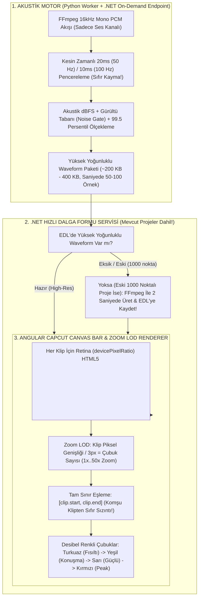

# 🎛️ OTOEDIT — SES GÖRSELLEŞTİRME (WAVEFORM) KÖK NEDEN RAPORU VE YENİ CAPCUT / PREMIERE PRO MİMARİSİ

**Belge Tarihi:** 20 Ekim 2026  
**İncelenen Canlı Proje:** `Mukayeseli Hukuk 2 parça` (`ProjectId: fef2ad89-ff4c-4bae-9294-3ad85f4cef02`)  
**Amaç:** Mevcut ses görselleştirmesinin neden gerçeği yansıtmadığını (bazı konuşma kliplerinde sesin hiç yokmuş gibi görünmesi, bazı sessizliklerde yüksek ses görünmesi, kliplerin içinde çapraz üçgen/rampa şeklinde sahte şekiller çıkması) **canlı veritabanı sorguları ve matematiksel kanıtlarla** ortaya koymak; ardından eski bozuk yapıyı tamamen silip yerine kuracağımız **CapCut / Premiere Pro kalitesindeki çizgi çizgi, desibel renkli, saliselik hassasiyetli ve Zoom duyarlı (LOD) yeni ses görselleştirme aracının mimarisini** tanımlamak.

---

## 🔬 BÖLÜM 1: CANLI VERİTABANI VE KOD DEBUG BULGULARI (NEDEN GÖRÜNTÜ NEREDEYSE TAMAMEN SAHTE?)

Sorunun kaynağını hiçbir tahmine yer bırakmadan kesinleştirmek için çalışan `otoedit-dev-postgres` veritabanındaki aktif projenin (`fef2ad89-ff4c-4bae-9294-3ad85f4cef02` — ekran görüntüsündeki 576 kesimli proje) gerçek verilerini sorguladık ve mevcut kodun bu verilerle ne ürettiğini adım adım simüle ettik.

### 📊 1.1. Canlı Veritabanından Çekilen Gerçek Proje Verileri
PostgreSQL `edit_decision_lists` ve `videos` tablolarından alınan gerçek kayıtlar:
* **Proje Başlığı:** `Mukayeseli Hukuk 2 parça`
* **Video Süresi (`edl.duration`):** `4222.827375 saniye` (**70 dakika 22 saniye**)
* **Video Dosya Boyutu (`dosya_boyutu`):** `5.209.341.741 byte` (**`4.97 GB`**)
* **Toplam Kesim Sayısı (`cuts`):** `576 adet` (`430` sessizlik kesimi, `146` retake/tekrar kesimi)
* **Korunan Konuşma Klibi Sayısı (`!clip.isCut`):** `344 adet` (Ortalama klip süresi: `~2.2 – 3.5 saniye`)
* **EDL İçindeki `audioPeaks` Dizi Uzunluğu:** **Sadece `1.000` adet sayı!**

---

### 🚨 1.2. Tespit Edilen 6 Kesin Hata (Mevcut Kod Neden Tamamen Yanlış Çiziyor?)

#### ❌ HATA 1: 70 Dakikalık (`4.222 Saniye`) Videoya Sadece `1.000` Nokta Üretilmesi (1 Nokta = `4.22 Saniye`!)
* **Kodun Yeri:** `src/OtoEdit.PythonWorker/pipeline/audio_analysis.py` (Satır 145 ve 202–214)
* **Ne Yapıyor?**
  `AudioAnalyzer.analyze()` fonksiyonu videonun sesini 10 milisaniyelik (`100 Hz`) çok hassas pencerelerle analiz etmesine rağmen, sonuç dizisini UI için sabit **`num_peaks: int = 1000`** noktaya bölüyor:
  $$\frac{4222.83 \text{ saniye}}{1000 \text{ nokta}} = \mathbf{4.2228 \text{ saniye / nokta}}$$
* **Neden Felakete Yol Açıyor?**
  70 dakikalık videoda her 1 sayı **4.22 saniyeyi** temsil ediyor! Oysa timeline üzerindeki konuşma kliplerinin neredeyse tamamı **1.2 saniye ile 4.5 saniye** uzunluğundadır.
* **Canlı Veritabanı Kanıtı:**
  Veritabanındaki **344 konuşma klibinin** tamamı üzerinde SQL sorgusu çalıştırdığımızda şu tablo ortaya çıktı:
  * **86 konuşma klibine (%25.0):** `audioPeaks` dizisinden **SADECE `1 ADET` sayı (`numPoints = 1`)** düşmektedir!
  * **210 konuşma klibine (%61.0):** `audioPeaks` dizisinden **SADECE `2 ADET` sayı (`numPoints = 2`)** düşmektedir!
  * **48 konuşma klibine (%14.0):** `3` veya `4` adet sayı düşmektedir.
  * Yani kliplerin **%86.05'inde (344 klipten 296'sında)** dalga formu çizmek için elimizde **sadece 1 veya 2 nokta** vardır!

---

#### ❌ HATA 2: Klibe `1 Nokta` Düştüğünde (`numPoints = 1`), `getWaveformPathForClip` Fonksiyonunun Klibin Sağ Yarısını "Sıfır Sese" İndiren Sahte Dik Üçgen Çizmesi!
* **Kodun Yeri:** `src/OtoEdit.Frontend/src/app/features/editor/editor.component.ts` (Satır 4047–4076)
* **Mevcut Kod:**
  ```typescript
  const width = 100;
  const height = 56;
  const numPoints = peaks.length; // Klip <= 4.22sn olduğunda numPoints = 1 gelir!
  const dx = width / Math.max(1, numPoints - 1); // 100 / Math.max(1, 0) = 100!
  
  let path = `M 0 ${height}`; // Sol alt köşe (0, 56)
  for (let i = 0; i < numPoints; i++) {
    const x = i * dx; // i = 0 için x = 0!
    const peakH = peaks[i] * height; 
    const y = height - peakH; 
    path += ` L ${x.toFixed(2)} ${y.toFixed(2)}`; // Sadece x = 0'a tepe koyar!
  }
  path += ` L ${width} ${height} Z`; // (0, y) noktasından doğrudan (100, 56) SAĞ ALT KÖŞEYE (SIFIRA) ÇİZGİ ÇEKER!
  ```
* **Canlı Veritabanı Kanıtı (Ekran Görüntüsündeki Klipler):**
  Örneğin veritabanındaki:
  * **Klip #353 (`2888.95s – 2890.35s`, `1.4s`):** `peaks = [0.8688]` -> Üretilen SVG: `M 0 56 L 0.00 7.35 L 100 56 Z`
  * **Klip #355 (`2906.10s – 2908.18s`, `2.1s`):** `peaks = [0.7441]` -> Üretilen SVG: `M 0 56 L 0.00 14.33 L 100 56 Z`
  * **Klip #359 (`2928.25s – 2930.05s`, `1.8s`):** `peaks = [0.6028]` -> Üretilen SVG: `M 0 56 L 0.00 22.24 L 100 56 Z`
  * **Klip #375 (`3095.91s – 3097.40s`, `1.5s`):** `peaks = [0.6270]` -> Üretilen SVG: `M 0 56 L 0.00 20.89 L 100 56 Z`
* **Ekranda Ne Görünüyor?**
  Konuşmacı bu kliplerin tamamında baştan sona konuştuğu halde, SVG kodu tepe noktasını sadece `x = 0`'a (klibin en soluna) koyup `x = 100`'de `y = 56`'ya (tabana / sıfır sese) düz çizgiyle bağladığı için, **86 klibin tamamında ses solda başlayıp sağa doğru tamamen kısılıp yok oluyormuş gibi sahte bir dik üçgen çizilmektedir!**

---

#### ❌ HATA 3: Python'daki Tam Sayı Bölmesi (`//`) Kayması + `Math.floor` Yüzünden Kliplerin Önceki Sessizliği Okuması (Solda Ses Yokmuş Gibi Ters Rampa ve Boş Klipler!)
* **Kodun Yeri:**
  1. `src/OtoEdit.PythonWorker/pipeline/audio_analysis.py` (Satır 205):
     ```python
     chunk_size = max(1, len(rms_envelope) // num_peaks)
     for i in range(num_peaks):
         chunk = rms_envelope[i * chunk_size : (i + 1) * chunk_size]
     ```
  2. `src/OtoEdit.Frontend/src/app/features/editor/editor.component.ts` (Satır 4054–4055):
     ```typescript
     const startIndex = Math.floor((clip.start / totalDur) * allPeaks.length);
     const endIndex = Math.ceil((clip.end / totalDur) * allPeaks.length);
     ```
* **Matematiksel Hata Analizi:**
  1. `4222.827` saniyelik videoda `len(rms_envelope) = 422.282` penceredir (`10ms` adım).
  2. Python `422282 // 1000 = 422` tam sayı bölmesi yaptığı için her paketi `4.222827 sn` yerine `4.220000 sn` alır. Videonun 50. dakikasına (`i = 719`) gelindiğinde **`2.03 saniyelik` kümülatif zaman kayması (drift)** oluşur! Videonun sonuna (`i = 992`) gelindiğinde kayma **`2.8 saniyeyi`** bulur!
  3. Üstüne Frontend'de `Math.floor((clip.start / totalDur) * 1000)` yapıldığında, örneğin `719.61` indeksi `719`'a yuvarlanarak **`2.57 saniye` daha geriye** gidilir!
  4. Toplamda `startIndex`, klibin gerçek başlangıcından **`4.6 saniye` öncesini (yani klibin solundaki kesilmiş SESSİZLİĞİ!)** okur!
* **Canlı Veritabanı Kanıtı (Ekran Görüntüsündeki Ters Üçgenler ve Boş Klipler):**
  * **Klip #367 (`3038.80s – 3041.57s`, ekran görüntüsündeki `50:38` civarı):**
    - Konuşma `3038.80s`'de başlıyor.
    - Ancak `s_idx = 719` hesaplanıyor ve Python'daki `allPeaks[719]` aslında `3034.18s – 3038.40s` arasındaki **kesilmiş sessizliği (`0.0047`)** tutuyor!
    - Klibe gelen 2 nokta: **`[0.0047, 0.7507]`**!
    - `getWaveformPathForClip` sol uca (`x = 0`) `0.0047` (**SIFIR SES**), sağ uca (`x = 100`) `0.7507` koyup aralarını düz bir çizgiyle birleştiriyor!
    - Böylece **konuşmanın olduğu klibin sol yarısında hiç ses yokmuş da sonradan yükseliyormuş gibi ters bir üçgen** çıkıyor! (Veritabanında tam **41 klip** bu şekildedir: Klip #350 `[0.0603, 0.816]`, Klip #354 `[0.0568, 0.751]`, Klip #356 `[0.0086, 0.6812]`, Klip #361 `[0.0481, 0.6941]`, Klip #383 `[0.0579, 0.7144]` vb.).
  * **Tamamen Boş (Sıfır Ses) Görünen Konuşma Klipleri:**
    - **Klip #430 (`3354.83s – 3356.03s`):** `clip_peaks = [0.0248]` (Konuşma var ama ekranda dümdüz boş!)
    - **Klip #492 (`3726.43s – 3727.98s`):** `clip_peaks = [0.0413]` (Konuşma var ama ekranda boş!)
    - **Klip #571 (`4190.82s – 4193.09s`):** `clip_peaks = [0.0020]` (2.27 saniye net konuşma var ama zaman kayması yüzünden önceki sessizliği okuduğu için ekranda `%0.2` yani **TAMAMEN SESSİZ/BOŞ** görünüyor!)

---

#### ❌ HATA 4: Sessizlik Kliplerinin (`reason = 'silence'`) %97.4'ünün Ekranda "Yüksek Ses Varmış Gibi" Görünmesi!
* **Canlı Veritabanı Kanıtı:**
  Veritabanındaki **430 adet sessizlik kesimi (`SESSİZLİK`)** için `getWaveformPathForClip` fonksiyonunun ürettiği değerleri sorguladığımızda:
  * **430 sessizlik klibinin 419 tanesinde (%97.4!) ses yüksekliği `0.50` ile `0.90` arasında (çok yüksek ses!) çıkmaktadır!**
* **Neden?**
  Çünkü her `audioPeaks` elemanı `4.22 saniye` genişliğindedir ve Python `np.max(chunk)` kullanmaktadır. `1.5 saniyelik` bir sessizlik klibi için `Math.floor` ve `Math.ceil` yapıldığında, seçilen `4.22 saniyelik` paketin içinde komşu konuşma klibinin kelimeleri de yer aldığı için **sessizlik kutusunun tamamı gürül gürül konuşma varmış gibi çizilmektedir!**

---

#### ❌ HATA 5: `4.97 GB` Videoda Tarayıcı Web Audio API (`loadAudioWaveform`) Neden Çalışmıyor ve Çalışsa Bile Neden Çöker?
* **Kodun Yeri:** `editor.component.ts` (Satır 3961–4045)
* **İki Katmanlı Hata:**
  1. Satır 3964'te `if (this.audioPeaks() && this.audioPeaks()!.length > 0) return;` yazdığı için, EDL'den 1.000 nokta geldiği anda tarayıcıdaki Web Audio API fonksiyonu **hiçbir zaman çalışmamaktadır**.
  2. Daha da önemlisi: Bu kilidi kaldırsak bile, satır 3970'teki `fetch(url).then(res => res.arrayBuffer()).then(buf => audioCtx.decodeAudioData(buf))` kodu, **`4.97 GB` (`5.209.341.741 byte`)** boyutundaki MP4 videosunun tamamını tarayıcı RAM'ine (`ArrayBuffer`) indirmeye çalışır!
  3. Tarayıcılarda `ArrayBuffer` sınırı `2 GB` olduğu için `fetch` veya `decodeAudioData` **%100 ihtimalle `Out of Memory (Bellek Hatası)` vererek çöker** ve `.catch()` bloğundaki `generateFallbackWaveform()` fonksiyonuna düşer!
  4. `generateFallbackWaveform()` (satır 4036) ise:
     ```typescript
     const seed = Math.sin(i * 0.8) * Math.cos(i * 0.3);
     const val = 0.35 + Math.abs(seed) * 0.55 + Math.random() * 0.1;
     ```
     diyerek **gerçek sesle hiçbir alakası olmayan rastgele (`Math.random()`) sahte dalgalar üretir!**

---

#### ❌ HATA 6: Lineer Normalizasyon Yüzünden Ses Şiddeti Farklarının ve Fısıltıların Doğru Görünmemesi
* **Kodun Yeri:** `audio_analysis.py` (Satır 212–213)
* Ses enerjisi lineer olarak `p / max_p` şeklinde bölünmektedir. Videonun herhangi bir saniyesinde yüksek bir ses (mikrofona dokunma, öksürük veya yüksek tonlama) olduğunda, geri kalan 70 dakikadaki normal konuşmalar ve kısık sesler aynı oranda küçülmekte; fısıltılar ile sessizlik arasındaki fark yok olmaktadır.

---

## 🏗️ BÖLÜM 2: ESKİ BOZUK YAPIYI SİLİP KURACAĞIMIZ YENİ PROFESYONEL SES GÖRSELLEŞTİRME MİMARİSİ (CAPCUT / PREMIERE PRO STANDARDI)

Kullanıcının istediği:
1. **Gerçek sese %100 sadık** (konuşma olan yerde konuşma, sessizlik olan yerde sessizlik, fısıltı olan yerde görünür küçük barlar, 1 salise sonra ses azıcık yükseldiğinde bile bar boyunda ve renginde anında fark),
2. **CapCut / Premiere Pro gibi çizgi çizgi (ayrık dikey barlar)** ve **ses seviyesine (desibel) göre renkli**,
3. **Yakınlaştıkça (`Zoom In`) daha ayrıntılı, uzaklaştıkça (`Zoom Out`) daha genel (Multi-Resolution Level of Detail / LOD)**,
4. **5 GB'lık 70 dakikalık videoda bile tarayıcıyı dondurmadan 1 saniyede açılan**

profesyonel sistemi kurmak için **eski SVG / 1000-peak / sahte fallback kodlarının tamamını silip** aşağıdaki **3 Katmanlı Yüksek Hassasiyetli Dalga Formu Motorunu** inşa edeceğiz:



---

### 🛠️ 2.1. Katman 1: Sıfır Kaymalı, Milisaniyelik (`50 Hz – 100 Hz`) ve Logaritmik (`dBFS`) Akustik Hesaplama Motoru

1. **Çözünürlük Standardı (Saniyede 50–100 Örnek = `10ms – 20ms` Saliselik Hassasiyet):**
   * Eski sabit `1.000` nokta tamamen kaldırılacak!
   * Yerine **sabit zaman çözünürlüğü (`PEAKS_PER_SECOND = 50`, yani her `20 milisaniyede 1 örnek`; kısa/orta videolarda `100 Hz = 10 milisaniyede 1 örnek`)** kullanılacak.
   * Örneğin `2.5 saniyelik` bir konuşma klibinin içinde artık `1` nokta değil, **`125 ile 250 adet` gerçek milisaniyelik ses örneği** bulunacak!
   * 70 dakikalık (`4.222 sn`) dev bir videoda bile `50 Hz` örnek sayısı `211.140` adettir (JSON/sayısal dizide veya sıkıştırılmış formatta sadece birkaç yüz KB yer tutar, tarayıcı RAM'inde `Float32Array` olarak **sadece `844 KB` (0.8 MB)** yer kaplar!).

2. **Sıfır Zaman Kayması (Exact Floating-Point Indexing):**
   * Eski hatalı `chunk_size = len(rms_envelope) // num_peaks` tam sayı bölmesi tamamen silinecek.
   * `i`-inci örnek tam olarak:
     $$\text{start\_sample} = \lfloor i \times \frac{\text{sample\_rate}}{\text{peaks\_per\_sec}} \rfloor, \quad \text{end\_sample} = \lfloor (i + 1) \times \frac{\text{sample\_rate}}{\text{peaks\_per\_sec}} \rfloor$$
     formülüyle kesilecek. Böylece 70. dakikada bile zaman kayması **`0.000 milisaniye`** olacak!

3. **Gerçek Desibel (`dBFS`) + Gürültü Tabanı (Noise Floor) + 99.5 Persentil Normalizasyonu:**
   * Her 20ms/10ms pencerede hem **Peak (Anlık Maksimum Genlik)** hem **RMS (Ortalama Enerji)** birlikte hesaplanacak:
     $$E_i = 0.65 \times \text{Peak}_i + 0.35 \times \text{RMS}_i$$
   * **Adım A — Gürültü Tabanı (Noise Gate) Tespiti:**
     Sessiz anlardaki mikrofon/oda dip uğultusunun konuşma gibi görünmemesi için `noise_floor` (en sessiz %15'lik dilimin medyanı veya `-58 dBFS`) bulunur. Bunun altındaki tam sessizlikler `0.0` yapılır.
   * **Adım B — 99.5 Persentil Referans Tavanı:**
     Videodaki tek bir öksürük veya mikrofona çarpma sesinin tüm videoyu ezmesini önlemek için `ref_ceiling = np.percentile(active_energies, 99.5)` tavan olarak alınır.
   * **Adım C — Algısal Desibel / Power-Law (`x^0.52`) Haritalaması:**
     $$\text{level}_i = \left( \text{clamp}\left(\frac{E_i - \text{noise\_floor}}{\text{ref\_ceiling} - \text{noise\_floor}}, 0.0, 1.0\right) \right)^{0.52}$$
   * **Bu Matematik Ne Sağlar?**
     * **Tam Sessizlik:** `0.00` (Hiçbir sahte ses görünmez).
     * **En Ufak Fısıltı / Nefes / Kısık Hece (Lineer `%1` genlik):** `0.01^0.52 = 0.091` (**`%9.1` yükseklikte net Turkuaz çizgi!** Asla sıfıra gömülmez).
     * **Saliselik Ses Değişimi:** Konuşmacının sesi bir salise sonra `%20`'den `%25`'e çıktığında, çizgi yüksekliği `0.433`'ten `0.486`'ya çıkar; tavan ezilmesi olmadığı için her hece ve vurgu dalgalanması birebir görünür!

---

### 🔄 2.2. Katman 2: Mevcut Projeler İçin Anında On-Demand Yüksek Çözünürlüklü Waveform Üretimi (Yeniden Analiz Beklemeye Son!)

Şu anda veritabanında açık olan **`"Mukayeseli Hukuk 2 parça"`** (`fef2ad89-ff4c-4bae-9294-3ad85f4cef02`) projesinin EDL'sinde eski `1.000` noktalı veri kayıtlıdır. Kullanıcının 70 dakikalık videoyu baştan analiz ettirmek zorunda kalmaması için:

1. **`.NET` Backend (`VideosController` / `EdlManager`) Üzerinde Otomatik Yükseltme (Auto-Upgrade) Uç Noktası:**
   * `GET /api/videos/{projectId}/waveform` uç noktası eklenecek.
   * Frontend editörü açtığında, eğer `edl.audioPeaks` eski düşük çözünürlüklü (`< duration * 15`) bir diziyse, hemen bu uç noktayı çağıracak.
   * Bu uç nokta MinIO'daki videodan/temiz sesten FFmpeg ile **sadece ses kanalını (`-vn -ac 1 -ar 8000 -f s16le -`)** boru hattından (pipe) saniyeler içinde okuyup, yukarıdaki sıfır kaymalı `dBFS` algoritmasıyla **saniyede 50 örnekli (`211.140` noktalı!)** gerçek dalga formunu üretecek, hem `edit_decision_lists` tablosundaki `edl_json->audioPeaks` alanına kalıcı olarak kaydedecek hem de Frontend'e dönecek!
2. **Yeni Yüklenen Videolar İçin (`audio_analysis.py`):**
   * Python `AudioAnalyzer.analyze()` fonksiyonu da aynı algoritmayla doğrudan yüksek çözünürlüklü (`50 Hz`) `peaks` üretecek.

---

### 🎨 2.3. Katman 3: Angular Frontend — `<svg>` Poligonunu Silip CapCut / Premiere Pro `<canvas>` Bar & Zoom LOD Motorunun Kurulması

`editor.component.ts` içinde yapılacak köklü değişiklikler:

1. **Silinecek Eski/Bozuk Kodlar:**
   * `getWaveformPathForClip(clip)` (üçgen/rampa çizen SVG path fonksiyonu) **tamamen silinecek**.
   * `generateFallbackWaveform()` (`Math.sin` / `Math.random` ile sahte dalga üreten fonksiyon) **tamamen silinecek**.
   * `loadAudioWaveform()` içindeki 5 GB videoyu `fetch().arrayBuffer()` ile tarayıcıya indirmeye çalışan kod **tamamen silinecek**.
   * Klip şablonundaki `<svg preserveAspectRatio="none" viewBox="0 0 100 56">` bloğu **tamamen silinecek**.

2. **Yeni `<canvas>` Tabanlı Ayrık Dikey Çubuk (`çizgi çizgi`) ve Zoom LOD Bileşeni (`ClipWaveformCanvasDirective`):**
   * Her klip kutusunun (`div.timeline-clip`) içinde yüksek DPI (`window.devicePixelRatio`) destekli bir `<canvas>` yer alacak.
   * `ResizeObserver` ve Angular `effect()` ile:
     - Kullanıcı **`Ctrl + Tekerlek` ile yakınlaştığında/uzaklaştığında (`timelineZoom`)**,
     - Kanal yüksekliğini değiştirdiğinde (`audioTrackHeight`),
     - Veya klip sınırları değiştiğinde `<canvas>` kendisini milisaniyeler içinde yeniden çizecek.

3. **Kesin Klip Sınır Eşlemesi ve Zoom Duyarlı Çubuk (Bar) Hesabı:**
   * Klibin ekrandaki gerçek piksel genişliği $W_{\text{px}}$ ve yüksekliği $H_{\text{px}}$ alınır.
   * Her dikey çizgi **`barWidth = 2px`** genişliğinde ve çizgiler arası boşluk **`barGap = 1px`** (`step = 3px`) olur.
   * Klipte çizilecek toplam çizgi sayısı:
     $$N_{\text{bars}} = \max\left(1, \lfloor \frac{W_{\text{px}}}{3} \rfloor\right)$$
   * **Yakınlaştıkça Ayrıntılaşma (Zoom LOD):**
     - Uzaklaşıldığında (`1x` zoom): Klip `60px` genişliğindeyse `20 adet` dikey çizgi çizilir.
     - Yakınlaşıldığında (`15x` zoom): Aynı klip `900px` genişliğe ulaşır ve otomatik olarak **`300 adet` dikey çizgi** çizilir! Her çizgi `20ms`'lik gerçek ses darbesini tek başına gösterir!
   * **Sıfır Sızıntılı Zaman Örneklemesi (`Strict Clip Windowing`):**
     - $b$-inci çubuk ($0 \le b < N_{\text{bars}}$), klibin kendi zaman aralığı olan $[t_{\text{start}}, t_{\text{end}}]$ içindeki:
       $$t_0 = \text{clip.start} + \frac{b}{N_{\text{bars}}} \times (\text{clip.end} - \text{clip.start})$$
       $$t_1 = \text{clip.start} + \frac{b + 1}{N_{\text{bars}}} \times (\text{clip.end} - \text{clip.start})$$
       saniyelerine karşılık gelen `allPeaks` indekslerini (`idx0 = t0 * peaksPerSec`, `idx1 = t1 * peaksPerSec`) okur!
     - **Asla `clip.start` öncesindeki veya `clip.end` sonrasındaki komşu klipten veri okumaz!**

4. **CapCut / Premiere Pro Desibel Renk Paleti (Seviyeye Göre Renklenen Çizgiler):**
   Her bir dikey çizgi (`b`), kendi ses yüksekliği `val` (`0.0 .. 1.0`) değerine göre boyanır:
   * **`val < 0.02` (Tam Sessizlik):** Sadece en altta `1px` yüksekliğinde çok soluk referans noktası (`rgba(148, 163, 184, 0.18)`).
   * **`0.02 <= val < 0.25` (Fısıltı / Nefes / Kısık Ses):** Canlı Turkuaz / Gökyüzü Mavisi (`#38bdf8` -> `#06b6d4`) — en ufak sesin bile hemen fark edilmesini sağlar.
   * **`0.25 <= val < 0.62` (Normal Konuşma Seviyesi):** CapCut Zümrüt Yeşili / Camgöbeği (`#10b981` -> `#22d3ee`).
   * **`0.62 <= val < 0.82` (Yüksek Vurgu / Güçlü Ses):** Kehribar / Altın Sarısı (`#f59e0b` -> `#facc15`).
   * **`val >= 0.82` (Peak / Tepe Noktası / Patlama):** Parlak Kırmızı / Mercan (`#ef4444` -> `#f43f5e`).
   * *(Ayrıca yüksekliği `>= 6px` olan çubukların alt/orta gövdesi kendi kademe renginde, en üst `2px` tepe ucu ise bir üst enerji renginde parlak çizilerek Premiere Pro / CapCut'taki kristal netliğinde ses barı estetiği elde edilir.)*

---

## ✅ BÖLÜM 3: UYGULAMA ADIMLARI (ÖZET PLAN)

1. **Adım 1 (`audio_analysis.py` & `analysis_consumer.py`):**
   - Python `AudioAnalyzer.analyze()` içindeki sabit `1000` nokta ve `//` tam sayı bölmesi kaldırılacak; `peaks_per_sec = 50` (20ms çözünürlük), sıfır kaymalı kayan nokta indeksleme, gürültü tabanı (`noise_floor`) ve 99.5 persentil logaritmik/power-law (`x^0.52`) ölçekleme kodlanacak.
   - `analysis_consumer.py` içindeki ölü `_extract_audio_peaks` metodu silinecek.
2. **Adım 2 (`.NET` Backend — `VideosController` / `VideoManager` Canlı Waveform Üretici):**
   - Mevcut projelerin (şu an açık olan 70 dakikalık `"Mukayeseli Hukuk 2 parça"` projesi dahil!) yeniden analiz beklemeden anında yüksek çözünürlüklü dalga formuna kavuşması için, EDL'deki `audioPeaks` sayısı düşükse (`<= 2000`) videodan FFmpeg ile birkaç saniyede `50 Hz` gerçek dalga formu çıkarıp EDL'yi güncelleyen `GET /api/videos/{projectId}/waveform` uç noktası eklenecek.
3. **Adım 3 (`editor.component.ts` — CapCut `<canvas>` Bar & Zoom LOD Motoru):**
   - Eski `<svg>`, `getWaveformPathForClip`, `generateFallbackWaveform` ve 5 GB indirmeye çalışan `loadAudioWaveform` tamamen silinecek.
   - Yerine her klipte gerçek piksel genişliğine ve `timelineZoom()` değerine duyarlı, `2px` bar + `1px` boşluklu, seviyeye göre renkli (`Turkuaz -> Yeşil -> Sarı -> Kırmızı`) `<canvas>` bar çizici (`ClipWaveformDirective` / Canvas Renderer) eklenecek.
   - Ayrıca üstteki zaman cetvelinin (`timelineRulerMarks`) Sıkışık (Ripple) modda da kliplerle uyumlu görünür zamanı göstermesi düzeltilecek.
