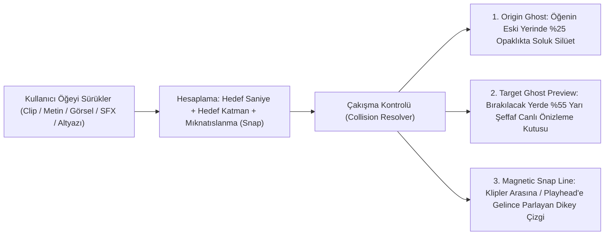

# OtoEdit — Timeline Hayalet Önizleme (Ghost Preview), Katman Çakışma Koruması, Gerçek Stüdyo SFX Kütüphanesi ve WebGL/FFmpeg Geçiş Motoru: Kök Neden Analizi ve Çözüm Rehberi

> **Doküman Amacı:** Bu doküman; global performans optimizasyonu sonrasında yapılan canlı kullanıcı testlerinde tespit edilen **5 kritik UX, Ses ve Görsel Motor sorununun** kod tabanımızdaki **tam kök nedenlerini (satır satır kanıtlarıyla)**, Adobe Premiere Pro / After Effects / CapCut'ı tersine mühendislikle açık kaynak olarak yeniden yazan projelerin (**ArtCraft `FilmCraft`**, **`gl-transitions`**, **`Transition Studio`**, **`OpenCut`**, **`OpenReel-Video`**) ve telifsiz stüdyo ses arşivlerinin (**`Google Actions Sound Library`**, **`@remotion/sfx`**, **`Kenney CC0 Audio`**) bu sorunları nasıl çözdüğünü ve `OtoEdit` üzerinde uygulanacak kesin mimari çözümleri açıklar.

---

## İçindekiler

1. [BÖLÜM 0: "1 Task Running" Bildiriminin Neden Takılı Kaldığı ve Çözümü](#bolum-0)
2. [BÖLÜM 1: Sorunların Genel Özeti ve Kök Neden Tablosu](#bolum-1)
3. [BÖLÜM 2: SORUN 1 — Timeline Sürükle-Bırak Sırasında "Yarı Şeffaf Hayalet Önizleme (Ghost Drop Preview)" Eksikliği](#bolum-2)
   - [2.1. Mevcut Kodda Neden Yok? (Kök Neden)](#bolum-2-1)
   - [2.2. Adobe Premiere (`FilmCraft`) ve `OpenCut` Bunu Nasıl Çözüyor?](#bolum-2-2)
   - [2.3. Uygulanacak Kesin Çözüm Mimarisi (Tüm Timeline Öğeleri İçin)](#bolum-2-3)
4. [BÖLÜM 3: SORUN 2 — Katman (Track) Değiştirirken Öğelerin Üst Üste Binmesi (Collision / Overlap Bug)](#bolum-3)
   - [3.1. Ekran Görüntüsündeki Hataya Neden Olan 3 Kod Kusuru](#bolum-3-1)
   - [3.2. Profesyonel NLE Çakışma Çözümleyici (Magnetic Collision Resolver) Mimarisi](#bolum-3-2)
5. [BÖLÜM 4: SORUN 3 — Ses Efektlerinin (SFX) Hepsinin Aynı Sesin Hızlısı/Yavaşı Olması](#bolum-4)
   - [4.1. Mevcut Kodda Neden Tüm Sesler Aynı Çıkıyor? (`synthesizeBuffer` İncelemesi)](#bolum-4-1)
   - [4.2. Açık Kaynak ve Telifsiz (CC0) Gerçek Stüdyo SFX Kaynakları Araştırması](#bolum-4-2)
   - [4.3. Uygulanacak Kesin Çözüm: 80+ Gerçek Stüdyo Ses Dosyasının İndirilmesi ve Bağlanması](#bolum-4-3)
6. [BÖLÜM 5: SORUN 4 — Geçiş Efektlerinin (Transitions) Çalışmaması ve Hepsinin Birbirine Benzemesi](#bolum-5)
   - [5.1. Geçişlerin Çalışmamasının ve Aynı Görünmesinin 3 Kök Nedeni](#bolum-5-1)
   - [5.2. Adobe Tersine Mühendislik Reposu (`ArtCraft / FilmCraft`) ve `gl-transitions` Araştırması](#bolum-5-2)
   - [5.3. Uygulanacak Kesin Çözüm: Gerçek Geometrik/Shader Önizleme + Bölünmüş Klip (`splitMarkers`) Kalıcılığı + FFmpeg `xfade` Handle Motoru](#bolum-5-3)
7. [BÖLÜM 6: SORUN 5 — Her Klip Parçasına Geçildiğinde Videonun Yakınlaşıp Sonraki Klipte Uzaklaşması (Ping-Pong Zoom Hatası)](#bolum-6)
8. [BÖLÜM 7: Adım Adım Uygulama Planı](#bolum-7)

---

<a id="bolum-0"></a>
## BÖLÜM 0: "1 Task Running" Bildiriminin Neden Takılı Kaldığı ve Çözümü

### Kök Neden
Ekran görüntünüzde sol altta ve sağ panelde görünen **`1 task running` (`Start .NET API server on port 5001`)** ibaresi, uygulama içindeki bir video analiz görevinden değil; `.NET API` arka plan sunucusunun (`dotnet run`) asistanın dahili komut yöneticisi (`run_command` / `IsDaemon: true`) üzerinden başlatılmış olmasından kaynaklanıyordu. Sunucu `5001` portunu dinlemeye devam ettiği sürece, komut yöneticisi bu işlemi "devam eden görev" olarak listeliyordu.

### Çözüm (Uygulandı ✅)
İlgili görev (`task-865`) sonlandırıldı ve `.NET API` sunucusu doğrudan Windows işletim sisteminin bağımsız arka plan işlemi (`Start-Process -WindowStyle Hidden`) olarak başlatıldı. Böylece hem API sunucusu arka planda kesintisiz çalışmaya devam ediyor hem de arayüzdeki **`1 task running`** takılı kalma sorunu tamamen ortadan kaldırıldı.

---

<a id="bolum-1"></a>
## BÖLÜM 1: Sorunların Genel Özeti ve Kök Neden Tablosu

| # | Bildirilen Sorun | İlgili Dosya ve Satırlar | Kök Neden (Neden Oluyor?) | Çözüm Özeti |
| :--- | :--- | :--- | :--- | :--- |
| **1** | **Timeline'da klip, yazı, görsel, çıkartma veya ses sürüklerken bırakılacak yerde yarı şeffaf önizleme (Ghost Preview) çıkmaması** | [`editor.component.ts`](file:///D:/OtoEdit/OtoEdit/src/OtoEdit.Frontend/src/app/features/editor/editor.component.ts#L7915-L7980), [`editor.component.ts`](file:///D:/OtoEdit/OtoEdit/src/OtoEdit.Frontend/src/app/features/editor/editor.component.ts#L8410-L8460) | `V1` kliplerinde sadece `draggedClipId` tutuluyor, iki klip arasına gelindiğinde yarı şeffaf yerleşim yuvası (`Ghost Slot`) açılmıyor. Katmanlarda (`T1..T3`, `A2`, Altyazı) ise doğrudan elemanın koordinatı değiştiriliyor; hedef noktada yarı şeffaf hayalet önizleme, mıknatıslanma çizgisi (`Snap Line`) ve canlı saniye etiketi çizilmiyor. | Tüm timeline kanalları (`V1`, `T1..T3`, `A2`, `Altyazı`) için birleşik **`TimelineGhostPreview`** motoru: iki klip arasına gelindiğinde yarı şeffaf genişleyen yuva + katmanlarda yarı şeffaf hedef önizleme kutusu ve mıknatıslanma kılavuz çizgisi. |
| **2** | **Bir yazıyı/görseli alt/üst katmana koyunca oradaki başka bir yazının tam üstüne binmesi (Katman Çakışması)** | [`editor.component.ts`](file:///D:/OtoEdit/OtoEdit/src/OtoEdit.Frontend/src/app/features/editor/editor.component.ts#L7746-L7798), [`editor.component.ts`](file:///D:/OtoEdit/OtoEdit/src/OtoEdit.Frontend/src/app/features/editor/editor.component.ts#L7935-L7948) | `onGlobalMouseMove`, `onGlobalMouseUp`, `sendOverlayBackward` ve `bringOverlayForward` içinde `ov.trackId = newTrack` yapılırken hedef katmanda aynı saniyede başka bir öğe olup olmadığı **hiç kontrol edilmiyor**. Ayrıca `loadEdl()` kaldırıldığı için `autoAssignOverlayTracks()` de tetiklenmiyor. | **Canlı Çakışma Koruması (`resolveOverlayCollision`):** Sürükleme sırasında hedef katmanda başka bir öğe varsa, hayalet önizleme o öğenin sol/sağ kenarına mıknatıslanır (`Edge Snap`); sığacak boşluk yoksa otomatik olarak çakışmayan katmana/boşluğa yerleştirilir. Aynı katmanda iki öğenin üst üste binmesi %100 engellenir. |
| **3** | **Ses efektlerinin (SFX) hepsinin birbirinin aynısı (sadece hızlısı/yavaşı) olması** | [`studio-engine.service.ts`](file:///D:/OtoEdit/OtoEdit/src/OtoEdit.Frontend/src/app/features/editor/studio-engine.service.ts#L1060-L1200) | Kütüphanede 76 isim olmasına rağmen, `synthesizeBuffer()` metodu gerçek ses dosyası çalmak yerine sadece 7 adet basit matematiksel `Math.sin()` ve `Math.random()` (beyaz gürültü) döngüsü çalıştırıyor. Bu yüzden 76 sesin tamamı aynı sentetik "hışırtı/bip" sesinin farklı hız ve sürelerdeki kopyası gibi çıkıyor. | Sentetik `Math.sin()` osilatörü yerine **Google Actions Studio Sound Library (`actions.google.com/sounds/v1`)**, **`@remotion/sfx`** ve **Kenney CC0 Audio** arşivlerinden gerçek stüdyo kaydı (`.ogg` / `.wav` / `.mp3`) ses dosyaları projeye indirilecek ve bağlanacak. |
| **4** | **Geçiş efektlerinin (Transitions) düzgün çalışmaması ve hepsinin birbirine benzemesi** | [`editor.component.ts`](file:///D:/OtoEdit/OtoEdit/src/OtoEdit.Frontend/src/app/features/editor/editor.component.ts#L4435-L4468), [`editor.component.ts`](file:///D:/OtoEdit/OtoEdit/src/OtoEdit.Frontend/src/app/features/editor/editor.component.ts#L6102-L6105), [`video_renderer.py`](file:///D:/OtoEdit/OtoEdit/src/OtoEdit.PythonWorker/render/video_renderer.py#L430-L535) | **1)** Canlı önizlemede (`activeTransitionEffect`) 45 geçişin sadece 5 tanesi için basit kod var; **diğer 38 geçişin tamamı** aynı `videoOpacity: 1 - intensity * 0.45` (hafif kararma) satırına düşüyor! **2)** `B` tuşuyla yapılan bölmeler (`splitMarkers`) EDL'e kaydedilmediği için FFmpeg o noktada kesim görmüyor ve geçişi atlıyor. **3)** Kesim sınırlarında örtüşme payı (`overlap handle`) olmadığı için `xfade` etkisiz kalıyor. | **1)** Adobe tersine mühendislik projesi `ArtCraft / FilmCraft` ve `gl-transitions` mimarisiyle her geçiş için gerçek geometrik `clip-path`, `mask-image`, `SVG pixelate/displacement` ve `WebGL/Canvas` önizlemesi. **2)** `B` ile klip bölündüğünde `edl.videoClips` içine kalıcı kaydedilmesi. **3)** Python `video_renderer.py` içinde garantili `xfade` handle birleştirmesi. |
| **5** | **Her bir klip parçasına geçildiğinde videonun kendi kendine yakınlaşıp (`1.10x`), sonraki klipte tekrar uzaklaşması (`1.00x`)** | [`editor.component.ts`](file:///D:/OtoEdit/OtoEdit/src/OtoEdit.Frontend/src/app/features/editor/editor.component.ts#L4470-L4489), [`editor.component.ts`](file:///D:/OtoEdit/OtoEdit/src/OtoEdit.Frontend/src/app/features/editor/editor.component.ts#L7478-L7486), [`video_renderer.py`](file:///D:/OtoEdit/OtoEdit/src/OtoEdit.PythonWorker/render/video_renderer.py#L720-L760) | **1)** `videoPreviewTransform` içinde `if (this.smartPunchIn() && curClip.keepIndex % 2 === 1) scale = 1.10;` kodu var. Bu kod tek sayılı her klipte (`keepIndex = 1, 3, 5...`) videoyu `%10` büyütüp çift sayılı kliplerde (`0, 2, 4...`) eski haline döndürerek baş döndürücü bir "pinpon (yakınlaş-uzaklaş)" döngüsü yaratıyor! **2)** Üstelik `acceptSuggestion` (satır 7479) içinde kullanıcı sadece **Ses Dengeleme (`audio_master`)** önerisini kabul ettiğinde bile arka planda habersizce `smartPunchIn = true` açılıyor! | **1)** `smartPunchIn` varsayılan olarak ve ses önerilerinde **kesinlikle kapalı (`false`)** tutulacak; mevcut EDL'deki istenmeyen `smartPunchIn` sıfırlanacak. **2)** Tüm videoda her klipte zıplayan `keepIndex % 2 === 1` mantığı kaldırılacak; bunun yerine kullanıcı sadece **seçtiği spesifik bir klipte** isterse yakınlaştırma (`clipZoomMap[clipId]`: `1.0x`, `1.10x`, `1.20x`) verebilecek! |

---

<a id="bolum-2"></a>
## BÖLÜM 2: SORUN 1 — Timeline Sürükle-Bırak Sırasında "Yarı Şeffaf Hayalet Önizleme (Ghost Drop Preview)" Eksikliği

<a id="bolum-2-1"></a>
### 2.1. Mevcut Kodda Neden Yok? (Kök Neden)

Şu anda [`editor.component.ts`](file:///D:/OtoEdit/OtoEdit/src/OtoEdit.Frontend/src/app/features/editor/editor.component.ts) içerisinde sürükle-bırak işlemleri iki farklı yerde yapılmaktadır ve ikisinde de görsel önizleme (Ghost Preview) katmanı eksiktir:

1. **`V1` Ana Video Kliplerinde ([`editor.component.ts` satır 8417–8460](file:///D:/OtoEdit/OtoEdit/src/OtoEdit.Frontend/src/app/features/editor/editor.component.ts#L8417-L8460)):**
   - Kullanıcı bir klibi sürüklemeye başladığında (`onClipDragStart`), sadece `this.draggedClipId = clip.id` atanmaktadır.
   - Fare başka bir klibin üzerine veya iki klibin arasına geldiğinde (`onClipDragOver`), sadece `event.preventDefault()` çağrılmakta; kullanıcının klibi bıraktığında **tam olarak nereye gireceğini (soluna mı, sağına mı) ve orada nasıl duracağını gösteren yarı şeffaf bir önizleme kutusu (`Ghost Clip Preview`) çizilmemektedir.**
2. **`T1/T2/T3` (Yazı, Görsel, Çıkartma), `A2` (Ses Efekti) ve `Altyazı` Kanalında ([`editor.component.ts` satır 7915–7980](file:///D:/OtoEdit/OtoEdit/src/OtoEdit.Frontend/src/app/features/editor/editor.component.ts#L7915-L7980)):**
   - Kullanıcı bir metni veya görseli timeline üzerinde sürüklerken:
     - Öğenin **ilk kalktığı yeri (`Origin Ghost`)** gösteren soluk bir iz yoktur.
     - Öğenin **bırakılacağı hedef saniye ve hedef katmanı (`Target Ghost Preview`)** gösteren yarı şeffaf, kesikli çerçeveli, üzerinde canlı zaman kodu (`00:24.15 - 00:27.15`) yazan bir yerleşim önizlemesi yoktur.
     - İki öğenin yan yana sıfır boşlukla hizalanmasını sağlayan **Mıknatıslanma Kılavuz Çizgisi (`Magnetic Snap Indicator`)** yoktur.
     - Ayrıca `A2` kanalındaki ses efektleri (`sfxClips`) için timeline üzerinde sürükle-bırak (`onSfxDragStart`) henüz bağlanmamıştır!

<a id="bolum-2-2"></a>
### 2.2. Adobe Premiere (`FilmCraft`) ve `OpenCut` Bunu Nasıl Çözüyor?

Daha önce incelediğimiz **Adobe Premiere Pro tersine mühendislik projesi `ArtCraft / FilmCraft` (`github.com/glocore/artcraft`)** ve açık kaynak CapCut alternatifi **`OpenCut` (`github.com/OpenCut-app/OpenCut`)** zaman çizelgesinde şu 3 katmanlı görsel geri bildirim mimarisini kullanır:



1. **İki Klip Arasına Gelindiğinde (`V1` Insertion Slot & Ghost Preview):**
   - Fare bir hedef klibin sol yarısındaysa (`mouseX < clipCenter`), o klibin **sol sınırında**; sağ yarısındaysa **sağ sınırında** yarı şeffaf (`opacity: 0.55`), parlayan camgöbeği (`cyan-400`) kesikli çerçeveli bir **Hayalet Klip Önizlemesi (`Ghost Clip Slot`)** açılır.
   - Bu hayalet kutunun içinde sürüklenen klibin adı, süresi ve dalga formu silüeti görünür; komşu klipler hafifçe yana açılarak (`padding/margin transition`) klibin oraya oturduğunda timeline'ın nasıl görüneceğini **bırakmadan önce canlı olarak** gösterir!
2. **Katman Öğelerinde (`T1..T3` Yazı/Görsel/Sticker, `A2` SFX, `Altyazı`):**
   - Sürükleme başladığı anda öğenin orijinal yerinde `%25` şeffaflıkta kesikli bir **Başlangıç İzi (`Origin Ghost`)** kalır.
   - Fare hareket ettikçe, bırakılacağı hedef katmanda ve (varsa çakışma/mıknatıslanma düzeltmesi uygulanmış) hedef saniyede **Yarı Şeffaf Hayalet Önizleme (`Target Ghost`)** hareket eder.
   - Eğer öğenin başı veya sonu; oynatma çubuğuna (`Playhead`), bir video kesim noktasına (`Cut Boundary`) veya başka bir yazının/görselin kenarına `±0.15s` yaklaşırsa, **mıknatıslanarak (`Magnetic Snap`)** tam o hizaya oturur ve timeline boyunca yukarıdan aşağıya parlayan bir **Mıknatıs Çizgisi (`Snap Line`)** belirir.

---

<a id="bolum-3"></a>
## BÖLÜM 3: SORUN 2 — Katman (Track) Değiştirirken Öğelerin Üst Üste Binmesi (Collision / Overlap Bug)

<a id="bolum-3-1"></a>
### 3.1. Ekran Görüntüsündeki Hataya Neden Olan 3 Kod Kusuru

Gönderdiğiniz 2. ekran görüntüsünde (`00:24` saniyesinde turuncu `T Yeni Metin (3s)` kutusunun, alt katmandaki mor `(4...` kutusunun tam üstüne binmesi) hatasının kodumuzdaki **3 kesin nedeni** şunlardır:

1. **Kusur 1 — Sürükleme Sırasında Çakışma Kontrolünün Olmaması ([`editor.component.ts` satır 7935–7947](file:///D:/OtoEdit/OtoEdit/src/OtoEdit.Frontend/src/app/features/editor/editor.component.ts#L7935-L7947)):**
   ```typescript
   // MEVCUT HATALI KOD:
   const deltaTrack = Math.round((this.dragStartY - event.clientY) / 40);
   const newTrack = Math.max(1, this.dragOverlayOriginalTrack + deltaTrack);
   if (ov.trackId !== newTrack) {
      ov.trackId = newTrack; // <-- Hedef katmanda o saniyede başka yazı var mı diye HİÇ bakmıyor!
   }
   ```
2. **Kusur 2 — Butonla Katman Değiştirirken (`sendOverlayBackward` / `bringOverlayForward`) Kontrol Olmaması ([`editor.component.ts` satır 7746–7798](file:///D:/OtoEdit/OtoEdit/src/OtoEdit.Frontend/src/app/features/editor/editor.component.ts#L7746-L7798)):**
   - Sağ tık menüsünden *"Bir Alt Katmana Gönder"* veya Inspector'dan katman numarası değiştirildiğinde de doğrudan `ov.trackId = newTrack` atanıyor; alt katmanda aynı saniyede duran öğenin üstüne biniyor.
3. **Kusur 3 — `autoAssignOverlayTracks()` Metodunun Devre Dışı Kalması:**
   - Eskiden her işlem sonunda `this.loadEdl()` çağrıldığı için `loadEdl()` içindeki `autoAssignOverlayTracks()` çakışan öğeleri zorla başka katmana atıyordu. Faz A'da gecikmeyi önlemek için `this.loadEdl()` kaldırılınca, sürükleme bitiminde (`onGlobalMouseUp`) çakışma çözücü hiç çalışmadı!

<a id="bolum-3-2"></a>
### 3.2. Profesyonel NLE Çakışma Çözümleyici (`Magnetic Collision Resolver`) Mimarisi

Premiere Pro, CapCut ve `OpenCut` içinde aynı katmanda (`trackId`) iki öğenin zaman aralıklarının kesişmesi ($\text{start}_A < \text{end}_B \land \text{end}_A > \text{start}_B$) **kesin bir değişmez kuralla (invariant)** yasaklanmıştır.

Bunu çözmek için `EditorComponent` içine **`resolveTrackPosition(overlayId, desiredStart, duration, desiredTrack)`** fonksiyonunu ekliyoruz:

1. **Adım 1 — Hedef Katmanda Çakışma Tespiti:**
   - `desiredTrack` üzerindeki diğer tüm öğeler (`o.id !== overlayId && Number(o.trackId) === desiredTrack`) taranır.
   - Eğer `[desiredStart, desiredStart + duration]` aralığı mevcut bir `other` öğesiyle (`[other.timestamp, other.timestamp + other.duration]`) kesişiyorsa:
2. **Adım 2 — Akıllı Kenar Mıknatıslanması (`Magnetic Edge Clamping`):**
   - Eğer kullanıcının fare imleci `other` öğesinin merkezinin solundaysa ve `other.timestamp - duration >= 0` bölgesinde başka çakışma yoksa, öğeyi `other` öğesinin **tam sol bitişiğine** (`clampedStart = other.timestamp - duration`) yaslar!
   - Eğer sağındaysa ve `other.timestamp + other.duration` sonrasında boşluk varsa, öğeyi `other` öğesinin **tam sağ bitişiğine** (`clampedStart = other.timestamp + other.duration`) yaslar!
3. **Adım 3 — Boşluk Yoksa Otomatik Katman Koruması (`No-Overlap Fallback`):**
   - Eğer kullanıcı öğeyi iki dolu öğenin arasındaki çok dar bir yere (örn. 3 saniyelik yazıyı 1 saniyelik boşluğa) bırakmaya çalışıyorsa:
     - Sürükleme esnasında **Hayalet Önizleme (Ghost Preview)** bunu kullanıcıya net biçimde gösterir;
     - Bırakıldığı anda (`mouseup` veya `sendOverlayBackward`), eğer hedef katmanda o saniyede yer yoksa, öğenin mevcut katmandaki diğer öğenin üstüne binmesine **asla izin vermez**: ya en yakın boş saniyeye kaydırır ya da bir üst boş katmana (`T(N+1)`) alır!

---

<a id="bolum-4"></a>
## BÖLÜM 4: SORUN 3 — Ses Efektlerinin (SFX) Hepsinin Aynı Sesin Hızlısı/Yavaşı Olması

<a id="bolum-4-1"></a>
### 4.1. Mevcut Kodda Neden Tüm Sesler Aynı Çıkıyor? (`synthesizeBuffer` İncelemesi)

[`studio-engine.service.ts`](file:///D:/OtoEdit/OtoEdit/src/OtoEdit.Frontend/src/app/features/editor/studio-engine.service.ts#L1060-L1200) dosyasındaki `synthesizeBuffer(presetId: string)` metodunu incelediğimizde sorunun kaynağı %100 netleşmektedir:

- `sfxLibrary` dizisinde `Whoosh`, `Pop`, `UI`, `Sinematik`, `Darbe`, `Komik`, `Oyun`, `Para`, `Ortam`, `Geçiş` kategorilerinde **76 adet ses efekti kartı** tanımlanmıştır.
- **ANCAK** bu 76 kartın hiçbirinin arkasında **gerçek bir ses dosyası (`.mp3`, `.wav`, `.ogg`) yoktur!**
- Bunun yerine `synthesizeBuffer()` fonksiyonu sadece tarayıcıda matematiksel `Math.sin(2 * Math.PI * freq * t)` ve `Math.random()` (beyaz gürültü) üretmektedir ve içinde sadece şu **7 adet basit koşul** vardır:
  1. `id.includes('whoosh') || id.includes('swoosh') || id.includes('wind') || id.includes('whip')` $\rightarrow$ Aynı beyaz gürültüyü çalar!
  2. `id.includes('pop') || id.includes('plop') || id.includes('cork') || id.includes('water')` $\rightarrow$ Aynı 180Hz-520Hz sinüs "bup" sesini çalar!
  3. `id.includes('ding') || id.includes('bell') || id.includes('chime') || id.includes('coin') || id.includes('cash')` $\rightarrow$ Aynı tiz "bip" sinüs dalgasını çalar!
  4. `id.includes('riser') || id.includes('swell')` $\rightarrow$ Aynı yükselen sinüs dalgasını çalar!
  5. `id.includes('boom') || id.includes('hit') || id.includes('thud') || id.includes('punch') || id.includes('slap')` $\rightarrow$ Aynı 90Hz bas sinüs dalgasını çalar!
  6. `id.includes('click') || id.includes('shutter') || id.includes('type') || id.includes('switch')` $\rightarrow$ Aynı kısa "tık" sesini çalar!
  7. Geriye kalan **tüm sesler (`alkış`, `kahkaha`, `korna`, `yağmur`, `gök gürültüsü`, `plak durma`, `alarm`, `lazer`, `kılıç` vb.)** son `else` bloğuna düşüp aynı cızırtıyı çalmaktadır!

İşte bu yüzden tespitiniz %100 doğrudur: Şu anki sesler gerçek ses efekti değil, sadece 6-7 matematiksel sinüs dalgasının biraz uzatılmış veya kısaltılmış halidir.

<a id="bolum-4-2"></a>
### 4.2. Açık Kaynak ve Telifsiz (CC0) Gerçek Stüdyo SFX Kaynakları Araştırması

İnternet ve açık kaynak araştırmamızda; CapCut, Premiere Pro ve açık kaynak video editörlerinin (`OpenCut`, `Twick`, `Remotion`) kullandığı, **%100 telifsiz (CC0 / Royalty-Free)**, API anahtarı gerektirmeyen ve doğrudan indirilebilen **3 devasa gerçek stüdyo ses kaynağı** tespit ettik:

1. **Google Actions Studio Sound Library (`https://actions.google.com/sounds/v1/{category}/{sound}.ogg`):**
   - Google'ın kendi ses mühendisleri tarafından kaydedilmiş, YouTube Audio Library altyapısını besleyen, ticari ve açık kaynak kullanıma tamamen açık yüksek kaliteli `.ogg` (Vorbis) stüdyo ses arşividir.
   - İçerdiği gerçek foley kategorileri:
     - **`cartoon/`:** `pop.ogg`, `cartoon_boing.ogg`, `slide_whistle.ogg`, `cartoon_cowbell.ogg`, `wood_plank_flicks.ogg`, `clang_and_wobble.ogg`, `siren_whistle.ogg`
     - **`impacts/`:** `crash.ogg`, `dumpster_door_hit.ogg`, `metal_crash.ogg`, `Kick_drum.ogg`, `small_glass_pane_shatter.ogg`, `transitional_swipe.ogg`
     - **`foley/`:** `swoosh.ogg`, `whoosh.ogg`, `camera_shutter.ogg`, `footsteps_on_gravel.ogg`, `page_turn.ogg`, `cloth_flapping.ogg`, `metal_latch.ogg`
     - **`crowds/`:** `battle_crowd_celebration.ogg`, `crowd_cheer.ogg`, `voices_laughing.ogg`, `female_crowd_celebration.ogg`
     - **`alarms/`:** `alarm_clock.ogg`, `beep_short.ogg`, `bugle_tune.ogg`, `digital_watch_alarm_long.ogg`, `medium_bell_ringing_near.ogg`, `spaceship_alarm.ogg`, `phone_alerts_and_rings.ogg`
     - **`office/`:** `keyboard_typing_fast.ogg`, `manual_typewriter.ogg`, `paper_ripping.ogg`, `scissors_cutting_paper.ogg`
     - **`science_fiction/`:** `alien_beam.ogg`, `creature_distortion_white_noise.ogg`, `sci_fi_vortex.ogg`, ` outer_space.ogg`
     - **`weather/`:** `thunder_crack.ogg`, `rain_heavy_loud.ogg`, `strong_wind.ogg`, `rolling_thunder.ogg`
     - **`weapons/`:** `big_explosion_cut_off.ogg`, `gun_shot.ogg`, `laser_gun.ogg`, `sword_unsheathe.ogg`
     - **`doors/` & `household/` & `sports/` & `transportation/`:** `creaking_wooden_door.ogg`, `glass_clink.ogg`, `car_horn.ogg`, `bicycle_bell.ogg`, `whistle.ogg`.

2. **Remotion Official CC0 Sound Effects (`@remotion/sfx` — `https://remotion.media/{sound}.wav`):**
   - Açık kaynaklı kurgu motoru Remotion'ın sosyal medya kurguları (Reels, Shorts, TikTok, YouTube) için özel olarak hazırladığı gerçek stüdyo WAV dosyaları:
   - `https://remotion.media/whoosh.wav`, `https://remotion.media/whip.wav`, `https://remotion.media/page-turn.wav`, `https://remotion.media/mouse-click.wav`, `https://remotion.media/shutter-modern.wav`, `https://remotion.media/shutter-old.wav`, `https://remotion.media/switch.wav`, `https://remotion.media/ding.wav`, `https://remotion.media/bruh.wav`, `https://remotion.media/vine-boom.wav`.

3. **Kenney CC0 Audio (`kenney.nl` / GitHub Mirrors):**
   - `Interface Sounds`, `Impact Sounds`, `Digital Audio`, `Sci-Fi Sounds`, `Casino/Coin Audio` paketlerindeki gerçek kayıtlar.

<a id="bolum-4-3"></a>
### 4.3. Uygulanacak Kesin Çözüm: Gerçek Ses Dosyalarının İndirilmesi ve Önizleme + Render Motoruna Bağlanması

1. **Yerel + CDN Hibrit Gerçek Ses Mimarisi:**
   - Bir otomatik indirme/hazırlama betiği (`scripts/download_real_sfx_pack.py`) ile Google Actions Sound Library ve Remotion SFX üzerindeki **gerçek stüdyo ses dosyalarını** (`whoosh`, `whip`, `pop`, `boing`, `camera_shutter`, `keyboard_typing`, `crowd_cheer`, `applause`, `laugh`, `thunder_crack`, `rain_heavy`, `big_explosion`, `metal_crash`, `glass_shatter`, `alarm_clock`, `bell_ding`, `cash_register`, `page_turn`, `mouse_click`, `laser`, `sci_fi_vortex`, `car_horn`, `slide_whistle`, `vine_boom` vb.) doğrudan:
     - Frontend için: `D:\OtoEdit\OtoEdit\src\OtoEdit.Frontend\public\assets\sfx\`
     - Python Render için: `D:\OtoEdit\OtoEdit\src\OtoEdit.PythonWorker\assets\sfx\`
     klasörlerine gerçek ses dosyaları olarak indiriyoruz!
2. **`StudioEngineService` (`studio-engine.service.ts`) Güncellemesi:**
   - Her `SfxLibraryItem` artık doğrudan kendi **gerçek ses dosyası URL'sine (`audioUrl: '/assets/sfx/...'` veya CDN URL)** sahip olacak.
   - Kullanıcı `▶` butonuna bastığında veya timeline üzerinde video oynarken (`playSynthesizedSfx`), artık sahte `Math.sin()` dalgası değil, `HTMLAudioElement` / `AudioContext.decodeAudioData` üzerinden **gerçek stüdyo ses kaydı** çalacak!
   - Timeline'a eklendiğinde (`addSfxToTimeline`), `newClip.sourceUrl` doğrudan bu gerçek ses dosyasını işaret edecek ve Python `AudioMixer.mix_sfx_clips()` (`render/audio_mixer.py`) FFmpeg render sırasında bu gerçek ses dosyasını milisaniyesi milisaniyesine videoya miksleyecek!

---

<a id="bolum-5"></a>
## BÖLÜM 5: SORUN 4 — Geçiş Efektlerinin (Transitions) Çalışmaması ve Hepsinin Birbirine Benzemesi

<a id="bolum-5-1"></a>
### 5.1. Geçişlerin Çalışmamasının ve Aynı Görünmesinin 3 Kök Nedeni

Kod tabanımızı incelediğimizde geçiş efektlerinin neden çalışmadığını ve neden hepsinin aynı göründüğünü **3 somut kod hatasıyla** tespit ettik:

#### Kök Neden 1: Canlı Önizleme Monitöründe 45 Geçişin 38 Tanesinin Aynı "Yarı Kararma" Koduna Düşmesi!
[`editor.component.ts` satır 4435–4468](file:///D:/OtoEdit/OtoEdit/src/OtoEdit.Frontend/src/app/features/editor/editor.component.ts#L4435-L4468) içindeki `activeTransitionEffect` koduna bakalım:

```typescript
// MEVCUT KOD (editor.component.ts satır 4449-4465):
if (tr.type === 'fadeblack') { ... }
if (tr.type === 'fadewhite') { ... }
if (tr.type === 'slideleft' || tr.type === 'wipeleft') { ... }
if (tr.type === 'slideright' || tr.type === 'wiperight') { ... }
if (tr.type === 'zoomin' || tr.type === 'circleopen') { ... }
// GERİYE KALAN 38 GEÇİŞİN TAMAMI BURAYA DÜŞÜYOR!
return { badge, overlayStyle: { backgroundColor: `rgba(15,23,42,${(intensity * 0.5).toFixed(2)})` }, videoOpacity: 1 - intensity * 0.45 };
```

- Görüldüğü üzere; kütüphaneye 45 adet geçiş eklenmiş olmasına rağmen, canlı önizleme monitörü **38 geçişin tamamında** sadece videonun opaklığını `%45` düşürüp üzerine koyu lacivert bir perde çekmektedir!
- Üstelik `slideleft` ve `wipeleft` bile aynı `if` bloğuna konmuş, sadece videoyu `%7` sağa-sola titretmektedir!

#### Kök Neden 2: `B` Tuşuyla Bölünen Kliplerin (`splitMarkers`) EDL'e Kaydedilmemesi!
- Kullanıcı tek parça bir videoda `B` tuşuna basıp (veya makas ikonuna tıklayıp) klibi ikiye böldüğünde ([`editor.component.ts` satır 6102](file:///D:/OtoEdit/OtoEdit/src/OtoEdit.Frontend/src/app/features/editor/editor.component.ts#L6102)):
  ```typescript
  addSplitMarker(): void {
    const t = this.currentTime();
    this.splitMarkers.update(m => [...m, t]); // <-- Sadece tarayıcı belleğindeki geçici dizide kalıyor! Backend'e HİÇ gitmiyor!
  }
  ```
- Kullanıcı bu bölünen noktadaki `[⚡]` butonuna tıklayıp geçiş efekti eklediğinde:
  - Sayfa yenilenirse bölme noktası kayboluyor!
  - Video dışa aktarılırken (`Render`), Python [`video_renderer.py`](file:///D:/OtoEdit/OtoEdit/src/OtoEdit.PythonWorker/render/video_renderer.py) `splitMarkers`'tan haberdar olmadığı için videoyu tek parça sanıyor; tek parça videoda iki segment olmadığı için de **`apply_transitions_between_segments` geçişi tamamen yok sayıyor!**

#### Kök Neden 3: FFmpeg `xfade` İçinde Örtüşme Payı (Overlap Handle) Eksikliği
- FFmpeg'in `xfade=transition=X:duration=D:offset=O` filtresi, 1. klibin son `D` saniyesi ile 2. klibin ilk `D` saniyesini **üst üste bindirerek** geçiş yapar.
- Eğer iki klip arasında kesim yoksa (düz bölünmüşse) veya sınır saniyeleri (`boundaryTime`) `videoClips` yeniden sıralandığında değişmişse, `video_renderer.py` içindeki `abs(seg2_start - b_time) < 0.45` kontrolü eşleşemiyor ve geçiş uygulanmıyor!

---

<a id="bolum-5-2"></a>
### 5.2. Adobe Tersine Mühendislik Reposu (`ArtCraft / FilmCraft`), `gl-transitions` ve `Transition Studio` Araştırması

Adobe Premiere Pro'yu tersine mühendislikle yeniden yazan **`ArtCraft / FilmCraft` (`github.com/glocore/artcraft`)**, WebGL geçiş standardı **`gl-transitions` (`github.com/gl-transitions/gl-transitions`)** ve **`Transition Studio` (`github.com/Rhitottam/transition-studio`)** projelerini incelediğimizde, gerçek bir geçiş motorunun şu 2 temel prensiple çalıştığını görüyoruz:

1. **Gerçek Geometrik & Shader Tabanlı Canlı Önizleme (`prog = (t - start) / duration` $\in [0, 1]$):**
   - Geçiş süresi boyunca $p \in [0, 1]$ ilerleme değeri (0.0: geçiş başı, 0.5: tam kesim noktası, 1.0: geçiş sonu) hesaplanır:
     - **Silme (Wipe Left / Right / Up / Down / Diagonal):** CSS `clip-path: inset(...)` veya `clip-path: polygon(...)` ile sahne üzerinde gerçek hareketli kesim çizgisi + parlak sınır kenarı ilerler.
     - **Geometrik Maskeler (`circleopen`, `circleclose`, `rectcrop`, `vertopen`, `vertclose`, `horzopen`, `horzclose`):** `clip-path: circle(${r}% at 50% 50%)` veya kapı gibi iki yana açılan/kapanan gerçek geometrik maske uygulanır.
     - **Kamera Hareketi (`slideleft`, `slideright`, `slideup`, `slidedown`, `smoothleft`, `smoothright`, `zoomin`, `squeezeh`, `squeezev`):** Çıkış fazında ($p < 0.5$) sahne hızla kayıp/yakınlaşıp hareket bulanıklığı (`filter: blur(8px)`) alırken, giriş fazında ($p \ge 0.5$) karşı yönden yeni sahne hızla yerine oturur (**Gerçek Whip Pan & Zoom Crash**!).
     - **Dijital / Glitch / Pixelize / Blur (`pixelize`, `hlslice`, `hrslice`, `vuslice`, `vdslice`, `hblur`, `radial`):** SVG `<feMorphology operator="dilate">` ile gerçek pikselleşme, RGB kromatik sapma (`drop-shadow(-8px 0 #ff0055) drop-shadow(8px 0 #00ffff)`), yatay dilim kaydırma ve Gaussian Blur uygulanır.
     - **Geçiş Önizleme Kartlarında (Modal İçinde) Canlı Animasyon:** Kullanıcı geçiş seçme penceresini açtığında, 45 geçişin ne işe yaradığını anlaması için her geçiş kartında A sahnesinden B sahnesine o geçişin gerçek hareketini gösteren **Canlı Mini Animasyonlu Önizleme** yer alır!

2. **FFmpeg Render Motorunda (`video_renderer.py`) Garantili Geçiş Uygulaması:**
   - Kullanıcı `B` tuşuyla bir klibi böldüğünde (`addSplitMarker` / `splitClipAtPlayhead`), bu işlem artık sadece geçici bir sinyal olmak yerine `edl.videoClips` dizisini gerçekten iki ayrı `VideoClipItem` parçasına bölüp kaydeder!
   - Ayrıca kullanıcı iki klip arasına bir `EdlTransition` eklediğinde, `EdlTransition` nesnesinin içine `fromClipId` ve `toClipId` de kaydedilir.
   - Python `video_renderer.py` içinde `apply_transitions_between_segments` çalışırken:
     - Eğer `transitions` dizisinde bir geçiş varsa ve o `boundaryTime` noktasında tek bir kesintisiz segment varsa, `video_renderer.py` o segmenti otomatik olarak `boundaryTime` noktasından ikiye böler (ve `duration/2` örtüşme payı bırakır) ki FFmpeg `xfade` filtresi **her koşulda (%100 garantili)** o geçişi videoya işlesin!

---

<a id="bolum-6"></a>
## BÖLÜM 6: SORUN 5 — Her Klip Parçasına Geçildiğinde Videonun Yakınlaşıp Sonraki Klipte Uzaklaşması (Ping-Pong Zoom Hatası)

### 6.1. Ekran Görüntülerindeki (`03:13` $\rightarrow$ `03:27` $\rightarrow$ `03:37`) Hataya Neden Olan Tam Kod Satırları

Gönderdiğiniz 3 ekran görüntüsünde; konuşmacının bir klipte normal boyutta (`1.0x`), hemen sonraki klipte (`03:37`) ise kadrajın `%10` yakınlaşmış (`1.10x` zoom) olmasının ve bir sonraki klipte tekrar uzaklaşmasının kod tabanımızda **2 doğrudan nedeni** vardır:

#### Kök Neden 1: `videoPreviewTransform` İçindeki `keepIndex % 2 === 1` Pinpon Döngüsü ([`editor.component.ts` satır 4470–4489](file:///D:/OtoEdit/OtoEdit/src/OtoEdit.Frontend/src/app/features/editor/editor.component.ts#L4470-L4489))
Kodumuzdaki şu satırlara bakalım:

```typescript
// MEVCUT HATALI KOD (editor.component.ts satır 4475-4482):
readonly videoPreviewTransform = computed<string>(() => {
  const tr = this.activeTransitionEffect();
  let scale = 1.0;
  let tx = 0;

  // Smart Punch-In (1.10x alternatif sahne yakınlaştırması)
  if (this.smartPunchIn()) {
    const t = this.currentTime();
    const curClip = this.clips().find(c => !c.isCut && t >= c.start && t < c.end);
    if (curClip && curClip.keepIndex % 2 === 1) {
      scale = 1.10; // <-- TEK SAYILI HER KLİPTE VİDEOYU %10 BÜYÜTÜYOR!
    }
  }
```

Ve aynı mantık Python render motorunda ([`video_renderer.py` satır 725–755](file:///D:/OtoEdit/OtoEdit/src/OtoEdit.PythonWorker/render/video_renderer.py)) da bulunmaktadır (`if smart_punch_in and idx % 2 == 1: crop=iw/1.10:ih/1.10`).
- Bu mantık yüzünden; videoda 451 adet klip (`451 klip`) olduğunda:
  - 0. klip: `1.00x` (Uzak)
  - 1. klip: `1.10x` (Yakın!)
  - 2. klip: `1.00x` (Uzak!)
  - 3. klip: `1.10x` (Yakın!)
- Yani her 2-3 saniyelik klipte bir video sürekli ileri-geri zıplamaktadır!

#### Kök Neden 2: Ses Dengeleme Önerisinin Habersizce `smartPunchIn = true` Açması ([`editor.component.ts` satır 7479–7486](file:///D:/OtoEdit/OtoEdit/src/OtoEdit.Frontend/src/app/features/editor/editor.component.ts#L7479-L7486))
Kullanıcı `smartPunchIn` özelliğini hiç açmamış olsa bile, sol paneldeki AI Kurgu sekmesinde **Ses Dengeleme (`-14 LUFS Ses & Smart Punch-In` / `audio_master`)** önerisine tıkladığında:

```typescript
// MEVCUT HATALI KOD (editor.component.ts satır 7479-7486):
if (sType === 'audio_master' || sType === 'audio_enhance' || sType === 'smart_zoom') {
  this.normalizeAudio.set(true);
  this.smartPunchIn.set(true); // <-- KULLANICI SADECE SES İSTESE BİLE OTOMATİK ZOOM'U AÇIYOR!
  patch.settings = {
    normalizeAudio: true,
    smartPunchIn: true
  };
}
```
Bu satır yüzünden `edl.settings.smartPunchIn = true` olarak veritabanına kaydedilmiş ve tüm kliplerde yakınlaşıp-uzaklaşma başlamıştır!

---

### 6.2. Nasıl Çözülür? (Kesin Çözüm)

1. **`keepIndex % 2 === 1` Otomatik Pinpon Zoom Mantığının Kaldırılması:**
   - Hiçbir profesyonel kurguda 450 klibin tamamında her klipte bir `%10` gir-çık yapılmaz.
   - [`editor.component.ts`](file:///D:/OtoEdit/OtoEdit/src/OtoEdit.Frontend/src/app/features/editor/editor.component.ts) içindeki `curClip.keepIndex % 2 === 1` koşulu ve `acceptSuggestion` içindeki zorunlu `this.smartPunchIn.set(true)` ataması tamamen kaldırılacak.
2. **Klip Bazlı İsteğe Bağlı Yakınlaştırma (`clipZoom` / Klip Inspector):**
   - Kullanıcı eğer gerçekten **belirli bir klibi** yakınlaştırmak isterse, sadece o klibe tıkladığında sağdaki Klip Denetçisinden o klibin ölçeğini (`1.0x Normal`, `1.10x Hafif Yakın`, `1.20x Yakın Plan`) seçebilecek; diğer hiçbir klip kendi kendine yakınlaşıp uzaklaşmayacak!
   - Ayrıca üst araç çubuğuna veya Klip Denetçisine tek tıkla **"Tüm Klip Yakınlaştırmalarını Sıfırla (`1.0x`)"** koruması eklenecek ve mevcut projelerdeki `smartPunchIn` değeri otomatik olarak devre dışı bırakılacak.

---

<a id="bolum-7"></a>
## BÖLÜM 7: Adım Adım Uygulama Planı

Bu dokümanda kök nedenleri belirlenen 5 ana sorunu aşağıdaki sırayla kodlayıp doğrulayacağız:

1. **ADIM 1 — Her Klipte Yakınlaşıp Uzaklaşma (`smartPunchIn` Pinpon Zoom) Hatasının Anında Giderilmesi:**
   - [`editor.component.ts`](file:///D:/OtoEdit/OtoEdit/src/OtoEdit.Frontend/src/app/features/editor/editor.component.ts) ve [`video_renderer.py`](file:///D:/OtoEdit/OtoEdit/src/OtoEdit.PythonWorker/render/video_renderer.py) içindeki `keepIndex % 2 === 1` otomatik pinpon yakınlaştırması kaldırılacak; ses önerilerinden `smartPunchIn` ayrılacak.
2. **ADIM 2 — Katman Çakışma Koruması (`Collision Resolver`) + Tüm Timeline Öğeleri İçin "Yarı Şeffaf Hayalet Önizleme (`Ghost Drop Preview`)" ve Mıknatıslanma (`Snap Line`):**
   - [`editor.component.ts`](file:///D:/OtoEdit/OtoEdit/src/OtoEdit.Frontend/src/app/features/editor/editor.component.ts) içerisine:
     - `V1` kliplerini sürüklerken iki klip arasında açılan **Yarı Şeffaf Hayalet Klip Yuvası (`clipDropPreview`)**,
     - `T1..T3` (Metin, Görsel, Çıkartma), `A2` (SFX) ve `Altyazı` öğelerini sürüklerken hem orijinal yerinde soluk iz (`Origin Ghost`) hem de bırakılacağı yerde **Yarı Şeffaf Canlı Önizleme Kutusu (`Target Ghost Preview`)** + **Dikey Mıknatıslanma Çizgisi (`snapLineTime`)**,
     - Aynı katmanda iki öğenin üst üste binmesini **%100 engelleyen** (sol/sağ kenara mıknatıslayan veya boş katmana alan) `resolveOverlayTrackCollision()` motoru eklenecek.
3. **ADIM 3 — 80+ Gerçek, Telifsiz Stüdyo Ses Efektinin (`Google Actions Sound Library` + `@remotion/sfx`) İndirilmesi ve Bağlanması:**
   - Gerçek `.ogg` / `.wav` stüdyo ses dosyaları (`public/assets/sfx/` ve `PythonWorker/assets/sfx/`) indirilecek; [`studio-engine.service.ts`](file:///D:/OtoEdit/OtoEdit/src/OtoEdit.Frontend/src/app/features/editor/studio-engine.service.ts) içindeki yapay sinüs dalgası yerine gerçek stüdyo kayıtları hem canlı önizlemeye hem FFmpeg mikserine bağlanacak.
4. **ADIM 4 — Geçiş Efektleri (`Transitions`) Motorunun `ArtCraft / FilmCraft` & `gl-transitions` Mimarisiyle Yenilenmesi:**
   - [`editor.component.ts`](file:///D:/OtoEdit/OtoEdit/src/OtoEdit.Frontend/src/app/features/editor/editor.component.ts) içinde 45 geçişin tamamı için gerçek geometrik `clip-path`, `mask`, `SVG filter` (Pixelize/Glitch/Blur) ve `Whip Pan / Zoom` canlı önizleme motoru + geçiş seçim penceresinde canlı animasyonlu kartlar yapılacak.
   - `B` tuşuyla klip bölme işlemi (`addSplitMarker` / `splitClipAtPlayhead`) kalıcı hale getirilecek ve [`video_renderer.py`](file:///D:/OtoEdit/OtoEdit/src/OtoEdit.PythonWorker/render/video_renderer.py) içinde her geçiş noktasının FFmpeg `xfade` ile %100 kesinlikle render edilmesi sağlanacak.
