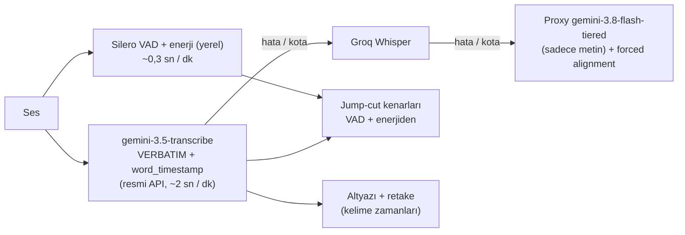
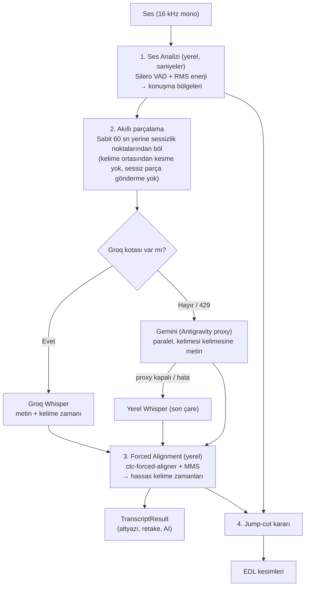

# 🔬 Transkript ve Oto Jump-Cut — Araştırma ve Önerilen Mimari

> **Tarih:** 13 Ekim 2026
> **Soru:** Gemini hızlı ve doğru metin çıkarıyor ama kelime zamanlarını güvenilir vermiyor. Bu aşılabilir mi? Ses analizi ve jump-cut'ı en iyi nasıl yaparız?
> **Bağlı belge:** [`yol_haritasi_ve_transkript_yenileme_plani.md`](file:///d:/OtoEdit/OtoEdit/docs/yol_haritasi_ve_transkript_yenileme_plani.md) (Faz 1 ve Faz 2'nin yerini bu belgedeki mimari alır)
> **Durum:** 📝 Araştırma + öneri — kod değişikliği yapılmadı

---

## ⚡ Güncelleme: Gerçek Ölçüm Sonuçları (13 Ekim, 10:30)

Test videosundan 60 sn'lik bir kesit (20.–80. sn) alındı. Silero VAD konuşma bölgeleri referans kabul edildi.

| Yol | Model | Süre (60 sn ses) | Kelime zamanı | Sonuç |
|---|---|---|---|---|
| Antigravity proxy | `gemini-3.8-flash-tiered` (sadece metin) | **33 sn** | Yok | Metin doğru, tekrarlar korunmuş |
| Antigravity proxy | `gemini-3.8-flash-tiered` (prompt ile zaman istendi) | **165 sn** | Tahmini; başlangıçlar medyan **0,33 sn erken** | Çok yavaş, zamanlar jump-cut için yetersiz |
| Antigravity proxy | `gemini-3.5-flash-*` | — | — | ❌ "artık mevcut değil, 3.7 Flash'a geçin" |
| Antigravity proxy | `gemini-3.7-flash`, `3.6-flash`, `3.1-pro-low` | — | — | ❌ HTTP 503 "All accounts failed or unhealthy" |
| **Resmi Gemini API anahtarı** | **`gemini-3.5-transcribe`** | **2,0 sn** | ✅ Yerleşik (`word_timestamp: true`), 0,1 sn çözünürlük | Kelime ortalarının **%94'ü** konuşma içinde, kenar hatası medyan **~0,25 sn** |

**Önemli gözlemler:**
- `gemini-3.5-transcribe` modeli **proxy'de yok** (`/v1/models` listesinde çıkmıyor). Ama worker'daki **resmi `GEMINI_API_KEY`** ile erişilebiliyor: `generateContent` destekliyor ve test başarılı.
- Hızı çok iyi: 60 sn ses 2 sn'de işlendi. Sıralı gönderimde 52 dk ≈ 2 dk, paralel gönderimde daha da kısa. (Tek ölçüm, ölçeklenince doğrulanmalı.)
- `VERBATIM` modunda tekrarlar korunuyor (`"bir hukuk hukuk yalnızca"`, `"dengenin ve dengenin"`, `"hatta vefat sonrası ölenin ... Hatta vefat sonrası ölenin"`). **Retake tespiti için ideal.**
- ✅ **Çözüldü:** İlk kelimenin ("Bismillahirrahmanirrahim") atlanmasının sebebi `language_codes: ["tr-TR"]`. Dil kodu varken 3/3 denemede atlandı, dil kodu kaldırılınca geldi (Arapça kelime + ~15 dB kısık bölüm). Dil kodu gönderilmeyecek ve ayrıca kayıp kelime dedektörü eklenecek. Bkz. [çözüm rehberi](file:///d:/OtoEdit/OtoEdit/docs/cozum_rehberi_transkript_ve_jumpcut.md).
- ⚠️ **Ücretsiz katman limiti: dakikada 3 istek** (`GenerateRequestsPerMinutePerProjectPerModel-FreeTier`). 10 dk'lık tek istek 9,9 sn'de 421 kelimeyle sorunsuz döndü; yani 52 dk ≈ 6 istek.
- ⚠️ Kenar hataları ~0,25 sn, bazen 0,6 sn'ye çıkıyor (ör. `"saygıya"` bitişi VAD'dan 0,28 sn erken, `"hukuk"` bitişi 0,6 sn geç). **Altyazı için yeterli, jump-cut kenarı için yetersiz.**
- Kaynaklara göre `SMART` mod ve `custom_vocabulary` kelime zamanıyla birlikte kullanılamıyor.

### Revize Öneri

- **Asıl transkript motoru:** `gemini-3.5-transcribe`. Groq ve proxy yedekte kalır.
- **Jump-cut kenarları her durumda yerel VAD + enerjiden gelir.** Transkript sadece "burada kelime var, kesme" koruması için kullanılır.
- **Forced alignment** artık zorunlu değil. Sadece proxy yoluna düşüldüğünde ya da karaoke vurgusu için ±0,25 sn yetmezse devreye girer.
- **Açık sorular:** Resmi anahtarın kota/ücret durumu (AI Studio'dan bakılmalı), uzun dosyada davranış (inline sınırı nedeniyle parçalama veya Files API), atlanan ilk kelime sorunu.

> Aşağıdaki bölümler ilk araştırmadır. Mimari kararları için yukarıdaki revize öneri geçerlidir.

---

## 1. Kısa Cevap

**Evet, çözülebilir, hem de yaygın kullanılan bir yöntemle.** Sektörde (WhisperX, `whisper-diarization` vb.) standart yaklaşım işi üçe bölmek:

| İş | En iyi araç | Neden |
|---|---|---|
| **"Ne söylendi?"** (metin) | Groq Whisper / **Gemini** | Büyük modeller, iyi Türkçe, hızlı |
| **"Kelime tam ne zaman söylendi?"** (zaman) | **Forced alignment** (zorunlu hizalama) | Metni zaten bilen küçük bir model, sesi tek seferde tarar ve her harfin/kelimenin yerini bulur |
| **"Nerede konuşma var, nerede yok?"** (jump-cut) | **Silero VAD** + enerji analizi | Konuşma algılamaya özel küçük model; gürültüyü konuşmadan ayırır |

Gemini'den zaman istememize gerek yok. **Gemini metni verir, zamanı yerel hizalayıcı bulur.**

---

## 2. Araştırma Bulguları

### 2.1 Gemini neden zaman damgasında kötü?
- Gemini sesi sabit hızda "ses token'larına" çeviriyor (saniyede ~32 token) ve zamanı akustik hizalama yaparak değil, **token sırasından tahmin ederek** üretiyor.
- Geliştiriciler uzun seslerde **giderek büyüyen kayma** (drift) bildiriyor: 1. dakikada doğru, 30. dakikada saniyelerce kaymış.
- Önerilen çözümler: (a) sesi kısa parçalara bölüp offset eklemek, (b) **Gemini'yi sadece metin için kullanıp zamanı forced alignment ile bulmak**. (b) kesin çözüm.

> [!NOTE]
> Aramada Google'ın kelime düzeyinde zaman damgası veren özel bir transkripsiyon modeli (`gemini-3.5-transcribe`) olduğu bilgisi çıktı. Bunu resmi dokümandan **doğrulayamadım**, ayrıca Antigravity Manager proxy'nizin bu modeli sunup sunmadığı da bilinmiyor. Varsa bonus olur, ama plan buna dayanmıyor.

### 2.2 Forced alignment nedir, hızlı mı?
- Elimizde metin varken model "ne söylendiğini" tahmin etmek zorunda kalmaz. Sadece "bu harfler seste nerede?" sorusunu cevaplar.
- Whisper gibi kelime kelime üretmez (otoregresif değil). Sesin üzerinden **tek bir ileri geçiş** yapar, sonra hızlı bir dinamik programlama (Viterbi) adımı gelir. Bu yüzden yerel Whisper'dan çok daha hafif ve hızlıdır.
- **Araç:** [`ctc-forced-aligner`](https://github.com/MahmoudAshraf97/ctc-forced-aligner). Meta'nın MMS modeliyle (1000+ dil, Türkçe dahil) çalışıyor, uzun seslerde düşük bellekle çalışmak için tasarlanmış. Alternatif: `torchaudio.pipelines.MMS_FA`.
- Metin ile ses birebir tutmasa bile (Gemini "ııı"ları yazmasa bile) CTC hizalayıcıları bu farkı "boşluk/yıldız" token'larıyla tolere ediyor.
- **4 GB VRAM:** MMS-300m (~300M parametre) GTX 1650'ye sığar; gerekirse CPU'da da çalışır.

### 2.3 Groq limitleri (sizin tecrübenizi doğruluyor)
Üçüncü taraf kaynaklara göre Groq ücretsiz katman (`whisper-large-v3` / `-turbo`):
- **Saatte 7.200 ses-saniyesi** (2 saat ses), **günde 28.800 ses-saniyesi** (8 saat ses), dakikada 20 istek.
- Bizim test videomuz 52 dk = **3.143 sn**. Yani saatte ~2, günde ~9 video. Yoğun kullanımda kesin bitecek.
- **Sonuç:** Groq "varsa kullan" katmanı olacak. **Asıl yük Gemini + hizalama yolunda olacak.** (Rakamlar Groq konsolundan doğrulanmalı.)

### 2.4 Jump-cut için diğerleri ne yapıyor?
- **Auto-Editor** (en popüler açık kaynak jump-cut aracı): ses yüksekliği eşiği + `--margin` (konuşmanın önüne/arkasına pay).
- **Silero VAD** tabanlı araçlar: dBFS eşiği yerine "bu ses konuşma mı?" diye soran bir model kullanıyor. Kısık konuşmayı ve fısıltıyı sessizlikten, klavye/uğultu gibi gürültüyü de konuşmadan ayırabiliyor.
- Talking-head / YouTube içerik için önerilen pay **150–250 ms**. Silero'nun varsayılan `speech_pad_ms=30` değeri video kurgu için çok dar.
- `min_silence_duration_ms` en az **300–500 ms** olmalı. Altında kalırsa "p, t, k" gibi duraklı ünsüzlerin içinden bile keser. Bu, Görsel 1'deki 0.1 s'lik parçalanmanın sebebiyle aynı.

> [!TIP]
> **Silero VAD projede zaten kurulu.** `faster-whisper` paketinin içinde geliyor (`faster_whisper.vad.get_speech_timestamps`). Yeni bağımlılık gerekmiyor.

---

## 3. Önerilen Mimari

### Katman 1 — Ses Analizi (jump-cut'ın temeli)
- Silero VAD ile konuşma bölgeleri çıkarılır: `threshold≈0.35–0.45` (kısık konuşmayı yutmasın), `min_silence_duration_ms≈500`, `speech_pad_ms≈200`.
- Aynı anda 10 ms'lik pencerelerle **RMS enerji eğrisi** hesaplanır. Bu eğri hem kesim kenarını ince ayarlamak hem de editördeki dalga formu için kullanılır.
- Sessizlik tespiti **orijinal ses** üzerinde yapılır. Gürültü azaltılmış ses kısık hece sonlarını bastırabiliyor.
- Mevcut `pydub.detect_silence` (sabit dBFS) emekliye ayrılır veya sadece yedek olarak kalır.

### Katman 2 — Metin
- **Parçalama:** VAD'ın bulduğu sessizlik noktalarından ~45–90 sn'lik parçalar. Fayda: kelime ortasından bölünmez, sessiz parçalar gönderilmez (Gemini'nin sessizlikte metin uydurması azalır).
- **Groq:** Kota varsa önce o. Kalan kotayı yanıt başlıklarından takip edip limite yaklaşınca isteği baştan Gemini'ye yönlendirmek (429 beklemeden).
- **Gemini (asıl yol):** VideoOzet'teki gibi paralel istek + anahtar rotasyonu, adres `http://host.docker.internal:8045`. Prompt'ta **"kelimesi kelimesine, tekrarları, yarım kalan cümleleri ve 'ııı/eee' gibi dolgu seslerini de yaz, düzeltme yapma"** talimatı olmalı. Retake tespiti bu tekrarları görmek zorunda; Gemini varsayılan olarak metni "temizlemeye" meyilli.
- **Yerel Whisper:** Sadece son çare.

### Katman 3 — Forced Alignment
- Her parçanın metni, aynı ses parçasıyla hizalanır, sonuca parça offset'i eklenir.
- Metin normalizasyonu: sayılar yazıya ("2026" → "iki bin yirmi altı") ve noktalama temizliği. Ekranda gösterilen metin orijinal kalır, sadece hizalama için normalize edilir.
- Groq'un kendi kelime zamanları da istenirse bu katmandan geçirilebilir. Whisper'ın kelime zamanları ±100–300 ms oynayabiliyor, CTC hizalaması daha hassas.

### Katman 4 — Jump-cut kararı (iki kaynak birlikte)
Bir aralık **ancak şu koşulların hepsi sağlanırsa** kesilir:
1. VAD orayı konuşma dışı sayıyor,
2. Hizalanmış hiçbir kelime `[kelime.start − 150 ms, kelime.end + 150 ms]` aralığıyla çakışmıyor,
3. Süre ≥ `min_silence` (ör. 600–800 ms).

Sonra kesim kenarları enerji eğrisinde en sessiz noktaya kaydırılır ve iki kesim arasında 300 ms'den kısa ada kalırsa birleştirilir.

**Retake kesimleri** de segment zamanları yerine hizalanmış kelime sınırlarına oturtulur. Böylece retake tarafındaki kelime kırpma da biter.

---

## 4. Beklenen Kazanç ve Riskler

| Konu | Şimdi | Önerilen |
|---|---|---|
| Metin kalitesi | `base` model, bozuk kelimeler | Gemini / Groq large-v3 |
| Kelime zamanı | `base` modelin tahmini | CTC forced alignment |
| Jump-cut | Sabit -40 dBFS eşiği | VAD + kelime koruması + enerji ile ince ayar |
| Groq'a bağımlılık | — | Var ise kullan, yoksa sorun yok |
| Süre | ~3,5 dk transkript (52 dk ses) | **Ölçülecek.** Gemini paralel + hizalama; tahminimce benzer ya da daha kısa, ama kanıt yok |

**Riskler / bilinmeyenler:**
- Antigravity proxy'nin eşzamanlı istek limiti: kaç paralel istek kaldırıyor?
- Gemini'nin dolgu seslerini atlaması: hizalama tolere eder, ama retake tespiti etkilenebilir. Prompt ile azaltılacak, test edilecek.
- MMS hizalayıcının Türkçe performansı: genel model iyi; yetmezse Türkçeye özel bir wav2vec2 modeli denenebilir.
- 4 GB VRAM: hizalayıcı ile diğer GPU işleri (yüz takibi vb.) aynı anda çalışırsa bellek çakışması olabilir. İşler sıraya konacak.

---

## 5. Uygulama Sırası (yol haritasındaki Faz 1 ve 2'nin yerine)

| Adım | İş | Süre (tahmin) | Doğrulama |
|---|---|---|---|
| **P0** | **Prototip / ölçüm scripti** (`tools/stt_benchmark.py`): 52 dk test sesi üzerinde Silero VAD süresi, Gemini parça transkripti, MMS hizalama süresi ve kelime zamanı kalitesi | 0,5–1 gün | Sayılar tabloya dökülür. Bu adım tüm yaklaşımı **kod tabanına girmeden** doğrular. |
| **P1** | Katman 1: VAD + enerji tabanlı jump-cut, orijinal ses üzerinde | 1 gün | Kesim sayısı, <0,4 sn klip sayısı, editörde görsel kontrol |
| **P2** | Katman 2: Groq (kota takibiyle) → Gemini proxy → yerel Whisper zinciri, VAD tabanlı parçalama | 1–1,5 gün | Groq anahtarı kaldırılınca Gemini'ye düşüyor mu, proxy kapatılınca yerel modele düşüyor mu |
| **P3** | Katman 3: `ctc-forced-aligner` entegrasyonu, Dockerfile'a eklenmesi | 1 gün | Altyazı ağız hareketiyle senkron mu, kelime zamanları tutarlı mı |
| **P4** | Katman 4: kelime korumalı jump-cut + retake kesimlerinin kelime sınırına oturtulması | 0,5–1 gün | "Kelime içine düşen kesim" sayısı ≈ 0 |

> [!IMPORTANT]
> **P0 kritik.** Gemini + hizalama yolunun gerçekten hızlı olup olmadığını, proxy'nin paralel isteği kaldırıp kaldırmadığını ve MMS'in Türkçe zamanlarının ne kadar iyi olduğunu tahmin değil ölçümle göreceğiz. Sonuç kötü çıkarsa mimariyi kod tabanına girmeden değiştirebiliriz.

---

## 6. Sizden İhtiyaç Duyulanlar

1. **Antigravity Manager proxy** P0 sırasında açık olmalı (`localhost:8045`). Hangi model adını kullanıyorsunuz? VideoOzet'te `gemini-3.8-flash-tiered` geçiyor.
2. **Groq API anahtarı** (varsa). Yoksa P0 sadece Gemini yoluyla yapılır.
3. P0 için 52 dk'lık videonun tamamını mı kullanalım, yoksa önce 5 dk'lık bir kesitle mi başlayalım?
