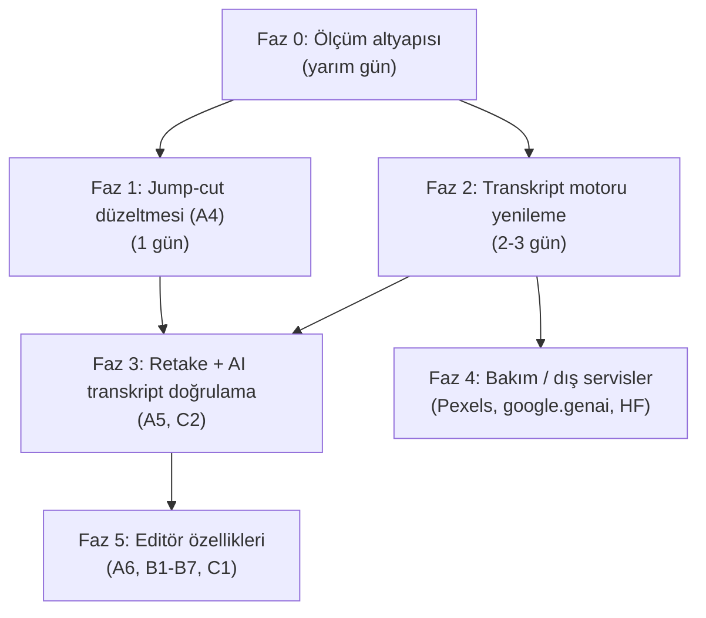
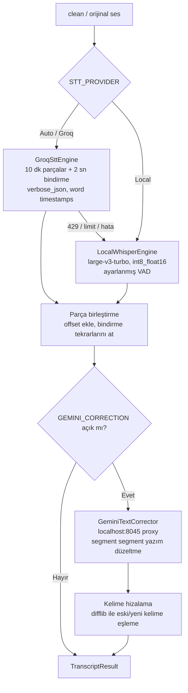

# 🗺️ OtoEdit — Öncelikli Yol Haritası ve Transkript Motoru Yenileme Planı

> **Tarih:** 13 Ekim 2026
> **Dayanak:** [`guncel_durum_ve_kalan_sorunlar_raporu.md`](file:///d:/OtoEdit/OtoEdit/docs/guncel_durum_ve_kalan_sorunlar_raporu.md), [`tum_sorunlar_ve_eksikler.md`](file:///d:/OtoEdit/OtoEdit/docs/tum_sorunlar_ve_eksikler.md), 13 Ekim worker logları, VideoOzet projesindeki STT zinciri incelemesi
> **Durum:** 📝 Plan — onay bekliyor, henüz kod değişikliği yapılmadı

> [!WARNING]
> **Güncelleme (13 Ekim, sonra):** Faz 1 ve Faz 2'nin tasarımı [`transkript_ve_jumpcut_arastirma_raporu.md`](file:///d:/OtoEdit/OtoEdit/docs/transkript_ve_jumpcut_arastirma_raporu.md) ile değişti. Groq'un limiti yetmeyeceği için asıl yol **Gemini (metin) + forced alignment (kelime zamanı)**, jump-cut ise **Silero VAD + kelime koruması** olacak. Faz 0, 3, 4 ve 5 geçerliliğini koruyor.

---

## 0. Bu Planı Değiştiren Yeni Bulgular

Raporu yazdıktan sonra worker loglarına daha derin baktım. Plan sırasını belirleyen 4 bulgu var:

| # | Bulgu | Kanıt (log) | Etkisi |
|---|---|---|---|
| 1 | **OpenAI anahtarı geçersiz, sistem en zayıf yerel modele düşüyor** | `OPENAI_API_KEY geçersiz...` → `faster-whisper model='base'` | `base` modeli Türkçe için zayıf. Loglardaki `'vukufiyete'`, `'viktam tatlinden'`, `'referenesi'`, `'huduz'` gibi bozuk kelimeler bunun sonucu. |
| 2 | **VAD filtresi sesin yarısından fazlasını atıyor** | `VAD filter removed 28:17.943 of audio` (toplam 52:23) | Sessizlik dedektörü yalnızca ~3 dk sessizlik bulurken Whisper'ın VAD'ı 28 dk atıyor. Bu büyük fark, **konuşma olan kısımların da transkriptten düşüyor olabileceğini** gösteriyor (52 dk'da sadece 1898 kelime). Doğrulanması gerekiyor. |
| 3 | **GPU: GTX 1650, 4 GB VRAM** | `nvidia-smi` | `large-v3` float16 sığmaz. `large-v3-turbo` + `int8_float16` sığar ama `base`'den yavaştır. Bu yüzden hızlı yol bulut (Groq), yerel model ise yedek olmalı. |
| 4 | **Sessizlik tespiti temizlenmiş ses üzerinde çalışıyor** | `..._clean.mp3` | Gürültü azaltma kısık hece sonlarını da bastırıyor olabilir; bu da erken kesimi artırır. **Hipotez**, test edilecek. |

> [!IMPORTANT]
> Transkript kalitesi tek başına bir altyazı sorunu değil. **Retake tespiti, altyazı, AI öneri motoru, viral klip ve (planlanan) AI transkript doğrulaması** hepsi bu transkripti girdi olarak kullanıyor. Retake kesimleri doğrudan Whisper'ın segment zamanlarıyla yapılıyor ([`retake_detector.py` L254-261](file:///d:/OtoEdit/OtoEdit/src/OtoEdit.PythonWorker/pipeline/retake_detector.py#L254-L261)); yani zaman damgaları kaymışsa retake kesimleri de kelime kırpar.

---

## 1. Önceki Rapordaki Düzeltmeler (Dürüstlük Notu)

- "-50 dBFS ile kelimeler %100 korunur" ifadesi **fazla iddialıydı**. Bu değerler tek bir videoda yapılan ölçüme dayanıyor; o yüzden Faz 1'de ölçüm scripti ile doğrulanacak.
- "38 retake'ten 3'ü sessizlikle birleşti, 35 kaldı" açıklaması **benim tahminimdi, doğrulanmadı**.
- Erken kesimin tek sebebi eşik değerleri olmayabilir: retake kesimleri (zayıf zaman damgası) ve temizlenmiş ses de katkı yapıyor olabilir.

---

## 2. Öncelik Sırası — Neden Bu Sıra?

**Mantık:**
1. **Önce ölçüm (Faz 0):** Şu ana kadar her düzeltmeyi "göz kararı" doğruladık. Her denemede 52 dk'lık videoyu tüm pipeline'dan geçirmek yerine 2 dakikada sonuç veren bir ölçüm scripti lazım.
2. **Sonra jump-cut (Faz 1):** En görünür ve en hızlı düzeltilecek hata. Sadece sessizlik modülüne dokunur.
3. **Transkript (Faz 2):** En büyük kalite kazancı. Sonraki tüm AI özelliklerinin temeli.
4. **Retake / AI doğrulama (Faz 3):** İyi bir transkript olmadan Gemini'ye bozuk metin göndermek anlamsız; bu yüzden Faz 2'den sonra.
5. **Editör özellikleri (Faz 5):** Önemli ama temel kalite sorunlarını çözmüyor.

---

## 3. Faz 0 — Ölçüm Altyapısı

**Amaç:** Her parametre değişikliğini aynı test videosu üzerinde dakikalar içinde objektif olarak ölçmek.

**Adımlar:**
1. `src/OtoEdit.PythonWorker/tools/cut_benchmark.py` scripti yazılacak:
   - Girdi: ses dosyası + (varsa) transkript JSON.
   - Farklı parametre setleriyle `SilenceDetector` çalıştırır.
   - Çıktı: kesim sayısı, toplam kesilen süre, **0.4 s'den kısa klip sayısı**, ve **bir kelimenin içine düşen kesim sayısı** (kesim aralığı ile kelime zaman damgası çakışması).
2. Aynı ölçüm hem `_clean.mp3` hem orijinal ses üzerinde yapılacak (Bulgu 4'ü test etmek için).
3. 13 Ekim test videosunun ses dosyası referans olarak saklanacak.

**Başarı kriteri:** Tek komutla parametre setlerini karşılaştıran bir tablo almak.

---

## 4. Faz 1 — Jump-Cut Düzeltmesi (A4)

**Adımlar:**

| Adım | Dosya | Değişiklik |
|---|---|---|
| 1.1 | [`config.py`](file:///d:/OtoEdit/OtoEdit/src/OtoEdit.PythonWorker/config.py#L51-L52) | Varsayılanlar: `SILENCE_THRESH_DBFS=-50`, `SILENCE_MIN_LEN_MS=800`; yeni `SILENCE_PADDING_SEC=0.25`, `SILENCE_MIN_KEEP_MS=300` — hepsi env ile ayarlanabilir. |
| 1.2 | [`silence_detector.py`](file:///d:/OtoEdit/OtoEdit/src/OtoEdit.PythonWorker/pipeline/silence_detector.py) | Padding ve mikro-klip eşiğini config'den okumak. `0.1s`'lik adacıkları komşu kesimle birleştirmek. |
| 1.3 | `silence_detector.py` | **Adaptif eşik:** Sabit -50 yerine sesin gürültü tabanı ölçülüp (ör. en sessiz %10'luk dilimin ortalaması) eşik = `gürültü_tabanı + 6 dB` olarak hesaplanacak. Farklı mikrofon/oda kayıtlarında tek bir sabit değer tutmaz. |
| 1.4 | `analysis_consumer.py` | Faz 0 sonucuna göre sessizlik tespiti orijinal ses üzerinde yapılacak (temizlenmiş ses değil). |
| 1.5 | `edl_builder.py` | **Konuşma koruması:** Transkript geldikten sonra, bir kelimenin `[start-0.15, end+0.15]` aralığına giren sessizlik kesimleri o aralığın dışına kırpılacak. (Faz 2'den sonra en etkili hale gelir.) |
| 1.6 | — | `docker restart otoedit-dev-worker` ve log satırında yeni değerlerin göründüğünü doğrulama. |

**Başarı kriteri (aynı test videosunda):**
- Kesim sayısı 544'ten belirgin şekilde düşmeli (hedef: yüzlerce değil onlarca).
- 0.4 s'den kısa klip kalmamalı.
- "Kelime içine düşen kesim" sayısı sıfıra yakın olmalı.
- Editörde Görsel 1'deki gibi dalga formunun kırmızı kutuya taşması görülmemeli.

---

## 5. Faz 2 — Transkript Motoru Yenileme

### 5.1 VideoOzet'teki Yaklaşım ve OtoEdit'e Aktarımı

VideoOzet'te ([`CompositeSttProvider.cs`](file:///C:/Users/Kursu/.gemini/antigravity-ide/brain/28df40d8-44bb-4a28-b951-abb39a13e6bc/scratch/VideoOzet/src/VideoOzet.Business/Infrastructure/AI/CompositeSttProvider.cs)) kullanılan zincir:

1. **Groq Whisper** (`whisper-large-v3` → `whisper-large-v3-turbo`), rate limit'te sonraki modele geçiyor.
2. **Gemini (yerel proxy, `localhost:8045`)**: ses FFmpeg ile 60 s'lik parçalara bölünüyor, 6 paralel istek, API anahtarı rotasyonu.
3. **Yerel faster-whisper servisi** (`127.0.0.1:5005`).

> [!WARNING]
> **Kritik fark:** VideoOzet özet çıkardığı için **sadece düz metin** istiyor (Groq'ta `response_format="json"`, Gemini'de düz metin). OtoEdit ise altyazı, jump-cut ve retake için **kelime düzeyinde zaman damgası** istiyor. Bu yüzden zinciri birebir kopyalayamayız; her katmanın zaman damgası üretme yeteneğine göre uyarlamamız gerekiyor.

| Katman | Zaman damgası | OtoEdit'teki rolü |
|---|---|---|
| Groq Whisper | ✅ `verbose_json` + `timestamp_granularities=[word, segment]` ile kelime düzeyinde | **Birincil motor** — hızlı ve `large-v3` kalitesinde |
| Yerel faster-whisper | ✅ `word_timestamps=True` | **Yedek motor** (Groq limiti dolarsa / internet yoksa) |
| Gemini (yerel proxy) | ❌ Güvenilir kelime zamanı vermez | **Tek başına motor değil, "metin düzeltici"**: Whisper'ın yanlış duyduğu kelimeleri düzeltir, zamanlar Whisper'dan kalır |

### 5.2 Yeni Mimari

### 5.3 Adımlar

**2a — Hızlı kazanç (yarım gün, sadece yapılandırma)**
- [`transcriber.py` L146-155](file:///d:/OtoEdit/OtoEdit/src/OtoEdit.PythonWorker/pipeline/transcriber.py#L146-L155):
  - Model `base` → env'den okunan `WHISPER_LOCAL_MODEL` (varsayılan `large-v3-turbo`).
  - `compute_type`: GTX 1650 için `int8_float16` (olmazsa `int8`).
  - VAD: `vad_parameters={"threshold": 0.35, "min_silence_duration_ms": 1000, "speech_pad_ms": 400}` — konuşmayı atmasını engellemek için daha toleranslı.
  - Model nesnesini her işte yeniden yüklemek yerine önbellekte tutmak (opsiyonel; 4 GB VRAM'de diğer işlerle çakışma riski ölçülecek).
- **Doğrulama:** "VAD filter removed" süresi ve kelime sayısı karşılaştırılacak.

**2b — Groq motoru (1 gün)**
- Yeni dosya: `pipeline/stt/groq_engine.py`.
  - Ses FFmpeg ile 16 kHz mono, düşük bitrate'e çevrilip ~10 dk parçalara bölünecek (Groq'un dosya boyutu sınırının altında kalmak için). Parçalar arasında 2 sn bindirme.
  - Her parça `verbose_json` + kelime/segment zaman damgası ile gönderilecek, dönen zamanlara parça başlangıç offset'i eklenecek.
  - Bindirme bölgesindeki tekrar kelimeler zaman damgasına göre ayıklanacak.
  - `whisper-large-v3` → `whisper-large-v3-turbo` model geçişi ve 429'da yerel motora düşme (VideoOzet mantığı).
- `GROQ_API_KEY` `.env` ve `docker-compose.dev.yml`'e eklenecek.

**2c — Gemini metin düzeltici (1 gün)**
- Yeni dosya: `pipeline/stt/gemini_corrector.py`.
  - Docker içinden proxy'ye erişim: `http://host.docker.internal:8045/v1/chat/completions` (VideoOzet'teki `localhost` worker konteynerinden çalışmaz).
  - Segmentler 40-50'lik gruplar halinde, **numaralı ve JSON formatında** gönderilecek; Gemini'den sadece yazım/duyma hatalarını düzeltmesi, kelime eklememesi/silmemesi istenecek.
  - Dönen metin, eski kelimelerle `difflib.SequenceMatcher` ile eşlenecek: birebir eşleşen kelimeler zamanını korur, değişen kelimeler eski kelimenin zamanını alır, sayı farkında segment içinde orantılı dağıtılır.
  - Proxy kapalıysa veya hata verirse adım atlanır, Whisper çıktısı olduğu gibi kullanılır (pipeline durmaz).
- Bu katman **opsiyonel** (`STT_GEMINI_CORRECTION=true/false`).

**2d — Birleştirme ve yapılandırma (yarım gün)**
- [`transcriber.py`](file:///d:/OtoEdit/OtoEdit/src/OtoEdit.PythonWorker/pipeline/transcriber.py) bir "orkestratör" haline gelir: `STT_PROVIDER=Auto|Groq|Local|OpenAI`.
- Logda hangi motorun kullanıldığı, süresi ve kelime sayısı açıkça yazılacak.
- Mevcut OpenAI yolu korunur (anahtar girilirse çalışır).

**Başarı kriteri:**
- 52 dk'lık videoda transkript süresi (Groq yolu) belirgin şekilde kısa olmalı.
- Loglarda görülen bozuk kelimeler (`vukufiyete`, `referenesi` vb.) düzelmeli.
- Kelime sayısı mevcut 1898'in anlamlı şekilde üstüne çıkmalı (VAD kayıpları giderildiyse).
- Groq anahtarı kaldırıldığında sistem yerel motora düşüp yine çalışmalı.

---

## 6. Faz 3 — Retake ve AI Transkript Doğrulama (A5, C2)

1. Retake kesimleri de Faz 1.5'teki "konuşma koruması" ile kelime sınırlarına hizalanacak (şu an segment zamanları direkt kullanılıyor).
2. Tüm kesimler uygulandıktan sonra **kalan transkript** Gemini proxy'ye gönderilecek; yarım cümle, tekrar eden ifade ve bağlam kopukluğu tespit edilecek.
3. Gemini'nin bulguları otomatik uygulanmayacak, editörde **"öneri"** olarak gösterilecek (kullanıcı onaylar/reddeder). Bu, C1 (AI Yönetmen) onay döngüsünün de ilk adımı olur.

---

## 7. Faz 4 — Bakım ve Dış Servisler

| İş | Not |
|---|---|
| Pexels 401 | `.env` içinde hiçbir API anahtarı tanımlı değil; anahtarlar başka bir yerden (muhtemelen Windows ortam değişkenleri) geliyor. Pexels anahtarı yenilenecek ve `.env`'e taşınacak. |
| `google.generativeai` → `google.genai` | Eski SDK desteği bitti. [`gemini_client.py`](file:///d:/OtoEdit/OtoEdit/src/OtoEdit.PythonWorker/services/gemini_client.py) yeni SDK'ya veya doğrudan yerel proxy'ye taşınacak (Faz 2c ile aynı istemci paylaşılabilir). |
| HF_TOKEN | Opsiyonel; model indirme hızı için. |
| Worker yeniden başlatma | Kod volume ile bağlı, ama Python süreci eski kodu bellekte tutuyor. Her backend değişikliğinden sonra `docker restart otoedit-dev-worker` gerekli — 13 Ekim testinde düzeltmenin görünmemesinin bir sebebi buydu (kod zaten değişmemişti). |

---

## 8. Faz 5 — Editör Özellikleri (Önerilen Sıra)

1. **A6** — Seçili katmanı silme (küçük, hızlı iş).
2. **B7** — Katman mute/hide/lock (A6 ile aynı kod bölgesi).
3. **B4** — Altyazı font/renk/konum paneli (render tarafı hazır, UI eksik).
4. **B3** — Metin editörü: border, harf aralığı, opaklık.
5. **B5** — Ses seviyesi, fade in/out, arka plan müziği.
6. **B2** — Renk ayarları (`eq` filtresi).
7. **B6** — Hız kontrolü (timeline remapping'i etkilediği için en riskli olanlardan).
8. **B1** — Arka plan kaldırma (`rembg`, 4 GB VRAM'de dikkatli).
9. **C1** — AI Yönetmen tam döngüsü (Faz 3'teki öneri altyapısının üstüne).

---

## 9. Kararınızı Bekleyen Sorular

1. **Groq API anahtarınız** var mı? (VideoOzet'tekini kullanabilir miyiz?)
2. **Antigravity Manager proxy'si** (`localhost:8045`) OtoEdit çalışırken de açık olacak mı?
3. Yerel yedek model için **`large-v3-turbo`** (daha iyi, daha yavaş) mı, **`medium`** (orta) mı tercih edersiniz?
4. Başlangıç: Faz 0 + Faz 1 ile mi başlayalım, yoksa Faz 2a'yı (sadece yapılandırma, hızlı kazanç) da aynı turda ekleyelim mi?
